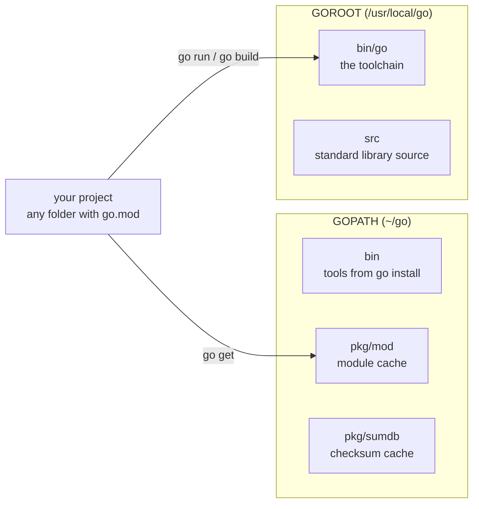

---
tags:
  - golang
  - intro
section: "01 Introduction"
video: https://www.youtube.com/watch?v=QEZlivtFOZk
video_title: "GOPATH and reading go docs"
order: 4
---
# GOPATH and Go Docs

> [!info] Source
> 🎬 [GOPATH and reading go docs](https://www.youtube.com/watch?v=QEZlivtFOZk) · Section **01 Introduction** of [[Golang Notes]]
> ⬅️ [[Installation and Hello World]] · ➡️ [[Lexer and Types]]

## Overview

A short video with two jobs. First, it answers a question anyone who touched Go years ago will have: *why could we run `main.go` from a random folder on the desktop in [[Installation and Hello World]], when old Go insisted that all code live inside a special workspace directory?* The answer is **GOPATH** and how **modules** replaced it. Second, and more important for the rest of the series, the instructor shows **how to read Go's own documentation**: the `go help` command, the long `go help gopath` text, and `go env`. Every later video that opens pkg.go.dev or a help page (`bufio` in [[User Input and Comma Ok Syntax]], `time` in [[Handling Time]], `net/http` in [[Handling Web Requests]]) builds on the habit started here.

## Then and now: the GOPATH workspace versus modules

In Go's early years the toolchain used **GOPATH mode**. Every project had to sit inside one workspace directory, under `$GOPATH/src/<import path>/`, and the `GOPATH` environment variable had to be set up before anything compiled. Dependencies were downloaded into the same tree, with no versions attached.

Since **modules** arrived (Go 1.11, the default since Go 1.16), none of that is required. A project is any directory containing a `go.mod` file, which `go mod init` creates, and it can live anywhere on disk. That is why the series simply makes a folder per video (`01hello`, `02variables`, …) and runs `go run main.go` inside it. Dependencies are versioned in `go.mod` and stored in a shared **module cache**. The details are in [[Go Modules]].

| | GOPATH mode (legacy) | Module mode (today) |
|---|---|---|
| Where code lives | Must be under `$GOPATH/src/…` | Anywhere; the folder with `go.mod` is the module root |
| How a project is identified | By its path inside the workspace | By the `module` line in `go.mod` |
| Dependencies | Copied into `$GOPATH/src`, unversioned | Versioned in `go.mod`, verified by `go.sum`, cached in `$GOPATH/pkg/mod` |
| Enabled by | `GO111MODULE=off` | Default (`GO111MODULE` unset or `on`) |

`GOPATH` itself has not disappeared. It still names the directory that holds the module cache and the binaries you install with `go install`; it just no longer dictates where *your* code lives.

## The go tool's built-in help

The command used in every video so far, `go run main.go`, has three parts: the program `go`, the subcommand `run`, and an argument. How does anyone discover these subcommands? Like almost every developer tool, `go` ships its own manual:

```bash
go help
```

```text
Go is a tool for managing Go source code.

Usage:

	go <command> [arguments]

The commands are:

	bug         start a bug report
	build       compile packages and dependencies
	clean       remove object files and cached files
	doc         show documentation for package or symbol
	env         print Go environment information
	fix         apply fixes suggested by static checkers
	fmt         gofmt (reformat) package sources
	generate    generate Go files by processing source
	get         add dependencies to current module and install them
	install     compile and install packages and dependencies
	list        list packages or modules
	mod         module maintenance
	run         compile and run Go program
	telemetry   manage telemetry data and settings
	test        test packages
	tool        run specified go tool
	version     print Go version
	vet         report likely mistakes in packages
	work        workspace maintenance

Use "go help <command>" for more information about a command.

Additional help topics:

	buildconstraint build constraints
	…
	gopath          GOPATH environment variable
	…
	modules         modules, module versions, and more
```

The instructor splits this output in two. The **commands** at the top (`bug` to `work`) are the everyday ones and are easy to understand from their one-line descriptions. The **additional help topics** at the bottom (build constraints, caches, `gopath`, `modules`…) are reference material that is harder to read and only needed later. The two lines to remember:

- `go help <command>` explains one command, for example `go help run`.
- `go help <topic>` explains one topic, for example `go help gopath`.

```bash
go help run
```

```text
usage: go run [build flags] [-exec xprog] package [arguments...]

Run compiles and runs the named main Go package.
Typically the package is specified as a list of .go source files from a single
directory, but it may also be an import path, file system path, or pattern
matching a single known package, as in 'go run .' or 'go run my/cmd'.
```

So `go run main.go` is "run, with no build flags, the package made of this one file", and `go run .` means "run the package in the current directory". Both appear throughout the series.

## Finding where Go lives: `go help gopath` and `go env`

When Go was installed in [[Installation and Hello World]] the installer set up the path in the background, the same way Java needs `PATH` and `JAVA_HOME`. To find out *where* things went, the instructor reads `go help gopath`. It is long, but one paragraph answers the question:

```text
Most users don't need to explicitly set GOPATH.
If the environment variable is unset, GOPATH defaults
to a subdirectory named "go" in the user's home directory
($HOME/go on Unix, %USERPROFILE%\go on Windows),
unless that directory holds a Go distribution.
Run "go env GOPATH" to see the current GOPATH.

The module cache is stored in the directory specified by
GOPATH/pkg/mod. If GOMODCACHE is set, it will be used
as the directory to store the module cache instead.

Executables installed using 'go install' are placed in the
directory specified by GOPATH/bin or, if GOBIN is set, by GOBIN.
```

So the default is `~/go` on macOS and Linux and `%USERPROFILE%\go` on Windows, and the quickest way to see the real value is:

```bash
go env GOPATH
```

```text
/Users/aryanrai_transfi/go
```

> [!warning] `go env` variable names are case-sensitive
> `go env gopath` (lowercase) is the mistake the instructor calls out: it prints an **empty line**, because no variable named `gopath` exists. It must be `go env GOPATH`, all capitals.

`go env` with no arguments prints every variable. The handful that matter in this series:

| Variable | Meaning | Typical value |
|---|---|---|
| `GOPATH` | Module cache and installed binaries | `/Users/you/go` |
| `GOROOT` | Where the Go toolchain itself is installed | `/usr/local/go` |
| `GOMODCACHE` | The module cache (defaults to `$GOPATH/pkg/mod`) | `/Users/you/go/pkg/mod` |
| `GOBIN` | Where `go install` puts binaries (defaults to `$GOPATH/bin`) | `/Users/you/go/bin` |
| `GOOS`, `GOARCH` | Target operating system and CPU architecture | `darwin`, `arm64` |
| `GO111MODULE` | Legacy switch for GOPATH mode; leave unset | (empty) |

`GOOS` and `GOARCH` come back in [[Building for Windows, Linux and Mac]], where changing them produces executables for other platforms.

### Exploring the directory

The instructor then `cd`s into the GOPATH and lists it. On his machine it holds `bin` and `pkg`; inside `pkg` are `mod` (the module cache) and `sumdb` (a cache of the checksum database that protects downloads); inside `mod` are `cache` plus one folder per source host such as `golang.org` and `github.com`.

```bash
cd "$(go env GOPATH)"
ls            # pkg            (bin appears after your first `go install`)
ls pkg        # mod  sumdb
ls pkg/mod    # cache  github.com  go.mongodb.org  golang.org
```

On a fresh install the tree is almost empty; it fills up as `go get` downloads dependencies in [[Go Modules]] and the API sections. `GOROOT` is the other interesting directory: its `src` folder contains the **source code of the standard library**, one folder per package (`bufio`, `bytes`, `fmt`, `net`…), which is excellent reading once the basics are in place.



## Reading package documentation

The same "read the manual" habit applies to packages. Two places give identical information:

- **`go doc`** in the terminal, which works offline: `go doc fmt`, `go doc fmt.Println`, `go doc bufio.Reader.ReadString`.
- **pkg.go.dev** in the browser, which adds examples, an index, and links to the source.

```bash
go doc fmt.Println
```

```text
package fmt // import "fmt"

func Println(a ...any) (n int, err error)
    Println formats using the default formats for its operands and writes to
    standard output. Spaces are always added between operands and a newline
    is appended. It returns the number of bytes written and any write error
    encountered.
```

Reading a signature like this is a skill the series builds up gradually: `a ...any` is a **variadic** parameter (any number of values of any type, see [[Functions]]), and `(n int, err error)` means the function returns two values, the second being an `error` (see [[Error Handling in Go]]). Every `fmt` function the series uses is collected in [[fmt Package and Format Verbs]].

> [!tip] A reading order for any pkg.go.dev page
> 1. **Overview** at the top: what the package is for, often with a short example.
> 2. **Index**: the list of types and functions; scan it for a name that sounds right.
> 3. The function's **signature and doc comment**: what goes in, what comes out, what errors mean.
> 4. **Examples**: runnable snippets you can copy into a local file.

## Gotchas and Best Practices

> [!warning] Do not set `GOPATH` by hand or put projects inside it
> Modern Go works out of the box. Setting `GOPATH`, or creating projects under `~/go/src` because an old tutorial said so, only causes confusion. Keep projects anywhere else and let `go mod init` describe them.

> [!tip] Put `$GOPATH/bin` on your `PATH`
> Tools installed with `go install` (for example `gopls`, the language server VS Code uses) land in `$GOPATH/bin`. Add that directory to your shell's `PATH` once and every installed tool becomes a command.

> [!note] `GOPATH` is not `GOROOT`
> `GOROOT` is the installation (`/usr/local/go`), owned by the installer; never write into it. `GOPATH` (`~/go`) is yours: caches and tools. Changing a default is done with `go env -w NAME=VALUE`, which records the setting in Go's own config file instead of your shell profile.

> [!tip] Read the docs before searching the web
> The instructor's point in this video is a habit, not a command: there is no way to guess tool flags or package APIs, and the manual is one command away. `go help`, `go help <topic>` and `go doc` answer most questions faster than a search.

## Modern Go Notes

- **Modules are the only supported mode in practice.** `GO111MODULE` is unset by default; GOPATH mode exists purely for legacy projects, as `go help gopath` now says in its "GOPATH mode" section.
- **`go get` no longer installs binaries** (since Go 1.18). To install a tool use `go install example.com/cmd/tool@latest`; it is placed in `$GOPATH/bin` (or `GOBIN`).
- **`GOMODCACHE`** can move the module cache away from `$GOPATH/pkg/mod`, which is handy on machines with small home directories or in CI.
- **`go env -w`** and **`go env -u`** change and unset defaults persistently; `go env -changed` lists what differs from the defaults.

## Video Timeline

| Time | What happens |
|---|---|
| [00:12](https://youtu.be/QEZlivtFOZk?t=12) | In the early days code had to live in a special directory; today it runs from anywhere |
| [00:53](https://youtu.be/QEZlivtFOZk?t=53) | The three parts of `go run main.go` and the `go help` command |
| [01:50](https://youtu.be/QEZlivtFOZk?t=110) | Commands at the top of `go help` are easy, the help topics below are the tricky ones |
| [02:33](https://youtu.be/QEZlivtFOZk?t=153) | `go help run` and its usage line |
| [03:45](https://youtu.be/QEZlivtFOZk?t=225) | Reading `go help gopath`: the default `$HOME/go` location |
| [04:57](https://youtu.be/QEZlivtFOZk?t=297) | `go env GOPATH` works, lowercase `gopath` prints nothing |
| [05:21](https://youtu.be/QEZlivtFOZk?t=321) | Exploring `~/go`: `bin`, `pkg`, `pkg/mod`, `cache` |

## Related Notes

- [[Installation and Hello World]] — the previous video, where `go mod init` and `go run` were first used.
- [[Lexer and Types]] — the next video, which keeps reading the documentation (the language specification this time).
- [[Go Modules]] — what `go.mod` and the module cache under `$GOPATH/pkg/mod` really contain.
- [[Building for Windows, Linux and Mac]] — `GOOS` and `GOARCH` from `go env` in action.
- [[User Input and Comma Ok Syntax]] — the first pkg.go.dev page the series reads (`bufio`).
- [[fmt Package and Format Verbs]] — the full `fmt` reference that `go doc fmt` summarises.
- [[Functions]] — how to read `...any` and multiple return values in a signature.
- [[Error Handling in Go]] — what the `err error` return value means.
- [[Go Quick Reference]] — the toolchain command table.
