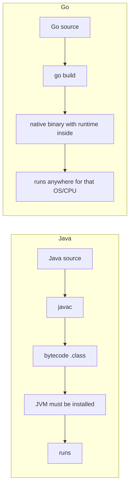

---
tags:
  - golang
  - intro
section: "01 Introduction"
video:
  - https://www.youtube.com/watch?v=JoJ8Sw5Yb4c
  - https://www.youtube.com/watch?v=F3klnY_r8FU
video_title: "Welcome to series on GO programming language / Before you start with golang"
order: 1
---
# Welcome to Go

> [!info] Source
> 🎬 [Welcome to series on GO programming language](https://www.youtube.com/watch?v=JoJ8Sw5Yb4c) · 🎬 [Before you start with golang](https://www.youtube.com/watch?v=F3klnY_r8FU) · Section **01 Introduction** of [[Golang Notes]]
> ⬅️ [[Golang Notes]] · ➡️ [[Installation and Hello World]]

## Overview

**Go** (often written *Golang* because its original website was `golang.org`) is a **compiled, statically typed** language designed at Google. The first two videos of the series do not write any code; they set the mindset. Go is already in production at companies like Google and Dropbox, startups love it, and it is one of the most natural fits for **cloud infrastructure** work. This note captures the roadmap of the whole series and the "before you start" ground rules that explain *why* Go looks the way it does, so that the hands-on notes starting with [[Installation and Hello World]] make sense.

## What the series covers

The series is a progression from language basics to a real REST API and concurrency. Each section below is a folder in this vault.

| # | Section | What you learn | Start here |
|---|---|---|---|
| 01 | Introduction | How Go differs, installing it, first program, reading docs | [[Installation and Hello World]] |
| 02 | Basics | Lexer, types, variables, user input, conversions, time, cross-platform builds | [[Lexer and Types]] |
| 03 | Memory and Data Types | Memory model, pointers, arrays, slices, maps, structs | [[Memory Management]] |
| 04 | Flow Control | if/else, switch, loops, functions, methods, defer | [[If Else]] |
| 05 | Web and Modules | Files, HTTP requests, URLs, JSON encoding/decoding, Go modules | [[Working with Files]] |
| 06 | Building an API | A CRUD "courses" API with `gorilla/mux` | [[Building an API - Models]] |
| 07 | API with MongoDB | A Netflix watchlist API backed by MongoDB Atlas | [[MongoDB Setup]] |
| 08 | Concurrency | Goroutines, WaitGroups, mutex, race conditions, channels | [[Concurrency and Goroutines]] |

The instructor's promise for the series: start from absolute basics, write a lot of code together, and read the **official documentation** often enough that it stops being scary. Reading docs is a recurring skill in these notes (see [[GOPATH and Go Docs]]).

## Who uses Go, and why it matters now

- Go is **already in production** at giants (Google, Dropbox) *and* loved by startups, which is an unusual position for a language.
- It was built with the **cloud era** in mind. The instructor's observation: teams that managed five or six machines for a service shrink to one or two after rewriting in Go, because Go programs are small, fast and use resources efficiently.
- Much of the modern cloud toolchain is written in Go: Docker, Kubernetes, Terraform and Prometheus are all Go projects.
- People who write Go are called **gophers**, the way Python developers are "Pythonistas".
- A common saying the instructor repeats: *"If C had been designed in the present era, it would look like Go."* Go is sometimes called a next-generation systems language for this reason.

## Compiled, interpreted, or in between?

A question every beginner asks. The three models:

| Model | Examples | How the code runs |
|---|---|---|
| **Compiled** | C, C++, Go | The whole program is translated to a native executable once; you run the binary. Fast. |
| **Interpreted** | JavaScript, Python | An interpreter reads and executes the code (roughly) line by line at run time. |
| **In between** | Java, C# | Compiled to intermediate bytecode; every machine that runs it needs a virtual machine (the JVM, the CLR). |

Go is **compiled**, but with a twist that matters: the Go **runtime** (garbage collector, goroutine scheduler) is baked into the final binary. You do not need a JVM-style virtual machine on the target machine, and you do not even need Go installed there. One file, copy it, run it.

Two consequences you will use later in the series:

- Go can produce executables for **Windows, Linux and macOS from any machine** (see [[Building for Windows, Linux and Mac]]).
- Go takes a lot of low-level control away from the operating system and hands it to you, especially around **threads**. That is the foundation of goroutines (see [[Concurrency and Goroutines]]).

## Don't bring baggage

The most important advice from the "before you start" video: experience from other languages helps with syntax (variables, loops, conditionals look familiar), but **do not carry the mindset** of those languages. Go deliberately leaves things out, and the right reaction is not to mimic them.

| Missing in Go | What Go gives you instead | Where in these notes |
|---|---|---|
| Classes and inheritance | **Structs** with **methods**, composition through embedding, implicit interfaces | [[Structs]], [[Methods]] |
| Method and operator overloading | One name, one meaning; what you see is exactly what runs | [[Functions]] |
| `try` / `catch` exceptions | **Errors are values** returned alongside results (the *comma ok* / *comma error* pattern); `panic` only for unrecoverable situations | [[Error Handling in Go]], [[User Input and Comma Ok Syntax]] |
| Semicolons typed by you | The **lexer** inserts them for you at line ends | [[Lexer and Types]] |
| Implicit numeric conversions | Explicit conversions only (`float64(x)`, `strconv` package) | [[Type Conversions]] |
| `while` loops, ternary `?:` | A single `for` keyword covers every loop; plain `if/else` | [[Loops, Break, Continue and Goto]], [[If Else]] |

> [!tip] Simplicity is the design principle
> Go is designed so that you can decide what a piece of code does **just by looking at it**. There is no hidden overriding, no operator that secretly calls a method, no exception flying out of a function three layers down. When something feels "missing", ask what the Go way is instead of recreating the old habit. Articles that show how to "mimic try/catch in Go" are exactly the baggage to avoid.

## Is Go object-oriented?

*Kind of yes and kind of no.* By the textbook definition you need classes and objects; Go has neither. What it has:

- **Structs** to group data (the closest thing to a class).
- **Methods** attached to any named type, not only structs.
- **Interfaces** that a type satisfies implicitly, just by having the right methods.
- No inheritance hierarchy, no `super`, no `parent`, no overloading.

So you can write code that is organised around types and behaviour, but you do it with composition rather than inheritance. This becomes concrete in [[Structs]] and [[Methods]].

## How the series will work

- One video a day, mostly 5 to 15 minutes each, so the notes in this vault are organised one video per note (a few short videos are merged).
- Folder and file names in the series follow a numbered pattern (`01hello`, `02variables`, ...). The instructor asks you to keep the *same structure* until the modules section ([[Go Modules]]) explains why names matter.
- Every example is written, run and often broken on purpose, so expect "a lot of errors" in the early videos. That is the learning tool, not a mistake.

## Gotchas and Best Practices

> [!warning] Do not try to learn Go only in the browser playground
> It is fine for tiny snippets, but real applications are built with Go installed locally. Several packages (time, random numbers) behave differently on the sandboxed playground servers. Details in [[Installation and Hello World]] and [[Switch Case]].

> [!tip] Write every line yourself
> The instructor repeats this in almost every video: watching is not learning. Type the code, run it, break it, fix it.

> [!note] "Go", not "Golang"
> The language is called Go; "golang" is just the searchable nickname. The official home is now `go.dev` (the older `golang.org` redirects there).

## Video Timeline

| Time | What happens |
|---|---|
| [00:00](https://youtu.be/JoJ8Sw5Yb4c?t=0) | (Video 1) Go in production at startups and giants |
| [00:50](https://youtu.be/JoJ8Sw5Yb4c?t=50) | (Video 1) Roadmap of the whole series: basics, web, JSON, APIs, MongoDB, goroutines |
| [02:05](https://youtu.be/JoJ8Sw5Yb4c?t=125) | (Video 1) Why reading the documentation will be part of the course |
| [01:45](https://youtu.be/F3klnY_r8FU?t=105) | (Video 2) Compiled vs interpreted vs "in between" (JVM); Go bakes the runtime into the binary |
| [03:27](https://youtu.be/F3klnY_r8FU?t=207) | (Video 2) Where Go is used; shrinking machine counts in the cloud |
| [04:19](https://youtu.be/F3klnY_r8FU?t=259) | (Video 2) "Don't bring baggage" from other languages |
| [05:11](https://youtu.be/F3klnY_r8FU?t=311) | (Video 2) Is Go object-oriented? Structs instead of classes, no overloading |
| [06:27](https://youtu.be/F3klnY_r8FU?t=387) | (Video 2) What is missing on purpose: try/catch, semicolons handled by the lexer |

## Related Notes

- [[Golang Notes]] — map of content for this whole vault.
- [[Installation and Hello World]] — the next step: install Go and run the first program.
- [[Lexer and Types]] — why you never type semicolons, and the type system overview.
- [[Error Handling in Go]] — the "errors are values" philosophy that replaces try/catch.
- [[Structs]] and [[Methods]] — Go's answer to classes.
- [[Building for Windows, Linux and Mac]] — cross-compiling the single static binary.
- [[Concurrency and Goroutines]] — the thread control the instructor teases in the intro.
- [[Go Quick Reference]] — cheat sheet for everything in the series.
