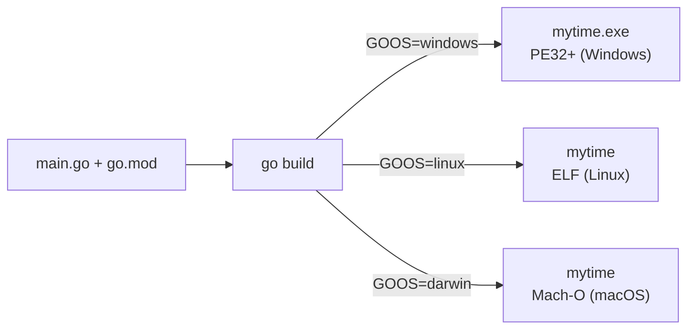

---
tags:
  - golang
  - basics
section: "02 Basics"
video: https://www.youtube.com/watch?v=9vxsO5vMTAw
video_title: "Build for windows, linux and mac"
order: 10
---
# Building for Windows, Linux and Mac

> [!info] Source
> 🎬 [Build for windows, linux and mac](https://www.youtube.com/watch?v=9vxsO5vMTAw) · Section **02 Basics** of [[Golang Notes]]
> ⬅️ [[Handling Time]] · ➡️ [[Math, Crypto and Random Numbers]]

## Overview

Until now every program ran with `go run`, which compiles to a temporary place and throws the binary away. This short video shows the other half of the promise made in [[Welcome to Go]]: `go build` produces a **single native executable** with the Go runtime inside, and by changing one environment variable, `GOOS`, you can build that executable for **Windows, Linux or macOS from whatever machine you are on**. No virtual machine, no Go installation on the target, nothing to ship but the file. The `mytime` program from [[Handling Time]] is the guinea pig.

## A quick aside: `UnixNano`

The video opens by revisiting `time.Now()`. Besides `Format`, a `Time` has methods like `Nanosecond()` and `UnixNano()`; the latter returns the number of nanoseconds since 1 January 1970 as one big, ever-changing `int64`. That makes it a popular **seed for random numbers** (`rand.Seed(time.Now().UnixNano())` in the dice game of [[Switch Case]]), a topic expanded in [[Math, Crypto and Random Numbers]]. Modern Go seeds the generator automatically, see the note there.

## `go env`: how Go sees your machine

```bash
go env
```

prints every environment variable the toolchain uses. The important ones:

| Variable | Meaning | Example |
|---|---|---|
| `GOOS` | the **target** operating system the next build is for | `darwin`, `linux`, `windows` |
| `GOARCH` | the target CPU architecture | `amd64`, `arm64` |
| `GOHOSTOS`, `GOHOSTARCH` | the OS and CPU you are **running on** (do not confuse with the two above) | `darwin`, `arm64` |
| `GOPATH` | where modules are cached and `go install` puts binaries | `/Users/you/go` |
| `GOMODCACHE` | the downloaded module cache | `/Users/you/go/pkg/mod` |
| `GOROOT` | where Go itself is installed | `/usr/local/go` |
| `GOVERSION` | the toolchain version | `go1.27.3` |

![[10_build_go_env_0130.png]]
*Figure: `go env` output in the terminal, with GOOS highlighted (video at 01:30)*

macOS reports itself as **`darwin`** (the name of its Unix core). To print just one value:

```bash
go env GOOS GOARCH
```

**Output** (on an Apple Silicon Mac):
```text
darwin
arm64
```

`GOPATH` and the module cache are explained in [[GOPATH and Go Docs]].

## `go build`: a real executable

Inside the `mytime` folder:

```bash
go build
```

With no arguments, `go build` compiles the package in the current directory (it finds `main.go` and any other `.go` files there) and writes an executable named after the last element of the main package's import path, which for a one-package module is the last element of the module path in `go.mod`: `mytime` on macOS and Linux, `mytime.exe` on Windows (`go build main.go` would produce `main` instead). Run it directly:

```bash
./mytime
```

**Output:**
```text
Welcome to time study of golang
2026-10-23 16:58:55.598672 +0530 IST m=+0.000118001
...
```

To pick the output name and location use `-o`:

```bash
go build -o build/mytime
```

## Cross-compiling with `GOOS` and `GOARCH`

Set the variable **for that one command** by putting it in front:

```bash
GOOS=windows go build        # produces mytime.exe
GOOS=linux   go build        # produces mytime (a Linux ELF binary)
GOOS=darwin  go build        # produces mytime (a macOS Mach-O binary)
```

Both the OS and the CPU can be chosen:

```bash
GOOS=linux GOARCH=amd64 go build -o mytime-linux-amd64
GOOS=linux GOARCH=arm64 go build -o mytime-linux-arm64
GOOS=windows GOARCH=amd64 go build -o mytime-windows-amd64.exe
```

Checking what came out (the `file` command on macOS/Linux):

```text
mytime.exe:   PE32+ executable (console) x86-64, for MS Windows
mytime-linux: ELF 64-bit LSB executable, x86-64, version 1 (SYSV), statically linked, Go BuildID=...
```

The Linux binary is **statically linked**: everything it needs, including the Go runtime, is inside the file. Copy `mytime-linux` to any Linux box with the right CPU and it runs, no Go installed there.



### On Windows shells

The `VAR=value command` prefix is a Unix shell feature. On Windows use:

```powershell
$env:GOOS = "linux"; go build
```

in PowerShell, or `set GOOS=linux` followed by `go build` in `cmd.exe`. Remember to set it back (or open a new terminal) afterwards.

### All supported targets

```bash
go tool dist list
```

prints every `os/arch` pair the toolchain can build for, for example `darwin/arm64`, `linux/amd64`, `linux/arm64`, `windows/amd64`, `windows/arm64`, plus many more (BSDs, WebAssembly, and so on).

| `GOOS` | `GOARCH` | Typical use |
|---|---|---|
| `linux` | `amd64` | servers, Docker images, most cloud VMs |
| `linux` | `arm64` | ARM servers (AWS Graviton), Raspberry Pi |
| `darwin` | `arm64` / `amd64` | Apple Silicon / Intel Macs |
| `windows` | `amd64` | desktop and server Windows |

## Gotchas and Best Practices

> [!warning] `GOOS` is the target, `GOHOSTOS` is you
> The instructor stresses it in the video: when reading `go env`, the line you care about for cross-compiling is `GOOS`, not `GOHOSTOS`.

> [!warning] The prefix form only affects that one command
> `GOOS=windows go build` does not change your shell. If you want to change it persistently, `go env -w GOOS=windows` writes it to Go's config, but that is rarely what you want; the per-command form is safer.

> [!tip] Name the artefacts by target
> When building for several platforms, use `-o` with the OS and architecture in the file name (`app-linux-amd64`, `app-windows-amd64.exe`) so they never get mixed up.

> [!tip] Smaller binaries
> `go build -ldflags="-s -w"` strips debug symbols: on the `mytime` program it shrank the binary from about 2.4 MB to about 1.6 MB. Binaries of a couple of megabytes are normal for Go because the whole runtime is inside.

> [!note] Cgo and cross-compilation
> Pure Go code cross-compiles out of the box. If a dependency uses C (cgo), cross-compiling needs a C cross-compiler, or `CGO_ENABLED=0` to force the pure-Go path. Nothing in this series needs cgo.

## Modern Go Notes

- Nothing here has changed in syntax since Go 1.17. `go build`, `GOOS`, `GOARCH` and `go tool dist list` work the same on current versions.
- `go install pkg@version` (not `go get`) is how you install other people's binaries now; building your *own* program is still `go build`.
- The explicit `rand.Seed(time.Now().UnixNano())` mentioned at the start is no longer needed (Go 1.20+ seeds randomly by default); details in [[Math, Crypto and Random Numbers]].

## Video Timeline

| Time | What happens |
|---|---|
| [00:03](https://youtu.be/9vxsO5vMTAw?t=3) | `time.Now().Nanosecond()` and `UnixNano()` as random seeds |
| [00:55](https://youtu.be/9vxsO5vMTAw?t=55) | Go can build executables for Windows, Linux and macOS |
| [01:21](https://youtu.be/9vxsO5vMTAw?t=81) | `go env`; finding `GOOS` (not `GOHOSTOS`); macOS is `darwin` |
| [02:12](https://youtu.be/9vxsO5vMTAw?t=132) | `GOOS=windows go build` produces `mytime.exe` |
| [03:03](https://youtu.be/9vxsO5vMTAw?t=183) | Building for Linux; assignment to explore the rest of `go env` |

## Related Notes

- [[Welcome to Go]] — why Go binaries need no VM or runtime installed on the target.
- [[Handling Time]] — the `mytime` program being built here.
- [[Installation and Hello World]] — `go run` versus `go build`.
- [[GOPATH and Go Docs]] — `GOPATH`, `GOMODCACHE` and `GOROOT` from the `go env` output.
- [[Math, Crypto and Random Numbers]] — the `UnixNano` seed and modern random numbers.
- [[Switch Case]] — the dice game that seeds `rand` with `UnixNano`.
- [[Go Modules]] — why the binary name comes from the module path in `go.mod`.
- [[Go Quick Reference]] — build commands cheat sheet.
