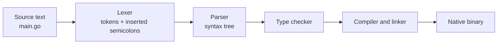

---
tags:
  - golang
  - basics
section: "02 Basics"
video: https://www.youtube.com/watch?v=elYPAeX9h1E
video_title: "Lexer in golang and Types"
order: 5
---
# Lexer and Types

> [!info] Source
> 🎬 [Lexer in golang and Types](https://www.youtube.com/watch?v=elYPAeX9h1E) · Section **02 Basics** of [[Golang Notes]]
> ⬅️ [[GOPATH and Go Docs]] · ➡️ [[Variables, Types and Constants]]

## Overview

This video is mostly documentation reading and theory, and it answers two questions that confuse everyone who comes from C, Java or JavaScript: *why does Go code have no semicolons when the language specification says it needs them?* and *what types does Go actually have?* The answer to the first is the **lexer**, a stage of the compiler that inserts semicolons for you. The answer to the second is a tour of the type system that the next notes ([[Variables, Types and Constants]], [[Arrays]], [[Slices]], [[Maps]], [[Structs]], [[Pointers]]) fill in one by one.

## Semicolons: the spec says yes, your code says no

Open the **language specification** (https://go.dev/ref/spec) and find the section *Semicolons* under *Lexical elements*. It states that the **formal grammar uses semicolons as terminators**, exactly like C. Yet every Go program you have seen so far has none, and if you add one at the end of `fmt.Println("hi");` and save, the Go extension removes it again.

![[05_lexer_spec_semicolons_0225.png]]
*Figure: the "Semicolons" section of the Go language specification (video at 02:25)*

The rule that makes this work: when the source is tokenised, a semicolon is **automatically inserted at the end of a line** if the last token on that line is

- an identifier (`x`, `fmt`),
- a literal (`42`, `"hello"`),
- one of the keywords `break`, `continue`, `fallthrough`, `return`,
- one of `++`, `--`, `)`, `]`, `}`.

A second rule lets you omit the semicolon before a closing `)` or `}`, which is why `fmt.Println("hi")` on the last line of a block does not need one either.

So semicolons are not optional in Go; they are **written for you**. The only places you still type them are where several statements share one line, for example the three clauses of a `for` loop or the init statement of an `if` (see [[Loops, Break, Continue and Goto]] and [[If Else]]):

```go
for i := 0; i < 5; i++ {
	// ...
}

if num := 3; num < 10 {
	// ...
}
```

## What a lexer is

Every language implementation, compiled or interpreted, has a **lexer** (also called a scanner or tokeniser). It is the first stage of compilation: it reads the raw characters of your source file and groups them into **tokens** such as keywords, identifiers, literals and operators, and checks that they follow the lexical grammar. It does *not* catch logic errors; it only checks that the text is made of valid pieces, in a valid order.



In Go the lexer is also where the automatic semicolons appear, which is why the instructor says "the lexer is doing a lot of work for you". The Go extension (through `gofmt`/`gopls`) formats the file on save with the same rules, so stray semicolons vanish.

> [!warning] The one visible consequence: braces must open on the same line
> Because a `)` at the end of a line gets a semicolon after it, this C-style layout breaks:
> ```go
> func main()
> {
> 	fmt.Println("hi")
> }
> ```
> **Output:**
> ```text
> ./main.go:6:1: syntax error: unexpected semicolon or newline before {
> ```
> The lexer turned `func main()` into `func main();`. Always write `func main() {` with the brace on the same line. The same applies to `if`, `for`, `switch` and struct literals.

## Case sensitivity and exported names

Go is case sensitive, and the **first letter of an identifier decides its visibility**:

| Identifier | Visibility | Example |
|---|---|---|
| Starts with a capital letter | **Exported** (public): usable from other packages | `fmt.Println`, `os.Stdin`, `bufio.NewReader` |
| Starts with a lowercase letter | **Unexported** (private to its package) | helper functions inside `fmt` that `Println` uses |

That is why every standard library function you call is capitalised: `Println`'s `P` is what makes it reachable from your `main` package. There is no `public` or `private` keyword in Go; the capital letter *is* the keyword. You will apply this rule to your own constants in [[Variables, Types and Constants]], to struct fields in [[Structs]] (JSON encoding depends on it, see [[Creating JSON Data]]) and to functions shared between packages in [[Go Modules]].

## Types in Go

Go is **statically typed**: the type of every variable is known at compile time. You either declare it explicitly or let the compiler infer it from the value (the `:=` syntax, covered next in [[Variables, Types and Constants]]). Once set, the type cannot change.

The instructor's phrase is "almost everything in Go is a type", in the same spirit as "almost everything in JavaScript is an object". Functions are types, channels are types, even a `mutex` is a type. Here is the map of the territory.

### Basic types

| Category | Types | Notes |
|---|---|---|
| Boolean | `bool` | only `true` or `false` |
| String | `string` | immutable sequence of bytes, UTF-8 by convention |
| Signed integers | `int8`, `int16`, `int32`, `int64`, `int` | `int` is 32 or 64 bits depending on the platform; use it by default |
| Unsigned integers | `uint8`, `uint16`, `uint32`, `uint64`, `uint`, `uintptr` | `uint8` holds 0 to 255 |
| Floating point | `float32`, `float64` | only these two; `float64` is the default and more precise |
| Complex | `complex64`, `complex128` | numbers with an imaginary part; the series does not use them |
| Aliases | `byte` = `uint8`, `rune` = `int32` | `rune` holds one Unicode code point |

Exact ranges for the integer types are listed in the spec under *Numeric types* and are reproduced in [[Variables, Types and Constants]], where the `uint8` overflow is demonstrated.

### Composite and advanced types

| Type | What it is | Note |
|---|---|---|
| Array | fixed-length list of one type | [[Arrays]] |
| Slice | growable view over an array; the everyday list type | [[Slices]] |
| Map | key/value store (hash map) | [[Maps]] |
| Struct | named group of fields, Go's answer to classes | [[Structs]] |
| Pointer | address of a value | [[Pointers]], [[Memory Management]] |
| Function | functions are values; pass them around and return them | [[Functions]] |
| Interface | a set of method signatures a type satisfies implicitly | touched on in [[Methods]] |
| Channel | typed pipe between goroutines | [[Channels and Deadlock]] |
| Mutex, WaitGroup | synchronisation types from package `sync` | [[Mutex]], [[WaitGroups]] |

Every one of these gets its own video; this note is only the overview the instructor gives on the presentation slide.

![[05_lexer_types_slide_0545.png]]
*Figure: the presentation slide listing Go's basic and advanced types (video at 05:45)*

## Gotchas and Best Practices

> [!tip] Read the spec in small doses
> The spec (https://go.dev/ref/spec) is the grammar of the language. You do not need all of it; the *Lexical elements*, *Semicolons* and *Types* sections are enough for now. The instructor's approach for the whole series is to keep opening the docs for one small fact at a time, so that they stop being intimidating (see [[GOPATH and Go Docs]]).

> [!warning] Never fight the formatter
> `gofmt` output is the one true style in Go. If the editor removes your semicolon or moves your brace, that is the language telling you the rule, not a bug in the extension.

> [!note] Capital letters are an API decision
> Capitalising a name publishes it. When you later write packages and structs, choose the case deliberately: a lowercase struct field will silently be skipped by the JSON encoder, for example.

## Video Timeline

| Time | What happens |
|---|---|
| [00:28](https://youtu.be/elYPAeX9h1E?t=28) | Where semicolons are allowed and where they are removed on save |
| [01:44](https://youtu.be/elYPAeX9h1E?t=104) | Opening the language specification and finding *Lexical elements* |
| [02:36](https://youtu.be/elYPAeX9h1E?t=156) | What a lexer does; semicolons inserted before compilation |
| [03:27](https://youtu.be/elYPAeX9h1E?t=207) | The "may be omitted before a closing ) or }" rule |
| [04:20](https://youtu.be/elYPAeX9h1E?t=260) | Case sensitivity: capital first letter means exported, `fmt.Println` as the example |
| [05:12](https://youtu.be/elYPAeX9h1E?t=312) | Tour of the basic types: string, bool, integers, floats, complex |
| [06:05](https://youtu.be/elYPAeX9h1E?t=365) | Advanced types: arrays, slices, maps, structs, pointers, functions, channels, mutex |

## Related Notes

- [[Variables, Types and Constants]] — declaring values of these types, zero values, `:=`, constants.
- [[Installation and Hello World]] — the `fmt.Println` whose capital `P` is explained here.
- [[If Else]] and [[Loops, Break, Continue and Goto]] — the two places you still type semicolons.
- [[Arrays]], [[Slices]], [[Maps]], [[Structs]], [[Pointers]] — each advanced type in depth.
- [[Functions]] — functions as first-class types.
- [[Channels and Deadlock]], [[Mutex]], [[WaitGroups]] — the concurrency types mentioned in passing.
- [[Go Quick Reference]] — type cheat sheet.
