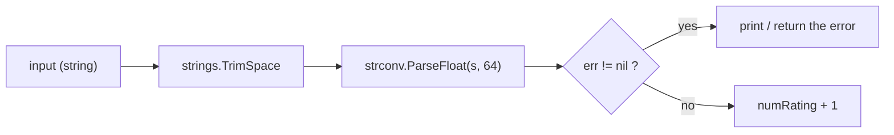

---
tags:
  - golang
  - basics
section: "02 Basics"
video: https://www.youtube.com/watch?v=3j43y-PFJPI
video_title: "Conversions in golang"
order: 8
---
# Type Conversions

> [!info] Source
> 🎬 [Conversions in golang](https://www.youtube.com/watch?v=3j43y-PFJPI) · Section **02 Basics** of [[Golang Notes]]
> ⬅️ [[User Input and Comma Ok Syntax]] · ➡️ [[Handling Time]]

## Overview

Input from the keyboard, from a URL query string, from a form or from a JSON body arrives as **text**. Before you can add, compare or store it as a number you must **convert** it, and Go makes that conversion explicit: there is no automatic coercion of `"4"` into `4`. This video rebuilds the pizza-rating program from [[User Input and Comma Ok Syntax]] and adds one feature, "add 1 to the rating", which forces three new things into the code: the **`strconv`** package, the **`if err != nil`** check, and the **`strings`** package to trim the trailing newline. The instructor warns up front: this video is full of errors on purpose, because the errors are the lesson.

## Project setup

```text
04conversion/
├── go.mod      ← go mod init conversion
└── main.go
```

The first half of `main.go` is a repetition of the previous note: print a welcome, create a `bufio.NewReader(os.Stdin)`, call `ReadString('\n')`, print the input. Repetition is deliberate; the instructor wants the reader-and-comma-ok pattern to become muscle memory.

## Error 1: you cannot add a number to a string

```go
numRating := input + 1
```

```text
./main.go:12:15: invalid operation: input + 1 (mismatched types string and untyped int)
```

`input` is a `string` (we proved that with `%T` in the previous note). Go has **no implicit conversions** between types; `"4" + 1` is meaningless to the compiler. We need to parse the text into a number.

## The `strconv` package

`strconv` (*string conversion*) is the standard library package for converting between strings and basic types. The functions you will use most:

| Function | Signature | Use |
|---|---|---|
| `strconv.ParseFloat` | `(s string, bitSize int) (float64, error)` | text to float; `bitSize` is 32 or 64 |
| `strconv.ParseInt` | `(s string, base int, bitSize int) (int64, error)` | text to integer in a given base (10 for decimal) |
| `strconv.Atoi` | `(s string) (int, error)` | "ASCII to int": the everyday text-to-`int` helper |
| `strconv.ParseBool` | `(str string) (bool, error)` | `"true"`, `"false"`, `"1"`, `"0"` to `bool` |
| `strconv.Itoa` | `(i int) string` | `int` to text |
| `strconv.FormatFloat` | `(f float64, fmt byte, prec, bitSize int) string` | float to text with a chosen format and precision |

The video uses `ParseFloat` with a bit size of **64**, which is the usual choice (it matches `float64`, see [[Variables, Types and Constants]]).

```go
numRating, err := strconv.ParseFloat(input, 64)
```

Every `Parse*` function returns **two values**, so the comma ok syntax is mandatory. This time we keep the error instead of discarding it with `_`, because parsing user input is exactly the kind of operation that fails in the real world.

## Error 2: handling the error with `if err != nil`

As soon as `err` is a real variable, the compiler complains that it is unused. The fix is the most common three lines in all of Go:

```go
if err != nil {
	fmt.Println(err)
} else {
	fmt.Println("Added 1 to your rating: ", numRating+1)
}
```

- `nil` is the "nothing here" value. `err != nil` reads as "there *is* an error".
- On error we print it. In real code you would return it to the caller, or, for truly unrecoverable situations, call `panic(err)`, which stops the program with the message. Both are discussed in [[Error Handling in Go]].
- This is also the first appearance of `if`/`else`, which gets its own note in [[If Else]].



## Error 3: the invisible newline

Run the program and rate the pizza `4`:

```text
strconv.ParseFloat: parsing "4\n": invalid syntax
```

There is nothing wrong with the code; the **data** is wrong. `ReadString('\n')` hands back the text *including* the newline the user typed, so `strconv` is asked to parse `"4\n"`, and a newline is not part of a number. This bug is extremely common whenever input comes from a terminal, a file or an HTTP request, which is why the instructor wants you to hit it now.

### The `strings` package

Go's **`strings`** package (plural; `string` is the type) is full of text helpers: `ToUpper`, `ToLower`, `Contains`, `Split`, `Replace`, `Trim`, `TrimLeft`, `TrimRight`, `TrimSpace`, and many more. The one we need is **`strings.TrimSpace`**, which removes all leading and trailing white space, including `\n` and `\r`:

```go
numRating, err := strconv.ParseFloat(strings.TrimSpace(input), 64)
```

Run again, rate `3`, and the output is `Added 1 to your rating: 4`.

## Example: the complete pizza-rating program

```go
package main

import (
	"bufio"
	"fmt"
	"os"
	"strconv"
	"strings"
)

func main() {
	fmt.Println("Welcome to our pizza app")
	fmt.Println("Please rate our pizza between 1 and 5")

	reader := bufio.NewReader(os.Stdin)

	input, _ := reader.ReadString('\n')

	fmt.Println("Thanks for rating, ", input)

	numRating, err := strconv.ParseFloat(strings.TrimSpace(input), 64)

	if err != nil {
		fmt.Println(err)
	} else {
		fmt.Println("Added 1 to your rating: ", numRating+1)
	}
}
```

**Output** (typing `3`):
```text
Welcome to our pizza app
Please rate our pizza between 1 and 5
3
Thanks for rating,  3

Added 1 to your rating:  4
```

**Output** (typing `abc`):
```text
Welcome to our pizza app
Please rate our pizza between 1 and 5
abc
Thanks for rating,  abc

strconv.ParseFloat: parsing "abc": invalid syntax
```

The program does not crash on bad input; it prints the error and ends normally. That is the behaviour the comma ok pattern buys you.

## Converting between numeric types

Not in the video but closely related: converting between Go's own numeric types is done with a **type conversion** that looks like a function call, and it is always explicit:

```go
var whole int = 2
var fraction float64 = 4.5
sum := float64(whole) + fraction   // 6.5, both operands must be float64
truncated := int(fraction)         // 4, the decimal part is dropped
```

`int(4.5)` truncates toward zero; it does not round. The instructor shows this `int(...)` form later in [[Math, Crypto and Random Numbers]].

> [!warning] `string(65)` is not `"65"`
> Converting an integer to `string` interprets it as a Unicode code point: `string(65)` is `"A"`. To get the digits, use `strconv.Itoa(65)` or `fmt.Sprintf("%d", 65)` (see [[fmt Package and Format Verbs]]).

## Gotchas and Best Practices

> [!warning] Always trim terminal input before parsing
> `strings.TrimSpace` is the standard fix. It also handles the `\r\n` that Windows terminals produce.

> [!warning] `ParseFloat` always returns a `float64`
> Even with `bitSize` 32 the result type is `float64`; the bit size only controls rounding so that the value fits a `float32` later. Use `strconv.Atoi` when you want an `int`.

> [!tip] Keep the error, check the error
> The `_` shortcut was fine for the welcome demo. The moment a conversion can fail because of user data, keep `err` and branch on it. This same four-line block appears in every API handler in [[Building an API - Models]] and the MongoDB section, where ids and parameters arrive as strings in the URL ([[Handling URLs]]).

> [!tip] The error message tells you the input
> `parsing "4\n": invalid syntax` quotes the exact text it received. Reading the quotes is how you spot invisible characters.

## Video Timeline

| Time | What happens |
|---|---|
| [00:29](https://youtu.be/3j43y-PFJPI?t=29) | Why conversions matter: parameters arrive as strings from URLs and input |
| [01:21](https://youtu.be/3j43y-PFJPI?t=81) | New folder `04conversion`, rebuild the reader and `ReadString` |
| [04:44](https://youtu.be/3j43y-PFJPI?t=284) | `input + 1` fails: mismatched types |
| [05:09](https://youtu.be/3j43y-PFJPI?t=309) | The `strconv` package and `ParseFloat(input, 64)` |
| [06:02](https://youtu.be/3j43y-PFJPI?t=362) | Keeping `err`; `if err != nil` and a mention of `panic` |
| [08:10](https://youtu.be/3j43y-PFJPI?t=490) | Running it: `parsing "4\n": invalid syntax` |
| [09:03](https://youtu.be/3j43y-PFJPI?t=543) | The `strings` package and `TrimSpace` fix |
| [09:54](https://youtu.be/3j43y-PFJPI?t=594) | Rating 3 becomes 4; why this exact code appears in every API |

## Related Notes

- [[User Input and Comma Ok Syntax]] — the program this one extends, and the two-value return pattern.
- [[Error Handling in Go]] — `nil`, `if err != nil`, `panic`, and when to use each.
- [[If Else]] — the branching syntax first used here.
- [[Variables, Types and Constants]] — why `float64` and bit size 64.
- [[Handling URLs]] and [[Building an API - Models]] — where string parameters from the web need the same conversions.
- [[Math, Crypto and Random Numbers]] — `int(...)` conversions between numeric types.
- [[fmt Package and Format Verbs]] — `Sprintf` as the other way to turn values into text.
- [[Go Quick Reference]] — `strconv` and `strings` cheat sheet.
