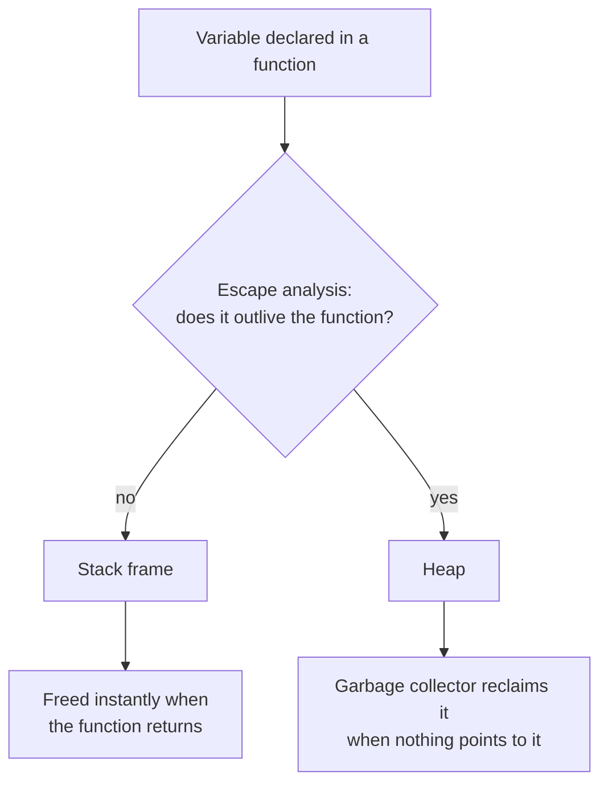

---
tags:
  - golang
  - memory
section: "03 Memory and Data Types"
video: https://www.youtube.com/watch?v=G1SP9uDJD0g
video_title: "Memory management in golang"
order: 11
---
# Memory Management

> [!info] Source
> 🎬 [Memory management in golang](https://www.youtube.com/watch?v=G1SP9uDJD0g) · Section **03 Memory and Data Types** of [[Golang Notes]]
> ⬅️ [[Math, Crypto and Random Numbers]] · ➡️ [[Pointers]]

## Overview

This section of the course is about Go's data types, and it deliberately starts with memory. Every variable, constant and array you have declared so far (see [[Variables, Types and Constants]]) is really a *reference to some memory*, and the next topic, [[Pointers]], is nothing more than a way of handing that memory address around. The good news the instructor leads with: in Go, memory management is **not your job**. Unlike C or C++, where you allocate and free memory by hand, Go's runtime allocates memory for you and a **garbage collector (GC)** reclaims it automatically. What you *do* need to understand is the two built-in functions that allocate memory, `new()` and `make()`, and the few knobs the runtime exposes for the GC.

## Where Go puts your data: stack vs heap

Go uses the two classic memory regions, but the *compiler*, not you, decides which one a value goes to. This decision is called **escape analysis**.

| Region | What lives there | Who frees it | Cost |
|---|---|---|---|
| **Stack** | Values whose lifetime ends when the function returns (most local variables) | Freed automatically when the function returns, no GC involved | Very cheap |
| **Heap** | Values that must outlive the function that created them (returned pointers, data stored in slices/maps that escape, values captured by goroutines) | The garbage collector, once nothing references them any more | More expensive; the GC has to track them |



You can ask the compiler to show its decisions with the `-m` flag; lines that say `moved to heap` or `escapes to heap` are values that ended up on the heap:

```bash
go build -gcflags=-m ./...
```

> [!note]
> You never choose stack or heap explicitly in Go. Writing idiomatic code and letting the compiler decide is the whole point; `-gcflags=-m` is only for curiosity or performance work.

## Allocating memory: `new()` vs `make()`

Both are built-in functions that allocate memory, and both come up constantly with [[Arrays]], [[Slices]] and [[Maps]]. The instructor's summary is worth memorising, because it is a classic interview question:

| | `new(T)` | `make(T, args...)` |
|---|---|---|
| Works with | **Any** type | **Only** slices, maps and channels |
| Returns | A **pointer** `*T` to zeroed storage | The initialised value itself (type `T`, not a pointer) |
| State of the memory | Allocated and **zeroed** (the zero value of `T`) | Allocated **and initialised**: the internal data structure (hash table, backing array, channel buffer) is ready to use |
| Typical use | Rare; `&T{}` is usually written instead | Very common: `make([]int, 4)`, `make(map[string]string)`, `make(chan int)` |

The way the instructor phrases it, "`new` gives you zeroed storage, `make` gives you non-zeroed storage": with `new` you get memory you still have to fill before it is useful, with `make` you get a slice, map or channel you can put values into immediately. Be precise about what "non-zeroed" means here: the *elements* of a `make`d slice are still zero values (`[0 0 0]` in the output below); what `make` initialises is the slice, map or channel header itself, so it is non-nil and ready to use. `new(int)` is immediately usable too; the "fill it first" caveat really bites only for maps and channels, which are useless while nil.

![[11_memory_management_new_vs_make_0215.png]]
*Figure: the slide comparing `new` and `make` that the instructor walks through (video at 02:15)*

> [!warning] A `map` declared without `make` is nil
> `var m map[string]int` gives you a **nil map** (and `new(map[string]int)` gives you a pointer to one). Reading from it is fine (you get zero values), but *writing* to it panics with `assignment to entry in nil map`. Always create maps with `make` or a literal `map[string]int{}`. See [[Maps]].

### Example: `new` and `make` side by side

```go
package main

import "fmt"

func main() {
	// new: allocates zeroed storage and returns a POINTER to it
	count := new(int)
	fmt.Println("new(int) gives a pointer:", count, "pointing at the zero value:", *count)
	*count = 42
	fmt.Println("after *count = 42:", *count)

	// make: allocates AND initialises a slice, map or channel
	scores := make([]int, 3)
	fmt.Println("make([]int, 3) gives:", scores, "| len:", len(scores), "| cap:", cap(scores))

	languages := make(map[string]string)
	languages["GO"] = "Golang"
	fmt.Println("make(map[string]string) gives:", languages)

	// a map declared without make is nil: reading is fine, writing panics
	var nilMap map[string]string
	fmt.Println("nil map read:", nilMap["GO"], "| len:", len(nilMap), "| is nil:", nilMap == nil)
	// nilMap["GO"] = "Golang" // panic: assignment to entry in nil map
}
```

**Output:** (the pointer address will differ on every run)

```text
new(int) gives a pointer: 0xc000012090 pointing at the zero value: 0
after *count = 42: 42
make([]int, 3) gives: [0 0 0] | len: 3 | cap: 3
make(map[string]string) gives: map[GO:Golang]
nil map read:  | len: 0 | is nil: true
```

The `*count` and `&` syntax used here is explained properly in [[Pointers]]; for now notice that `new` hands back an address, while `make` hands back something you can index straight away.

## Garbage collection

Go's garbage collector runs **automatically and concurrently** with your program. Anything that goes out of scope, or that nothing references any more (for example, a pointer that is set to `nil`), becomes *eligible* for collection. Eligible does not mean "collected immediately": the GC only runs when certain thresholds are crossed.

### The `GOGC` threshold

The instructor reads this straight from the `runtime` package documentation. The **`GOGC`** environment variable sets the *garbage collection target percentage*: a collection is triggered when the ratio of freshly allocated data to the live data remaining after the previous collection reaches this percentage. The default is `GOGC=100`, meaning "run the GC once the heap has grown by 100% since the last collection". `GOGC=off` disables the collector entirely, and `runtime/debug.SetGCPercent` changes the same setting at run time.

```bash
GOGC=200 go run main.go   # collect less often, use more memory
GOGC=50  go run main.go   # collect more often, use less memory
```

> [!note] A bit of history
> Go's GC was heavily criticised in the language's early years for its pause times. The Go team rewrote it as a concurrent, low-latency collector (the big change landed around Go 1.5, in 2015) and it has been tuned in nearly every release since. You can safely leave it alone in normal application code.

### The `runtime` package

`runtime` is the package that exposes low-level information about the Go runtime and the machine. The course only touches it, but two things are handy to know:

- **`runtime.NumCPU()`** returns the number of logical CPUs usable by the current process. This becomes relevant again in [[Concurrency and Goroutines]].
- **`runtime.ReadMemStats`** fills a `runtime.MemStats` struct with allocator statistics such as the bytes currently on the heap and how many GC cycles have completed.

```go
package main

import (
	"fmt"
	"runtime"
	"runtime/debug"
)

func main() {
	fmt.Println("Logical CPUs:", runtime.NumCPU())
	fmt.Println("Go version:  ", runtime.Version())
	fmt.Println("OS / Arch:   ", runtime.GOOS, runtime.GOARCH)

	// GOGC: the garbage-collection target percentage (default 100)
	previous := debug.SetGCPercent(100)
	fmt.Println("GC percent was:", previous)

	var stats runtime.MemStats
	runtime.ReadMemStats(&stats)
	fmt.Println("Heap allocated (bytes):", stats.HeapAlloc)
	fmt.Println("Completed GC cycles:", stats.NumGC)
}
```

**Output:** (numbers depend on your machine)

```text
Logical CPUs: 10
Go version:   go1.27.3
OS / Arch:    darwin arm64
GC percent was: 100
Heap allocated (bytes): 139816
Completed GC cycles: 0
```

![[11_memory_management_runtime_docs_0400.png]]
*Figure: the `runtime` package documentation with the `GOGC` paragraph the instructor reads out (video at 04:00)*

## Gotchas and Best Practices

> [!tip] Reach for `make` for slices, maps and channels
> In the overwhelming majority of code you will use `make` (or a literal). `new` is rarely seen in idiomatic Go because `&MyStruct{}` does the same job and reads better.

> [!warning] Memory that is "out of scope" is not freed instantly
> Setting a variable to `nil` only makes the data *eligible* for collection. If you are holding on to a large slice or map that you no longer need (for example inside a long-lived global), nothing is reclaimed until you drop the reference.

> [!tip] Do not call `runtime.GC()` yourself
> It exists, but it blocks your program while a full collection runs. Tune `GOGC` (or the `GOMEMLIMIT` soft memory limit) instead, and only when profiling shows a real problem.

## Video Timeline

| Time | What happens |
|---|---|
| [00:32](https://youtu.be/G1SP9uDJD0g?t=32) | Memory allocation and deallocation is automatic in Go |
| [01:21](https://youtu.be/G1SP9uDJD0g?t=81) | `new` vs `make`: both allocate, only `make` initialises |
| [02:11](https://youtu.be/G1SP9uDJD0g?t=131) | The interview line: `new` = zeroed storage, `make` = ready-to-use storage |
| [02:39](https://youtu.be/G1SP9uDJD0g?t=159) | Garbage collection: out-of-scope or nil values become eligible |
| [03:35](https://youtu.be/G1SP9uDJD0g?t=215) | Reading the `runtime` package docs and the `GOGC` variable |
| [04:55](https://youtu.be/G1SP9uDJD0g?t=295) | `runtime.NumCPU()` as an example of querying the machine |

## Related Notes

- [[Pointers]] — the next video; pointers are the addresses of the memory discussed here.
- [[Slices]] — `make([]int, 4)` and how `append` reallocates the backing array.
- [[Maps]] — why maps must be created with `make` (or a literal) before use.
- [[Variables, Types and Constants]] — every variable is a named piece of memory with a zero value.
- [[Concurrency and Goroutines]] — `runtime.NumCPU()` and the scheduler come back here.
- [[Go Quick Reference]] — one-line reminders of `new` vs `make`.
- [[Golang Notes]] — map of the whole vault.
