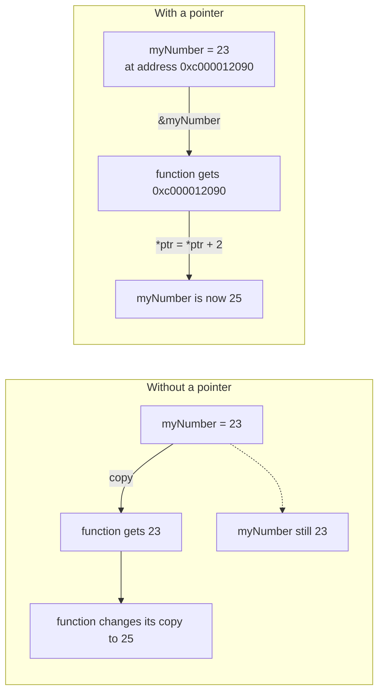

---
tags:
  - golang
  - memory
section: "03 Memory and Data Types"
video: https://www.youtube.com/watch?v=-BFJ0dZyxHg
video_title: "Pointers in golang"
order: 12
---
# Pointers

> [!info] Source
> 🎬 [Pointers in golang](https://www.youtube.com/watch?v=-BFJ0dZyxHg) · Section **03 Memory and Data Types** of [[Golang Notes]]
> ⬅️ [[Memory Management]] · ➡️ [[Arrays]]

## Overview

The instructor's opening point is that pointers are **over-explained** and that is what makes beginners afraid of them. A pointer is simply a variable that holds the **memory address** of another value. That is the whole concept. What matters more than the definition is *why* pointers exist: in every language, when you pass a variable into a function, a **copy** may be made and the function works on that copy, so changes do not reach the original. A pointer is the guarantee that the function receives the *actual* value's location, so the operation is performed on the real thing. This builds directly on [[Memory Management]], and you will see pointers everywhere later: in [[Methods]] with pointer receivers, in [[Structs]] passed to APIs, and in the `sync` types of [[Mutex]] and [[WaitGroups]].

## Why pointers exist: the copy problem

Every variable you declare (see [[Variables, Types and Constants]]) stores its value somewhere in memory. Go is a **pass-by-value** language: when you hand a variable to a function, the function gets its own copy. Changing the copy leaves the original untouched, which is sometimes exactly what you want, and sometimes a silent bug.



When you pass the *address* instead of the value, there is only one piece of memory involved, so there is a 100% guarantee that the real value is being read and modified. That is the single most important thing to take from this video.

## The two symbols: `*` and `&`

| Symbol | Name | Used for | Example |
|---|---|---|---|
| `*T` in a type | pointer type | "a pointer that holds the address of a `T`" | `var ptr *int` |
| `&x` | address-of (reference) | get the memory address of an existing variable | `ptr = &myNumber` |
| `*ptr` in an expression | dereference | read or write the value stored *at* the address | `*ptr = *ptr + 2` |

> [!tip] A rule of thumb from the video
> Whenever there is talk of *referencing* something that already exists, that is `&`. The asterisk does double duty: in a **type** it says "I am a pointer", in an **expression** it says "give me what is inside the pointer".

### Declaring a pointer

A pointer type is written with an asterisk in front of the type it points to. A pointer that has not been given an address is **`nil`**, exactly like the zero values of other types:

```go
var ptr *int                      // a pointer to an int, currently pointing nowhere
fmt.Println("Value of pointer is", ptr)   // Value of pointer is <nil>
```

### Pointing at an existing variable (referencing)

To make a pointer that refers to a variable that was already declared, use `&`. The type is inferred as `*int` because `myNumber` is an `int`:

```go
myNumber := 23
var ptr = &myNumber               // ptr holds the ADDRESS of myNumber
fmt.Println(ptr)                  // 0xc000012090 (an address; differs every run)
fmt.Println(*ptr)                 // 23 (the value living at that address)
```

### Dereferencing and modifying through the pointer

`*ptr` on the left-hand side of an assignment writes *through* the pointer, so the original variable changes even though its name was never mentioned:

```go
*ptr = *ptr + 2
fmt.Println(myNumber)             // 25
```

## Example: the instructor's pointer program

The companion code for this video (`07mypointers/main.go`) with the commented-out `nil` experiment included:

```go
package main

import "fmt"

func main() {
	fmt.Println("Welcome to a class on pointers")

	// a declared-but-unassigned pointer is nil
	var emptyPtr *int
	fmt.Println("Value of pointer is", emptyPtr)

	myNumber := 23

	var ptr = &myNumber // & = "give me the address of myNumber"

	fmt.Println("Value of actual pointer is", ptr)  // the address
	fmt.Println("Value of actual pointer is", *ptr) // the value at that address

	*ptr = *ptr + 2 // operate on the real value, not a copy
	fmt.Println("New value is:", myNumber)
}
```

**Output:** (the address changes on every run)

```text
Welcome to a class on pointers
Value of pointer is <nil>
Value of actual pointer is 0xc000012090
Value of actual pointer is 23
New value is: 25
```

The last line is the quiz the instructor poses: `myNumber` was 23, the program only ever touched `*ptr`, and yet `myNumber` is now 25. If that makes sense, "half of your doubts about pointers are gone".

## Example: pointers and functions

The video stops at a single function, but the copy problem it describes shows up the moment a second function is involved. Both versions below add ten, but only the pointer version affects the caller's variable:

```go
package main

import "fmt"

func addTenByValue(n int) {
	n = n + 10 // changes a COPY that disappears when the function returns
}

func addTenByPointer(n *int) {
	*n = *n + 10 // changes the ORIGINAL through its address
}

func main() {
	score := 50

	addTenByValue(score)
	fmt.Println("after addTenByValue:  ", score)

	addTenByPointer(&score)
	fmt.Println("after addTenByPointer:", score)
}
```

**Output:**

```text
after addTenByValue:   50
after addTenByPointer: 60
```

This exact pattern reappears in [[Functions]] and [[Methods]] (a method with a pointer receiver `func (u *User) ...` can modify the struct), and in [[Mutex]] and [[WaitGroups]], where a `sync.WaitGroup` must be passed as a pointer or every goroutine would get its own copy of the counter.

## Pointers to structs

A preview of something used heavily from [[Structs]] onwards: Go lets you access fields through a struct pointer without writing `(*p).Name`, it dereferences automatically.

```go
type User struct {
	Name string
	Age  int
}

u := User{Name: "Hitesh", Age: 16}
p := &u          // *User
p.Age = 17       // same as (*p).Age = 17
fmt.Println(u.Age) // 17
```

## Gotchas and Best Practices

> [!warning] Dereferencing a nil pointer panics
> `var p *int; fmt.Println(*p)` crashes with `panic: runtime error: invalid memory address or nil pointer dereference`. Always make sure a pointer points somewhere before using `*p`; this is the Go equivalent of a null-pointer exception. See [[Error Handling in Go]] for how panics behave.

> [!note] No pointer arithmetic
> Unlike C, you cannot do `ptr + 1` to walk through memory. Go pointers are references only, which removes a whole class of memory-corruption bugs and keeps the garbage collector's job simple.

> [!tip] When to pass a pointer
> Pass a pointer when the function must *modify* the caller's value, or when the value is large and copying it would be wasteful. Pass a plain value when the function only needs to *read* it; copies of small values are cheap and safer.

> [!note] Printing addresses
> `fmt.Println(ptr)` prints the address in hex (`0xc000012090`). The `%p` verb in [[fmt Package and Format Verbs]] does the same explicitly. The exact number is meaningless to you and differs between runs.

## Video Timeline

| Time | What happens |
|---|---|
| [01:29](https://youtu.be/-BFJ0dZyxHg?t=89) | Why pointers exist: variables may be copied when passed around |
| [03:24](https://youtu.be/-BFJ0dZyxHg?t=204) | Declaring `var ptr *int` and printing it: the value is `nil` |
| [06:02](https://youtu.be/-BFJ0dZyxHg?t=362) | `myNumber := 23` and `var ptr = &myNumber`: referencing with `&` |
| [08:01](https://youtu.be/-BFJ0dZyxHg?t=481) | Running it: the address `0xc00...` vs the value `23` |
| [09:02](https://youtu.be/-BFJ0dZyxHg?t=542) | `*ptr = *ptr + 2` and the quiz: what is `myNumber` now? |
| [10:13](https://youtu.be/-BFJ0dZyxHg?t=613) | The guarantee: operations happen on the real value, not a copy |

## Related Notes

- [[Memory Management]] — what an address *is*, and the `new()` function that returns one.
- [[Structs]] — struct pointers and automatic dereferencing.
- [[Methods]] — value receivers copy the struct, pointer receivers modify it.
- [[Functions]] — Go passes arguments by value; pointers are how you opt out.
- [[Mutex]] and [[WaitGroups]] — `sync` types must be shared by pointer, never copied.
- [[Error Handling in Go]] — nil-pointer panics and how to guard against them.
- [[fmt Package and Format Verbs]] — `%p` for printing addresses.
- [[Go Quick Reference]] — `*` and `&` at a glance.
