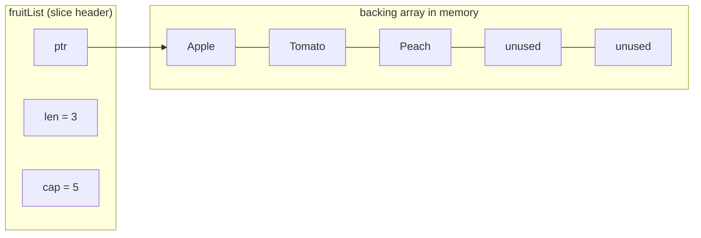

---
tags:
  - golang
  - memory
section: "03 Memory and Data Types"
video:
  - https://www.youtube.com/watch?v=k7hVj8QL9Co
  - https://www.youtube.com/watch?v=931nR5TGCAk
video_title: "Slices in golang / How to remove a value from slice based on index in golang"
order: 14
---
# Slices

> [!info] Source
> 🎬 [Slices in golang](https://www.youtube.com/watch?v=k7hVj8QL9Co) and 🎬 [How to remove a value from slice based on index in golang](https://www.youtube.com/watch?v=931nR5TGCAk) · Section **03 Memory and Data Types** of [[Golang Notes]]
> ⬅️ [[Arrays]] · ➡️ [[Maps]]

## Overview

Slices are the most-used data type in Go. A slice is an **array with a layer of abstraction on top**: it still stores its elements in an underlying array, but it can grow, it can be cut into pieces, and it works with the `sort` and `slices` packages. The instructor points out that getting comfortable with slices is what makes database work in Go feel easy, and the second video covers the one slice operation you will need in every to-do app and every API: **removing an element by index**. This note merges both videos and bookmarks that operation, because it comes straight back in [[Update Course Controller]] and [[Delete Course Controller]].

## What a slice actually is

A slice value is a small **header** with three fields: a pointer to a backing array, a **length** (`len`, how many elements you can see) and a **capacity** (`cap`, how many elements the backing array has room for from the slice's start). This is why slices are cheap to pass around and why two slices can share the same memory.



## Declaring a slice

The syntax looks like an array declaration **without the number** inside the square brackets. Leaving the size out is exactly what tells Go "this is a slice, not an array" (compare [[Arrays]]). When you use this literal syntax you initialise the values at the same time:

```go
var fruitList = []string{"Apple", "Tomato", "Peach"}
fmt.Printf("Type of fruitList is %T\n", fruitList)   // Type of fruitList is []string
```

`%T` (see [[fmt Package and Format Verbs]]) confirms the type is `[]string`, a slice of strings, as opposed to `[3]string`.

### Adding elements with `append`

You never write `fruitList[3] = "Mango"` to add to a slice; you use the built-in **`append`**. Its first argument is the slice to add to, followed by any number of values. It returns the *new* slice, which you store back into the same variable:

```go
fruitList = append(fruitList, "Mango", "Banana")
fmt.Println(fruitList)   // [Apple Tomato Peach Mango Banana]
```

> [!warning] Always store the result of `append`
> `append` may have to allocate a bigger backing array and return a slice that points to it. If you write `append(fruitList, "Mango")` without assigning the result, the new element is lost.

## Slicing a slice: the colon syntax

The expression `s[low:high]` gives you a *window* onto the same backing array, from index `low` **up to but not including** `high`. Either side can be omitted: `low` defaults to `0` and `high` to `len(s)`. The instructor spends a lot of time on this on purpose, because the delete-by-index idiom is built from it.

Starting from `[Apple Tomato Peach Mango Banana]`:

| Expression | Meaning | Result |
|---|---|---|
| `fruitList[1:]` | from index 1 to the end | `[Tomato Peach Mango Banana]` |
| `fruitList[1:3]` | index 1 and 2 (3 is excluded) | `[Tomato Peach]` |
| `fruitList[:3]` | index 0, 1, 2 | `[Apple Tomato Peach]` |
| `fruitList[:]` | the whole slice | `[Apple Tomato Peach Mango Banana]` |

The mental model the instructor repeats: "start at `low`, count up, stop *before* `high`, the last number is never included".

## Creating a slice with `make`

[[Memory Management]] introduced `make` as the allocator for slices, maps and channels. `make([]int, 4)` creates a slice of integers with **length 4**, all zeroed, ready to be written to by index:

```go
highScores := make([]int, 4)
highScores[0] = 234
highScores[1] = 945
highScores[2] = 465
highScores[3] = 867
// highScores[4] = 777   // panic: index out of range [4] with length 4
```

Writing to index 4 panics exactly as it would with an array. **But `append` is different**: it notices the backing array is full, allocates a bigger one, copies the values across, and carries on. This is the "quirky" Go behaviour the instructor highlights: the initial allocation is tight and memory-efficient, and reallocation only happens when it has to.

```go
highScores = append(highScores, 555, 666, 321)
fmt.Println(highScores)   // [234 945 465 867 555 666 321]
```

### Watching the capacity grow

You can see the reallocation strategy by printing `len` and `cap` while appending. Go roughly doubles the capacity each time the array fills up (the exact numbers are an implementation detail; the sequence below was observed on Go 1.27), so appends are cheap on average:

```go
package main

import "fmt"

func main() {
	var nums []int // nil slice: len 0, cap 0
	for i := 1; i <= 9; i++ {
		nums = append(nums, i)
		fmt.Printf("len=%d cap=%d %v\n", len(nums), cap(nums), nums)
	}
}
```

**Output:**

```text
len=1 cap=1 [1]
len=2 cap=2 [1 2]
len=3 cap=4 [1 2 3]
len=4 cap=4 [1 2 3 4]
len=5 cap=8 [1 2 3 4 5]
len=6 cap=8 [1 2 3 4 5 6]
len=7 cap=8 [1 2 3 4 5 6 7]
len=8 cap=8 [1 2 3 4 5 6 7 8]
len=9 cap=16 [1 2 3 4 5 6 7 8 9]
```

## Sorting with the `sort` package

Sorting is one of the things arrays do not offer and slices do. The `sort` package has ready-made functions for the common element types plus "is it sorted?" checks:

| Function | What it does |
|---|---|
| `sort.Ints(s)` | sorts a `[]int` in increasing order (in place) |
| `sort.Strings(s)` | sorts a `[]string` |
| `sort.Float64s(s)` | sorts a `[]float64` |
| `sort.IntsAreSorted(s)` | returns `true`/`false` |
| `sort.Slice(s, less)` | sorts anything with a custom comparison function |

```go
fmt.Println(sort.IntsAreSorted(highScores))   // false
sort.Ints(highScores)
fmt.Println(highScores)                       // [234 321 465 555 666 867 945]
fmt.Println(sort.IntsAreSorted(highScores))   // true
```

## Example: the instructor's slices program

The companion code for video 14 (`09myslices/main.go`), with the three slicing expressions shown side by side instead of reassigning the list each time:

```go
package main

import (
	"fmt"
	"sort"
)

func main() {
	fmt.Println("Welcome to video on slices")

	var fruitList = []string{"Apple", "Tomato", "Peach"}
	fmt.Printf("Type of fruitList is %T\n", fruitList)

	fruitList = append(fruitList, "Mango", "Banana")
	fmt.Println(fruitList)

	// slicing: low is inclusive, high is exclusive
	fmt.Println(fruitList[1:])  // drop the first element
	fmt.Println(fruitList[1:3]) // index 1 and 2
	fmt.Println(fruitList[:3])  // index 0, 1 and 2

	highScores := make([]int, 4)
	highScores[0] = 234
	highScores[1] = 945
	highScores[2] = 465
	highScores[3] = 867
	// highScores[4] = 777 // panic: index out of range [4] with length 4

	highScores = append(highScores, 555, 666, 321) // append grows the slice
	fmt.Println(highScores)

	fmt.Println(sort.IntsAreSorted(highScores))
	sort.Ints(highScores)
	fmt.Println(highScores)
	fmt.Println(sort.IntsAreSorted(highScores))
}
```

**Output:**

```text
Welcome to video on slices
Type of fruitList is []string
[Apple Tomato Peach Mango Banana]
[Tomato Peach Mango Banana]
[Tomato Peach]
[Apple Tomato Peach]
[234 945 465 867 555 666 321]
false
[234 321 465 555 666 867 945]
true
```

## Removing a value by index (video 15)

> [!example] Bookmark this one
> The instructor calls this a reference video: removing an element at a known index is the most common slice operation in to-do apps and database-style code, and the course reuses it in [[Update Course Controller]] and [[Delete Course Controller]].

There is no `remove` built in. Instead you glue together the part **before** the index and the part **after** it, using `append` and the colon syntax:

```go
courses = append(courses[:index], courses[index+1:]...)
```

Step by step for `courses = [reactjs javascript swift python ruby]` and `index = 2`:

1. `courses[:index]` is `courses[:2]`: start at the default `0`, stop before `2`, giving `[reactjs javascript]`.
2. `courses[index+1:]` is `courses[3:]`: start at `3`, run to the end, giving `[python ruby]`.
3. `append` takes the first part and adds the elements of the second part onto it. The `...` after the second slice is required: `append` wants individual values, not a slice, and the three dots *spread* the slice into individual arguments. This is the **variadic** syntax explained in [[Functions]].
4. The result, `[reactjs javascript python ruby]`, is stored back into `courses`; `swift` at index 2 is gone.

```go
package main

import "fmt"

func main() {
	var courses = []string{"reactjs", "javascript", "swift", "python", "ruby"}
	fmt.Println(courses)

	var index int = 2
	courses = append(courses[:index], courses[index+1:]...)
	fmt.Println(courses)
}
```

**Output:**

```text
[reactjs javascript swift python ruby]
[reactjs javascript python ruby]
```

Without the `...` the compiler refuses the call: `cannot use courses[index + 1:] (value of type []string) as string value in argument to append`.

## Gotchas and Best Practices

> [!warning] Sub-slices share the backing array
> Slicing does not copy. A slice taken from another slice sees, and can overwrite, the same elements, and an `append` that fits inside the shared capacity overwrites the original too:
> ```go
> nums := []int{1, 2, 3, 4, 5}
> firstThree := nums[:3]        // len 3, cap 5, same memory
> firstThree[0] = 100           // nums is now [100 2 3 4 5]
> firstThree = append(firstThree, 999) // fits in cap: nums becomes [100 2 3 999 5]
> ```
> If you need an independent copy, use `copy(dst, src)` or `slices.Clone`.

> [!warning] The delete idiom modifies the original slice
> `append(courses[:i], courses[i+1:]...)` shifts the tail left *in place*. Any other slice that pointed at the same backing array now sees the shifted data. Fine in simple code, surprising in shared code.

> [!tip] A nil slice is usable
> `var s []int` is `nil`, has `len` 0 and `cap` 0, and `append` works on it directly. You do not need `make` unless you want a specific starting length or capacity (`make([]int, 0, 100)` pre-allocates room for 100 elements with zero length).

> [!note] One-argument `append` does nothing
> The companion code contains `fruitList = append(fruitList[:3])`. Appending nothing simply returns the slice, so this is just a long way of writing `fruitList = fruitList[:3]`.

## Modern Go Notes

- Since Go 1.21 the standard library has a generic **`slices`** package: `slices.Sort(s)` (which `sort.Ints` now calls internally), `slices.Contains(s, v)`, `slices.Index(s, v)` and **`slices.Delete(s, i, j)`**, which removes `s[i:j]` and is the official spelling of the delete-by-index idiom: `courses = slices.Delete(courses, index, index+1)`.
- The built-in `clear(s)` (Go 1.21) zeroes every element of a slice.
- Naming your module `slices` (as the companion `go.mod` does) now collides with the standard library package and fails with `ambiguous import: found package slices in multiple modules`. Pick a different module name, for example `myslices`. See [[Go Modules]].

## Video Timeline

| Time | What happens |
|---|---|
| [01:36](https://youtu.be/k7hVj8QL9Co?t=96) | Slice syntax vs array syntax: no size in the brackets |
| [04:10](https://youtu.be/k7hVj8QL9Co?t=250) | Adding values with `append` |
| [05:21](https://youtu.be/k7hVj8QL9Co?t=321) | The colon syntax: `[1:]`, `[1:3]`, `[:3]`, the end is exclusive |
| [09:34](https://youtu.be/k7hVj8QL9Co?t=574) | `make([]int, 4)`, index-out-of-range, and how `append` reallocates |
| [13:05](https://youtu.be/k7hVj8QL9Co?t=785) | The `sort` package: `sort.Ints` and `sort.IntsAreSorted` |
| [02:07](https://youtu.be/931nR5TGCAk?t=127) | Video 15: the `courses` slice and the index to remove |
| [03:06](https://youtu.be/931nR5TGCAk?t=186) | `append(courses[:index], courses[index+1:]...)` explained piece by piece |

## Related Notes

- [[Arrays]] — the fixed-size structure a slice is built on.
- [[Memory Management]] — `make` and what reallocation means for the backing array.
- [[Functions]] — variadic parameters and the `...` spread syntax used in the delete idiom.
- [[Maps]] — the other `make`-created collection, next in the course.
- [[Loops, Break, Continue and Goto]] — `for range` over a slice.
- [[Update Course Controller]] and [[Delete Course Controller]] — the delete-by-index idiom in a real API.
- [[Go Modules]] — why a module named `slices` breaks the build today.
- [[fmt Package and Format Verbs]] — `%T` and `%v` for inspecting slices.
- [[Go Quick Reference]] — slice syntax at a glance.
