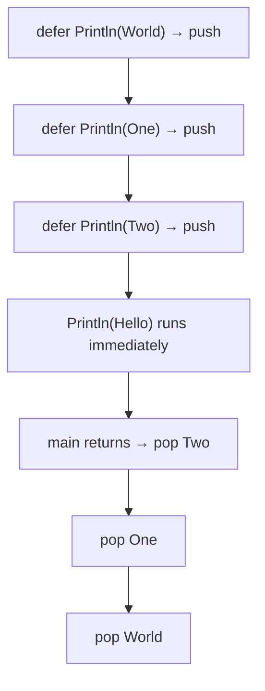

---
tags:
  - golang
  - flow-control
section: "04 Flow Control"
video: https://www.youtube.com/watch?v=jiy584-vv38
video_title: "Defer in golang"
order: 23
---
# Defer

> [!info] Source
> 🎬 [Defer in golang](https://www.youtube.com/watch?v=jiy584-vv38) · Section **04 Flow Control** of [[Golang Notes]]
> ⬅️ [[Methods]] · ➡️ [[Working with Files]]

## Overview

`defer` postpones a function call until the **surrounding function is about to return**. The instructor originally planned to explain it in passing while working with files and databases, then decided it deserves its own video because it "troubles the internet a lot". The rule is actually tiny: a deferred call is pushed onto a list and the list is run in **reverse order** (last in, first out) just before the function exits. Once that clicks, every `defer file.Close()` in [[Working with Files]], every `defer response.Body.Close()` in [[Handling Web Requests]] and every `defer mut.Unlock()` in [[Mutex]] reads naturally.

## What the Specification Says, in Plain Words

The Go specification describes `defer` in two sentences the video picks apart:

1. *"A defer statement invokes a function whose execution is deferred to the moment the surrounding function returns, either because the surrounding function executed a return statement, reached the end of its function body, or because the corresponding goroutine is panicking."*
   A function normally executes line by line. Put `defer` in front of a call and that call is *not* run there; it is run at the very end of the function, as if you had cut the line out and pasted it just above the function's closing `}`.
2. *"Deferred functions are invoked immediately before the surrounding function returns, in the reverse order they were deferred."*
   If several calls are deferred, the **last** one deferred runs **first**. The instructor's words: this would have been clearer if the spec simply said *LIFO, last in first out*. He pictures a drive-through line where the car that arrived last is served first; in computing terms the deferred calls live on a **stack**.

The spec's own example uses `lock` / `defer unlock`, which the instructor skips because locks only make sense once you reach [[Mutex]].

## Step 1: A Single `defer`

```go
fmt.Println("Hello")
defer fmt.Println("World")
```

This prints `Hello` then `World`, which looks like nothing special. Move the deferred line *above* the other one:

```go
defer fmt.Println("World")
fmt.Println("Hello")
```

The output is **still** `Hello` then `World`. Without the `defer` keyword, swapping the lines would print `World` first; with it, the `World` call is cut out and executed at the end of `main` regardless of where it was written.

| Code order | With `defer` | Without `defer` |
|---|---|---|
| `World` line first, `Hello` second | `Hello`, `World` | `World`, `Hello` |

## Step 2: Multiple `defer`s Run Last-In, First-Out

```go
defer fmt.Println("World")
defer fmt.Println("One")
defer fmt.Println("Two")
fmt.Println("Hello")
```

Walk through it as the function runs:

1. `World` is deferred: pushed onto the stack.
2. `One` is deferred: pushed on top of `World`.
3. `Two` is deferred: pushed on top of `One`.
4. `Hello` is not deferred, so it prints immediately.
5. `main` is about to return, so the stack is emptied from the top: `Two`, then `One`, then `World`.



**Output:**

```text
Hello
Two
One
World
```

## Step 3: `defer` Inside a Loop

To make it more interesting the instructor adds a second function with a deferred call inside a `for` loop (see [[Loops, Break, Continue and Goto]]):

```go
func myDefer() {
	for i := 0; i < 5; i++ {
		defer fmt.Print(i)
	}
}
```

Each iteration defers *another* `fmt.Print`, so by the time the loop ends there are five deferred calls stacked up: `0` at the bottom, `4` on top. They run when **`myDefer` returns**, not when `main` returns, because `myDefer` is their surrounding function. The result is `43210`.

Combining both functions, `main` defers `World`, `One`, `Two`, prints `Hello`, calls `myDefer()` (which prints `43210` as it returns), and finally drains its own stack:

| Moment | Printed so far |
|---|---|
| `main` prints `Hello` | `Hello` |
| `myDefer` returns, its stack empties | `Hello` `43210` |
| `main` returns, its stack empties | `Hello` `43210` `Two` `One` `World` |

Because `fmt.Print` adds no newline, `43210` and `Two` land on the same line in the real output shown below.

## Arguments Are Evaluated Immediately

Why does the loop print `43210` and not `55555`? Because the **arguments** of a deferred call are evaluated at the moment the `defer` statement runs; only the *call itself* is postponed. Each `defer fmt.Print(i)` captured the value `i` had at that instant. A closure, on the other hand, reads the variable when it finally runs:

```go
package main

import "fmt"

func main() {
	count := 1
	defer fmt.Println("deferred sees count =", count) // argument captured NOW (1)
	count = 99
	fmt.Println("function sees count =", count)

	defer func() {
		fmt.Println("closure sees count =", count) // closure reads the variable LATER (99)
	}()
}
```

**Output:**

```text
function sees count = 99
closure sees count = 99
deferred sees count = 1
```

The closure was deferred last, so it runs first (LIFO), and it sees `99`; the plain call captured `1` when it was deferred.

## Where `defer` Is Used in Real Code

The video shows the mechanics; the rest of the series shows the purpose. `defer` pairs a resource's **acquire** with its **release** on adjacent lines, so the cleanup cannot be forgotten no matter how the function exits:

| Pattern | Where it appears |
|---|---|
| `file, err := os.Create(...)` then `defer file.Close()` | [[Working with Files]] |
| `response, err := http.Get(url)` then `defer response.Body.Close()` | [[Handling Web Requests]], [[Making GET Requests]] |
| `mut.Lock()` then `defer mut.Unlock()` | [[Mutex]] |
| `wg.Add(1)` in the caller, `defer wg.Done()` in the goroutine | [[WaitGroups]], [[Concurrency and Goroutines]] |
| `cur, err := collection.Find(...)` then `defer cur.Close(ctx)` | [[Get All Documents from MongoDB]] |
| `defer func() { if r := recover(); r != nil { ... } }()` | recovering from a `panic`, see [[Error Handling in Go]] |

Deferred calls still run when the function exits through a `panic`, which is what makes the `recover` pattern possible:

```go
package main

import "fmt"

func risky() {
	defer fmt.Println("cleanup still runs")
	defer func() {
		if r := recover(); r != nil {
			fmt.Println("recovered from:", r)
		}
	}()
	panic("something went wrong")
}

func main() {
	risky()
	fmt.Println("main continues after risky()")
}
```

**Output:**

```text
recovered from: something went wrong
cleanup still runs
main continues after risky()
```

## Example: The Complete Program

From the video (companion folder `17defer`):

```go
package main

import "fmt"

func main() {
	defer fmt.Println("World")
	defer fmt.Println("One")
	defer fmt.Println("Two")
	fmt.Println("Hello")
	myDefer()
}

func myDefer() {
	for i := 0; i < 5; i++ {
		defer fmt.Print(i)
	}
}
```

**Output:**

```text
Hello
43210Two
One
World
```

## Gotchas and Best Practices

> [!warning] `defer` in a loop accumulates until the *function* returns
> Deferring `file.Close()` inside a loop that opens 10,000 files keeps all of them open until the function ends. Move the loop body into its own function so each iteration's defer runs promptly.

> [!warning] `os.Exit` skips deferred calls
> `go doc os.Exit`: "The program terminates immediately; deferred functions are not run." The same is true for `log.Fatal`, which calls `os.Exit(1)` (used throughout [[Connecting to MongoDB]]).

> [!note] Arguments now, call later
> `defer fmt.Println(x)` freezes `x`; `defer func() { fmt.Println(x) }()` reads it at exit. Pick deliberately.

> [!tip] Put the `defer` right after the successful acquire
> `f, err := os.Open(name); if err != nil { return err }; defer f.Close()`. Deferring before the error check would call `Close` on a `nil` file.

> [!note] Deferred closures can change named results
> With `func f() (err error)`, a deferred closure may assign to `err` after the `return` statement ran. Useful for wrapping errors, surprising if accidental.

> [!tip] Readability over cleverness
> The instructor's advice: stop reading blog posts about `defer` and write small experiments. The behaviour is simple; only the explanations are complicated.

## Video Timeline

| Time | What happens |
|---|---|
| [00:42](https://youtu.be/jiy584-vv38?t=42) | Reading the two sentences of the specification |
| [02:24](https://youtu.be/jiy584-vv38?t=144) | First `defer fmt.Println("World")` |
| [03:12](https://youtu.be/jiy584-vv38?t=192) | Moving the deferred line to the top: output unchanged |
| [04:18](https://youtu.be/jiy584-vv38?t=258) | Three deferred calls and the last-in-first-out line |
| [06:08](https://youtu.be/jiy584-vv38?t=368) | `myDefer` with `defer` inside a `for` loop |
| [07:29](https://youtu.be/jiy584-vv38?t=449) | Predicting the full output before running it |

![[23_defer_stack_trace_0822.png]]
*Figure: The instructor marking the deferred calls as a last-in, first-out line next to the code (video at 08:22)*

## Related Notes

- [[Functions]] — `defer` always belongs to a surrounding function.
- [[Loops, Break, Continue and Goto]] — the `for` loop that stacks five deferred prints.
- [[Working with Files]] — `defer file.Close()`, the first real use in the series.
- [[Handling Web Requests]] — `defer response.Body.Close()`.
- [[Mutex]] — `defer mut.Unlock()` and the spec's lock example.
- [[WaitGroups]] — `defer wg.Done()` inside goroutines.
- [[Get All Documents from MongoDB]] — `defer cur.Close(context.Background())`.
- [[Error Handling in Go]] — `panic` and `recover` rely on deferred functions.
- [[Go Quick Reference]] — one-page syntax summary.
