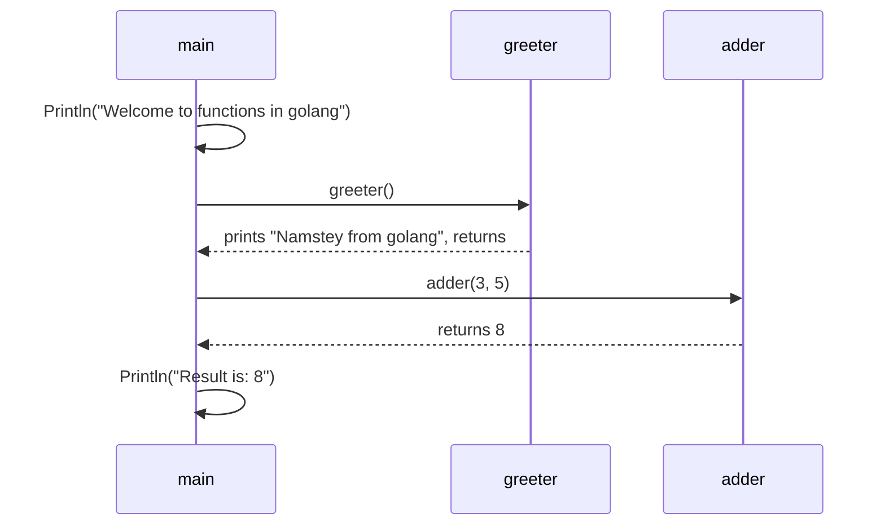

---
tags:
  - golang
  - flow-control
section: "04 Flow Control"
video: https://www.youtube.com/watch?v=rcUST3QvVOQ
video_title: "Functions in golang"
order: 21
---
# Functions

> [!info] Source
> 🎬 [Functions in golang](https://www.youtube.com/watch?v=rcUST3QvVOQ) · Section **04 Flow Control** of [[Golang Notes]]
> ⬅️ [[Loops, Break, Continue and Goto]] · ➡️ [[Methods]]

## Overview

A **function** packages a piece of logic under a name so it can be called again and again, from the same file or from another one. We have used one since the very first program in [[Installation and Hello World]]: `func main()`. This note covers what the instructor calls "enough to get started": how a function is declared, why `main` runs without being called, how parameters and return types form a **signature**, how a function returns *several* values, and how **variadic** functions accept any number of arguments. [[Methods]] then attaches functions to [[Structs]].

## Anatomy of a Function

```go
func adder(valOne int, valTwo int) int {
	return valOne + valTwo
}
```

| Part | In the example | Meaning |
|---|---|---|
| `func` keyword | `func` | starts every function declaration |
| name | `adder` | how you call it; capitalised names are exported from the package |
| parameters | `(valOne int, valTwo int)` | each parameter needs a type; `valOne, valTwo int` is the short form |
| return type | `int` | type of the value handed back; omitted when nothing is returned |
| body | `{ return ... }` | the code; `return` sends a value back to the caller |

The parameters and the return type together are the function's **signature**: what it expects to receive and what it promises to give back. Go is strict about both, so a caller can never pass the wrong kind of value or ignore that a value comes back.



### `main` is the entry point

`main` is never called anywhere in your code, yet it runs as soon as you type `go run main.go`. That is the proof that `main` (inside `package main`) is the **entry point**: of the thousands of functions a program may contain, the Go tool knows to start execution here. Every other function only runs when something calls it.

### Declaring is not calling

```go
func greeter() {
	fmt.Println("Namstey from golang")
}
```

Declaring `greeter` does nothing by itself. Writing `greeter()` *with parentheses* inside `main` executes it: control jumps to the function body, runs it, and comes back to the line after the call. Writing `greeter` *without* parentheses refers to the function as a value (useful for passing it around, see below); standing alone it is rejected with `greeter (value of type func()) is not used`. The order of the declarations in the file does not matter; the order of the **calls** does.

## Functions Cannot Be Declared Inside Functions

The instructor tries to declare a second named function inside `main` and gets a wall of errors (`syntax error: unexpected name greeterTwo, expected (`). Go only allows **named** function declarations at the package level, so the fix is to move the definition outside `main`, above or below it.

What *is* allowed inside a function is an **anonymous function** (a function literal). It can be stored in a variable or executed immediately (an IIFE, immediately invoked function expression). The video postpones these, but a taste:

```go
square := func(n int) int { return n * n }   // stored, called later as square(7)

func(msg string) {                            // declared and invoked at once
	fmt.Println("IIFE says:", msg)
}("hello")
```

Anonymous functions become essential in [[Concurrency and Goroutines]] (`go func() { ... }()`) and in [[Defer]].

## Parameters and Return Types

The `adder` function receives two integers and sends back their sum. The instructor first writes `return valOne + valTwo` without a return type and gets a red squiggle: if a function returns something, the **type** of that something must be declared after the parameter list. Only the type is written, not a name (named results are possible but optional).

```go
result := adder(3, 5)
fmt.Println("Result is: ", result)   // Result is:  8
```

Rather than printing inside the function (as `greeter` does), `adder` *returns* the value so the caller can store it, print it later or keep calculating with it. That split between functions that **do** something and functions that **compute** something is a habit worth building.

## Multiple Return Values

A Go function can return more than one value; the return types are then wrapped in parentheses. This is the mechanism behind the `value, err` pairs from [[User Input and Comma Ok Syntax]] and the `index, value` pair of `range` loops.

```go
func proAdder(values ...int) (int, string) {
	total := 0
	for _, val := range values {
		total += val
	}
	return total, "Hi Pro result function"
}
```

Calling it with only one variable on the left is a compile error (the same error you see when forgetting the second value in a comma-ok assignment). Either receive both or discard what you do not need with the blank identifier:

```go
proRes, myMessage := proAdder(2, 5, 8, 7, 3)   // keep both
proRes, _ = proAdder(2, 5, 8, 7, 3)            // or ignore the string (plain `=`: proRes already exists)
```

## Variadic Functions

`values ...int` means "any number of `int` arguments". The three dots make `proAdder` **variadic**: call it with two numbers or twenty. Inside the function `values` is simply a [[Slices|slice]] (`[]int`), which is why it can be looped with `range` and summed.

```go
proAdder(2, 5, 8, 7)        // values is []int{2, 5, 8, 7}  → 22
proAdder(2, 5, 8, 7, 3)     // values is []int{2, 5, 8, 7, 3} → 25

nums := []int{2, 5, 8, 7, 3}
proAdder(nums...)           // spread an existing slice into the parameters
```

The `nums...` spread syntax is the same one used with `append(courses[:index], courses[index+1:]...)` in [[Slices]]; `append` is itself a variadic function. The variadic parameter must be the **last** one in the list, otherwise the compiler complains `can only use ... with final parameter`.

## Example: Greeter, Adder and Pro Adder

The complete program from the video (companion folder `15functions`):

```go
package main

import "fmt"

func main() {
	fmt.Println("Welcome to functions in golang")
	greeter()

	result := adder(3, 5)
	fmt.Println("Result is: ", result)

	proRes, myMessage := proAdder(2, 5, 8, 7, 3)
	fmt.Println("Pro result is: ", proRes)
	fmt.Println("Pro Message is: ", myMessage)
}

func adder(valOne int, valTwo int) int {
	return valOne + valTwo
}

func proAdder(values ...int) (int, string) {
	total := 0

	for _, val := range values {
		total += val
	}

	return total, "Hi Pro result function"
}

func greeter() {
	fmt.Println("Namstey from golang")
}
```

**Output:**

```text
Welcome to functions in golang
Namstey from golang
Result is:  8
Pro result is:  25
Pro Message is:  Hi Pro result function
```

## Beyond the Video: Anonymous Functions, Named Results and Generics

Three things the instructor mentions only in passing, in one runnable program:

```go
package main

import "fmt"

// Sum works for any type in the constraint (Go 1.18+ generics).
func Sum[T int | float64](values ...T) T {
	var total T
	for _, v := range values {
		total += v
	}
	return total
}

// divide uses named results and a comma-error return.
func divide(a, b float64) (result float64, err error) {
	if b == 0 {
		return 0, fmt.Errorf("cannot divide %v by zero", a)
	}
	return a / b, nil
}

func main() {
	// anonymous function stored in a variable
	square := func(n int) int { return n * n }
	fmt.Println("square(7) =", square(7))

	// immediately invoked function expression (IIFE)
	func(msg string) {
		fmt.Println("IIFE says:", msg)
	}("hello")

	// spreading a slice into a variadic function
	nums := []int{2, 5, 8, 7, 3}
	fmt.Println("Sum of slice:", Sum(nums...))
	fmt.Println("Sum of floats:", Sum(1.5, 2.5))

	if res, err := divide(10, 4); err != nil {
		fmt.Println("error:", err)
	} else {
		fmt.Println("10 / 4 =", res)
	}
	if _, err := divide(1, 0); err != nil {
		fmt.Println("error:", err)
	}
}
```

**Output:**

```text
square(7) = 49
IIFE says: hello
Sum of slice: 25
Sum of floats: 4
10 / 4 = 2.5
error: cannot divide 1 by zero
```

- **Named results** (`(result float64, err error)`) document what comes back and are handy with [[Defer]].
- Returning `(value, error)` is *the* Go convention; see [[Error Handling in Go]].
- **Generics** (`[T int | float64]`) let one function serve several types; the series predates them, so treat this as extra.

## Gotchas and Best Practices

> [!warning] Every return type must be declared
> `return x` in a function declared as `func f()` is a compile error. Declare `func f() int`.

> [!warning] Unused values are errors
> Calling `proAdder(...)` without using its results is allowed, but assigning a result to a variable you never use is not (`declared and not used`). Use `_` for values you intentionally discard.

> [!note] Arguments are passed by value
> Numbers, strings and [[Structs]] are **copied** into the parameters; changes inside the function do not affect the caller's variable. To modify the original, pass a [[Pointers|pointer]]. Slices and [[Maps]] behave differently because they already contain references to shared data.

> [!tip] Small, single-purpose functions
> Keep `main` short and move work into named functions. The API section ([[Building an API - Models]]) splits a whole server into small handler functions for exactly this reason.

> [!tip] Capitalise to export
> `Adder` would be visible to other packages, `adder` is private to its package. The rule is the same as for struct fields in [[Structs]] and matters once you split code into packages in [[Go Modules]].

## Video Timeline

| Time | What happens |
|---|---|
| [00:46](https://youtu.be/rcUST3QvVOQ?t=46) | The `func` keyword, name, parentheses and braces |
| [01:41](https://youtu.be/rcUST3QvVOQ?t=101) | Why `main` runs without being called: the entry point |
| [02:20](https://youtu.be/rcUST3QvVOQ?t=140) | Declaring `greeter` and calling it with `()` |
| [03:51](https://youtu.be/rcUST3QvVOQ?t=231) | Trying to declare a function inside a function |
| [05:13](https://youtu.be/rcUST3QvVOQ?t=313) | Anonymous functions and IIFEs exist (postponed) |
| [05:55](https://youtu.be/rcUST3QvVOQ?t=355) | `adder` with typed parameters and a return type |
| [08:40](https://youtu.be/rcUST3QvVOQ?t=520) | Variadic `proAdder(values ...int)` |
| [11:39](https://youtu.be/rcUST3QvVOQ?t=699) | Returning two values `(int, string)` and handling them |

## Related Notes

- [[Methods]] — functions with a receiver, attached to a struct.
- [[Defer]] — scheduling a function call for when the surrounding function returns.
- [[Slices]] — a variadic parameter is a slice; `append` uses the same `...` syntax.
- [[Loops, Break, Continue and Goto]] — the `for ... range` loop used to sum the values.
- [[User Input and Comma Ok Syntax]] — multiple return values in practice.
- [[Error Handling in Go]] — the `(value, error)` return convention.
- [[Structs]] — the same export rule applies to fields and methods.
- [[Concurrency and Goroutines]] — anonymous functions launched with `go`.
- [[Go Quick Reference]] — one-page syntax summary.
