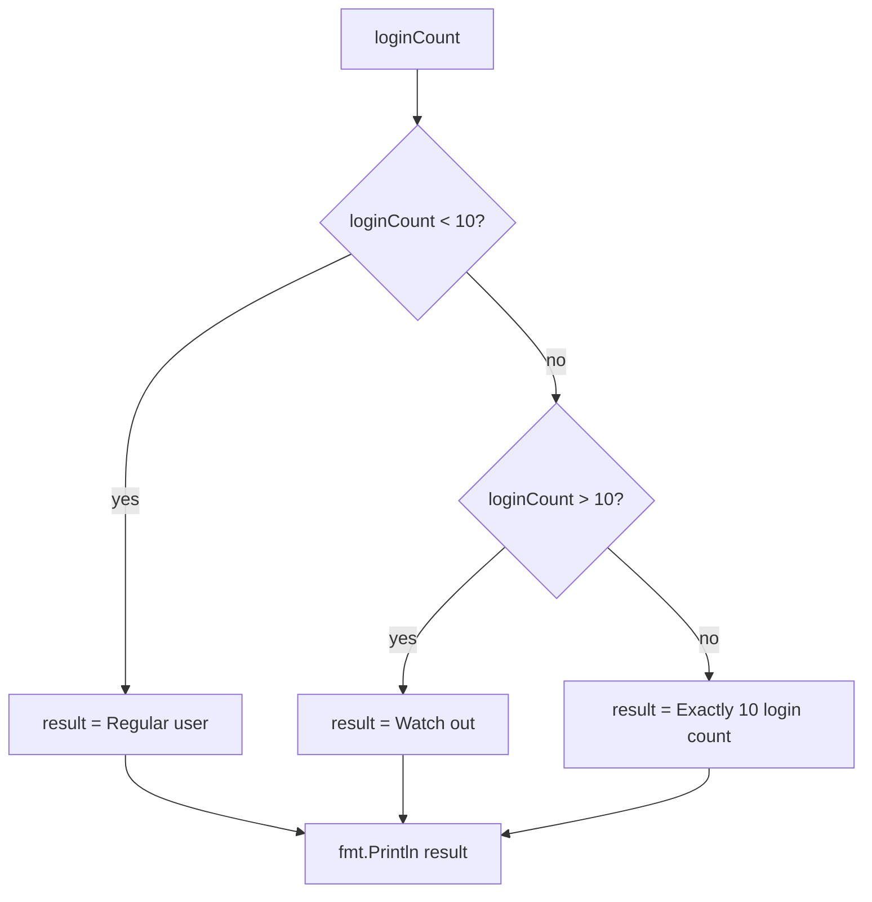

---
tags:
  - golang
  - flow-control
section: "04 Flow Control"
video: https://www.youtube.com/watch?v=f_xNeRurjZY
video_title: "If else in golang"
order: 18
---
# If Else

> [!info] Source
> 🎬 [If else in golang](https://www.youtube.com/watch?v=f_xNeRurjZY) · Section **04 Flow Control** of [[Golang Notes]]
> ⬅️ [[Structs]] · ➡️ [[Switch Case]]

## Overview

Everything so far ([[Variables, Types and Constants]], [[Slices]], [[Maps]], [[Structs]]) ran top to bottom. **Control flow** statements let a program choose a direction: run this block *or* that one. Go's `if` / `else if` / `else` looks like the version in C, Java or JavaScript, but Go is opinionated about the details. The condition needs no parentheses, the braces are mandatory, the opening brace *must* stay on the same line (a consequence of how the [[Lexer and Types|lexer]] inserts semicolons), the condition must be a real `bool`, and there is a special "init statement" form of `if` that you will meet constantly in web code and in [[Error Handling in Go]].

## Basic `if` / `else if` / `else`

The instructor's scenario: an application such as LearnCodeOnline keeps a **login count** per user, and an internal rule sends the admin a different message depending on that count.

```go
loginCount := 23
var result string

if loginCount < 10 {
	result = "Regular user"
} else if loginCount > 10 {
	result = "Watch out"
} else {
	result = "Exactly 10 login count"
}

fmt.Println(result)
```

- The **condition** (`loginCount < 10`) is evaluated first. If it is `true` the first block runs and the rest of the chain is skipped.
- `else if` adds another condition that is only checked when the previous ones were `false`.
- `else` is the catch-all; because there is only one case left (exactly 10), the instructor uses `else` instead of writing `loginCount == 10` explicitly.

| `loginCount` | Printed message |
|---|---|
| 5 | `Regular user` |
| 23 | `Watch out` |
| 10 | `Exactly 10 login count` |



## Rules the Compiler Enforces

### No parentheses around the condition

`if (loginCount < 10) {` compiles, but `gofmt` strips the parentheses and idiomatic Go never writes them. The braces do the grouping instead.

### The opening brace must be on the same line

The instructor stresses this one: you are *not allowed* to move the `{` to the next line, and it is not a style choice you can argue with. The [[Lexer and Types|lexer]] automatically inserts a semicolon at the end of any line that ends with an identifier, literal, `)` or similar. So this code

```go
if loginCount < 10
{                       // ✗ the line above already ended with an inserted ";"
	result = "Regular user"
}
```

is seen by the compiler as `if loginCount < 10;` and fails with:

```text
syntax error: unexpected newline, expected { after if clause
```

The same rule applies to `else`: it must sit on the same line as the closing `}` of the previous block. Putting `else` on its own line gives `syntax error: unexpected keyword else, expected }`. In short, the only legal layout is `} else if ... {` and `} else {`.

### The condition must be a boolean

Go has no "truthy" or "falsy" values. Writing `if loginCount {` with an `int` is rejected with `non-boolean condition in if statement`. You always compare explicitly using one of the comparison operators, and combine conditions with `&&` (and), `||` (or) and `!` (not).

| Operator | Meaning |
|---|---|
| `==` `!=` | equal, not equal |
| `<` `<=` | less than, less than or equal |
| `>` `>=` | greater than, greater than or equal |
| `&&` `\|\|` `!` | logical and, or, not |

## Computing the Condition on the Fly

You do not have to prepare a variable first; the condition can be any expression that produces a `bool`. The even/odd check uses the **modulus** operator `%`, which gives the remainder of a division:

```go
if 9%2 == 0 {
	fmt.Println("Number is even")
} else {
	fmt.Println("Number is odd")
}
```

`9 % 2` is `1`, so the program prints `Number is odd`.

## The `if` with an Init Statement

This is the form the instructor calls "super important" because it shows up everywhere once you start [[Handling Web Requests]]. Before the condition you may write a short **initialisation statement**, separated by a semicolon:

```go
if num := 3; num < 10 {
	fmt.Println("Num is less than 10")
} else {
	fmt.Println("Num is NOT less than 10")
}
```

Two things happen on that one line: `num` is declared and assigned (`:=`), and then it is immediately tested. The variable is **scoped to the whole if/else chain** and does not exist afterwards; using `num` after the closing brace fails with `undefined: num`. That is exactly the point: a value that comes in from a request, a parse or a lookup is checked right where it is produced and does not leak into the rest of the function.

The most common use is with the comma-ok / comma-error pattern from [[User Input and Comma Ok Syntax]] and [[Type Conversions]]:

```go
package main

import (
	"fmt"
	"strconv"
)

func main() {
	if n, err := strconv.Atoi("42"); err != nil {
		fmt.Println("could not parse:", err)
	} else {
		fmt.Println("parsed number:", n)
	}

	if _, err := strconv.Atoi("forty-two"); err != nil {
		fmt.Println("could not parse:", err)
	}
}
```

**Output:**

```text
parsed number: 42
could not parse: strconv.Atoi: parsing "forty-two": invalid syntax
```

`err != nil` reads as "there *is* an error". When a function reports nothing went wrong it returns the zero value `nil` for the error, so the condition is `false` and the happy path continues. See [[Error Handling in Go]] for the full pattern.

## Example: Login Count Checker

The complete program from the video (companion folder `12ifelse`):

```go
package main

import "fmt"

func main() {
	fmt.Println("If else in golang")

	loginCount := 10
	var result string

	if loginCount < 10 {
		result = "Regular user"
	} else if loginCount > 10 {
		result = "Watch out"
	} else {
		result = "Exactly 10 login count"
	}

	fmt.Println(result)

	if 9%2 == 0 {
		fmt.Println("Number is even")
	} else {
		fmt.Println("Number is odd")
	}

	if num := 3; num < 10 {
		fmt.Println("Num is less than 10")
	} else {
		fmt.Println("Num is NOT less than 10")
	}
}
```

**Output:**

```text
If else in golang
Exactly 10 login count
Number is odd
Num is less than 10
```

Change `loginCount` to `23` and the second line becomes `Watch out`; change it to `5` and you get `Regular user`.

## Gotchas and Best Practices

> [!warning] Brace placement is not negotiable
> `{` on the same line as `if`/`else`, and `else` on the same line as the previous `}`. Let `gofmt` (the VS Code Go extension runs it on save) fix the layout for you.

> [!warning] No implicit truthiness
> `if count {` is a compile error. Write `if count != 0 {`, `if name != "" {`, `if ptr != nil {`.

> [!tip] Keep the happy path on the left
> Idiomatic Go checks the error case first and returns early, so the main logic is not nested inside `else` blocks:
> ```go
> if err != nil {
> 	return err
> }
> // happy path continues here, un-indented
> ```

> [!note] There is no ternary operator
> Go deliberately has no `cond ? a : b`. Write a small `if`/`else`, or a helper function.

> [!tip] Use the init statement to limit scope
> `if v, ok := languages["JS"]; ok { ... }` keeps `v` and `ok` out of the surrounding function. The same trick works with [[Maps]] lookups, type assertions and every function that returns `(value, error)`.

## Video Timeline

| Time | What happens |
|---|---|
| [01:16](https://youtu.be/f_xNeRurjZY?t=76) | The login-count scenario and the first `if` |
| [02:51](https://youtu.be/f_xNeRurjZY?t=171) | Why the curly brace cannot move to the next line |
| [03:41](https://youtu.be/f_xNeRurjZY?t=221) | Adding `else if` and `else`, running the three cases |
| [05:19](https://youtu.be/f_xNeRurjZY?t=319) | Computing a condition on the fly: even or odd with `%` |
| [06:32](https://youtu.be/f_xNeRurjZY?t=392) | The `if num := 3; num < 10` init-statement syntax |
| [07:45](https://youtu.be/f_xNeRurjZY?t=465) | How this connects to `err != nil` and the comma-ok syntax |

## Related Notes

- [[Switch Case]] — the next flow-control tool, better than a long `else if` ladder.
- [[Loops, Break, Continue and Goto]] — `if` inside loops drives `break` and `continue`.
- [[Lexer and Types]] — the automatic semicolon insertion behind the brace rule.
- [[User Input and Comma Ok Syntax]] — where the `value, err :=` pair being tested here comes from.
- [[Error Handling in Go]] — the `if err != nil` idiom in depth.
- [[Variables, Types and Constants]] — `:=` short declaration used in the init statement.
- [[Maps]] — the comma-ok lookup `v, ok := m[key]` is usually wrapped in an `if`.
- [[Handling Web Requests]] — the init-statement form is used on almost every request.
- [[Go Quick Reference]] — one-page syntax summary.
