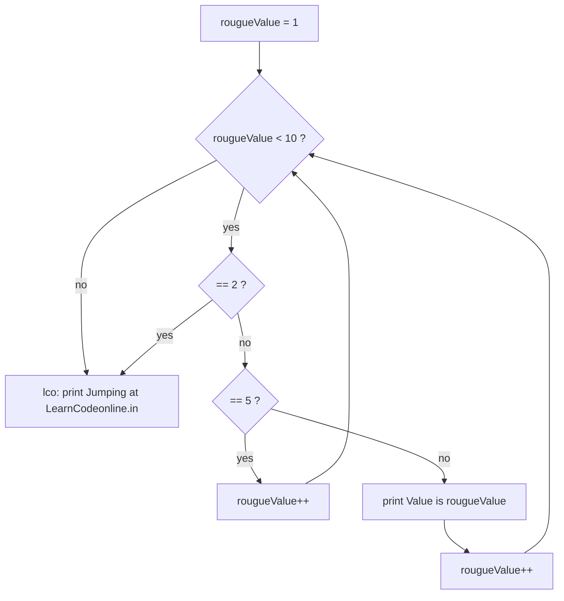

---
tags:
  - golang
  - flow-control
section: "04 Flow Control"
video: https://www.youtube.com/watch?v=ZWBA3l818y0
video_title: "Loop break continue and goto in golang"
order: 20
---
# Loops, Break, Continue and Goto

> [!info] Source
> 🎬 [Loop break continue and goto in golang](https://www.youtube.com/watch?v=ZWBA3l818y0) · Section **04 Flow Control** of [[Golang Notes]]
> ⬅️ [[Switch Case]] · ➡️ [[Functions]]

## Overview

Go has exactly **one loop keyword: `for`**. There is no `while`, no `do … while`, no `foreach`; every kind of loop is a variation of `for`. This video covers all of them in one go: the classic three-part loop, `range` over a slice, the condition-only loop that behaves like `while`, and the three jump statements `break`, `continue` and `goto`. The running example is a slice of weekdays (see [[Slices]]) followed by a counter the instructor calls `rougueValue`, and the companion code is `14loops/main.go`.

## Setting up: a slice of days

Loops need something to loop over, and the instructor picks a slice because "that's what everybody loves in Go": unlike an [[Arrays|array]], a slice does not have empty trailing slots, so looping until `len(days)` visits exactly the values you put in.

```go
days := []string{"Sunday", "Tuesday", "Wednesday", "Friday", "Saturday"}
fmt.Println(days)
```

```text
[Sunday Tuesday Wednesday Friday Saturday]
```

## Form 1: the classic three-part `for`

```go
for d := 0; d < len(days); d++ {
	fmt.Println(days[d])
}
```

The three clauses are separated by semicolons, one of the few places in Go where you type them yourself (the lexer inserts the rest, see [[Lexer and Types]]):

1. **init** `d := 0` runs once; `d` only exists inside the loop.
2. **condition** `d < len(days)` is checked before every iteration.
3. **post** `d++` runs after every iteration.

Using `len(days)` instead of a hard-coded `5` means the loop keeps working when the slice grows. The instructor's "relief" for people coming from C or JavaScript: Go has **no `++d`**, only `d++`, and it is a statement, not an expression, so `x := d++` is not allowed either. Writing `++d` fails to compile:

```text
./main.go:6:21: syntax error: unexpected ++ in argument list; possibly missing comma or )
```

## Forms 2 and 3: `range`

`range` is the idiomatic way to walk a collection. It returns **two values per iteration**: the index first, then the element.

```go
// index only: i is 0, 1, 2 …
for i := range days {
	fmt.Println(days[i])
}

// index and value
for i, day := range days {
	fmt.Printf("index is %v and value is %v\n", i, day)
}

// value only: throw the index away with the blank identifier
for _, day := range days {
	fmt.Println(day)
}
```

```text
index is 0 and value is Sunday
index is 1 and value is Tuesday
index is 2 and value is Wednesday
index is 3 and value is Friday
index is 4 and value is Saturday
```

The instructor stresses the first point because it trips up JavaScript developers: with one variable, `range` gives you the **index**, not the element. If you want the element, take both values and ignore the index with `_`, the same blank identifier used in the comma-ok pattern (see [[User Input and Comma Ok Syntax]]). The same shape works for every collection:

| Collection | `for a, b := range x` gives | Note |
|---|---|---|
| slice or array | index, element | elements are **copies**; assigning to `b` does not change the slice |
| map | key, value | order is random on purpose, see [[Maps]] |
| string | byte index, rune (character) | multi-byte characters advance the index by more than 1 |
| channel | value only | ends when the channel is closed, see [[Channels and Deadlock]] |
| integer `n` | 0 … n-1 | Go 1.22+, see Modern Go Notes |

## Form 4: the condition-only loop (Go's `while`)

Drop the init and post clauses and `for` becomes a `while` loop:

```go
rougueValue := 1

for rougueValue < 10 {
	fmt.Println("Value is: ", rougueValue)
	rougueValue++
}
```

Forgetting `rougueValue++` makes the condition true forever, and the program prints `Value is:  1` until you press `Ctrl+C`. The instructor hits exactly this a couple of times in the video, which is worth seeing once: an **infinite loop is not a compile error**, Go cannot know you meant to stop.

Dropping the condition as well gives the deliberate infinite loop `for { … }`, used by servers and workers that run until something inside calls `break` or `return` (see [[Concurrency and Goroutines]]).

| Form | Syntax | Equivalent elsewhere |
|---|---|---|
| Classic | `for i := 0; i < n; i++ { }` | `for` in C / JavaScript |
| Condition only | `for cond { }` | `while` |
| Infinite | `for { }` | `while (true)` |
| Range | `for i, v := range x { }` | `for … of` / `foreach` |

## `break` and `continue`

Both need a condition to react to, so the video combines them with [[If Else]]:

```go
package main

import "fmt"

func main() {
	// break: the whole loop stops the moment the value reaches 5
	v := 1
	for v < 10 {
		if v == 5 {
			break
		}
		fmt.Print(v, " ")
		v++
	}
	fmt.Println("<- break at 5")

	// continue: only 5 is skipped; increment BEFORE continue or the loop never ends
	v = 1
	for v < 10 {
		if v == 5 {
			v++
			continue
		}
		fmt.Print(v, " ")
		v++
	}
	fmt.Println("<- continue skipped 5")
}
```

**Output:**

```text
1 2 3 4 <- break at 5
1 2 3 4 6 7 8 9 <- continue skipped 5
```

- **`break`** terminates the loop altogether; nothing after it in the loop runs again.
- **`continue`** abandons the *current* iteration and jumps straight to the next condition check.

> [!warning] The `continue` trap the instructor demonstrates
> Writing `if v == 5 { continue }` without `v++` is a *logical* error: the increment at the bottom of the loop is skipped, `v` stays 5, the condition stays true, and the program loops forever. Because `continue` skips the rest of the body, any update the loop depends on must happen **before** the `continue`.

## `goto` and labels

Go keeps `goto`. A **label** is an identifier followed by a colon, placed before a statement, and `goto label` jumps to it:

```go
	for rougueValue < 10 {
		if rougueValue == 2 {
			goto lco
		}
		// …
	}

lco:
	fmt.Println("Jumping at LearnCodeonline.in")
```

Two rules the video runs into:

- A label that is declared but never jumped to is a compile error, just like an unused variable:
  ```text
  ./main.go:11:1: label lco defined and not used
  ```
- Any identifier works as a label name except keywords such as `if` or `for`; `main` is legal but confusing.

Labels are far more useful with `break` and `continue` in **nested loops**, where a plain `break` only leaves the innermost loop:

```go
package main

import "fmt"

func main() {
	// an infinite loop ends only with break (or return)
	n := 0
	for {
		n++
		if n == 3 {
			break
		}
	}
	fmt.Println("stopped at", n)

	// labels let break and continue act on an OUTER loop
outer:
	for i := 1; i <= 3; i++ {
		for j := 1; j <= 3; j++ {
			if j == 2 {
				continue outer // next i, skipping the rest of the inner loop
			}
			if i == 3 {
				break outer // leaves both loops at once
			}
			fmt.Printf("i=%d j=%d\n", i, j)
		}
	}
	fmt.Println("done")
}
```

**Output:**

```text
stopped at 3
i=1 j=1
i=2 j=1
done
```



## Example: the complete companion program

This is `14loops/main.go` as the video leaves it: the `days` loops commented out, the `rougueValue` loop with `goto`, `continue`, and the label at the end.

```go
package main

import "fmt"

func main() {
	fmt.Println("Welcome to loops in golang")

	rougueValue := 1

	for rougueValue < 10 {

		if rougueValue == 2 {
			goto lco
		}

		if rougueValue == 5 {
			rougueValue++
			continue
		}

		fmt.Println("Value is: ", rougueValue)
		rougueValue++
	}

lco:
	fmt.Println("Jumping at LearnCodeonline.in")
}
```

**Output:**

```text
Welcome to loops in golang
Value is:  1
Jumping at LearnCodeonline.in
```

Only `1` is printed: on the second pass the value is `2`, the `goto` fires, and execution continues at the `lco:` label after the loop. The `== 5` branch never runs in this version because the jump happens first; comment out the `goto` block to see `continue` skip `5`.

## Gotchas and Best Practices

> [!tip] Reach for `range` first
> The three-part loop is right when you need the index arithmetic (every second element, counting down). For "do something with each element", `for _, v := range xs` is shorter and cannot go out of bounds.

> [!warning] `range` hands you copies
> `for _, day := range days { day = "x" }` changes a local copy, not the slice. To modify elements, assign through the index: `days[i] = "x"`. This matters even more with slices of structs (see [[Structs]]).

> [!note] `goto` is legal but rare
> Idiomatic Go code almost never uses `goto`; labelled `break`/`continue`, early `return`, or splitting the loop body into a function (see [[Functions]]) express the same intent more clearly. Knowing it exists is enough.

> [!tip] Infinite loop? `Ctrl+C`
> The terminal shortcut stops a runaway `go run`. Then look for a missing increment or a `continue` placed before the update.

## Modern Go Notes

Everything in the video still compiles unchanged. Go 1.22 added two things that make loops nicer, both verified on Go 1.27 (they switch on only when the `go` line in `go.mod` says `1.22` or later; with an older directive the compiler keeps the old semantics and rejects `range 3` with `requires go1.22 or later`):

- **Range over an integer**: `for i := range 3` yields `0, 1, 2`, replacing the three-part loop for simple counting.
- **Per-iteration loop variables**: each iteration gets a *fresh* `i`. Before 1.22, closures created inside a loop all shared one variable and printed the final value; now each closure keeps its own.
- Go 1.23 went further with **range over functions** (iterators), which is beyond this series.

```go
package main

import "fmt"

func main() {
	// range over an integer (Go 1.22+): 0, 1, 2
	for i := range 3 {
		fmt.Print(i, " ")
	}
	fmt.Println()

	// range over a map: order is deliberately random
	languages := map[string]string{"JS": "JavaScript", "PY": "Python", "GO": "Go"}
	for code, name := range languages {
		fmt.Println(code, "=>", name)
	}

	// range over a string yields the byte index and the rune (character)
	for i, r := range "Go!" {
		fmt.Printf("%d:%c ", i, r)
	}
	fmt.Println()

	// per-iteration loop variables (Go 1.22+): each closure sees its own i
	var funcs []func()
	for i := 0; i < 3; i++ {
		funcs = append(funcs, func() { fmt.Print(i, " ") })
	}
	for _, f := range funcs {
		f()
	}
	fmt.Println()
}
```

**Output** (the map lines can appear in any order):

```text
0 1 2 
JS => JavaScript
PY => Python
GO => Go
0:G 1:o 2:! 
0 1 2 
```

## Video Timeline

| Time | What happens |
|---|---|
| [01:06](https://youtu.be/ZWBA3l818y0?t=66) | Creating the `days` slice to loop over |
| [02:24](https://youtu.be/ZWBA3l818y0?t=144) | `for` is the only loop keyword; the classic three-part loop, `d++` only |
| [04:16](https://youtu.be/ZWBA3l818y0?t=256) | `range` with one variable returns the index, not the value |
| [05:37](https://youtu.be/ZWBA3l818y0?t=337) | `for i, day := range days` and discarding the index with `_` |
| [07:18](https://youtu.be/ZWBA3l818y0?t=438) | The `rougueValue` condition-only loop, the `while` of Go, and the infinite-loop mistake |
| [08:54](https://youtu.be/ZWBA3l818y0?t=534) | `break` versus `continue`, and why `continue` needs the increment first |
| [10:29](https://youtu.be/ZWBA3l818y0?t=629) | `goto`, labels, and the "label declared and not used" error |

## Related Notes

- [[Switch Case]] — the previous video; a labelled `break` is how you leave a loop from inside a `switch`.
- [[Functions]] — the next video; loops inside functions, including the variadic `proAdder` that ranges over its arguments.
- [[If Else]] — the conditions that drive `break`, `continue` and `goto`.
- [[Slices]] — the collection being looped over, and why slices beat arrays for this.
- [[Arrays]] — fixed-size arrays and their empty trailing slots.
- [[Maps]] — ranging over key/value pairs in random order.
- [[User Input and Comma Ok Syntax]] — the blank identifier `_` first seen with comma-ok.
- [[Channels and Deadlock]] — `for v := range ch` receives until the channel is closed.
- [[Concurrency and Goroutines]] — infinite `for {}` loops in long-running workers.
- [[Go Quick Reference]] — all loop forms on one page.
