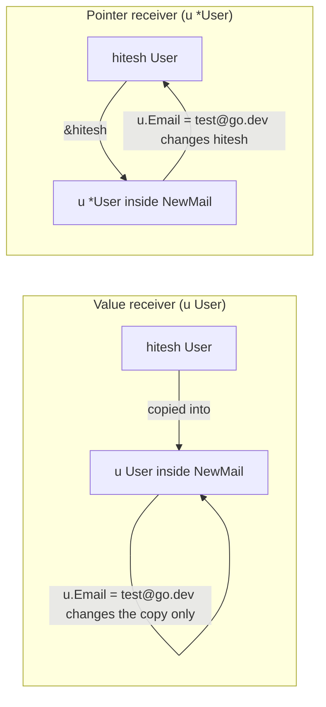

---
tags:
  - golang
  - flow-control
section: "04 Flow Control"
video: https://www.youtube.com/watch?v=GhYIKwMxz_Y
video_title: "Methods in golang"
order: 22
---
# Methods

> [!info] Source
> 🎬 [Methods in golang](https://www.youtube.com/watch?v=GhYIKwMxz_Y) · Section **04 Flow Control** of [[Golang Notes]]
> ⬅️ [[Functions]] · ➡️ [[Defer]]

## Overview

In class-based languages a function that lives inside a class is called a **method**. Go has no classes, but it has [[Structs]], and a function can be attached to a struct type by giving it a **receiver**. That is the whole difference between a [[Functions|function]] and a method: the signature gains one extra parameter, written in its own parentheses *before* the name. The video reuses the `User` struct, adds a `GetStatus` method, and then uses a `NewMail` "setter" to show something important about how Go passes values around: a method with a **value receiver** works on a *copy*, which is exactly why [[Pointers]] exist.

## Functions vs Methods

| | Function | Method |
|---|---|---|
| Declaration | `func GetStatus(u User)` | `func (u User) GetStatus()` |
| Call | `GetStatus(hitesh)` | `hitesh.GetStatus()` |
| Belongs to | the package | the type `User` |
| Access to the data | through a normal parameter | through the receiver `u` |

```go
func (u User) GetStatus() {
	fmt.Println("Is user active: ", u.Status)
}
```

- `(u User)` is the **receiver**: the struct value the method is called on. By convention the name is short (one or two letters of the type name), never `this` or `self`.
- Inside the body `u.Status`, `u.Email` and every other field are available, just like a parameter.
- The method can be declared above or below the struct definition; the position does not matter.

## Exported vs Unexported Names

The same capital-letter rule applies to methods and fields. `GetStatus` (capital G) is **exported**, so other packages can call it; `getStatus` would be private to the package. The instructor adds an extra field `oneAge` to the struct to make the point: with a lowercase first letter the field is not exportable. This becomes important once code is split into packages in [[Go Modules]] and in the MongoDB API ([[Defining Models for MongoDB]]), where the JSON and BSON encoders can only see exported fields.

## Defining and Calling a Method

Instead of asking every time "is this user active?" by reading `hitesh.Status`, we wrap the question in a method and call it with dot syntax:

```go
hitesh := User{"Hitesh", "hitesh@go.dev", true, 16}
hitesh.GetStatus()
```

**Output:**

```text
Is user active:  true
```

The method already prints, so no `fmt.Println` is needed at the call site. In a real program a method like this would usually *return* the value instead of printing it.

## Value Receivers Pass a Copy

The "setter" `NewMail` changes the email and prints it:

```go
func (u User) NewMail() {
	u.Email = "test@go.dev"
	fmt.Println("Email of this user is: ", u.Email)
}
```

Calling it prints the new address, but printing `hitesh.Email` afterwards still shows the *old* one:

```text
Name is Hitesh and email is hitesh@go.dev.
Is user active:  true
Email of this user is:  test@go.dev
Name is Hitesh and email is hitesh@go.dev.
```

Why? When the method runs, Go **copies** `hitesh` into the receiver `u`. The assignment `u.Email = ...` changes the copy, which is thrown away when the method returns. This is the same pass-by-value behaviour as ordinary function parameters (see the pass-by-value callout in [[Functions]]), and it is the reason [[Pointers]] were designed: to change the original you must hand the method the *address* of the struct rather than a copy.



## Pointer Receivers Modify the Original

The instructor promises to show the fix later (it appears when [[Mutex]] and the API controllers pass references around). Here it is now, because it is a one-character change: declare the receiver as `*User`.

```go
package main

import "fmt"

type User struct {
	Name   string
	Email  string
	Status bool
	Age    int
}

// Value receiver: reads a copy, cannot change the caller's User.
func (u User) GetStatus() {
	fmt.Println("Is user active: ", u.Status)
}

// Pointer receiver: works on the original User through its address.
func (u *User) NewMail() {
	u.Email = "test@go.dev"
	fmt.Println("Email of this user is: ", u.Email)
}

func main() {
	hitesh := User{"Hitesh", "hitesh@go.dev", true, 16}
	fmt.Printf("Before: %+v\n", hitesh)

	hitesh.GetStatus()
	hitesh.NewMail() // Go automatically passes &hitesh

	fmt.Printf("After:  %+v\n", hitesh)
}
```

**Output:**

```text
Before: {Name:Hitesh Email:hitesh@go.dev Status:true Age:16}
Is user active:  true
Email of this user is:  test@go.dev
After:  {Name:Hitesh Email:test@go.dev Status:true Age:16}
```

Notice the call site did not change: `hitesh.NewMail()` still works even though the receiver is a pointer, because Go automatically takes the address of an addressable variable (`(&hitesh).NewMail()`). Inside the method, `u.Email` is shorthand for `(*u).Email`; no explicit dereferencing is needed. The API in [[Building an API - Models]] uses exactly this shape: `func (c *Course) IsEmpty() bool`.

## Choosing Between Value and Pointer Receivers

| Use a **value receiver** `(u User)` when | Use a **pointer receiver** `(u *User)` when |
|---|---|
| the method only reads the data | the method must modify the struct |
| the struct is small (a few fields) | the struct is large and copying it is wasteful |
| you want the method to be safe to call on copies | the struct holds something that must not be copied (a `sync.Mutex`, see [[Mutex]]) |

> [!tip] Be consistent
> If *any* method of a type needs a pointer receiver, give **all** of its methods pointer receivers. Mixing the two makes the type harder to reason about.

## Methods on Any Named Type

Receivers are not limited to structs. Any type declared in your package (`type Celsius float64`) can carry methods:

```go
package main

import "fmt"

type Celsius float64

func (c Celsius) ToFahrenheit() float64 {
	return float64(c)*9/5 + 32
}

func main() {
	temp := Celsius(37)
	fmt.Printf("%.1f°C is %.1f°F\n", float64(temp), temp.ToFahrenheit())
}
```

**Output:**

```text
37.0°C is 98.6°F
```

The conversion `float64(c)` is the same explicit conversion covered in [[Type Conversions]]. You cannot, however, attach methods to types you do not own (`int`, `string`, or a type from another package).

## Example: User with GetStatus and NewMail

The complete program from the video (companion folder `16methods`), kept with the value receiver so the copy behaviour is visible:

```go
package main

import "fmt"

func main() {
	fmt.Println("Structs in golang")
	// no inheritance in golang; No super or parent

	hitesh := User{"Hitesh", "hitesh@go.dev", true, 16}
	fmt.Println(hitesh)
	fmt.Printf("hitesh details are: %+v\n", hitesh)
	fmt.Printf("Name is %v and email is %v.\n", hitesh.Name, hitesh.Email)
	hitesh.GetStatus()
	hitesh.NewMail()
	fmt.Printf("Name is %v and email is %v.\n", hitesh.Name, hitesh.Email)
}

type User struct {
	Name   string
	Email  string
	Status bool
	Age    int
}

func (u User) GetStatus() {
	fmt.Println("Is user active: ", u.Status)
}

func (u User) NewMail() {
	u.Email = "test@go.dev"
	fmt.Println("Email of this user is: ", u.Email)
}
```

**Output:**

```text
Structs in golang
{Hitesh hitesh@go.dev true 16}
hitesh details are: {Name:Hitesh Email:hitesh@go.dev Status:true Age:16}
Name is Hitesh and email is hitesh@go.dev.
Is user active:  true
Email of this user is:  test@go.dev
Name is Hitesh and email is hitesh@go.dev.
```

`%+v` prints the field names alongside the values; see [[fmt Package and Format Verbs]].

## Gotchas and Best Practices

> [!warning] A value receiver cannot mutate the caller
> If a "setter" seems to do nothing, check the receiver. `func (u User) Set...` changes a copy; `func (u *User) Set...` changes the original.

> [!note] Go has no inheritance
> There is no `super` or parent class. Types share behaviour through **embedding** (placing one struct inside another) and through **interfaces**, which are satisfied automatically by any type that has the right methods.

> [!tip] Getter naming
> Idiomatic Go drops the `Get` prefix: a getter for `Status` is called `Status()`, and a setter `SetStatus()`. The video's `GetStatus` is fine for learning but you will rarely see that spelling in the standard library.

> [!note] Receiver name
> Use a short, consistent name (`u` for `User`, `c` for `Course`) in every method of the type. `this`/`self` are legal but non-idiomatic.

> [!warning] Methods only on local types
> `func (s string) Shout()` does not compile. Define `type MyString string` first, then attach methods to `MyString`.

## Video Timeline

| Time | What happens |
|---|---|
| [00:55](https://youtu.be/GhYIKwMxz_Y?t=55) | Functions vs methods: Go has structs, not classes |
| [01:57](https://youtu.be/GhYIKwMxz_Y?t=117) | Exported vs unexported fields (`oneAge`) |
| [02:21](https://youtu.be/GhYIKwMxz_Y?t=141) | Writing `func (u User) GetStatus()` |
| [04:26](https://youtu.be/GhYIKwMxz_Y?t=266) | Calling `hitesh.GetStatus()` and running |
| [05:07](https://youtu.be/GhYIKwMxz_Y?t=307) | The `NewMail` setter |
| [06:58](https://youtu.be/GhYIKwMxz_Y?t=418) | Proof that the original email did not change |
| [07:29](https://youtu.be/GhYIKwMxz_Y?t=449) | Why pointers exist: copies versus references |

## Related Notes

- [[Structs]] — the `User` type these methods are attached to.
- [[Functions]] — everything about parameters and return values applies to methods too.
- [[Pointers]] — the `&` and `*` behind pointer receivers.
- [[Memory Management]] — why passing a struct copies it.
- [[Type Conversions]] — `float64(c)` in the `Celsius` example.
- [[Building an API - Models]] — `func (c *Course) IsEmpty() bool`, a pointer receiver in real use.
- [[Mutex]] — a type containing a mutex must use pointer receivers.
- [[fmt Package and Format Verbs]] — `%v` and `%+v` used to print the struct.
- [[Go Quick Reference]] — one-page syntax summary.
