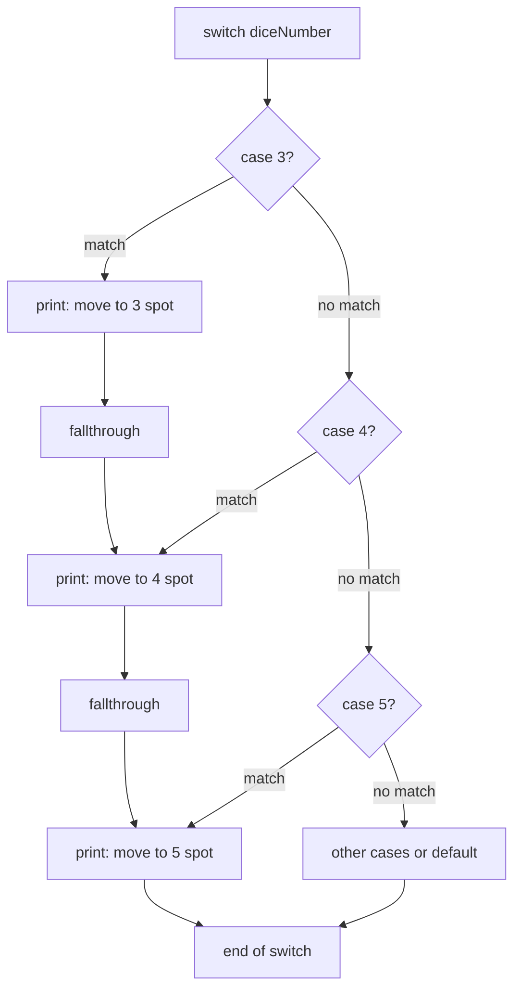

---
tags:
  - golang
  - flow-control
section: "04 Flow Control"
video: https://www.youtube.com/watch?v=Up4lTPhJBvs
video_title: "Switch case in golang and online playground"
order: 19
---
# Switch Case

> [!info] Source
> 🎬 [Switch case in golang and online playground](https://www.youtube.com/watch?v=Up4lTPhJBvs) · Section **04 Flow Control** of [[Golang Notes]]
> ⬅️ [[If Else]] · ➡️ [[Loops, Break, Continue and Goto]]

## Overview

A `switch` compares one value against several **cases** and runs the first one that matches. It replaces a long `if` / `else if` ladder ([[If Else]]) with something flatter and easier to read. Go's version has two differences from C-style languages that matter immediately: there is **no automatic fallthrough** (each case ends by itself), and the `fallthrough` keyword exists for the rare moments when you really do want to continue into the next case. The video builds a small **dice game** (think Ludo) to show all of this, and ends with a surprising lesson about the online Go Playground.

## Setting Up the Dice Game

A dice gives a number from 1 to 6. The rules the instructor wants to express:

| Dice value | Message |
|---|---|
| 1 | you can open (bring a piece onto the board) |
| 2 … 5 | move that many spots |
| 6 | move 6 spots and roll again |

The random number comes from **`math/rand`**, not from `crypto/rand` (see [[Math, Crypto and Random Numbers]] for the difference). The video follows the pre-Go-1.20 convention of seeding the generator first:

```go
rand.Seed(time.Now().UnixNano())   // seed with the current time in nanoseconds
diceNumber := rand.Intn(6) + 1      // Intn(6) gives 0..5, so add 1 to get 1..6
```

`rand.Intn(n)` returns a value in the **half-open range** `[0, n)`; the upper bound is never produced, which is why `+ 1` is needed. `time.Now().UnixNano()` (see [[Handling Time]]) gives a number that changes every nanosecond, so every run gets a different sequence. Running the program three times printed `2`, `5`, `2`, proving the randomness works before any `switch` is written.

## Switch Syntax

```go
switch diceNumber {
case 1:
	fmt.Println("Dice value is 1 and you can open")
case 2:
	fmt.Println("You can move 2 spot")
case 6:
	fmt.Println("You can move to 6 spot and roll dice again")
default:
	fmt.Println("What was that!")
}
```

- `switch diceNumber` names the value being tested (the **tag**). Each `case` is compared to it with `==`.
- Cases can be any comparable values: numbers, strings (`case "hitesh":`), runes, constants or even expressions.
- `default` runs when nothing matched. It is optional and may appear anywhere, though it is conventionally last. The instructor adds it "in case you are not comfortable leaving any other case alone", even though `rand.Intn(6) + 1` can never produce anything outside 1–6.
- One case can list several values: `case 2, 3, 4, 5:`.
- Only the **first** matching case runs; the cases are checked top to bottom.

## No Automatic Fallthrough

In C, Java or JavaScript, forgetting `break` makes execution spill into the next case. Go flips the default: every case **breaks automatically**. If you want the spill-over, you say so explicitly with the `fallthrough` keyword:

```go
case 3:
	fmt.Println("You can move to 3 spot")
	fallthrough
case 4:
	fmt.Println("you can move to 4 spot")
	fallthrough
case 5:
	fmt.Println("You can move to 5 spot")
```

Now rolling a `4` prints the message for 4 *and* for 5, and rolling a `3` prints 3, 4 and 5. `fallthrough` does not re-check the next case's condition; it simply continues into its body.



The instructor hits a compile error while typing this, and it is worth remembering: `fallthrough` must be the **last statement** in its case. Putting a `fmt.Println` after it gives:

```text
fallthrough statement out of place
```

## Other Forms of `switch`

The video only uses the expression switch, but Go has three variations you will meet in real code:

```go
package main

import (
	"fmt"
	"time"
)

func main() {
	score := 72

	// tagless switch: cases are boolean expressions, evaluated top to bottom
	switch {
	case score >= 90:
		fmt.Println("Grade A")
	case score >= 70:
		fmt.Println("Grade B")
	default:
		fmt.Println("Keep practising")
	}

	// switch with an init statement; day is scoped to the switch
	switch day := time.Saturday; day {
	case time.Saturday, time.Sunday:
		fmt.Println(day, "is a weekend")
	default:
		fmt.Println(day, "is a weekday")
	}

	// type switch: branch on the dynamic type of an interface value
	var value any = 3.14
	switch v := value.(type) {
	case int:
		fmt.Println("int:", v)
	case float64:
		fmt.Println("float64:", v)
	case string:
		fmt.Println("string:", v)
	}
}
```

**Output:**

```text
Grade B
Saturday is a weekend
float64: 3.14
```

- A **tagless** `switch {` is a cleaner way to write an `if` / `else if` chain of boolean conditions.
- The **init statement** form (`switch day := ...; day {`) mirrors the `if` init statement from [[If Else]].
- A **type switch** picks a branch by the dynamic type stored in an interface value; you will see it again when decoding unknown JSON in [[Consuming JSON Data]].

## The Go Playground Surprise

The instructor copies the finished program into the online **Go Playground** at [go.dev/play](https://go.dev/play) and runs it repeatedly. Locally the dice changes every run; on the playground it prints **3** every single time, and the fallthrough chain `3 → 4 → 5` appears again and again.

![[19_switch_case_playground_0846.png]]
*Figure: The same dice program on go.dev/play printing the same value on every run (video at 08:46)*

The reason is not a bug in the program. The playground runs code in a sandbox where some values are deliberately fixed for safety and caching: in particular its clock is **deterministic** (it always starts at the same moment, 10 November 2009), so `time.Now().UnixNano()` returns the same seed on every run and `rand` produces the same sequence. The instructor's conclusion: the playground is fine for sharing snippets, but learn on a **local installation** where you control the machine (see [[Installation and Hello World]]).

## Example: The Dice Game

The complete program from the video (companion folder `13switchcase`):

```go
package main

import (
	"fmt"
	"math/rand"
	"time"
)

func main() {
	fmt.Println("Switch and case in golang")

	rand.Seed(time.Now().UnixNano())
	diceNumber := rand.Intn(6) + 1
	fmt.Println("Value of dice is ", diceNumber)

	switch diceNumber {
	case 1:
		fmt.Println("Dice value is 1 and you can open")
	case 2:
		fmt.Println("You can move 2 spot")
	case 3:
		fmt.Println("You can move to 3 spot")
		fallthrough
	case 4:
		fmt.Println("you can move to 4 spot")
		fallthrough
	case 5:
		fmt.Println("You can move to 5 spot")
	case 6:
		fmt.Println("You can move to 6 spot and roll dice again")
	default:
		fmt.Println("What was that!")
	}
}
```

**Output** (varies per run; three real runs):

```text
Switch and case in golang
Value of dice is  6
You can move to 6 spot and roll dice again
```

```text
Switch and case in golang
Value of dice is  4
you can move to 4 spot
You can move to 5 spot
```

```text
Switch and case in golang
Value of dice is  1
Dice value is 1 and you can open
```

The second run shows the fallthrough: a `4` also prints the `5` message.

## Gotchas and Best Practices

> [!warning] `fallthrough` rules
> It must be the last statement of a case (`fallthrough statement out of place`), and it cannot appear in the final case (`cannot fallthrough final case in switch`). Use it rarely; most readers expect Go cases to be independent.

> [!warning] Duplicate constant cases do not compile
> `case 3:` twice in the same switch gives `duplicate case 3 (constant of type int) in expression switch`. Non-constant cases (variables, function calls) are allowed to overlap, and then only the first match wins.

> [!note] `break` inside a `switch` leaves the switch, not the loop
> When a `switch` sits inside a `for` loop, `break` only exits the switch. To leave the loop use a labelled break; see [[Loops, Break, Continue and Goto]].

> [!tip] Prefer `switch` over long `else if` chains
> Three or more conditions on the same value read better as cases. A tagless switch is the idiomatic way to express ranges (`case score >= 90:`).

> [!tip] A `switch` with no `default` silently does nothing
> That is fine when every value is covered, but add `default` when a surprise value should be reported.

## Modern Go Notes

- `rand.Seed` is **deprecated since Go 1.20** because the generator is now seeded randomly at startup; `go doc math/rand.Seed` says so explicitly. Since Go 1.24 the top-level `Seed` call is a no-op by default (running `rand.Seed(1)` twice on Go 1.27 gave different sequences; setting `GODEBUG=randseednop=0` restores the old deterministic behaviour). Programs that need a repeatable sequence should create their own generator with `rand.New(rand.NewSource(seed))`.
- Go 1.22 added **`math/rand/v2`** with cleaner names (`rand.IntN` instead of `rand.Intn`) and no global seeding at all. The modern dice program:

```go
package main

import (
	"fmt"
	"math/rand/v2"
)

func main() {
	diceNumber := rand.IntN(6) + 1 // no seeding needed
	fmt.Println("Value of dice is", diceNumber)

	switch diceNumber {
	case 1:
		fmt.Println("Dice value is 1 and you can open")
	case 2, 3, 4, 5:
		fmt.Printf("You can move %d spots\n", diceNumber)
	case 6:
		fmt.Println("You can move 6 spots and roll the dice again")
	}
}
```

**Output** (one run):

```text
Value of dice is 4
You can move 4 spots
```

- Because of auto-seeding, the Playground behaviour described above applies to code that seeds *explicitly* from the clock; verify current Playground behaviour yourself if you rely on it.

## Video Timeline

| Time | What happens |
|---|---|
| [00:44](https://youtu.be/Up4lTPhJBvs?t=44) | The Ludo-style dice game rules |
| [02:19](https://youtu.be/Up4lTPhJBvs?t=139) | `math/rand`, seeding with `time.Now().UnixNano()`, `rand.Intn(6) + 1` |
| [04:25](https://youtu.be/Up4lTPhJBvs?t=265) | Writing the `switch` and its cases |
| [06:05](https://youtu.be/Up4lTPhJBvs?t=365) | Adding `default` |
| [06:39](https://youtu.be/Up4lTPhJBvs?t=399) | No automatic fallthrough; the `fallthrough` keyword and its placement error |
| [08:08](https://youtu.be/Up4lTPhJBvs?t=488) | Running the program on go.dev/play and always getting 3 |

## Related Notes

- [[If Else]] — the simpler branching tool; a tagless `switch` replaces long chains of it.
- [[Loops, Break, Continue and Goto]] — labelled `break` is needed to leave a loop from inside a `switch`.
- [[Math, Crypto and Random Numbers]] — `math/rand` versus `crypto/rand`, seeding and the `v2` package.
- [[Handling Time]] — `time.Now()` and `UnixNano()` used for the seed.
- [[Installation and Hello World]] — why a local setup beats the Playground for learning.
- [[Consuming JSON Data]] — type switches on `map[string]interface{}` values.
- [[fmt Package and Format Verbs]] — `Printf("%d")` used in the modern version.
- [[Go Quick Reference]] — one-page syntax summary.
