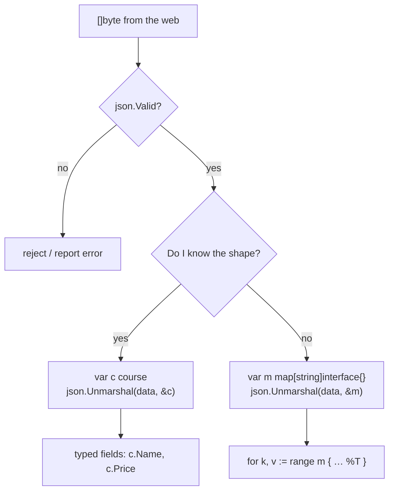

---
tags:
  - golang
  - web
section: "05 Web and Modules"
video: https://www.youtube.com/watch?v=a96veXdifys
video_title: "How to consume JSON data in golang"
order: 32
---
# Consuming JSON Data

> [!info] Source
> 🎬 [How to consume JSON data in golang](https://www.youtube.com/watch?v=a96veXdifys) · Section **05 Web and Modules** of [[Golang Notes]]
> ⬅️ [[Creating JSON Data]] · ➡️ [[Go Modules]]

## Overview

Most of the JSON a backend deals with is JSON it *receives*: from an API it calls, from another Go service, or from a client posting a request body. Reading that JSON into Go values is called **decoding** or **unmarshalling**, the mirror image of [[Creating JSON Data]]. In [[Handling Web Requests]] and [[Making GET Requests]] we saw that anything arriving from the web is a **slice of bytes** (`[]byte`), and so far we only ever wrapped it in `string(...)`. This note shows the two real strategies: when you *know* the shape of the data, decode it into a [[Structs|struct]]; when you do not, decode it into a [[Maps|map]] of `string` to `interface{}` and loop over it. The instructor keeps the example offline (a hard-coded byte slice) so the lesson is about JSON only, not about networking.

## Where the JSON comes from

Rather than making a web request, the instructor pastes the JSON produced in the last video into a raw string literal (backticks allow line breaks and double quotes without escaping) and converts it to the type the web would deliver:

```go
jsonDataFromWeb := []byte(`
{
	"coursename": "ReactJS Bootcamp",
	"Price": 299,
	"website": "LearnCodeOnline.in",
	"tags": ["web-dev","js"]
}
`)
```

Note that he removes the trailing comma after the object: this is a single object now, not an element of an array. Whether a stray comma survives is exactly what Step 1 checks.

The target type is the same `course` struct from [[Creating JSON Data]], including its tags:

```go
type course struct {
	Name     string `json:"coursename"`
	Price    int
	Platform string   `json:"website"`
	Password string   `json:"-"`
	Tags     []string `json:"tags,omitempty"`
}
```

## Step 1: Validate with `json.Valid`

```go
func Valid(data []byte) bool
```

Data that comes over the wire can be truncated or malformed, so Go gives you a cheap yes/no check before you try to decode. It returns a `bool`, not an `error`, which makes it a natural fit for an `if` (see [[If Else]]):

```go
checkValid := json.Valid(jsonDataFromWeb)

if checkValid {
	fmt.Println("JSON was valid")
	// decode here
} else {
	fmt.Println("JSON WAS NOT VALID")
}
```

The instructor deliberately breaks the input by leaving an extra comma in it, runs the program, and gets `JSON WAS NOT VALID`; removing the comma flips it to `JSON was valid`. (`Unmarshal` would also have refused the broken input with `invalid character '}' looking for beginning of object key string`, but `Valid` lets you reject bad data up front with a clear message.)

## Step 2: Decode into a struct with `json.Unmarshal`

```go
func Unmarshal(data []byte, v any) error
```

`Unmarshal` takes the bytes and a **pointer** to the value it should fill. The instructor stresses the `&`: a function receives a *copy* of its arguments (see [[Functions]] and [[Pointers]]), so passing `lcoCourse` by value would fill a copy and leave your variable empty. In fact the documentation states that if `v` is not a pointer, `Unmarshal` returns an `InvalidUnmarshalError`.

```go
var lcoCourse course
json.Unmarshal(jsonDataFromWeb, &lcoCourse)
fmt.Printf("%#v\n", lcoCourse)
```

`%#v` prints the Go-syntax representation, including the type name and every field (see [[fmt Package and Format Verbs]]).

**Output:**

```text
JSON was valid
main.course{Name:"ReactJS Bootcamp", Price:299, Platform:"LearnCodeOnline.in", Password:"", Tags:[]string{"web-dev", "js"}}
```

How did `"coursename"` land in `Name`? The decoder matches each incoming key against the *same names the encoder would produce*: the tag name if there is one, otherwise the field name. The match prefers an exact hit but also accepts a case-insensitive one, so `"Price"` and `"price"` both fill `Price`. Keys with no matching field are ignored, and fields with no matching key keep their zero value, which is why `Password` is `""`. The `tags` array became a `[]string` automatically.

> [!tip] This is the everyday pattern
> In most applications you define a struct that mirrors the JSON you expect, unmarshal into it, and work with typed fields from then on. The whole API section does this with `json.NewDecoder(r.Body).Decode(&course)` in [[Create Course Controller]].

## Step 3: Decode into a map when the shape is unknown

Sometimes you do not want to write a struct: the payload is ad hoc, or you only need to pick out a few keys. Then decode into a map. The **key** of a JSON object is always a string, that part is guaranteed, but the **value** can be a number, a string, an array or a nested object, so the value type has to be `interface{}` ("I do not know yet"):

```go
var myOnlineData map[string]interface{}
json.Unmarshal(jsonDataFromWeb, &myOnlineData)
fmt.Printf("%#v\n", myOnlineData)
```

**Output:**

```text
map[string]interface {}{"Price":299, "coursename":"ReactJS Bootcamp", "tags":[]interface {}{"web-dev", "js"}, "website":"LearnCodeOnline.in"}
```

Looping over a map is the same `for … range` you already know from [[Maps]] and [[Loops, Break, Continue and Goto]]. The instructor prints the key, the value, and, with `%T`, the dynamic type Go chose for each value:

```go
for k, v := range myOnlineData {
	fmt.Printf("Key is %v and value is %v and Type is: %T\n", k, v, v)
}
```

**Output** (map iteration order is random, so your lines may be in a different order):

```text
Key is website and value is LearnCodeOnline.in and Type is: string
Key is tags and value is [web-dev js] and Type is: []interface {}
Key is coursename and value is ReactJS Bootcamp and Type is: string
Key is Price and value is 299 and Type is: float64
```

When decoding into an `interface{}`, Go picks the value type by JSON kind:

| JSON | Go type stored in the interface |
|---|---|
| `true` / `false` | `bool` |
| number (`299`, `2.5`) | `float64` **always**, even for integers |
| string | `string` |
| array | `[]interface{}` |
| object | `map[string]interface{}` |
| `null` | `nil` |

That is why `Price` shows up as `float64` although it was written as an integer: JSON has a single number type, so without a struct Go has no way to know you wanted an `int`, and the decoder always picks `float64` (which, incidentally, cannot represent every `int64` exactly). To get an `int`, use the struct approach (or see the decoder options under Modern Go Notes). To get at the elements of `tags`, you would type-assert: `tags := myOnlineData["tags"].([]interface{})`.



## Example: Decoding the course JSON

The complete `DecodeJson` program from the video (the encode half lives in [[Creating JSON Data]]):

```go
package main

import (
	"encoding/json"
	"fmt"
)

type course struct {
	Name     string `json:"coursename"`
	Price    int
	Platform string   `json:"website"`
	Password string   `json:"-"`
	Tags     []string `json:"tags,omitempty"`
}

func main() {
	fmt.Println("Welcome to JSON video")
	DecodeJson()
}

func DecodeJson() {
	jsonDataFromWeb := []byte(`
	{
		"coursename": "ReactJS Bootcamp",
		"Price": 299,
		"website": "LearnCodeOnline.in",
		"tags": ["web-dev","js"]
	}
	`)

	var lcoCourse course

	checkValid := json.Valid(jsonDataFromWeb)

	if checkValid {
		fmt.Println("JSON was valid")
		json.Unmarshal(jsonDataFromWeb, &lcoCourse)
		fmt.Printf("%#v\n", lcoCourse)
	} else {
		fmt.Println("JSON WAS NOT VALID")
	}

	// some cases where you just want to add data to key value

	var myOnlineData map[string]interface{}
	json.Unmarshal(jsonDataFromWeb, &myOnlineData)
	fmt.Printf("%#v\n", myOnlineData)

	for k, v := range myOnlineData {
		fmt.Printf("Key is %v  and value is %v and Type is: %T\n", k, v, v)
	}
}
```

**Output:**

```text
Welcome to JSON video
JSON was valid
main.course{Name:"ReactJS Bootcamp", Price:299, Platform:"LearnCodeOnline.in", Password:"", Tags:[]string{"web-dev", "js"}}
map[string]interface {}{"Price":299, "coursename":"ReactJS Bootcamp", "tags":[]interface {}{"web-dev", "js"}, "website":"LearnCodeOnline.in"}
Key is website  and value is LearnCodeOnline.in and Type is: string
Key is tags  and value is [web-dev js] and Type is: []interface {}
Key is coursename  and value is ReactJS Bootcamp and Type is: string
Key is Price  and value is 299 and Type is: float64
```

## Gotchas and Best Practices

> [!warning] `Unmarshal` returns an error; do not throw it away
> The video calls `json.Unmarshal(...)` without looking at the result. It *does* return an `error` (a type mismatch such as `"Price": "free"` into an `int` field, or malformed input). The idiomatic form is:
> ```go
> if err := json.Unmarshal(jsonDataFromWeb, &lcoCourse); err != nil {
> 	fmt.Println("could not decode:", err)
> 	return
> }
> ```
> See [[Error Handling in Go]].

> [!warning] Always pass a pointer
> `json.Unmarshal(data, lcoCourse)` compiles (the parameter is `any`) but fails at run time with an `InvalidUnmarshalError`, and your struct stays empty; `go vet` catches it first (`call of Unmarshal passes non-pointer as second argument`). Write `&lcoCourse`.

> [!note] Matching is case-insensitive and lenient
> `"PRICE"`, `"price"` and `"Price"` all fill the `Price` field, and unknown keys are ignored without complaint. That is convenient for consuming third-party APIs but hides typos in your own clients. Use `DisallowUnknownFields` (below) when you want strictness.

> [!tip] Prefer structs for anything you control
> The map form is great for exploration and one-off scripts. For your own API contracts a struct documents the expected fields, gives you real types (`int`, not `float64`), and lets the compiler catch mistakes.

## Modern Go Notes

- `map[string]interface{}` can be written `map[string]any` since Go 1.18; `any` is an alias of `interface{}`, nothing else changes.
- For data arriving as a stream (an HTTP body, a file) use a decoder instead of reading everything into a byte slice first: `json.NewDecoder(r.Body).Decode(&course)`. This is what [[Create Course Controller]] and the MongoDB controllers do.
- A `*json.Decoder` has two switches the plain `Unmarshal` lacks: `dec.UseNumber()` keeps numbers as `json.Number` (a string you can convert with `.Int64()` or `.Float64()`) instead of `float64`, and `dec.DisallowUnknownFields()` makes decoding fail when the input has keys your struct does not declare.
- Go 1.27 also ships `encoding/json/v2`; the classic package used here is still the default. Check the current documentation before using v2.

## Video Timeline

| Time | What happens |
|---|---|
| [01:44](https://youtu.be/a96veXdifys?t=104) | JSON from the web is a `[]byte`; pasting the sample into a raw string |
| [03:53](https://youtu.be/a96veXdifys?t=233) | `json.Valid` returns a `bool` |
| [04:46](https://youtu.be/a96veXdifys?t=286) | `json.Unmarshal` into the struct, passing a reference with `&` |
| [06:34](https://youtu.be/a96veXdifys?t=394) | Breaking the JSON with an extra comma: `JSON WAS NOT VALID` |
| [08:30](https://youtu.be/a96veXdifys?t=510) | Decoding into `map[string]interface{}` for unknown shapes |
| [10:54](https://youtu.be/a96veXdifys?t=654) | Ranging over the map with `%v` and `%T`; numbers are `float64` |

## Related Notes

- [[Creating JSON Data]] — the encoder side; the struct tags defined there drive the key matching here.
- [[Structs]] — decoding into a struct is the standard way to give JSON a type.
- [[Maps]] — `map[string]interface{}` and ranging over it.
- [[Pointers]] — why `Unmarshal` needs `&lcoCourse`.
- [[Making GET Requests]] — where real `[]byte` JSON bodies come from.
- [[Create Course Controller]] — `json.NewDecoder(r.Body).Decode(&course)` applies this lesson to request bodies.
- [[Error Handling in Go]] — the error returned by `Unmarshal` that the video ignores.
- [[fmt Package and Format Verbs]] — `%#v` and `%T` used to inspect the decoded values.
- [[Go Quick Reference]] — one-page syntax cheat sheet.
