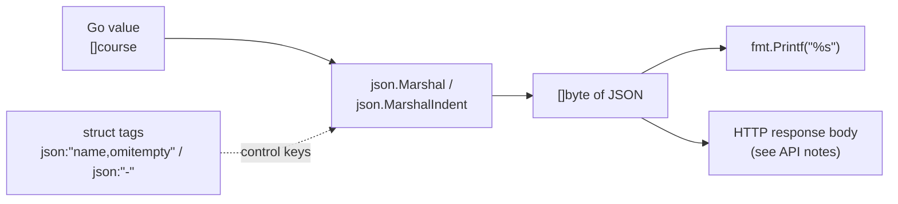

---
tags:
  - golang
  - web
section: "05 Web and Modules"
video: https://www.youtube.com/watch?v=SZ5xZ9OTeEI
video_title: "How to create JSON data in golang"
order: 31
---
# Creating JSON Data

> [!info] Source
> 🎬 [How to create JSON data in golang](https://www.youtube.com/watch?v=SZ5xZ9OTeEI) · Section **05 Web and Modules** of [[Golang Notes]]
> ⬅️ [[Sending Form Data]] · ➡️ [[Consuming JSON Data]]

## Overview

In the previous videos we *received* JSON from a web server (see [[Making GET Requests]] and [[Making POST Requests with JSON]]) but we only ever treated it as a plain `string`. That was a start, but a real backend has to **produce** JSON from its own data and **consume** JSON it receives. This note covers the first half: turning Go values (a [[Structs|struct]], a [[Slices|slice]] of structs, a [[Maps|map]]) into valid JSON bytes. This process is called **encoding** or **marshalling**, and Go ships everything you need in the standard-library package `encoding/json`. Along the way this is also a revisit of structs, because **struct tags** are what let you control the exact shape of the JSON an API sends out.

| Direction | Name | Function | Note |
|---|---|---|---|
| Go value → JSON bytes | encoding / marshalling | `json.Marshal`, `json.MarshalIndent` | this note |
| JSON bytes → Go value | decoding / unmarshalling | `json.Unmarshal` | [[Consuming JSON Data]] |

## Step 1: Model the data with a struct

The instructor starts a new folder (`22bitmorejson`), runs `go mod init` (see [[Go Modules]]) and defines the data he wants to publish, a **course** sold on LearnCodeOnline (LCO):

```go
type course struct {
	Name     string
	Price    int
	Platform string
	Password string
	Tags     []string
}
```

Two things are deliberate here:

- The **type name is lowercase** (`course`). Identifiers that start with a lowercase letter are *unexported*: they are visible only inside their own package. The instructor does this on purpose to show that not everything has to be capitalised; inside `package main` it works fine. The capitalisation rule itself is covered in [[Variables, Types and Constants]].
- The **field names are capitalised** (`Name`, `Price`, …). This is *not* optional for JSON. `encoding/json` can only see **exported** fields; an unexported field like `password string` would be silently skipped. Remember this rule, it is the single most common "why is my JSON empty?" bug.

The `Password` field is there only so the instructor can show, a few minutes later, how to keep a field *out* of the JSON.

## Step 2: Build some data

A slice of `course` values, written in positional form (values in the same order as the fields). The third course has `nil` tags on purpose:

```go
lcoCourses := []course{
	{"ReactJS Bootcamp", 299, "LearnCodeOnline.in", "abc123", []string{"web-dev", "js"}},
	{"MERN Bootcamp", 199, "LearnCodeOnline.in", "bcd123", []string{"full-stack", "js"}},
	{"Angular Bootcamp", 299, "LearnCodeOnline.in", "hit123", nil},
}
```

## Step 3: `json.Marshal` turns a value into JSON bytes

```go
func Marshal(v any) ([]byte, error)
```

`Marshal` walks the value recursively and returns the JSON encoding as a **byte slice**, not a string. The parameter type `any` (the instructor calls it "an interface") means *you can hand it anything*: a struct, a slice, a map, a number. Because not every value can be converted (a channel or a function cannot, and `NaN` floats cannot), it also returns an `error`, and the instructor insists on handling it instead of using `_` (see [[Error Handling in Go]]):

```go
finalJson, err := json.Marshal(lcoCourses)
if err != nil {
	panic(err)
}
fmt.Printf("%s\n", finalJson)
```

The `%s` verb prints a `[]byte` as text; `fmt.Println(finalJson)` would print the raw byte numbers instead (see [[fmt Package and Format Verbs]]).

**Output:**

```text
[{"Name":"ReactJS Bootcamp","Price":299,"Platform":"LearnCodeOnline.in","Password":"abc123","Tags":["web-dev","js"]},{"Name":"MERN Bootcamp","Price":199,"Platform":"LearnCodeOnline.in","Password":"bcd123","Tags":["full-stack","js"]},{"Name":"Angular Bootcamp","Price":299,"Platform":"LearnCodeOnline.in","Password":"hit123","Tags":null}]
```

It is a one-liner and it already produces valid JSON (a JSON array of objects). But look closely, the instructor points out three problems:

1. It is **hard to read**: everything is on one line.
2. The **password is exposed** to whoever consumes the API.
3. The Angular course's tags came out as `null` (Go's `nil` slice becomes JSON `null`), and the keys are capitalised exactly like the Go field names (`"Name"`, `"Price"`), which is not what most JSON consumers expect.

## Step 4: `json.MarshalIndent` for readable output

```go
func MarshalIndent(v any, prefix, indent string) ([]byte, error)
```

Same job as `Marshal`, but every element starts on a new line. The line begins with `prefix` and is then indented with one copy of `indent` per nesting level. For JSON you almost always pass an empty prefix and a tab (or two spaces) as the indent:

```go
finalJson, err := json.MarshalIndent(lcoCourses, "", "\t")
```

**Output (first course shown):**

```text
[
	{
		"Name": "ReactJS Bootcamp",
		"Price": 299,
		"Platform": "LearnCodeOnline.in",
		"Password": "abc123",
		"Tags": [
			"web-dev",
			"js"
		]
	},
	…
]
```

The instructor admits the `prefix` argument is hard to explain in words, so here is what it does. With `json.MarshalIndent(lcoCourses[:1], "LCO", "\t")` every line *after the first* starts with the prefix:

```text
[
LCO	{
LCO		"Name": "ReactJS Bootcamp",
LCO		"Price": 299,
LCO		"Platform": "LearnCodeOnline.in",
LCO		"Password": "abc123",
LCO		"Tags": [
LCO			"web-dev",
LCO			"js"
LCO		]
LCO	}
LCO]
```

It exists so that JSON can be embedded inside other text (for example, indented inside a log line or a code block). You will rarely need it.

## Step 5: Struct tags control the JSON shape

Go knows that structs are constantly converted to JSON, so it gives you a way to annotate each field. A **struct tag** is a raw string (written between backticks, the key below Esc) placed after the field type. The `encoding/json` package reads the part under the `json:` key:

```go
type course struct {
	Name     string `json:"coursename"`
	Price    int
	Platform string   `json:"website"`
	Password string   `json:"-"`
	Tags     []string `json:"tags,omitempty"`
}
```

| Tag | Effect on the JSON |
|---|---|
| `json:"coursename"` | Use `coursename` as the key instead of the field name `Name`. This is how you get lowercase, API-friendly keys. |
| *(no tag)* on `Price` | Tags are optional per field; the key stays `Price`. |
| `json:"website"` | Rename `Platform` to `website`. |
| `json:"-"` | **Never** encode this field. The password disappears from the output entirely. |
| `json:"tags,omitempty"` | Key is `tags`, and if the value is *empty* the key is left out instead of printing `null`. |

`omitempty` treats these as empty: `false`, `0`, a nil pointer, a nil interface, and any array, slice, map or string of length zero.

> [!warning] No space after the comma
> The instructor types `json:"tags, omitempty"` by accident and his editor immediately underlines it. The option must be written as `tags,omitempty` with **no space**. With the space, Go reads the option as `" omitempty"`, which it does not recognise, so the field is *not* omitted. `go vet` (which VS Code runs on save) catches this with a "suspicious space in struct tag value" warning. In Go, the space is the common culprit.

![[31_json_struct_tag_warning_1414.png]]
*Figure: VS Code underlining the struct tag with a stray space (video at 14:14)*

**Output with the tags in place:**

```text
[
	{
		"coursename": "ReactJS Bootcamp",
		"Price": 299,
		"website": "LearnCodeOnline.in",
		"tags": [
			"web-dev",
			"js"
		]
	},
	{
		"coursename": "MERN Bootcamp",
		"Price": 199,
		"website": "LearnCodeOnline.in",
		"tags": [
			"full-stack",
			"js"
		]
	},
	{
		"coursename": "Angular Bootcamp",
		"Price": 299,
		"website": "LearnCodeOnline.in"
	}
]
```

Compare with Step 3: the keys are renamed, `Password` is gone everywhere, and the Angular course simply has no `tags` key because its slice was `nil`. The same struct with the same tags is what the decoder uses in reverse in [[Consuming JSON Data]], and the same technique models the courses API in [[Building an API - Models]].



## Example: Encoding LCO courses

The complete program from the video, cleaned up so it compiles as-is:

```go
package main

import (
	"encoding/json"
	"fmt"
)

type course struct {
	Name     string `json:"coursename"`
	Price    int
	Platform string   `json:"website"`
	Password string   `json:"-"`
	Tags     []string `json:"tags,omitempty"`
}

func main() {
	fmt.Println("Welcome to JSON video")
	EncodeJson()
}

func EncodeJson() {
	lcoCourses := []course{
		{"ReactJS Bootcamp", 299, "LearnCodeOnline.in", "abc123", []string{"web-dev", "js"}},
		{"MERN Bootcamp", 199, "LearnCodeOnline.in", "bcd123", []string{"full-stack", "js"}},
		{"Angular Bootcamp", 299, "LearnCodeOnline.in", "hit123", nil},
	}

	// package this data as JSON data
	finalJson, err := json.MarshalIndent(lcoCourses, "", "\t")
	if err != nil {
		panic(err)
	}
	fmt.Printf("%s\n", finalJson)
}
```

Run it with `go run main.go`; the output is the tagged JSON shown in Step 5, preceded by the welcome line.

## Gotchas and Best Practices

> [!warning] Unexported fields vanish silently
> Only exported (capitalised) fields are encoded. A lowercase field never shows up and Go will not warn you. If a key is missing from your JSON, check the capital letter first.

> [!warning] `nil` slice vs empty slice
> A `nil` slice encodes as `null`; an empty-but-allocated slice (`[]string{}`) encodes as `[]`. Front-end code often breaks on `null` where it expected an array, so either initialise the slice or use `omitempty` as the instructor does. See [[Slices]] for the difference between nil and empty.

> [!tip] Use `json:"-"` for secrets
> Passwords, tokens and internal IDs should never reach the wire by accident. Hiding them with a tag is safer than remembering to blank them out before every `Marshal`.

> [!note] A few more encoding rules worth knowing
> - Map keys must be strings, integers or implement `encoding.TextMarshaler`; map values are written as a JSON object.
> - A `[]byte` field is encoded as a base64 string, not as an array of numbers.
> - Strings are HTML-escaped by default (`<`, `>` and `&` become `<`, `>` and `&`), so JSON is safe to embed inside a `<script>` tag. This can be switched off on an `Encoder` with `SetEscapeHTML(false)`.
> - Pointer fields (like `*Author` in [[Building an API - Models]]) are followed and encoded; a nil pointer becomes `null`, or is dropped with `omitempty`.

## Modern Go Notes

- The signature `Marshal(v any)` uses `any`, which has been an alias for `interface{}` since Go 1.18. Older material (and the video) says "interface"; they mean the same thing.
- When writing JSON to an HTTP response you do not need `Marshal` at all: `json.NewEncoder(w).Encode(value)` streams the encoding straight into any `io.Writer`, and `enc.SetIndent("", "\t")` makes it pretty. This is the form used in every controller of the API section, starting with [[Get All Courses Controller]].
- Go 1.27's standard library also ships `encoding/json/v2` (`go doc encoding/json/v2`). The classic `encoding/json` used in this series remains the default; check the current Go documentation before adopting v2 in a project.

## Video Timeline

| Time | What happens |
|---|---|
| [01:57](https://youtu.be/SZ5xZ9OTeEI?t=117) | The `course` struct is defined (lowercase type, exported fields) |
| [03:15](https://youtu.be/SZ5xZ9OTeEI?t=195) | What "encoding JSON" means |
| [06:58](https://youtu.be/SZ5xZ9OTeEI?t=418) | `json.Marshal`, error handling, printing with `%s` |
| [09:12](https://youtu.be/SZ5xZ9OTeEI?t=552) | First output: unreadable, password visible, `null` tags |
| [09:46](https://youtu.be/SZ5xZ9OTeEI?t=586) | `json.MarshalIndent` and the mysterious prefix argument |
| [12:14](https://youtu.be/SZ5xZ9OTeEI?t=734) | Struct tags: rename, `-`, and `omitempty` (and the space gotcha) |

## Related Notes

- [[Consuming JSON Data]] — the reverse operation, `json.Unmarshal`, using the very same struct and tags.
- [[Structs]] — what a struct is; tags are an extension of the field syntax learned there.
- [[Slices]] — why `nil` tags became `null` and why `omitempty` fixes it.
- [[Making POST Requests with JSON]] — earlier we sent JSON as a hand-written string; now it can be generated from data.
- [[Building an API - Models]] — the `Course` and `Author` models use exactly these tags to shape API responses.
- [[Get All Courses Controller]] — `json.NewEncoder(w).Encode(courses)` writes marshalled data to an HTTP response.
- [[Error Handling in Go]] — why the `error` from `Marshal` should be checked.
- [[fmt Package and Format Verbs]] — `%s` for byte slices, `%+v` / `%#v` for inspecting structs.
- [[Go Quick Reference]] — one-page syntax cheat sheet.
