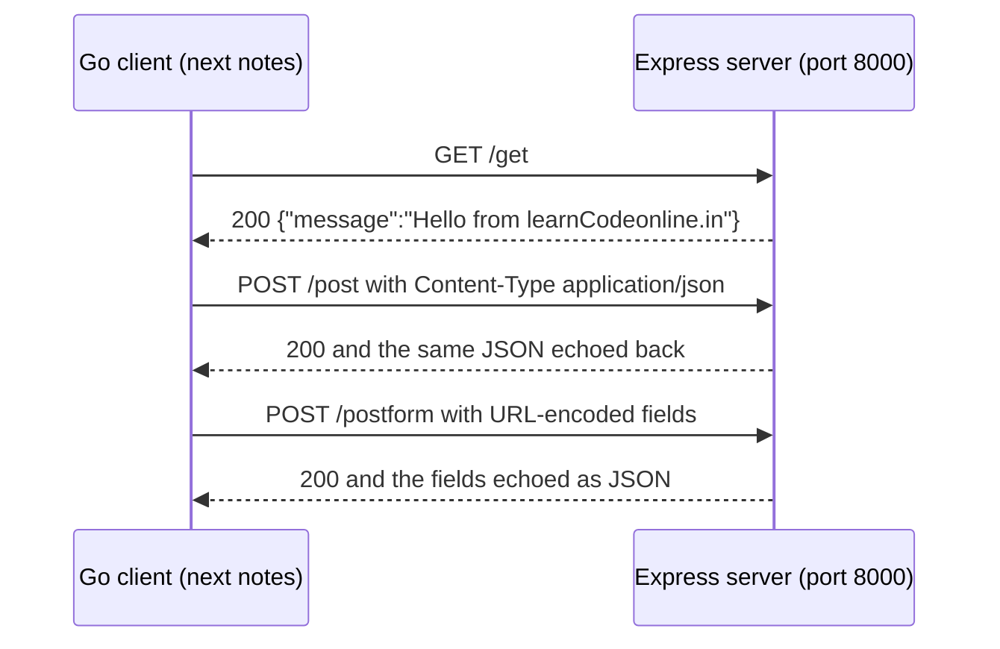

---
tags:
  - golang
  - web
section: "05 Web and Modules"
video: https://www.youtube.com/watch?v=xh79JXJy0yY
video_title: "Creating server for golang frontend"
order: 27
---
# Creating a Test Web Server

> [!info] Source
> 🎬 [Creating server for golang frontend](https://www.youtube.com/watch?v=xh79JXJy0yY) · Section **05 Web and Modules** of [[Golang Notes]]
> ⬅️ [[Handling URLs]] · ➡️ [[Making GET Requests]]

## Overview

This video steps away from Go for ten minutes. To practise sending data to a backend you need a backend whose behaviour you **control**: you must know which routes exist, what each one expects, and what it answers. Fetching a random website (as in [[Handling Web Requests]]) does not give you that. So the instructor ships a tiny **Node.js + Express** server as an exercise file and uses it as the target for the next three notes: [[Making GET Requests]], [[Making POST Requests with JSON]] and [[Sending Form Data]]. You do not need to understand JavaScript to use it; you only need to run it and know its four routes. Later in the series the roles flip and Go becomes the server (see [[Go Modules]] and [[Building an API - Models]]).

## The server

The whole server is one file, `lcowebserver/index.js`, from the companion repository:

```javascript
const express = require('express')
const app = express()
const port = 8000

app.use(express.json());
app.use(express.urlencoded({extended: true}));

app.get('/', (req, res) => {
  res.status(200).send("Welcome to LearnCodeonline server")
})

app.get('/get', (req, res) => {
    res.status(200).json({message: "Hello from learnCodeonline.in"})
})

app.post('/post', (req, res) => {
    let myJson = req.body;      // your JSON
    res.status(200).send(myJson);
})

app.post('/postform', (req, res) => {
    res.status(200).send(JSON.stringify(req.body));
})

app.listen(port, () => {
  console.log(`Example app listening at http://localhost:${port}`)
})
```

Reading it line by line, even without Node experience:

- `express.json()` and `express.urlencoded(...)` are **body parsers**. They tell the server to decode request bodies that arrive as JSON or as URL-encoded form data into `req.body`. Anything else (for example multipart form data) is *not* decoded, which explains a gotcha below.
- Each `app.get` / `app.post` line is a **route**: an HTTP verb plus a path plus a handler, the same concept as `r.HandleFunc("/courses", getAllCourses).Methods("GET")` in [[Routes and Testing the API]].
- The two POST routes are **echo** routes: whatever body you send is sent straight back, which is perfect for checking that a Go client encoded its payload correctly.
- `app.listen(port)` is the equivalent of `http.ListenAndServe(":8000", r)` in Go.

### The four routes

| Verb and path | Expects | Responds with | `Content-Type` of the response |
|---|---|---|---|
| `GET /` | nothing | `Welcome to LearnCodeonline server` | `text/html` |
| `GET /get` | nothing | `{"message":"Hello from learnCodeonline.in"}` | `application/json` |
| `POST /post` | a JSON body | the same JSON, echoed | `application/json` |
| `POST /postform` | a URL-encoded form body | the form fields echoed as a JSON string | `text/html` |

Any other combination (for example `GET /post`) answers `404 Not Found`.

## Running it

1. Install Node.js and confirm it works. Any version is fine; the instructor's only check is that a version number comes back:
   ```bash
   node -v
   ```
2. Open the `lcowebserver` folder in a **separate** VS Code window or terminal. It has to keep running on its own while you work on the Go code.
3. Install the dependencies listed in `package.json` (Express and nodemon), then start the server:
   ```bash
   npm install
   npm start        # runs "nodemon index.js"; or simply: node index.js
   ```
4. You should see:
   ```text
   Example app listening at http://localhost:8000
   ```

> [!tip] Port already in use?
> The instructor's machine had something else on port 3000, so the file uses 8000. If 8000 is busy on yours, change the `port` constant to any free port (3000, 5000, 7000, ...) and remember to use the same number in every Go URL that follows.

## Trying the routes before writing any Go

The video uses the **Thunder Client** VS Code extension (Postman does the same job) to hit each route and see the shape of the responses. The same checks with `curl`, with the real responses from the server:

```bash
curl -i http://localhost:8000/
```
```text
HTTP/1.1 200 OK
Content-Type: text/html; charset=utf-8
Content-Length: 33

Welcome to LearnCodeonline server
```

```bash
curl -i http://localhost:8000/get
```
```text
HTTP/1.1 200 OK
Content-Type: application/json; charset=utf-8
Content-Length: 43

{"message":"Hello from learnCodeonline.in"}
```

![[27_thunder_client_get_0535.png]]
*Figure: Thunder Client showing the JSON answer of `GET /get` (video at 05:35)*

```bash
curl -i -X POST http://localhost:8000/post \
     -H 'Content-Type: application/json' \
     -d '{"name":"hitesh","age":4}'
```
```text
HTTP/1.1 200 OK
Content-Type: application/json; charset=utf-8

{"name":"hitesh","age":4}
```

Sending the POST **without a body** is not an error, but the echo is empty, which is what the instructor shows first in Thunder Client:

```bash
curl -X POST http://localhost:8000/post
```
```text
{}
```

```bash
curl -i -X POST http://localhost:8000/postform --data-urlencode 'country=india'
```
```text
HTTP/1.1 200 OK
Content-Type: text/html; charset=utf-8

{"country":"india"}
```

![[27_thunder_client_formencode_0805.png]]
*Figure: The "Form-encode" tab in Thunder Client is the one that works for `/postform` (video at 08:05)*

### The form-data trap

The instructor makes a deliberate mistake: in Thunder Client he fills in the plain **Form** tab (which sends `multipart/form-data`) and `/postform` answers with an empty object, `{}`. Only after switching to **Form-encode** (`application/x-www-form-urlencoded`) does the server echo the fields. The reason is in the source: `express.urlencoded` parses URL-encoded bodies, and nothing in the server parses multipart bodies, so `req.body` stays empty:

```bash
curl -X POST http://localhost:8000/postform -F country=india   # multipart
```
```text
{}
```

Go's `http.PostForm` sends the URL-encoded form automatically, which is why it "just works" in [[Sending Form Data]].



## What the next three notes do with it

| Note | Go function | Route hit | Go API used |
|---|---|---|---|
| [[Making GET Requests]] | `PerformGetRequest` | `GET /get` | `http.Get` |
| [[Making POST Requests with JSON]] | `PerformPostJsonRequest` | `POST /post` | `http.Post` with `application/json` |
| [[Sending Form Data]] | `PerformPostFormRequest` | `POST /postform` | `http.PostForm` with `url.Values` |

All three live in one Go file (`21webreqverbs/main.go` in the companion repository) and are switched on and off from `main` by commenting calls in and out.

## Gotchas and Best Practices

> [!warning] Keep the server running in its own window
> If the terminal running `node index.js` is closed, every Go request in the next notes fails with `connection refused`. Run it in a second VS Code instance or a separate terminal tab.

> [!warning] Same port on both sides
> The port in `index.js` and the port in the Go URLs (`http://localhost:8000/...`) must match.

> [!warning] `/postform` wants URL-encoded data, not multipart
> Use "Form-encode" in Thunder Client, `--data-urlencode` in curl, or `http.PostForm` in Go.

> [!tip] Echo servers are the fastest way to debug clients
> When a real API rejects your request, point the same code at an echo route and look at exactly what you sent.

> [!note] Why Node and not Go here?
> At this point in the series the Go server side has not been taught yet. A 34-line Express file is the quickest way to get a known backend. Once [[Go Modules]] introduces Gorilla Mux, the same four routes are easy to write in Go, and the API in [[Building an API - Models]] replaces this server entirely.

## Video Timeline

| Time | What happens |
|---|---|
| [00:08](https://youtu.be/xh79JXJy0yY?t=8) | Why a server you control is needed to learn requests and responses |
| [01:19](https://youtu.be/xh79JXJy0yY?t=79) | The `lcowebserver` exercise files; checking Node with `node -v` |
| [02:51](https://youtu.be/xh79JXJy0yY?t=171) | `npm install`, then `npm start` |
| [03:17](https://youtu.be/xh79JXJy0yY?t=197) | Port 3000 is busy, so the port is changed to 8000 |
| [04:13](https://youtu.be/xh79JXJy0yY?t=253) | Installing the Thunder Client extension (Postman works too) |
| [04:57](https://youtu.be/xh79JXJy0yY?t=297) | `GET /` and `GET /get` and what they return |
| [05:45](https://youtu.be/xh79JXJy0yY?t=345) | `POST /post` needs a JSON body; the server echoes it |
| [06:54](https://youtu.be/xh79JXJy0yY?t=414) | `POST /postform`: the plain form tab returns nothing |
| [07:47](https://youtu.be/xh79JXJy0yY?t=467) | Switching to Form-encode makes the echo work |
| [08:26](https://youtu.be/xh79JXJy0yY?t=506) | Plan for the next videos: GET, POST JSON and POST form from Go |

## Related Notes

- [[Handling Web Requests]] — the one-line `http.Get` that will now target this server.
- [[Making GET Requests]] · [[Making POST Requests with JSON]] · [[Sending Form Data]] — the three clients written against it.
- [[Handling URLs]] — `url.Values`, the type behind URL-encoded form bodies.
- [[Go Modules]] — the first Go web server in the series, built with Gorilla Mux.
- [[Routes and Testing the API]] — testing a Go API with Thunder Client or Postman, the same way this server is tested here.
- [[Creating JSON Data]] — producing the JSON payloads these routes accept.
- [[Go Quick Reference]] · [[Golang Notes]]
