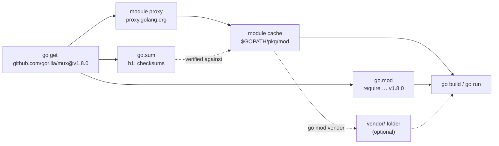

---
tags:
  - golang
  - web
section: "05 Web and Modules"
video: https://www.youtube.com/watch?v=O8uUGEobo-Q
video_title: "A long video on MOD in golang"
order: 33
---
# Go Modules

> [!info] Source
> 🎬 [A long video on MOD in golang](https://www.youtube.com/watch?v=O8uUGEobo-Q) · Section **05 Web and Modules** of [[Golang Notes]]
> ⬅️ [[Consuming JSON Data]] · ➡️ [[Building an API - Models]]

## Overview

Since [[Installation and Hello World]] every project in this series has started with `go mod init <name>`, and we never stopped to ask what that does. Before the next section builds a backend that is meant for production ([[Building an API - Models]]), this 27-minute video finally takes the **module system** apart: what `go.mod` and `go.sum` are, how third-party code is downloaded, verified, cached and shipped, and which `go mod` sub-commands you will actually use. The payoff is a first real server using the **gorilla/mux** router, the library the whole API section depends on. If you work in a company that runs Go in production, this is the tooling you need to understand in depth.

## Go's tooling in one place

Go ships its tools inside the single `go` command. The instructor groups the ones we have met so far:

| Command | What it does | Covered in |
|---|---|---|
| `go run main.go` | Compile to a temporary location and run; cheap for development | [[Installation and Hello World]] |
| `go build .` | Produce a production binary in the current folder | [[Building for Windows, Linux and Mac]] |
| `go mod …` | Create and maintain the module (dependencies) | this note |
| `go get pkg@version` | Add, upgrade or downgrade a dependency | this note |
| `go env` | Print the environment the tools use (`GOPATH`, `GOMODCACHE`, …) | [[GOPATH and Go Docs]] |
| `go list` | Query packages and modules | this note |
| `go doc pkg.Symbol` | Read documentation offline | [[GOPATH and Go Docs]] |

`go help mod` lists the sub-commands (`download`, `edit`, `graph`, `init`, `tidy`, `vendor`, `verify`, `why`); the cheat sheet at the end of this note summarises them.

## What a module is

A **module** is a collection of packages that are released, versioned and distributed together. It is rooted at a directory that contains a `go.mod` file. Two files describe it:

- **`go.mod`** declares the **module path** (its identity and the prefix other code uses to import it), the Go version the code expects, and the modules it *requires*, each pinned to a version.
- **`go.sum`** records cryptographic checksums of every required module version, so the exact same bytes are used on every machine.

The module path and the folder name are independent. The instructor's folder is `23mymodules`, but the module is named after where the code will eventually be hosted: `github.com/hiteshchoudhary/mymodules`. Using the repository URL as the module path is the convention because it makes the path globally unique and lets `go get` find the code later.

## `go mod init`

You *can* run a lone `main.go` with `go run main.go` and no module at all, but the instructor calls that a bad habit. Create the module (here `main.go` already exists in the folder, which is why Go also hints at `go mod tidy` below; in an empty folder only the first line prints):

```bash
go mod init github.com/hiteshchoudhary/mymodules
```

**Output:**

```text
go: creating new go.mod: module github.com/hiteshchoudhary/mymodules
go: to add module requirements and sums:
	go mod tidy
```

The generated `go.mod` is two lines. In the video it says `go 1.17`; with today's toolchain it records the full version:

```text
module github.com/hiteshchoudhary/mymodules

go 1.27.3
```

So the first job of `go.mod` is simply to say *"this is a module called X, and the code was written against Go version Y"*. Anyone (or any server) that builds your code can read which Go version it depends on.

## Semantic versioning

Every version number in the module system follows **semantic versioning** (the rules live at semver.org, which the instructor recommends reading):

| Part | Example change | Meaning |
|---|---|---|
| MAJOR | `1.8.0` → `2.0.0` | Breaking changes; code using the old version may not compile |
| MINOR | `1.7.4` → `1.8.0` | New features, backwards compatible |
| PATCH | `1.8.0` → `1.8.1` | Bug fixes only |

Go adds two twists worth knowing now, because you will meet both later in the series:

- Versions are Git tags with a `v` prefix: `v1.8.0`.
- A major version of 2 or higher becomes part of the module path, for example `go.mongodb.org/mongo-driver/v2` (the series uses v1, see [[Connecting to MongoDB]]). Untagged commits get a *pseudo-version* such as `v0.0.0-20210220032951-036812b2e83c` (a timestamp plus a commit hash); you will see several of those in the MongoDB project's `go.mod`.

## From GOPATH workspaces to modules

Go did not always work this way. Originally all code had to live inside one **GOPATH workspace** tree (`$GOPATH/src/github.com/user/repo`) and dependencies were not versioned at all; whatever was checked out on your machine was what you built against. Modules were introduced as preliminary support around Go 1.11 and 1.12 (the go.dev blog post *Using Go Modules*, which the instructor reads on screen, opens with exactly that sentence) and became the default mode a few releases later. The instructor's advice: workspaces are gone, Go is not going back, so if you maintain a legacy GOPATH project it is time to migrate.

![[33_go_modules_blog_0545.png]]
*Figure: The go.dev blog post "Using Go Modules" that the instructor walks through (video at 05:45)*

`GOPATH` itself still exists (`go env GOPATH` prints `$HOME/go`), but it is no longer where your projects live. It holds `bin/` for installed tools and `pkg/mod/` for the **module cache** described below. The history and today's role of GOPATH are in [[GOPATH and Go Docs]].

## Adding a dependency: `go get`

We need a router for the upcoming API, and gorilla/mux is the popular choice. Its README says to install it with the Go toolchain. The instructor runs `go get -u github.com/gorilla/mux` (the `-u` asks for the newest minor/patch release); to reproduce the video exactly, pin the version he got:

```bash
go get github.com/gorilla/mux@v1.8.0
```

**Output:**

```text
go: downloading github.com/gorilla/mux v1.8.0
go: added github.com/gorilla/mux v1.8.0
```

> [!warning] `go get` talks to the internet
> It fetches the repository from the web (through the Go module proxy). Some production servers are not allowed to reach the internet; the vendoring section below is the answer for those.

Three things changed on disk. First, `go.mod` gained a `require` line:

```text
module github.com/hiteshchoudhary/mymodules

go 1.27.3

require github.com/gorilla/mux v1.8.0 // indirect
```

The `// indirect` comment means *"nothing in your code imports this yet"*. As soon as a `.go` file imports the package and you tidy the module, the comment goes away.

Second, a new file `go.sum` appeared:

```text
github.com/gorilla/mux v1.8.0 h1:i40aqfkR1h2SlN9hojwV5ZA91wcXFOvkdNIeFDP5koI=
github.com/gorilla/mux v1.8.0/go.mod h1:DVbg23sWSpFRCP0SfiEN6jmj59UnW/n46BH5rLB71So=
```

One line is the hash of the module's source zip, the other the hash of its `go.mod`. The instructor explains why this matters with a then-recent supply-chain attack in the USA, where a malicious change was injected into a vendor's update and every customer installed it (most likely the 2020 SolarWinds incident; the instructor does not name it). Because you pull a lot of code from public repositories, Go records the hash of *exactly this version* at the time you added it. If the content behind `v1.8.0` ever changes, the hash no longer matches and the download fails instead of silently running tampered code; this `go.sum` check happens automatically whenever a module is fetched or loaded. `go mod verify` is the related on-demand check that the copies already in your module cache have not been tampered with since they were downloaded.

Third, nothing new appeared in the project folder. The code went somewhere else.

## Where downloads go: the module cache

Run `go env` and look for `GOPATH` and `GOMODCACHE`:

```bash
go env GOPATH GOMODCACHE
```

```text
/Users/aryanrai_transfi/go
/Users/aryanrai_transfi/go/pkg/mod
```

Every module you fetch lands in that cache, not in your working directory. Drilling down the way the instructor does in the terminal:

```text
$HOME/go/pkg/mod/
├── github.com/gorilla/mux@v1.8.0/        ← extracted, read-only source
└── cache/download/github.com/gorilla/mux/@v/
    ├── list
    ├── v1.8.0.info
    ├── v1.8.0.mod
    ├── v1.8.0.zip
    └── v1.8.0.ziphash
```

The next project that asks for `mux v1.8.0` is served from this local copy, with no network round trip. This is also why a fresh checkout of your repository only needs `go.mod` and `go.sum`: the `go` command refills the cache on the first build.



## Example: the first gorilla/mux server

With the dependency in place, the instructor writes the smallest possible web server. Two functions are defined: a plain `greeter` and a **handler**.

```go
package main

import (
	"fmt"
	"log"
	"net/http"

	"github.com/gorilla/mux"
)

func main() {
	fmt.Println("Hello mod in golang")
	greeter()
	r := mux.NewRouter()
	r.HandleFunc("/", serveHome).Methods("GET")

	log.Fatal(http.ListenAndServe(":4000", r))
}

func greeter() {
	fmt.Println("Hey there mod users")
}

func serveHome(w http.ResponseWriter, r *http.Request) {
	w.Write([]byte("<h1>Welcome to golang series on YT</h1>"))
}
```

Reading it line by line:

- `serveHome(w http.ResponseWriter, r *http.Request)` is a signature you will type dozens of times from now on. `r` is a **pointer** to the incoming request (see [[Pointers]]); everything the client sent, including URL parameters, lives inside it (see [[Handling URLs]]). `w` is the **response writer**, the only way to send something back. Because everything on the web travels as bytes ([[Handling Web Requests]]), the response is written as `[]byte("…")`.
- `mux.NewRouter()` creates a router; `r.HandleFunc("/", serveHome)` says *"when a request hits `/`, run `serveHome`"*. Pass the function **by name**, not `serveHome()` with parentheses: the router calls it later, per request (see [[Functions]]).
- `.Methods("GET")` restricts the route to one HTTP verb. A `POST` to the same path gets `405 Method Not Allowed`.
- `http.ListenAndServe(":4000", r)` starts the server on port 4000 and **blocks** forever; it only returns if something goes wrong (for example the port is taken). Wrapping it in `log.Fatal` prints that error and exits, which is the idiom used in every server of this series (see [[Error Handling in Go]]).

The import `github.com/gorilla/mux` resolves because the module was added with `go get`; without that step the editor shows *could not import github.com/gorilla/mux*.

Build and run:

```bash
go build .        # produces a binary named "mymodules" (last element of the module path)
go run main.go
```

**Output:**

```text
Hello mod in golang
Hey there mod users
```

The program then sits waiting for requests. Open `http://localhost:4000` in a browser, or use curl from a second terminal:

```bash
curl -i http://localhost:4000/
```

```text
HTTP/1.1 200 OK
Content-Type: text/html; charset=utf-8
Content-Length: 39

<h1>Welcome to golang series on YT</h1>
```

![[33_mux_server_browser_1700.png]]
*Figure: The first route served by the gorilla/mux router, viewed in the browser at localhost:4000 (video at 17:00)*

## `go mod tidy`

Even though `main.go` now imports mux, `go.mod` still says `// indirect`, and `go mod init` already hinted at the fix. `go mod tidy` makes `go.mod` match the source code: it adds any module the code needs, removes modules nothing imports, and adds or prunes `go.sum` entries accordingly. Stop the server, run it, and the comment disappears:

```bash
go mod tidy
```

```text
module github.com/hiteshchoudhary/mymodules

go 1.27.3

require github.com/gorilla/mux v1.8.0
```

You will run this command a lot. The instructor's caveat: everything under `go mod` can be an expensive operation (it may resolve and download the whole dependency graph), so keep an eye on it in CI pipelines. `go mod tidy -diff` prints what *would* change without touching the files, which is handy as a CI check.

## Inspecting dependencies

A set of read-only commands answers the questions you will have about a module.

**Is the cache intact?** `go mod verify` re-hashes every dependency in the module cache and checks that nothing has been modified since it was downloaded (`go.sum` itself is enforced automatically whenever a module is downloaded or loaded):

```text
all modules verified
```

**What does my module depend on?** Plain `go list` prints only the current package, and `go list all` dumps *every* package including the standard library (the instructor warns it is huge). The useful form adds `-m` to list modules:

```bash
go list -m all
```

```text
github.com/hiteshchoudhary/mymodules
github.com/gorilla/mux v1.8.0
```

**Which versions exist?** Instead of browsing GitHub to find a version to downgrade to, ask the toolchain. The `-m` flag is required:

```bash
go list -m -versions github.com/gorilla/mux
```

```text
github.com/gorilla/mux v1.2.0 v1.3.0 v1.4.0 v1.5.0 v1.6.0 v1.6.1 v1.6.2 v1.7.0 v1.7.1 v1.7.2 v1.7.3 v1.7.4 v1.8.0 v1.8.1
```

If the latest release breaks something, `go get github.com/gorilla/mux@v1.7.4` pins the previous one.

**Why is this dependency here?** `go mod why` prints the shortest import path from your module to the package:

```bash
go mod why github.com/gorilla/mux
```

```text
# github.com/gorilla/mux
github.com/hiteshchoudhary/mymodules
github.com/gorilla/mux
```

**The whole graph.** `go mod graph` prints one `module requirement` pair per line. With one dependency it is tiny (today's toolchains also list the Go version itself as a requirement):

```text
github.com/hiteshchoudhary/mymodules github.com/gorilla/mux@v1.8.0
github.com/hiteshchoudhary/mymodules go@1.27.3
go@1.27.3 toolchain@go1.27.3
```

## `go mod edit`

Some teams never touch `go.mod` by hand and script every change instead. `go mod edit -go=1.16` rewrites the `go` directive, `go mod edit -module=<new path>` renames the module, and `go mod edit -fmt` only reformats the file. The instructor is honest that he does not see the point for small edits and simply changes the version number in the editor; the official help agrees for the common case and says users should prefer `go get go@<version>` to bump the Go version.

## Vendoring

Everything so far assumes the module cache (and, the first time, the internet) is available at build time. If your build server is air-gapped, or you need to patch a dependency's source and ship the patched copy, **vendor** it:

```bash
go mod vendor
```

This creates a `vendor/` folder inside the project, think of it as Go's `node_modules`, with a full copy of every required package plus a manifest:

```text
vendor/
├── modules.txt
└── github.com/gorilla/mux/…
```

```text
# github.com/gorilla/mux v1.8.0
## explicit; go 1.12
github.com/gorilla/mux
```

In the video the instructor then runs `go run -mod=vendor main.go` to force the build to use the vendored copy instead of the cache. He also warns that vendoring is not something to do casually: for most projects the cache plus `go.mod`/`go.sum` is all you need.

## Command cheat sheet

| Command | Purpose |
|---|---|
| `go mod init github.com/you/project` | Create `go.mod` |
| `go get pkg@v1.2.3` / `go get -u pkg` | Add or upgrade a dependency (writes `go.mod`, `go.sum`) |
| `go get pkg@none` | Remove a dependency |
| `go mod tidy` | Sync `go.mod`/`go.sum` with the imports in the code |
| `go mod verify` | Check that cached modules are unmodified since download |
| `go list -m all` | List the module and all its dependencies |
| `go list -m -versions pkg` | List published versions of a module |
| `go mod why pkg` | Explain why a package is needed |
| `go mod graph` | Print the requirement graph |
| `go mod download` | Pre-fill the module cache (useful in Docker builds) |
| `go mod edit -go=1.21` | Script edits to `go.mod` |
| `go mod vendor` | Copy dependencies into `vendor/` |
| `go env GOPATH GOMODCACHE` | Find the cache location |

## Gotchas and Best Practices

> [!tip] Commit `go.mod` *and* `go.sum`
> They are the reproducibility contract of your project. Never edit `go.sum` by hand; let `go get` and `go mod tidy` maintain it.

> [!warning] Run module commands inside the module
> `go get`, `go mod tidy` and friends act on the nearest `go.mod` up the directory tree. Running them in the wrong folder either edits the wrong module or fails with "go.mod file not found" (the same way `go run main.go` from the wrong folder goes nowhere, which happens to the instructor once in [[Creating JSON Data]]).

> [!note] `// indirect` is not an error
> It only means the module is required but not imported directly by your code, typically because it is a dependency of a dependency, or because you ran `go get` before writing the import. `go mod tidy` sorts it out.

> [!tip] Pin versions for reproducible builds
> `go get pkg@v1.8.0` is explicit; `go get -u pkg` silently moves you to the newest minor release. Both are fine, but know which one you ran before you commit.

## Modern Go Notes

- Since Go 1.18, `go get` only edits `go.mod`; it no longer builds or installs executables. To install a command-line tool use `go install example.com/cmd@latest`, which ignores the current module entirely.
- `go mod init` now writes a full version (`go 1.27.3`) and the toolchain may add a `toolchain` directive; bump them with `go get go@latest` or `go get toolchain@patch` rather than editing by hand.
- The `-mod=vendor` flag is usually unnecessary today: when a `vendor/` directory exists and the `go` version in `go.mod` is 1.14 or newer, the `go` command behaves as if `-mod=vendor` were set.
- Go 1.18 introduced a *new* kind of workspace (`go work`, a `go.work` file spanning several modules). It is unrelated to the old GOPATH workspaces the instructor says are gone.
- Downloads go through `proxy.golang.org` and are checked against the `sum.golang.org` checksum database by default; set `GOPRIVATE` for private repositories. `GO111MODULE` still exists but module mode has been the default for years.
- gorilla/mux's newest release at the time of writing is `v1.8.1`. Go 1.22+ also added method-and-pattern routing to the standard `net/http` ServeMux (`"GET /course/{id}"` with `r.PathValue("id")`), a dependency-free alternative discussed in [[Routes and Testing the API]].

## Video Timeline

| Time | What happens |
|---|---|
| [02:50](https://youtu.be/O8uUGEobo-Q?t=170) | `go mod init github.com/…/mymodules` and the `go.mod` file |
| [04:09](https://youtu.be/O8uUGEobo-Q?t=249) | Semantic versioning, then the history of GOPATH workspaces vs modules |
| [07:04](https://youtu.be/O8uUGEobo-Q?t=424) | `go get` gorilla/mux, `// indirect`, and what `go.sum` protects against |
| [09:59](https://youtu.be/O8uUGEobo-Q?t=599) | `go env` and a tour of the module cache under `GOPATH/pkg/mod` |
| [11:58](https://youtu.be/O8uUGEobo-Q?t=718) | Writing `serveHome`, the mux router, `ListenAndServe`, and the first page at localhost:4000 |
| [17:39](https://youtu.be/O8uUGEobo-Q?t=1059) | `go mod tidy`, `verify`, `list -m`, `why`, `graph`, `edit` and `vendor` |

## Related Notes

- [[Installation and Hello World]] — where `go mod init` and `go run` first appeared.
- [[GOPATH and Go Docs]] — the old workspace model and what `GOPATH` still does today.
- [[Building for Windows, Linux and Mac]] — `go build` and cross-compiling the binary this note produces.
- [[Handling Web Requests]] — the client side of HTTP; this note is the first server side.
- [[Handling URLs]] — the request `r` carries the URL and query parameters you will parse next.
- [[Building an API - Models]] — the next video starts the courses API on top of this exact mux setup.
- [[Routes and Testing the API]] — more `HandleFunc` routes with path variables and HTTP verbs.
- [[Connecting to MongoDB]] — a much larger `go.mod` with many `// indirect` entries and pseudo-versions.
- [[Error Handling in Go]] — `log.Fatal` around `ListenAndServe`.
- [[Go Quick Reference]] — one-page syntax cheat sheet.
