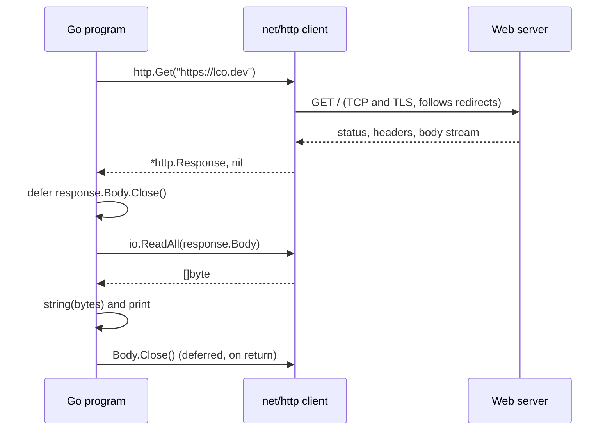

---
tags:
  - golang
  - web
section: "05 Web and Modules"
video: https://www.youtube.com/watch?v=ru53LpdVHn4
video_title: "Handling web request in golang"
order: 25
---
# Handling Web Requests

> [!info] Source
> 🎬 [Handling web request in golang](https://www.youtube.com/watch?v=ru53LpdVHn4) · Section **05 Web and Modules** of [[Golang Notes]]
> ⬅️ [[Working with Files]] · ➡️ [[Handling URLs]]

## Overview

This video opens the **web** section of the series. The goal is deliberately small: fetch the home page of a website and print its HTML. No JSON, no APIs yet, those come in [[Making GET Requests]] and [[Consuming JSON Data]]. Everything needed is already in the standard library's `net/http` package, which is both the most used and one of the fastest HTTP implementations in the Go world. The instructor's point is that nothing here is new: the `error` checks, the `defer`, the `[]byte` to `string` conversion and the pointer in the result were all covered in the previous sections, and this video simply combines them.

## The `net/http` package

`net` is a large tree of packages (`net`, `net/http`, `net/url`, `net/mail`, ...). `net/http` alone contains both the **client** side (making requests) and the **server** side (handling requests), which is why its documentation index looks enormous. The pieces that matter for this section:

| Piece | What it is | Where it is used |
|---|---|---|
| `http.Get(url)` | One-line GET request | this note |
| `http.Post`, `http.PostForm` | One-line POST requests | [[Making POST Requests with JSON]], [[Sending Form Data]] |
| `http.Response` | What every request returns | this note |
| `http.Header` | `map[string][]string` of header lines | reading and setting headers |
| `http.Client` | A client with its own timeout, cookies and redirect policy | the improved example below |
| `http.Request` | A request you build by hand when you need custom headers | [[Making POST Requests with JSON]] (modern variant) |
| `http.ListenAndServe` (with a router's `HandleFunc`) | The server side | [[Go Modules]] and the whole [[Building an API - Models]] section |

The docs also expose cookie jars, hijackers and more; none of that is needed yet.

## Anatomy of `http.Response`

When a request succeeds you receive a pointer to an `http.Response` struct. The fields the video highlights:

| Field | Type | Meaning |
|---|---|---|
| `Status` | `string` | Text form, for example `"200 OK"` |
| `StatusCode` | `int` | Numeric form, for example `200`; branch on it with [[If Else]] |
| `Header` | `http.Header` | Response headers (content type, cookies, auth hints) |
| `Body` | `io.ReadCloser` | The payload as a **stream** that you read, then close |
| `ContentLength` | `int64` | Bytes in the body, or `-1` when unknown |
| `Request` | `*http.Request` | The request that produced this response |

`Body` is the field that matters most. It is not a string and not a byte slice; it is a stream that can be read exactly once, and the documentation for it contains the sentence the instructor highlights on screen: **"It is the caller's responsibility to close Body."** Neither the default client nor `io.ReadAll` closes it for you.

![[25_http_response_docs_0345.png]]
*Figure: The `http.Response` documentation, with the note that closing `Body` is the caller's responsibility (video at 03:45)*

## Making the request

```go
const url = "https://lco.dev"

response, err := http.Get(url)
if err != nil {
    panic(err)
}
```

- The URL lives in a package-level constant so it is easy to swap. The instructor recommends keeping the exact same URL as the video while learning, so that errors can be compared, and changing it only afterwards.
- `http.Get` returns `(*http.Response, error)`. The error is set only for **transport-level** failures: no internet, DNS failure, a refused connection, TLS problems, too many redirects. A page that answers `404` or `500` is *not* an error in Go; you must look at `StatusCode` yourself.
- `http.Get` follows up to 10 redirects automatically (`301`, `302`, `303`, `307`, `308`).
- HTTPS works out of the box; no extra configuration is needed for a public site.

### It is a pointer

```go
fmt.Printf("Response is of type: %T\n", response)
```

**Output:**
```text
Response is of type: *http.Response
```

The asterisk means you hold a **reference** to the response, not a copy (see [[Pointers]]). A response can be large, and the standard library passes it around by pointer so that reading the body, inspecting headers and closing all operate on the same object.

### Closing the body

```go
defer response.Body.Close() // caller's responsibility to close the connection
```

Placed right after the error check, exactly like `defer file.Close()` in [[Working with Files]]. Forgetting it leaks a network connection and, in a long-running program, eventually exhausts the connection pool or file descriptors.

### Reading the body

```go
databytes, err := io.ReadAll(response.Body)
if err != nil {
    panic(err)
}
content := string(databytes)
fmt.Println(content)
```

`io.ReadAll` drains the stream into a `[]byte` (the video uses the older `ioutil.ReadAll`, see Modern Go Notes). The conversion to `string` is the same one used for file contents. From this point the HTML is ordinary text you could search, save to a file, or parse.



## Example: fetch a page and print its HTML

```go
package main

import (
	"fmt"
	"io"
	"net/http"
)

const url = "https://lco.dev"

func main() {
	fmt.Println("LCO web request")

	response, err := http.Get(url)
	if err != nil {
		panic(err)
	}

	fmt.Printf("Response is of type: %T\n", response)

	defer response.Body.Close() // caller's responsibility to close the connection

	databytes, err := io.ReadAll(response.Body)
	if err != nil {
		panic(err)
	}
	content := string(databytes)
	fmt.Println(content)
}
```

**Output (representative; the HTML depends on the site):**
```text
LCO web request
Response is of type: *http.Response
<!DOCTYPE html>
<html lang="en" data-theme="auto">
<head>
<meta charset="utf-8">
<meta name="viewport" content="width=device-width, initial-scale=1">
...
```

> [!note] `lco.dev` may no longer answer
> The instructor used a spare domain of his own as the target. At the time of writing these notes (October 2026) `https://lco.dev` did not respond at all, which makes `http.Get` return a connection error and the program panic. Point `url` at any public page instead, for example `https://go.dev` (the output above comes from it), or at the local test server built in [[Creating a Test Web Server]].

## A more careful version

The video stops at printing the HTML and leaves two improvements as an exercise: check the status code, and do not rely on the default client, which has **no timeout** and can hang forever on a slow server.

```go
package main

import (
	"fmt"
	"io"
	"net/http"
	"time"
)

func main() {
	// A client with a timeout: http.Get uses http.DefaultClient, which has none
	client := http.Client{Timeout: 10 * time.Second}

	response, err := client.Get("https://go.dev")
	if err != nil {
		panic(err)
	}
	defer response.Body.Close()

	// A non-2xx status is NOT an error in Go: check it yourself
	if response.StatusCode != http.StatusOK {
		fmt.Println("Unexpected status:", response.Status)
		return
	}

	fmt.Println("Status:", response.Status)
	fmt.Println("Content-Type:", response.Header.Get("Content-Type"))

	body, err := io.ReadAll(response.Body)
	if err != nil {
		panic(err)
	}
	fmt.Println("Bytes received:", len(body))
}
```

**Output** (the byte count and headers change whenever go.dev changes):
```text
Status: 200 OK
Content-Type: text/html; charset=utf-8
Bytes received: 64762
```

`http.StatusOK` is one of the named constants for status codes (`http.StatusNotFound`, `http.StatusInternalServerError`, ...), which read better than bare numbers. `Header.Get` is case-insensitive, so `"content-type"` works too. The `time.Duration` value comes from [[Handling Time]].

## Gotchas and Best Practices

> [!warning] A `404` or `500` does not set `err`
> `err` only reports that the request could not be made. Always inspect `response.StatusCode` before trusting the body.

> [!warning] Always `defer response.Body.Close()`
> Do it immediately after the `err` check. Without it, connections are not returned to the pool and the program slowly leaks resources. Reading the body to the end *and* closing it lets the client reuse the TCP connection for the next request.

> [!warning] The body can be read once
> `io.ReadAll` drains the stream. Keep the resulting `[]byte` if you need the content twice.

> [!tip] Give production clients a timeout
> `http.DefaultClient` waits forever. Create an `http.Client{Timeout: ...}` once and reuse it; it is safe for concurrent use from several goroutines (see [[Concurrency and Goroutines]]).

> [!tip] Requests belong in their own functions
> The instructor writes everything inside `main` here to keep the first example short, then splits GET, POST and form requests into separate functions in [[Making GET Requests]] so they can be reused.

## Modern Go Notes

- `ioutil.ReadAll` is deprecated since Go 1.16; `io.ReadAll` is the same function. The examples above already use it.
- For requests that must be cancellable (a user navigates away, a deadline expires) build the request with `http.NewRequestWithContext(ctx, http.MethodGet, url, nil)` and send it with `client.Do(req)`. The `context` package is used the same way with MongoDB in [[Connecting to MongoDB]].
- When you need custom headers (for example an `Authorization` header) `http.Get` is not enough; use `http.NewRequest` + `client.Do`, shown in [[Making POST Requests with JSON]].

## Video Timeline

| Time | What happens |
|---|---|
| [00:41](https://youtu.be/ru53LpdVHn4?t=41) | The target is a plain web page (`lco.dev`), not a JSON API; that comes later |
| [01:28](https://youtu.be/ru53LpdVHn4?t=88) | Tour of the `net/http` documentation: cookies, headers, the many request helpers |
| [02:45](https://youtu.be/ru53LpdVHn4?t=165) | The `Response` type: `Status`, `StatusCode`, `Header` and why checking the status matters |
| [03:39](https://youtu.be/ru53LpdVHn4?t=219) | The docs say closing `Body` is the caller's responsibility |
| [05:06](https://youtu.be/ru53LpdVHn4?t=306) | `go mod init lcorequest`; the URL as a package-level constant |
| [06:17](https://youtu.be/ru53LpdVHn4?t=377) | `http.Get(url)` returns a response and an error; classic `if err != nil { panic(err) }` |
| [08:46](https://youtu.be/ru53LpdVHn4?t=526) | `%T` prints `*http.Response`: you get a pointer, not a copy |
| [09:16](https://youtu.be/ru53LpdVHn4?t=556) | `defer response.Body.Close()` |
| [09:34](https://youtu.be/ru53LpdVHn4?t=574) | `ReadAll(response.Body)` into bytes, then `string(databytes)` |
| [11:35](https://youtu.be/ru53LpdVHn4?t=695) | The whole HTML of the page prints in the terminal |

## Related Notes

- [[Working with Files]] — same `defer ... Close()` discipline and the same bytes-to-string conversion.
- [[Handling URLs]] — parsing the URL you are about to request, and reading query parameters.
- [[Creating a Test Web Server]] — a local server you control, used by the next three notes.
- [[Making GET Requests]] — the same GET against the local server, with status code, content length and `strings.Builder`.
- [[Making POST Requests with JSON]] and [[Sending Form Data]] — the other two verbs.
- [[Consuming JSON Data]] — turning the response bytes into Go values instead of a string.
- [[Pointers]] — why the response is `*http.Response`.
- [[Defer]] — the guarantee behind `defer response.Body.Close()`.
- [[Error Handling in Go]] — what `err` does and does not cover for HTTP.
- [[Go Quick Reference]] · [[Golang Notes]]
