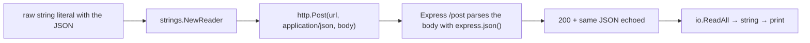

---
tags:
  - golang
  - web
section: "05 Web and Modules"
video: https://www.youtube.com/watch?v=h5NeKZuzUoc
video_title: "How to make POST request with JSON data in golang"
order: 29
---
# Making POST Requests with JSON

> [!info] Source
> 🎬 [How to make POST request with JSON data in golang](https://www.youtube.com/watch?v=h5NeKZuzUoc) · Section **05 Web and Modules** of [[Golang Notes]]
> ⬅️ [[Making GET Requests]] · ➡️ [[Sending Form Data]]

## Overview

A **POST** request carries data to the server, usually to be stored in a database. Two things change compared with the GET of the previous note: the request has a **body**, and the server must be told what **type** of data the body contains (the `Content-Type` header). The `/post` route of the test server from [[Creating a Test Web Server]] accepts only JSON and echoes it back, which makes it easy to confirm that the Go client sent exactly what was intended.

JSON itself has not been covered yet at this point in the series. The instructor's trick is to write the payload as a **raw string literal** and wrap it in a reader. The proper way, encoding a Go struct with `encoding/json`, is the subject of [[Creating JSON Data]] and is shown as a second example at the end of this note.

## `http.Post`

```go
func Post(url, contentType string, body io.Reader) (resp *Response, err error)
```

Three arguments, in this order:

| Argument | In the video | Why |
|---|---|---|
| `url` | `"http://localhost:8000/post"` | where the data goes |
| `contentType` | `"application/json"` | tells the server how to parse the body |
| `body` | `strings.NewReader(...)` | the payload, as something that can be read |

The body is an `io.Reader`, not a string. Anything readable works: `strings.NewReader` for a string, `bytes.NewReader` for a `[]byte`, an open file, or another response body. The same interface idea that let `io.WriteString` write into a file in [[Working with Files]] lets `http.Post` read from anything here. If the body also implements `io.Closer`, `Post` closes it after the request.

> [!warning] `"application/json"` must be spelled exactly
> The instructor calls misspelling the content type "a really common mistake". With a wrong type the Express server's JSON parser never runs, `req.body` stays empty, and the echo comes back as `{}` even though the request "succeeded" with `200`.

Common content types you will set from Go:

| Content type | Body format | Go helper |
|---|---|---|
| `application/json` | `{"key": "value"}` | `http.Post` with a JSON reader |
| `application/x-www-form-urlencoded` | `key=value&other=value` | `http.PostForm` (see [[Sending Form Data]]) |
| `multipart/form-data` | file uploads | `mime/multipart` package |
| `text/plain` | raw text | `http.Post` with `strings.NewReader` |

## Building the payload with a raw string literal

```go
requestBody := strings.NewReader(`
	{
		"coursename":"Let's go with golang",
		"price": 0,
		"platform":"learnCodeOnline.in"
	}
`)
```

- Backticks delimit a **raw string literal**: it can span several lines and nothing inside is escaped, so the double quotes that JSON requires can be typed directly. A normal `"..."` string would need `\"` everywhere and could not contain newlines.
- JSON keys and string values are always in double quotes; `price` is a number, so `0` is written bare.
- `strings.NewReader` turns the string into an `io.Reader` that `http.Post` can consume. This is the same `strings` package as `strings.Builder` from [[Making GET Requests]].

The video has already been reading the response the same way for three notes: check the error, `defer response.Body.Close()`, `ReadAll`, convert to `string`.

## Example: POST JSON to `/post`

```go
package main

import (
	"fmt"
	"io"
	"net/http"
	"strings"
)

func main() {
	fmt.Println("Welcome to web verb video - LCO")
	PerformPostJsonRequest()
}

func PerformPostJsonRequest() {
	const myurl = "http://localhost:8000/post"

	// fake JSON payload: a raw string literal (backticks) can span lines
	requestBody := strings.NewReader(`
		{
			"coursename":"Let's go with golang",
			"price": 0,
			"platform":"learnCodeOnline.in"
		}
	`)

	response, err := http.Post(myurl, "application/json", requestBody)
	if err != nil {
		panic(err)
	}
	defer response.Body.Close()

	content, _ := io.ReadAll(response.Body)
	fmt.Println(string(content))
}
```

**Output (with the test server running on port 8000):**
```text
Welcome to web verb video - LCO
{"coursename":"Let's go with golang","price":0,"platform":"learnCodeOnline.in"}
```

The server parsed the body, rebuilt it and sent it back on one line, proof that the payload and the content type were both right. In the video the same request is first made from Thunder Client, where the "JSON" body tab must be used and the form tabs left empty.

![[29_thunder_client_post_json_0110.png]]
*Figure: Thunder Client posting a JSON body to `/post` and receiving it back (video at 01:10)*



## The proper way: encode a struct and set headers yourself

Once [[Creating JSON Data]] has introduced `encoding/json`, the payload comes from a Go value instead of a hand-typed string, and `http.NewRequest` lets you add any header (an `Authorization` token, for example), which `http.Post` cannot do:

```go
package main

import (
	"bytes"
	"encoding/json"
	"fmt"
	"io"
	"net/http"
)

type Course struct {
	CourseName string `json:"coursename"`
	Price      int    `json:"price"`
	Platform   string `json:"platform"`
}

func main() {
	payload, err := json.Marshal(Course{"Let's go with golang", 0, "learnCodeOnline.in"})
	if err != nil {
		panic(err)
	}

	req, err := http.NewRequest(http.MethodPost, "http://localhost:8000/post", bytes.NewReader(payload))
	if err != nil {
		panic(err)
	}
	req.Header.Set("Content-Type", "application/json")
	req.Header.Set("Authorization", "Bearer my-token") // custom headers need NewRequest

	response, err := http.DefaultClient.Do(req)
	if err != nil {
		panic(err)
	}
	defer response.Body.Close()

	content, _ := io.ReadAll(response.Body)
	fmt.Println(response.Status, string(content))
}
```

**Output:**
```text
200 OK {"coursename":"Let's go with golang","price":0,"platform":"learnCodeOnline.in"}
```

- `json.Marshal` produces the `[]byte` payload from a struct; the backtick **struct tags** choose the JSON key names (explained in [[Creating JSON Data]]).
- `bytes.NewReader` wraps the bytes as an `io.Reader`.
- `http.NewRequest` + `client.Do` is the general form; `http.Post` is just a shortcut around it with a single header.

## Gotchas and Best Practices

> [!warning] A `200` with `{}` means the server did not understand the body
> Check the `Content-Type` spelling and make sure the body is valid JSON (double quotes, no trailing comma). `json.Valid` from [[Consuming JSON Data]] can check a payload before sending it.

> [!warning] Do not build JSON by string concatenation in real code
> The raw string literal is a teaching shortcut. Values containing quotes or newlines would break it; `json.Marshal` escapes them correctly.

> [!warning] Still close the body
> A POST returns an `http.Response` like any other request; `defer response.Body.Close()` applies.

> [!tip] Use `http.MethodPost` and `http.StatusOK` constants
> They avoid typos in `"POST"` and `200` and read clearly.

> [!tip] Reuse one client
> `http.DefaultClient` has no timeout; a shared `http.Client{Timeout: ...}` is better for anything long-running (see [[Handling Web Requests]]).

## Modern Go Notes

- `ioutil.ReadAll` in the video is deprecated; use `io.ReadAll`.
- For cancellation and deadlines, create the request with `http.NewRequestWithContext(ctx, ...)`; the request is otherwise identical to the second example.
- On the server side, the matching work (decoding a JSON body into a struct with `json.NewDecoder(r.Body).Decode(&course)`) is done in [[Create Course Controller]].

## Video Timeline

| Time | What happens |
|---|---|
| [00:06](https://youtu.be/h5NeKZuzUoc?t=6) | Goal: POST to the local server; `/post` only understands JSON |
| [00:46](https://youtu.be/h5NeKZuzUoc?t=46) | In Thunder Client the JSON body is echoed back; form tabs must stay empty |
| [02:13](https://youtu.be/h5NeKZuzUoc?t=133) | `PerformPostJsonRequest` and its URL |
| [02:53](https://youtu.be/h5NeKZuzUoc?t=173) | A fake JSON payload with `strings.NewReader` and a backtick string |
| [04:32](https://youtu.be/h5NeKZuzUoc?t=272) | `http.Post(url, contentType, body)` |
| [04:58](https://youtu.be/h5NeKZuzUoc?t=298) | `"application/json"`: the content type everybody misspells |
| [05:54](https://youtu.be/h5NeKZuzUoc?t=354) | Error check, `ReadAll`, and the forgotten `defer response.Body.Close()` |
| [07:42](https://youtu.be/h5NeKZuzUoc?t=462) | The server echoes the course name, price and platform |

## Related Notes

- [[Creating a Test Web Server]] — the `/post` echo route and the body parsers behind it.
- [[Making GET Requests]] — the first function in the same file; `strings` package introduced there.
- [[Sending Form Data]] — the same POST with a URL-encoded body instead of JSON.
- [[Creating JSON Data]] — `json.Marshal`, struct tags, and `MarshalIndent`.
- [[Consuming JSON Data]] — `json.Unmarshal` and `json.Valid` for the response side.
- [[Create Course Controller]] — the Go server that receives such a POST and decodes it.
- [[Handling Web Requests]] — the `http.Response` fields and the timeout-aware client.
- [[Structs]] — the `Course` type used for the typed payload.
- [[Defer]] and [[Error Handling in Go]] — closing the body and handling `err`.
- [[Go Quick Reference]] · [[Golang Notes]]
