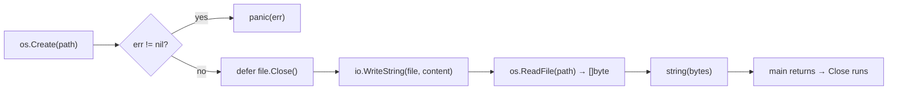

---
tags:
  - golang
  - web
section: "05 Web and Modules"
video: https://www.youtube.com/watch?v=Mdg3tlGUXrE
video_title: "Working with files in golang"
order: 24
---
# Working with Files

> [!info] Source
> 🎬 [Working with files in golang](https://www.youtube.com/watch?v=Mdg3tlGUXrE) · Section **05 Web and Modules** of [[Golang Notes]]
> ⬅️ [[Defer]] · ➡️ [[Handling Web Requests]]

## Overview

Go's standard library can create, write and read **plain text files** out of the box through the `os` and `io` packages. Anything more specialised (CSV, PDF, Excel) needs a dedicated library, exactly as it would in JavaScript or Java. A file is an **operating-system resource**: you open it, use it, and must **close** it. That makes this topic the first real-world use of [[Defer]], and the same open/use/close discipline returns later for HTTP response bodies in [[Handling Web Requests]] and for database connections in [[Connecting to MongoDB]].

Three ideas carry the whole video:

1. Creating and writing is done through `os.Create` and `io.WriteString`.
2. Every operation returns an `error` that you check immediately (the **comma ok** idiom from [[User Input and Comma Ok Syntax]], covered in depth in [[Error Handling in Go]]).
3. Whatever you read back from a file (or from the network) arrives as **bytes**, not as a string.

## The packages involved

| Package | Role in file handling | Used in the video as |
|---|---|---|
| `os` | Talks to the operating system: create, open, remove files, permissions (`Chmod`, `Chown`) | `os.Create("./mylcogofile.txt")` |
| `io` | Generic reading and writing on top of *any* reader or writer | `io.WriteString(file, content)` |
| `io/ioutil` | Old convenience helpers; **deprecated since Go 1.16** (see Modern Go Notes) | `ioutil.ReadFile(filename)` |
| `bufio` | Buffered, line-by-line reading and writing (also used for user input) | not in the video; see the extra example |

> [!note] Why `io.WriteString` works on a file
> `os.Create` returns a `*os.File`. That type has a `Write` method, so it satisfies the `io.Writer` interface. Any function that accepts an `io.Writer` can therefore write into a file, a network connection, or a buffer without caring which one it is. This is the same interface-based design that makes `json.NewEncoder(w)` work on an HTTP response later in [[Get All Courses Controller]].

## Creating and writing a file

```go
content := "This needs to go in a file - LearnCodeOnline.in"

file, err := os.Create("./mylcogofile.txt")
if err != nil {
    panic(err)
}
defer file.Close()

length, err := io.WriteString(file, content)
if err != nil {
    panic(err)
}
fmt.Println("length is:", length)
```

What each line does:

- `os.Create` **creates the file, or truncates it to zero length if it already exists**. The path `./` means "the current working directory", which is the directory you run `go run` from, not the directory of the source file. The file is created with permission mode `0666` (minus the process umask, so usually `rw-r--r--`).
- The call can fail: the directory might not exist, might be read-only, or the disk might be full. That is why it returns two values, `*os.File` and `error`, and why the very next statement is an `if err != nil` check.
- `panic(err)` stops the program immediately and prints the error. It is fine for a learning script; a real service would return the error to its caller instead (see [[Error Handling in Go]]).
- `io.WriteString` returns the number of **bytes written** and an error. For the sentence above that is `47`. The instructor stresses that the only way to know a function returns a length and not the file is to **read the documentation**: `go doc io.WriteString` prints it in the terminal.

### Closing the file

`file.Close()` releases the operating-system file descriptor. The video first calls it at the end of `main`, then moves it into a `defer` statement, which is the recommended form:

- `defer file.Close()` is written **right after the error check**, so it is impossible to forget it when more code is added below.
- Deferred calls run when the surrounding function returns, in last-in-first-out order (see [[Defer]]), so the file is closed even if a later `panic` unwinds the function.

> [!tip] Place the `defer` immediately after you know the resource is valid
> Writing `defer file.Close()` *before* the `if err != nil` check would call `Close` on a `nil` file when creation fails. Check first, then defer.

## Reading a file

Reading uses a different helper than creating. The video uses `ioutil.ReadFile`; the modern spelling is `os.ReadFile`, which does exactly the same thing:

```go
func readFile(filename string) {
    databyte, err := os.ReadFile(filename)
    checkNilErr(err)

    fmt.Println("Text data inside the file is \n", string(databyte))
}
```

The important detail is the **type of `databyte`**: it is `[]byte`, a [[Slices|slice]] of bytes, not a `string`. Printing it directly shows the raw byte values:

**Output (printing `databyte` without conversion):**
```text
Text data inside the file is
 [84 104 105 115 32 110 101 101 100 115 ...]
```

`84` is the ASCII code of `T`, `104` is `h`, `105` is `i` and so on. Wrapping the slice in `string(...)` converts it to text. This is a normal [[Type Conversions|type conversion]], not a hack, and the same conversion is used on every HTTP response body in [[Handling Web Requests]]. The second way to deal with raw bytes, parsing them as JSON, is covered in [[Consuming JSON Data]].

## The `checkNilErr` helper

Checking `err != nil` three times in a short program is repetitive, so the video extracts the check into a small function. The pattern is extremely common in Go code bases:

```go
func checkNilErr(err error) {
    if err != nil {
        panic(err)
    }
}
```

It saves little typing, but it makes the main flow easier to read and gives one place to change the behaviour later (log instead of panic, for example). `error` is an ordinary type in Go, so it can be passed to a function like any other value.

## Example: write a file, then read it back

```go
package main

import (
	"fmt"
	"io"
	"os"
)

func main() {
	fmt.Println("Welcome to files in Go")
	content := "This needs to go in a file - LearnCodeOnline.in"

	// os.Create creates the file (or truncates it if it already exists)
	file, err := os.Create("./mylcogofile.txt")
	checkNilErr(err)
	defer file.Close() // runs when main returns, no matter what

	// io.WriteString writes a string into anything that is an io.Writer
	length, err := io.WriteString(file, content)
	checkNilErr(err)
	fmt.Println("length is:", length)

	readFile("./mylcogofile.txt")
}

func readFile(filename string) {
	// os.ReadFile returns the whole file as a []byte
	databyte, err := os.ReadFile(filename)
	checkNilErr(err)

	fmt.Println("Text data inside the file is \n", string(databyte))
}

func checkNilErr(err error) {
	if err != nil {
		panic(err)
	}
}
```

**Output:**
```text
Welcome to files in Go
length is: 47
Text data inside the file is
 This needs to go in a file - LearnCodeOnline.in
```

After the run, a new `mylcogofile.txt` appears next to `main.go` containing the sentence.



## Extra example: append, and read line by line

The video only shows whole-file operations. Two things you will need almost immediately in real programs are **appending** instead of overwriting, and reading **one line at a time** (large files should not be loaded into memory in one go):

```go
package main

import (
	"bufio"
	"fmt"
	"os"
)

func main() {
	// 1. Write a whole file in one call (creates or truncates it)
	lines := "line one\nline two\nline three\n"
	err := os.WriteFile("notes.txt", []byte(lines), 0644)
	checkNilErr(err)

	// 2. Append to an existing file instead of overwriting it
	f, err := os.OpenFile("notes.txt", os.O_APPEND|os.O_WRONLY, 0644)
	checkNilErr(err)
	_, err = f.WriteString("line four (appended)\n")
	checkNilErr(err)
	f.Close()

	// 3. Read the file line by line with a bufio.Scanner
	f, err = os.Open("notes.txt") // read-only
	checkNilErr(err)
	defer f.Close()

	scanner := bufio.NewScanner(f)
	lineNo := 1
	for scanner.Scan() {
		fmt.Printf("%d: %s\n", lineNo, scanner.Text())
		lineNo++
	}
	checkNilErr(scanner.Err())
}

func checkNilErr(err error) {
	if err != nil {
		panic(err)
	}
}
```

**Output:**
```text
1: line one
2: line two
3: line three
4: line four (appended)
```

- `os.WriteFile` is the one-liner counterpart of `os.ReadFile`: it creates or truncates the file and writes the bytes.
- `os.OpenFile` takes **flags** combined with `|`: `os.O_APPEND` (write at the end), `os.O_WRONLY` (write only), `os.O_CREATE` (create if missing), `os.O_RDONLY` and so on. `os.Open` is simply `OpenFile` with `O_RDONLY`.
- `bufio.Scanner` is the same family as the `bufio.Reader` used for keyboard input in [[User Input and Comma Ok Syntax]]; `Scan` returns `false` at the end of the file, and `scanner.Err()` reports any read error.

## Gotchas and Best Practices

> [!warning] `os.Create` wipes an existing file
> It truncates to zero length before you write anything. Use `os.OpenFile` with `os.O_APPEND` when you want to keep the old content.

> [!warning] Paths are relative to where you run the program
> `./mylcogofile.txt` is resolved against the current working directory of the process, which is wherever you typed `go run main.go`. Running the compiled binary from another folder creates the file *there*.

> [!warning] Never ignore the bytes-versus-string difference
> `os.ReadFile`, `io.ReadAll` and `bufio.Reader.ReadString` all hand you `[]byte` or raw text that still needs trimming or converting. Forgetting `string(...)` prints numbers; forgetting `strings.TrimSpace` keeps the trailing newline (the exact bug from [[Type Conversions]]).

> [!tip] One `defer` per opened file, placed right after the error check
> A `defer` inside a loop only runs when the *function* returns, not at the end of each iteration, so a loop that opens many files should do the work in a helper function.

> [!tip] `panic` is for scripts; returning `error` is for libraries and services
> Keep `checkNilErr` for small tools. In an API (see [[Building an API - Models]]) you report the problem to the client instead of crashing the server.

## Modern Go Notes

The video imports `io/ioutil`. Since Go 1.16 every function in that package is a thin wrapper that is marked **Deprecated** in the docs, and `go doc io/ioutil.ReadFile` says so explicitly. Use the replacements:

| Video (`io/ioutil`) | Use instead | Notes |
|---|---|---|
| `ioutil.ReadFile(name)` | `os.ReadFile(name)` | identical behaviour |
| `ioutil.WriteFile(name, data, perm)` | `os.WriteFile(name, data, perm)` | identical behaviour |
| `ioutil.ReadAll(r)` | `io.ReadAll(r)` | used for HTTP bodies in [[Handling Web Requests]] |
| `ioutil.ReadDir(dir)` | `os.ReadDir(dir)` | returns `[]os.DirEntry` instead of `[]os.FileInfo` |
| `ioutil.TempDir`, `ioutil.TempFile` | `os.MkdirTemp`, `os.CreateTemp` | |

The instructor's companion code still compiles with `ioutil`, because deprecated does not mean removed, but new code and linters expect the `os`/`io` forms. All examples in this note use them.

## Video Timeline

| Time | What happens |
|---|---|
| [00:03](https://youtu.be/Mdg3tlGUXrE?t=3) | Go handles text files natively; CSV or PDF need a library; files must be closed, ideally with `defer` |
| [02:36](https://youtu.be/Mdg3tlGUXrE?t=156) | `os.Create("./mylcogofile.txt")`, a look at `os` methods such as `Chmod` and `Chown` |
| [03:43](https://youtu.be/Mdg3tlGUXrE?t=223) | Checking `err != nil` and stopping with `panic(err)` |
| [04:21](https://youtu.be/Mdg3tlGUXrE?t=261) | Writing with `io.WriteString`; it returns the length, which you learn from the docs |
| [06:35](https://youtu.be/Mdg3tlGUXrE?t=395) | `file.Close()` moved into a `defer`; first run creates the file |
| [07:52](https://youtu.be/Mdg3tlGUXrE?t=472) | `readFile` function using `ioutil.ReadFile` |
| [08:33](https://youtu.be/Mdg3tlGUXrE?t=513) | The data comes back as bytes; printing it raw, then wrapping it in `string(...)` |
| [11:10](https://youtu.be/Mdg3tlGUXrE?t=670) | Extracting the repeated error check into `checkNilErr` |

## Related Notes

- [[Defer]] — the mechanism that guarantees `file.Close()` runs.
- [[Error Handling in Go]] — `if err != nil`, `panic`, and when to return errors instead.
- [[User Input and Comma Ok Syntax]] — the two-value return idiom and `bufio.NewReader`, cousin of `bufio.Scanner`.
- [[Type Conversions]] — `string(bytes)` is the same kind of conversion as `strconv.ParseFloat`.
- [[Slices]] — `[]byte` is an ordinary slice, which is why `len` and indexing work on it.
- [[Handling Web Requests]] — HTTP bodies are read with the same `io.ReadAll` → `string` pattern and closed with the same `defer`.
- [[Consuming JSON Data]] — the second way to handle raw bytes: decode them as JSON.
- [[fmt Package and Format Verbs]] — `Println`, `Printf` and `%T` used throughout.
- [[Go Quick Reference]] — cheat sheet entry for files.
- [[Golang Notes]] — map of the whole series.
