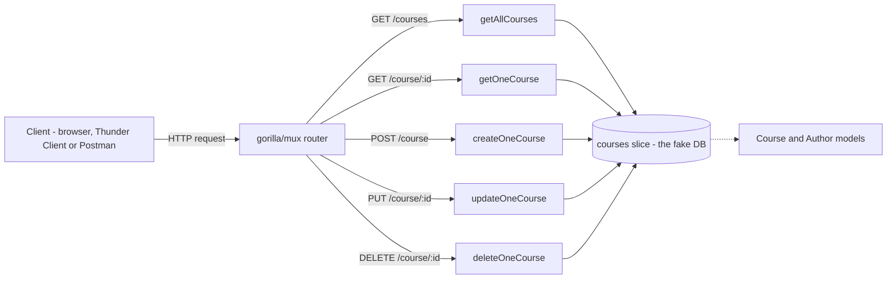

---
tags:
  - golang
  - api
section: "06 Building an API"
video: https://www.youtube.com/watch?v=TrouRtr5xWE
video_title: "Building API in golang - Models"
order: 34
---
# Building an API - Models

> [!info] Source
> 🎬 [Building API in golang - Models](https://www.youtube.com/watch?v=TrouRtr5xWE) · Section **06 Building an API** of [[Golang Notes]]
> ⬅️ [[Go Modules]] · ➡️ [[Get All Courses Controller]]

## Overview
This section builds a complete **CRUD API** (Create, Read, Update, Delete) for a catalogue of courses, modelled on the LearnCodeOnline backend. Everything learned so far comes together: [[Structs]] describe the data, [[Slices]] hold it, [[Creating JSON Data]] and [[Consuming JSON Data]] move it over HTTP, and the `gorilla/mux` router introduced in [[Go Modules]] dispatches requests to the right function.

Two deliberate simplifications are made. There is **no database yet**: a slice acts as a fake one, and the real database arrives in [[MongoDB Setup]]. And the whole API lives in **one `main.go`**, so every moving part is visible on one screen; comments in the code mark what would normally be separate files, and the split into packages happens in the MongoDB section.

This first video sets up the project and writes the **model layer**: the `Course` and `Author` structs, the fake database, and a small validation helper.

## The action plan
The instructor writes the plan down before coding, which is a habit worth copying:

1. Users can **get all courses**, **get one course**, **create** a course, **update** an existing course and **delete** a course.
2. A course without a name (and originally without an id) must **not** be added, so a helper method is needed to check for that.
3. A **slice** of courses is the fake database for this section.
4. Every route is handled by its own function (a **controller**), and `gorilla/mux` maps HTTP verbs and paths to those controllers.



The router and the controllers are built in the next videos; this note covers the two boxes on the right.

## Project setup
A new folder, a new module, and the router dependency:

```bash
mkdir 24buildapi && cd 24buildapi
go mod init github.com/hiteshchoudhary/buildapi   # the instructor's module path; use your own
go get github.com/gorilla/mux                     # copied from the package page on pkg.go.dev
```

Because `gorilla/mux` was already in the local **module cache** from the [[Go Modules]] video, `go get` finishes almost instantly: Go only looks up the latest version and reuses the cached copy instead of downloading it again.

![[34_pkggodev_gorilla_mux_0316.png]]
*Figure: the gorilla/mux README on GitHub with the install command the instructor copies (video at 03:16)*

> [!note] Why the instructor's go.mod says `// indirect`
> He runs `go get` before any code imports the package, so Go records the dependency as `require github.com/gorilla/mux v1.8.0 // indirect`. Once `main.go` imports it, `go mod tidy` rewrites the line without the comment. Nothing is broken either way.

The instructor also mentions that he saves the file less often in this section: saving triggers the editor's Go tooling, which can rewrite the import block while the code is half-written.

## The Course model
A **model** describes the shape of one record. In Go that is a struct, and because this struct will be sent and received as JSON, every field gets a **struct tag** that names its JSON key:

```go
// Model for course - file
type Course struct {
	CourseId    string  `json:"courseid"`
	CourseName  string  `json:"coursename"`
	CoursePrice int     `json:"price"`
	Author      *Author `json:"author"`
}

type Author struct {
	Fullname string `json:"fullname"`
	Website  string `json:"website"`
}
```

| Go field | Go type | JSON key | Why |
|---|---|---|---|
| `CourseId` | `string` | `courseid` | A string id makes the create controller more work (see [[Create Course Controller]]), which the instructor does on purpose to teach string conversion |
| `CourseName` | `string` | `coursename` | The one field a course can never be without |
| `CoursePrice` | `int` | `price` | Kept as an integer (rupees) rather than a float |
| `Author` | `*Author` | `author` | A nested model, stored by pointer |
| `Author.Fullname` | `string` | `fullname` | |
| `Author.Website` | `string` | `website` | |

Key points about the declaration:

- Field names start with a **capital letter** so they are **exported**. The `encoding/json` package lives in another package and can only see exported fields; a lowercase field is silently skipped when encoding and decoding.
- The tag `json:"coursename"` decouples the Go name from the wire format. Lowercase JSON keys are the convention for web APIs, and the Go side can keep its own `CamelCase` names. See [[Creating JSON Data]] for the other tag options (`omitempty`, `-`).
- Tags are written between **backticks**, with no space around the colon: `json:"price"`.

### Why `Author` is a pointer
`Author` could have been declared as a plain `Author` value. The instructor chooses `*Author` for the reason covered in [[Pointers]]: a value field is **copied** into every course, while a pointer lets several courses **share** one author record and lets the field be empty (`nil`). The type is only being *declared* here; the actual pointer is created later when a course is seeded with `&Author{...}` (see [[Routes and Testing the API]]).

One consequence to remember: a `nil` pointer field encodes to JSON `null`, so a course created without an author comes back as `"author": null`.

## The fake database
Until the MongoDB section, the "database" is a package-level slice:

```go
// fake DB
var courses []Course
```

It starts out as a **nil slice** with length zero. Controllers read it with a `for ... range` loop, add to it with `append`, and remove from it with the slice-of-slices trick from [[Slices]]. Because it is a package-level variable, every controller function can reach it without passing it around.

## The helper method: `IsEmpty`
Real APIs have helpers and **middleware** (the instructor uses the words interchangeably here, although middleware normally means code that runs *around* every request). This one answers a single question: should this course be allowed into the database?

```go
// middleware, helper - file
func (c *Course) IsEmpty() bool {
	return c.CourseId == "" && c.CourseName == ""
}
```

It is a method on `*Course` (see [[Methods]]), so any course value can be asked `course.IsEmpty()`. It returns `true` when the course has no data, and the create controller uses that to stop early.

> [!warning] `&&` does not mean "both must be filled"
> The instructor says he wants to proceed *only if both fields are filled*, but `c.CourseId == "" && c.CourseName == ""` is `true` only when **both** are empty. A course with just an id would pass. To reject a course when **either** field is missing you need `||`. The point becomes moot in [[Create Course Controller]], where the method is changed to check only `CourseName`, because the server generates the id itself.

## Example: the model layer on its own
The models, the fake database and the helper work without any HTTP code. This program seeds two courses that share one author, shows how a pointer field prints, and marshals the slice to JSON:

```go
package main

import (
	"encoding/json"
	"fmt"
)

type Course struct {
	CourseId    string  `json:"courseid"`
	CourseName  string  `json:"coursename"`
	CoursePrice int     `json:"price"`
	Author      *Author `json:"author"`
}

type Author struct {
	Fullname string `json:"fullname"`
	Website  string `json:"website"`
}

var courses []Course

func (c *Course) IsEmpty() bool {
	return c.CourseName == ""
}

func main() {
	hitesh := &Author{Fullname: "Hitesh Choudhary", Website: "lco.dev"}

	courses = append(courses,
		Course{CourseId: "2", CourseName: "ReactJS", CoursePrice: 299, Author: hitesh},
		Course{CourseId: "4", CourseName: "MERN Stack", CoursePrice: 199, Author: hitesh},
	)

	fmt.Printf("%+v\n", courses[0])

	hitesh.Website = "example.dev" // both courses see the change: they share the pointer
	fmt.Println(courses[0].Author.Website, courses[1].Author.Website)

	empty := Course{}
	fmt.Println("empty course is empty?", empty.IsEmpty())
	fmt.Println("ReactJS is empty?", courses[0].IsEmpty())

	out, _ := json.MarshalIndent(courses, "", "  ")
	fmt.Println(string(out))
}
```

**Output:**

```text
{CourseId:2 CourseName:ReactJS CoursePrice:299 Author:0x9d7d1576080}
example.dev example.dev
empty course is empty? true
ReactJS is empty? false
[
  {
    "courseid": "2",
    "coursename": "ReactJS",
    "price": 299,
    "author": {
      "fullname": "Hitesh Choudhary",
      "website": "example.dev"
    }
  },
  {
    "courseid": "4",
    "coursename": "MERN Stack",
    "price": 199,
    "author": {
      "fullname": "Hitesh Choudhary",
      "website": "example.dev"
    }
  }
]
```

The first line is the interesting one: `%+v` (see [[fmt Package and Format Verbs]]) prints the **address** stored in the pointer field (the exact hex value changes from run to run), not the author's data. The JSON encoder, on the other hand, follows the pointer and writes the nested object.

## Gotchas and Best Practices
> [!warning] Unexported fields vanish from JSON
> `name string` instead of `Name string` compiles fine and then produces `{}`. Always capitalise fields that must cross the JSON boundary.

> [!tip] Write the plan as comments first
> The `// Model for course - file`, `// fake DB` and `// middleware, helper - file` comments are the instructor's map of the future project layout. The MongoDB section turns each comment into a real file or package.

> [!note] Money as an integer
> The instructor briefly considers `float` for the price and settles on `int`. Keeping money in whole units (rupees, or better, paise) avoids floating-point rounding surprises.

> [!tip] Pointer receivers work on values too
> `empty.IsEmpty()` compiles even though `empty` is a value, because Go takes its address automatically when the variable is addressable. See [[Methods]].

## Video Timeline
| Time | What happens |
|---|---|
| [00:30](https://youtu.be/TrouRtr5xWE?t=30) | The section's plan: a full CRUD API, no database yet, one file, `gorilla/mux` for routing |
| [02:26](https://youtu.be/TrouRtr5xWE?t=146) | Creating `24buildapi`, `go mod init`, adding `gorilla/mux` from pkg.go.dev |
| [03:53](https://youtu.be/TrouRtr5xWE?t=233) | The action plan: get all, create, update, delete, a validation helper, a slice as fake DB |
| [05:12](https://youtu.be/TrouRtr5xWE?t=312) | Defining the `Course` model and the nested `Author` model with JSON tags |
| [08:10](https://youtu.be/TrouRtr5xWE?t=490) | Why `Author` is stored as a pointer |
| [09:21](https://youtu.be/TrouRtr5xWE?t=561) | The fake database `courses []Course` |
| [09:42](https://youtu.be/TrouRtr5xWE?t=582) | The `IsEmpty` helper and the helper-vs-middleware naming |

## Related Notes
- [[Get All Courses Controller]] — the first controller that reads from this fake database.
- [[Go Modules]] — where `gorilla/mux` and `go mod init` were introduced.
- [[Structs]] — the type behind every model.
- [[Pointers]] — why `Author` is `*Author` and what sharing a pointer means.
- [[Slices]] — the fake database and the `append`/remove operations the controllers use.
- [[Methods]] — `IsEmpty` is a method with a pointer receiver.
- [[Creating JSON Data]] — struct tags, `omitempty`, and `MarshalIndent`.
- [[MongoDB Setup]] — where the fake database is replaced by a real one.
- [[fmt Package and Format Verbs]] — `%+v` and why it prints a pointer address.
- [[Go Quick Reference]] — syntax cheat sheet.
