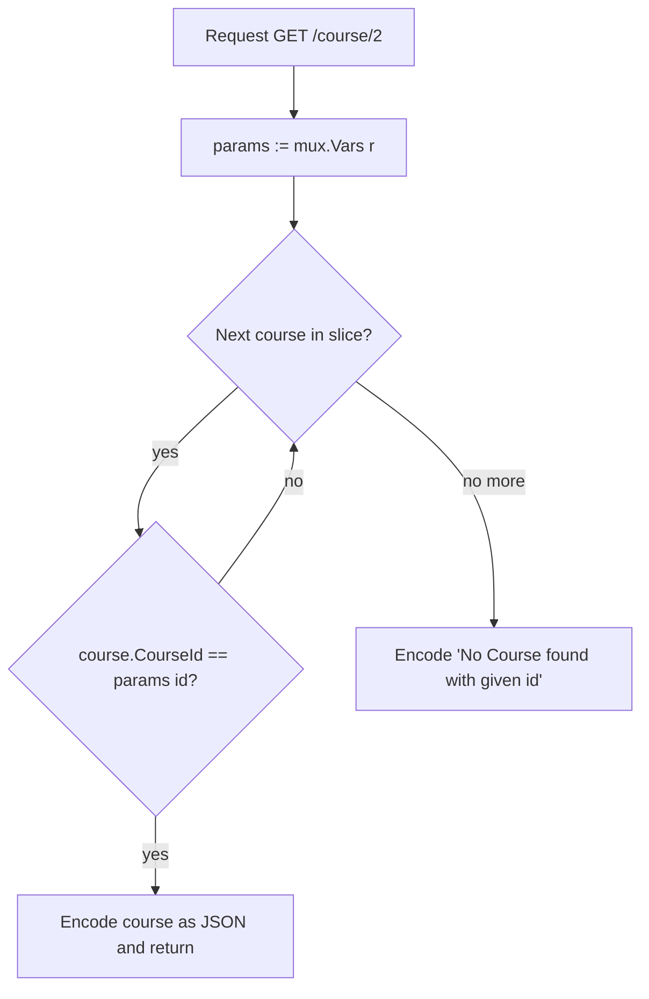

---
tags:
  - golang
  - api
section: "06 Building an API"
video: https://www.youtube.com/watch?v=1J1sgKriM-o
video_title: "Get one course based on request id in golang"
order: 36
---
# Get One Course Controller

> [!info] Source
> 🎬 [Get one course based on request id in golang](https://www.youtube.com/watch?v=1J1sgKriM-o) · Section **06 Building an API** of [[Golang Notes]]
> ⬅️ [[Get All Courses Controller]] · ➡️ [[Create Course Controller]]

## Overview
Returning everything is easy; returning **one** record means the client has to tell the server which one. The id travels in the URL (`/course/2`), the router extracts it, and the controller searches the fake database for it. This video introduces `mux.Vars`, the `gorilla/mux` way of reading **route parameters**, and the loop-compare-return pattern that the update and delete controllers reuse later. Without a database there is no "find by id" helper, so the search is a plain `for ... range` loop over the slice from [[Building an API - Models]].

## A word on naming
The instructor deliberately **breaks a REST convention**. Production APIs tend to name the resource, not the action: one route `/courses` and one route `/courses/{id}`, with the HTTP verb (`GET`, `POST`, `PUT`, `DELETE`) saying what happens. In a tutorial, a function called `getOneCourse` makes it obvious what the code does, so he names controllers by action and keeps the routes short (`/course`, `/course/{id}`). Renaming later is a basic refactor; understanding the mechanics matters more.

| Convention | Route | Verb | Handler name |
|---|---|---|---|
| Typical production | `/courses/{id}` | `GET` | often just `course` or `show` |
| This series | `/course/{id}` | `GET` | `getOneCourse` |

## Reading the id from the request
Everything the client sends is inside `*http.Request`. The id could be parsed from `r.URL` by hand, as in [[Handling URLs]], but the router has already matched the path against a pattern like `/course/{id}`, so it offers the captured pieces directly:

```go
// grab id from request
params := mux.Vars(r)
```

`mux.Vars(r)` returns a `map[string]string` (see [[Maps]]) holding **every** route variable of the matched route, keyed by the name written inside the curly braces in the route pattern. For `/course/{id}` the map is `map[id:2]` when the request was `/course/2`.

> [!warning] The key must match the route pattern
> `params["id"]` only works because the route is declared as `/course/{id}` in [[Routes and Testing the API]]. If the route said `/course/{courseId}`, the controller would have to read `params["courseId"]`. Change one and you must change the other.

The instructor leaves printing `params` as an exercise. Doing it shows both the value and the type:

```go
fmt.Printf("%v is of type %T\n", params, params)
```

**Output:**

```text
map[id:2] is of type map[string]string
```

## The search
The plan, written as comments before the code:

1. Loop through `courses`.
2. Find the course whose `CourseId` matches the id the user sent.
3. Return that course as the response.



```go
func getOneCourse(w http.ResponseWriter, r *http.Request) {
	fmt.Println("Get one course")
	w.Header().Set("Content-Type", "application/json")

	// grab id from request
	params := mux.Vars(r)

	// loop through courses, find matching id and return the response
	for _, course := range courses {
		if course.CourseId == params["id"] {
			json.NewEncoder(w).Encode(course)
			return
		}
	}
	json.NewEncoder(w).Encode("No Course found with given id")
}
```

Line by line:

- `for _, course := range courses` is the classic range loop from [[Loops, Break, Continue and Goto]]. The index is not needed here, so it is discarded with `_`; only the value matters.
- `course.CourseId == params["id"]` is a plain string comparison, which is why the model stores the id as a string.
- `json.NewEncoder(w).Encode(course)` sends the match, exactly as in [[Get All Courses Controller]]. What is sent is up to you: the whole course, only its author, only its name.
- `return` ends the function the moment a match is found. Without it, the loop would keep running and the "not found" message would be written **after** the course, producing two JSON values in one response.
- After the loop, nothing matched, and a string is encoded as the answer. The instructor suggests including the requested id in the message as an exercise.

> [!note] "Redundant return statement"
> The companion code has a final `return` after the not-found line. The editor flags it as redundant because the function ends there anyway. It is harmless, and the instructor keeps it only to be explicit.

## What the client receives
With the seeded data from [[Routes and Testing the API]]:

```bash
curl http://localhost:4000/course/2
```

```json
{
  "courseid": "2",
  "coursename": "ReactJS",
  "price": 299,
  "author": { "fullname": "Hitesh Choudhary", "website": "lco.dev" }
}
```

```bash
curl http://localhost:4000/course/99
```

```text
"No Course found with given id"
```

The second response is a JSON **string** (note the quotes) and, because the controller never sets a status code, it arrives with `200 OK`. See the best-practice callout below.

## Example: a stricter version
The same controller with the two improvements the instructor leaves as exercises: an informative message that includes the id, and a proper `404` status so clients can tell success from failure without parsing the body.

```go
func getOneCourse(w http.ResponseWriter, r *http.Request) {
	w.Header().Set("Content-Type", "application/json")
	params := mux.Vars(r)

	for _, course := range courses {
		if course.CourseId == params["id"] {
			json.NewEncoder(w).Encode(course)
			return
		}
	}

	w.WriteHeader(http.StatusNotFound)
	json.NewEncoder(w).Encode("No course found with id " + params["id"])
}
```

`w.WriteHeader(code)` must be called **before** the body is written, and `http.StatusNotFound` is the named constant for `404`.

## Gotchas and Best Practices
> [!warning] Forgetting `return` sends two bodies
> The loop does not stop on its own after `Encode`. Always `return` after writing a successful response.

> [!tip] Use status codes, not only messages
> Clients and monitoring tools look at the status line first. `404` for "not found", `400` for a bad request and `201` for "created" make the API self-describing. Set them with `w.WriteHeader` before encoding.

> [!note] A linear search is fine for a slice, not for a database
> Looping over every course is O(n). With MongoDB in [[Get All Documents from MongoDB]] and its siblings, the database does the lookup by id for you.

> [!tip] Print `params` once
> Seeing `map[id:2]` in the terminal removes all doubt about what the router extracted and which key to read.

## Modern Go Notes
Since Go 1.22 the standard library router can do this without `gorilla/mux`. The route pattern carries the method and a wildcard, and the request exposes the wildcard's value:

```go
mux := http.NewServeMux()
mux.HandleFunc("GET /course/{id}", getOneCourse)
```

```go
id := r.PathValue("id") // instead of mux.Vars(r)["id"]
```

The series uses `gorilla/mux` throughout, so the notes keep it; the standard library version is shown in full in [[Routes and Testing the API]].

## Video Timeline
| Time | What happens |
|---|---|
| [00:16](https://youtu.be/1J1sgKriM-o?t=16) | Why the controller is named `getOneCourse` (breaking the REST naming convention on purpose) |
| [02:56](https://youtu.be/1J1sgKriM-o?t=176) | Grabbing the id with `mux.Vars(r)` |
| [04:07](https://youtu.be/1J1sgKriM-o?t=247) | The action plan: loop, find the matching id, return the response |
| [04:28](https://youtu.be/1J1sgKriM-o?t=268) | The `for ... range` loop and the `if` comparison |
| [05:53](https://youtu.be/1J1sgKriM-o?t=353) | Encoding the found course and returning early |
| [06:35](https://youtu.be/1J1sgKriM-o?t=395) | The "no course found" response and the redundant `return` hint |

## Related Notes
- [[Get All Courses Controller]] — the encoder pattern this controller reuses.
- [[Create Course Controller]] — the next controller, which reads the request body instead of the URL.
- [[Routes and Testing the API]] — where `/course/{id}` is declared, which defines the `id` key.
- [[Handling URLs]] — parsing URLs and query parameters by hand with `net/url`.
- [[Maps]] — `mux.Vars` returns a `map[string]string`.
- [[Loops, Break, Continue and Goto]] — the `for ... range` loop and early exits.
- [[Slices]] — the fake database being searched.
- [[Update Course Controller]] and [[Delete Course Controller]] — reuse the same find-by-id loop.
- [[Go Quick Reference]] — syntax cheat sheet.
