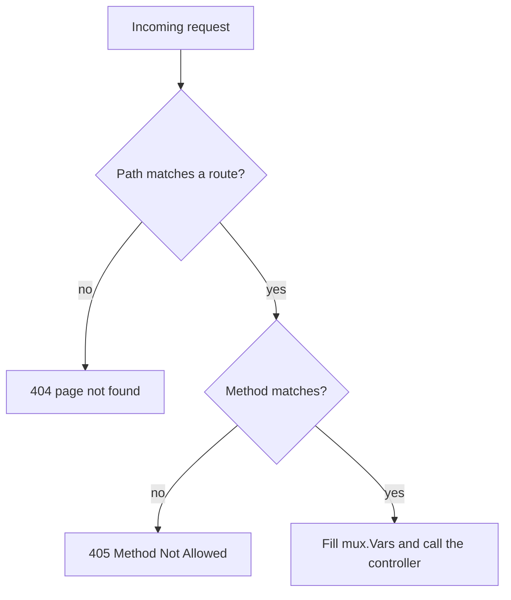

---
tags:
  - golang
  - api
section: "06 Building an API"
video: https://www.youtube.com/watch?v=NedcxRgo4DY
video_title: "Handling routes and testing routes in golang"
order: 40
---
# Routes and Testing the API

> [!info] Source
> 🎬 [Handling routes and testing routes in golang](https://www.youtube.com/watch?v=NedcxRgo4DY) · Section **06 Building an API** of [[Golang Notes]]
> ⬅️ [[Delete Course Controller]] · ➡️ [[MongoDB Setup]]

## Overview
Five controllers exist but nothing calls them. This video wires each one to a **route** (an HTTP verb plus a path) with `gorilla/mux`, seeds the fake database with two courses, starts the server on port 4000, and then tests every route with the **Thunder Client** extension for VS Code (Postman works the same way). The instructor calls it the "second last" step because testing is where bugs surface, and several do: a wrong path, a server that does not reload, a body with the wrong keys, and a delete that answers with silence. The full assembled program is at the end of this note.

## Reading the gorilla/mux documentation
The package page shows the three calls the whole routing layer is made of:

```go
r := mux.NewRouter()                        // a router
r.HandleFunc("/products", ProductsHandler)  // a path and its controller
r.HandleFunc("/products", ProductsHandler).Methods("POST") // restricted to one verb
```

![[40_mux_docs_methods_0114.png]]
*Figure: the gorilla/mux documentation example of a route, its handler and the `.Methods()` matcher (video at 01:14)*

`HandleFunc` returns a `*mux.Route`, and `Methods("GET")` adds a matcher to it, so the same path can be registered several times with different verbs. The documentation also shows query matchers and host matchers, which the series does not use.

## Seeding the fake database
Before the routes, `main` puts two courses into `courses` so the read routes have something to return. Each course is a struct literal with named fields (see [[Structs]]), and the author is created with `&Author{...}` because the field is a pointer (see [[Pointers]]):

```go
// seeding
courses = append(courses, Course{CourseId: "2", CourseName: "ReactJS", CoursePrice: 299,
	Author: &Author{Fullname: "Hitesh Choudhary", Website: "lco.dev"}})
courses = append(courses, Course{CourseId: "4", CourseName: "MERN Stack", CoursePrice: 199,
	Author: &Author{Fullname: "Hitesh Choudhary", Website: "go.dev"}})
```

Nothing forces the author to be filled in; a course without one would simply carry `"author": null`.

## Listening on a port
```go
log.Fatal(http.ListenAndServe(":4000", r))
```

`http.ListenAndServe` takes the address (the **colon** is mandatory; `":4000"` means every interface on port 4000) and a handler, here the mux router. It blocks for as long as the server runs and only returns when something goes wrong, which is why its result is wrapped in `log.Fatal`: if the port is taken or the server dies, the error is printed and the program exits. Anything placed after it never runs; the MongoDB project's `Listening at port 4000 ...` line in [[MongoDB API Routes and Testing]] is exactly that mistake.

## Wiring the routes
```go
// routing
r.HandleFunc("/", serveHome).Methods("GET")
r.HandleFunc("/courses", getAllCourses).Methods("GET")
r.HandleFunc("/course/{id}", getOneCourse).Methods("GET")
r.HandleFunc("/course", createOneCourse).Methods("POST")
r.HandleFunc("/course/{id}", updateOneCourse).Methods("PUT")
r.HandleFunc("/course/{id}", deleteOneCourse).Methods("DELETE")
```

| Verb | Path | Controller | Input |
|---|---|---|---|
| `GET` | `/` | `serveHome` | none |
| `GET` | `/courses` | `getAllCourses` | none |
| `GET` | `/course/{id}` | `getOneCourse` | route variable |
| `POST` | `/course` | `createOneCourse` | JSON body |
| `PUT` | `/course/{id}` | `updateOneCourse` | route variable + JSON body |
| `DELETE` | `/course/{id}` | `deleteOneCourse` | route variable |

Three details matter:

- The controller is passed as a **value**, `serveHome`, not called as `serveHome()`. The router calls it later, once per request (see [[Functions]]).
- `{id}` declares a **route variable**. Its name is the key that `mux.Vars(r)["id"]` reads in the controllers; rename one and you must rename the other.
- The same path `/course/{id}` appears three times with different verbs. `mux` picks the route whose path *and* method match.



## Building and running
```bash
go build .        # compiles every .go file in the folder (another way to check for errors)
go run main.go    # or: go run .
```

The server prints `API - LearnCodeOnline.in` and stays running. Opening `http://localhost:4000` in a browser shows the welcome heading from `serveHome`. (The instructor first types port 8000 out of habit; the server is on 4000.)

> [!warning] No automatic reload
> Go programs do not restart themselves when the source changes. After every edit, stop the server (`Ctrl+C`) and `go run` again. The instructor notices this when a tag change seems to have no effect. Tools such as `air` add live reload if you want it.

## Testing the routes
Thunder Client is a lightweight REST-client extension for VS Code; Postman is the standalone equivalent, used again in [[MongoDB API Routes and Testing]]. Every request below shows the URL, the body if any, and the response as the server really sends it.

### GET /courses
![[40_thunder_get_courses_1114.png]]
*Figure: Thunder Client showing the two seeded courses returned by `GET /courses` (video at 11:14)*

```text
[{"courseid":"2","coursename":"ReactJS","price":299,"author":{"fullname":"Hitesh Choudhary","website":"lco.dev"}},{"courseid":"4","coursename":"MERN Stack","price":199,"author":{"fullname":"Hitesh Choudhary","website":"go.dev"}}]
```

### GET /course/2
```json
{"courseid":"2","coursename":"ReactJS","price":299,"author":{"fullname":"Hitesh Choudhary","website":"lco.dev"}}
```

The instructor first requests `/courses/2` and gets `404 page not found`: the route is `/course/{id}`, singular. A custom `NotFoundHandler` on the router can replace that plain-text page with a JSON message.

While here, he retests a trick from [[Creating JSON Data]]: changing the price tag to `json:"-"` hides the price from every response (after a restart). The tag is then put back.

### POST /course
With an empty body, or with `{}`, the create controller refuses:

```text
"No data inside JSON"
```

With a real course, whose keys must match the struct tags (`coursename`, `price`, `author` with `fullname` and `website`):

```json
{
  "coursename": "Angular JS",
  "price": 199,
  "author": { "fullname": "Telusko", "website": "telusko.com" }
}
```

![[40_thunder_post_course_1538.png]]
*Figure: Thunder Client posting a course and receiving it back with a generated id (video at 15:38)*

```json
{"courseid":"3","coursename":"Angular JS","price":199,"author":{"fullname":"Telusko","website":"telusko.com"}}
```

The id is random (`7` in the video, `3` in this run). `GET /courses` now lists three courses. Posting the same body again creates a **duplicate** with a new id, which leads to the assignment below.

### PUT /course/3
```json
{
  "coursename": "NodeJS Crash Course",
  "price": 399,
  "author": { "fullname": "Brad T", "website": "brad.com" }
}
```

```json
{"courseid":"3","coursename":"NodeJS Crash Course","price":399,"author":{"fullname":"Brad T","website":"brad.com"}}
```

`GET /courses` confirms the rename and the new price.

### DELETE /course/2
The response body is empty, so the only way to confirm the deletion is another `GET /courses`, which now returns the MERN Stack course and the updated course only. The instructor adds a `TODO` for a confirm-or-deny response; the finished version is in [[Delete Course Controller]].

### A wrong verb
`POST /courses` matches the path but not the method, so `mux` answers `405 Method Not Allowed` with an empty body. A path nothing matches gives `404`.

## Assignment: reject duplicate titles
Inside `createOneCourse`, after the `IsEmpty` check, loop through `courses`; if any `CourseName` equals the incoming name, respond with a message such as "a course with this name already exists" and return. A solution is in [[Create Course Controller]].

## Example: the complete program
Everything from [[Building an API - Models]] to this video in one file, with the header typo corrected and a `return` added after the empty-body message:

```go
package main

import (
	"encoding/json"
	"fmt"
	"log"
	"math/rand"
	"net/http"
	"strconv"
	"time"

	"github.com/gorilla/mux"
)

// Model for course - file
type Course struct {
	CourseId    string  `json:"courseid"`
	CourseName  string  `json:"coursename"`
	CoursePrice int     `json:"price"`
	Author      *Author `json:"author"`
}

type Author struct {
	Fullname string `json:"fullname"`
	Website  string `json:"website"`
}

// fake DB
var courses []Course

// middleware, helper - file
func (c *Course) IsEmpty() bool {
	// return c.CourseId == "" && c.CourseName == ""
	return c.CourseName == ""
}

func main() {
	fmt.Println("API - LearnCodeOnline.in")
	r := mux.NewRouter()

	// seeding
	courses = append(courses, Course{CourseId: "2", CourseName: "ReactJS", CoursePrice: 299, Author: &Author{Fullname: "Hitesh Choudhary", Website: "lco.dev"}})
	courses = append(courses, Course{CourseId: "4", CourseName: "MERN Stack", CoursePrice: 199, Author: &Author{Fullname: "Hitesh Choudhary", Website: "go.dev"}})

	// routing
	r.HandleFunc("/", serveHome).Methods("GET")
	r.HandleFunc("/courses", getAllCourses).Methods("GET")
	r.HandleFunc("/course/{id}", getOneCourse).Methods("GET")
	r.HandleFunc("/course", createOneCourse).Methods("POST")
	r.HandleFunc("/course/{id}", updateOneCourse).Methods("PUT")
	r.HandleFunc("/course/{id}", deleteOneCourse).Methods("DELETE")

	// listen to a port
	log.Fatal(http.ListenAndServe(":4000", r))
}

// controllers - file

// serve home route
func serveHome(w http.ResponseWriter, r *http.Request) {
	w.Write([]byte("<h1>Welcome to API by LearnCodeOnline</h1>"))
}

func getAllCourses(w http.ResponseWriter, r *http.Request) {
	fmt.Println("Get all courses")
	w.Header().Set("Content-Type", "application/json")
	json.NewEncoder(w).Encode(courses)
}

func getOneCourse(w http.ResponseWriter, r *http.Request) {
	fmt.Println("Get one course")
	w.Header().Set("Content-Type", "application/json")

	// grab id from request
	params := mux.Vars(r)

	// loop through courses, find matching id and return the response
	for _, course := range courses {
		if course.CourseId == params["id"] {
			json.NewEncoder(w).Encode(course)
			return
		}
	}
	json.NewEncoder(w).Encode("No Course found with given id")
}

func createOneCourse(w http.ResponseWriter, r *http.Request) {
	fmt.Println("Create one course")
	w.Header().Set("Content-Type", "application/json")

	// what if: body is empty
	if r.Body == nil {
		json.NewEncoder(w).Encode("Please send some data")
		return
	}

	// what about - {}
	var course Course
	_ = json.NewDecoder(r.Body).Decode(&course)
	if course.IsEmpty() {
		json.NewEncoder(w).Encode("No data inside JSON")
		return
	}

	// TODO: check only if title is duplicate
	// loop, title matches with course.coursename, JSON

	// generate unique id, string
	// append course into courses
	rand.Seed(time.Now().UnixNano()) // not needed since Go 1.20 (see Modern Go Notes)
	course.CourseId = strconv.Itoa(rand.Intn(100))
	courses = append(courses, course)
	json.NewEncoder(w).Encode(course)
}

func updateOneCourse(w http.ResponseWriter, r *http.Request) {
	fmt.Println("Update one course")
	w.Header().Set("Content-Type", "application/json")

	// first - grab id from req
	params := mux.Vars(r)

	// loop, id, remove, add with my ID
	for index, course := range courses {
		if course.CourseId == params["id"] {
			courses = append(courses[:index], courses[index+1:]...)
			var course Course
			_ = json.NewDecoder(r.Body).Decode(&course)
			course.CourseId = params["id"]
			courses = append(courses, course)
			json.NewEncoder(w).Encode(course)
			return
		}
	}
	// TODO: send a response when id is not found
}

func deleteOneCourse(w http.ResponseWriter, r *http.Request) {
	fmt.Println("Delete one course")
	w.Header().Set("Content-Type", "application/json")

	params := mux.Vars(r)

	// loop, id, remove (index, index+1)
	for index, course := range courses {
		if course.CourseId == params["id"] {
			courses = append(courses[:index], courses[index+1:]...)
			// TODO: send a confirm or deny response
			break
		}
	}
}
```

The server's own terminal shows one log line per request, which is how you tell which controller handled what:

```text
API - LearnCodeOnline.in
Get all courses
Get one course
Create one course
Update one course
Delete one course
```

## Gotchas and Best Practices
> [!warning] Singular versus plural paths
> `/courses` lists, `/course/{id}` fetches one. Mixing them up is the first bug of the testing session and produces a `404`, not a helpful message.

> [!warning] JSON keys follow the tags, not the field names
> `CourseName` in Go is `coursename` on the wire. Sending `"CourseName"` or `"name"` leaves the field empty and the request is rejected as "No data inside JSON".

> [!tip] Restart after every change
> Until a live-reload tool is added, every edit needs `Ctrl+C` and `go run` again.

> [!tip] Log inside controllers while testing
> The `fmt.Println` labels in each controller are the cheapest tracing you can get.

> [!note] Two TODOs remain
> No response when a delete or update id is unknown, and no duplicate-title check on create. Both are finished in [[Create Course Controller]], [[Update Course Controller]] and [[Delete Course Controller]].

## Modern Go Notes
Since Go 1.22 the standard library's `http.ServeMux` understands method prefixes and `{name}` wildcards, so this API no longer needs a third-party router. The routing block becomes:

```go
mux := http.NewServeMux()
mux.HandleFunc("GET /{$}", serveHome) // {$} matches only "/", a bare "/" would match every path
mux.HandleFunc("GET /courses", getAllCourses)
mux.HandleFunc("GET /course/{id}", getOneCourse)
mux.HandleFunc("POST /course", createOneCourse)
mux.HandleFunc("PUT /course/{id}", updateOneCourse)
mux.HandleFunc("DELETE /course/{id}", deleteOneCourse)
log.Fatal(http.ListenAndServe(":4000", mux))
```

and inside the controllers `mux.Vars(r)["id"]` becomes `r.PathValue("id")`. Other notes:

- `rand.Seed` is deprecated since Go 1.20 and a no-op since Go 1.24; delete the call and the `time` import.
- The `gorilla/mux` project was archived by its original maintainers in late 2022 and revived under new maintainers in 2023; `go get` resolves to v1.8.1 today (the video used v1.8.0). Check the project's status before choosing it for new work.
- Tools such as `air` add live reloading during development; check its repository for the current install command.

## Video Timeline
| Time | What happens |
|---|---|
| [00:30](https://youtu.be/NedcxRgo4DY?t=30) | Reading the gorilla/mux docs: `NewRouter`, `HandleFunc`, `.Methods(...)` |
| [02:10](https://youtu.be/NedcxRgo4DY?t=130) | Seeding the fake database with two courses, and `&Author{...}` |
| [04:57](https://youtu.be/NedcxRgo4DY?t=297) | `log.Fatal(http.ListenAndServe(":4000", r))` |
| [05:31](https://youtu.be/NedcxRgo4DY?t=331) | Wiring every route: `/`, `/courses`, `/course/{id}`, `POST`, `PUT` and `DELETE` |
| [09:48](https://youtu.be/NedcxRgo4DY?t=588) | `go build .`, `go run main.go`, first visit to localhost:4000 |
| [10:30](https://youtu.be/NedcxRgo4DY?t=630) | Testing `GET /courses` and `GET /course/2` in Thunder Client, and the `/courses/2` slip |
| [13:14](https://youtu.be/NedcxRgo4DY?t=794) | Testing `POST /course`: empty body, `{}`, then a valid course |
| [15:48](https://youtu.be/NedcxRgo4DY?t=948) | Assignment: reject duplicate course names |
| [17:28](https://youtu.be/NedcxRgo4DY?t=1048) | Testing `PUT /course/{id}` and `DELETE /course/{id}`; the missing delete response |

## Related Notes
- [[Building an API - Models]] — the models, fake database and helper this program is built on.
- [[Get All Courses Controller]], [[Get One Course Controller]], [[Create Course Controller]], [[Update Course Controller]], [[Delete Course Controller]] — the five controllers wired here.
- [[Go Modules]] — the first `mux.NewRouter` and `HandleFunc`, and how the dependency got into `go.mod`.
- [[Creating a Test Web Server]] — the Express server used earlier to test requests from the other side.
- [[Making GET Requests]] and [[Making POST Requests with JSON]] — making these same calls from Go instead of Thunder Client.
- [[MongoDB Setup]] — the next section replaces the slice with a real database.
- [[MongoDB API Routes and Testing]] — the same routing and testing flow with a router package and Postman.
- [[Structs]] and [[Pointers]] — struct literals and `&Author{}` in the seeding code.
- [[Go Quick Reference]] — syntax cheat sheet.
