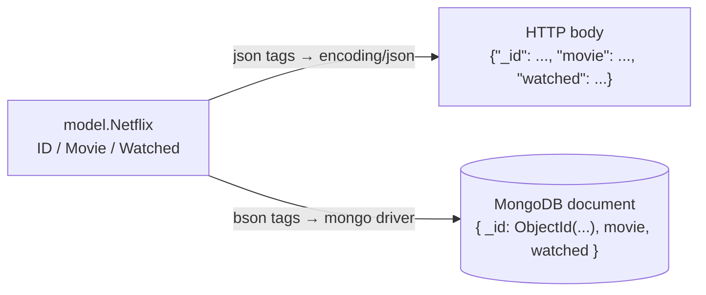

---
tags:
  - golang
  - mongodb
section: "07 API with MongoDB"
video: https://www.youtube.com/watch?v=laeZI6UdDNg
video_title: "Defining models for netflix in golang"
order: 42
---
# Defining Models for MongoDB

> [!info] Source
> 🎬 [Defining models for netflix in golang](https://www.youtube.com/watch?v=laeZI6UdDNg) · Section **07 API with MongoDB** of [[Golang Notes]]
> ⬅️ [[MongoDB Setup]] · ➡️ [[Connecting to MongoDB]]

## Overview

A **model** is the Go [[Structs|struct]] that mirrors one document in a MongoDB collection. We already built models for the courses API in [[Building an API - Models]]; the difference here is that the struct must speak two languages at once: **JSON** towards the HTTP client and **BSON** towards the database. Both are expressed with struct tags, and MongoDB adds one new type, the `ObjectID`, that it generates for every document's `_id`.

This video also settles the project structure (folders `model`, `controller`, `router`) that [[MongoDB Setup]] announced.

## Project structure

Create the three folders from the file explorer (the instructor does it in Finder because the editor sometimes creates things in the wrong place):

```text
25mongoapi/
├── main.go          # package main – the only Go file in the root
├── model/
│   └── models.go    # package model
├── controller/      # package controller (next notes)
└── router/          # package router (last note of the section)
```

> [!warning] One `main.go` in the root
> If several files in the root declare `package main`, `go run main.go` compiles only the file you named and fails on the missing declarations; `go run .` compiles the whole directory but every file still shares one namespace. Keeping each concern in its own folder sidesteps both problems and is the idiomatic layout.

Add as many extra folders as you like (helpers, middleware, config). The only rule is that files in one folder form one package.

## The Netflix model

`model/models.go` declares the package and a single struct:

```go
package model

import (
	"go.mongodb.org/mongo-driver/bson/primitive"
)

type Netflix struct {
	ID      primitive.ObjectID `json:"_id,omitempty" bson:"_id,omitempty"`
	Movie   string             `json:"movie,omitempty"`
	Watched bool               `json:"watched,omitempty"`
}
```

The collection is a watchlist: each document is one movie that can be marked watched or unwatched. The series deliberately keeps it this simple (one struct, no nested author like in the courses API) so the attention stays on the database calls.

| Field | Go type | Meaning |
|---|---|---|
| `ID` | `primitive.ObjectID` | MongoDB's auto-generated unique identifier, stored as `_id` |
| `Movie` | `string` | the movie name |
| `Watched` | `bool` | whether it has been watched |

The package name is `model`, not `models`: other packages will refer to the type as `model.Netflix`, and the package name (declared with `package model`) is what matters, not the file or folder name.

## BSON, JSON and `primitive.ObjectID`

MongoDB does not store JSON. It stores **BSON** ("Binary JSON"), a binary encoding that looks like JSON when printed but carries extra types that JSON lacks:

| Concept | JSON | BSON |
|---|---|---|
| Encoding | text | binary |
| Document ids | just a string/number | dedicated `ObjectId` type |
| Dates, binary data, 32/64-bit ints, decimals | not distinguished | native types |
| Used for | HTTP request/response bodies | storage and the wire protocol to MongoDB |

Every document gets an `_id`. If you do not provide one, MongoDB (in practice the driver) generates an **ObjectID**: a 12-byte value made of a 4-byte timestamp, a 5-byte random value and a 3-byte counter, usually shown as a 24-character hex string such as `652f1a2b3c4d5e6f7a8b9c0d`. In Go this type lives in the driver's `bson/primitive` package, hence the single import. `primitive.ObjectID` is literally `[12]byte` with helper methods such as `Hex()`, `IsZero()` and `String()`.

> [!note] Why the database generates ids
> Database-generated ids guarantee uniqueness and are indexed, so looking a document up by `_id` is fast. In the courses API we invented ids with `rand.Intn`; here we let MongoDB do it and read the generated id back after an insert (see [[Insert Data in MongoDB]]).

## Struct tags: `json` and `bson` side by side

Struct tags were introduced in [[Creating JSON Data]]: a backtick string that encoders read via reflection. Two things are new here:

- A field can carry **several tags**, separated by a **space**, not a comma: `` `json:"_id,omitempty" bson:"_id,omitempty"` ``.
- The `bson` tag tells the MongoDB driver what key to use in the document, exactly as the `json` tag does for `encoding/json`. For the id we must use the key `_id` in both worlds, because that is the name MongoDB reserves for the primary key.

`omitempty` means "leave the field out if it is empty", but the two encoders disagree on what *empty* means for an `ObjectID`:

- The **BSON codec** asks the value itself: `primitive.ObjectID` has an `IsZero()` method, and the all-zero id counts as empty. A freshly created `Netflix` value therefore goes to the database **without** `_id`, and MongoDB generates a proper one. This is the essential part: without `bson:"_id,omitempty"` the driver would insert `_id: ObjectID("000000000000000000000000")` and the *second* insert would fail with a duplicate key error.
- **`encoding/json`** only treats `false`, `0`, `nil` pointers/interfaces and *empty* strings, slices, maps and arrays as empty. An `ObjectID` is a `[12]byte` array, which is never empty, so the JSON side still prints the zero id as `"000000000000000000000000"`. Harmless for requests (the database ignores it thanks to the BSON rule above), but it is why a response built from a freshly decoded struct can show an all-zero `_id`.

> [!tip] Fields without a `bson` tag
> `Movie` and `Watched` only have `json` tags. The driver then uses the **lower-cased field name** as the BSON key, so the documents end up as `{ "_id": ..., "movie": "...", "watched": true }`. That is why later notes filter and update with the keys `"movie"` and `"watched"` (see [[Update a Record in MongoDB]]). Adding explicit `bson:"movie"` tags makes this visible instead of relying on the default.



## Example: seeing the tags in action

This standalone program (run it from any module that has the driver in `go.mod`) encodes the same struct with both encoders. It needs no database.

```go
package main

import (
	"encoding/json"
	"fmt"

	"go.mongodb.org/mongo-driver/bson"
	"go.mongodb.org/mongo-driver/bson/primitive"
)

type Netflix struct {
	ID      primitive.ObjectID `json:"_id,omitempty" bson:"_id,omitempty"`
	Movie   string             `json:"movie,omitempty"`
	Watched bool               `json:"watched,omitempty"`
}

func main() {
	// A new movie: ID is the zero ObjectID, Watched is false.
	m := Netflix{Movie: "Interstellar"}

	asJSON, _ := json.Marshal(m)
	fmt.Println("JSON :", string(asJSON))

	raw, _ := bson.Marshal(m)
	var doc bson.M
	_ = bson.Unmarshal(raw, &doc)
	fmt.Println("BSON :", doc)

	// After an insert the driver fills the ID; simulate that here.
	m.ID = primitive.NewObjectID()
	m.Watched = true
	asJSON, _ = json.Marshal(m)
	fmt.Println("JSON :", string(asJSON))
	fmt.Println("Hex  :", m.ID.Hex(), "IsZero:", m.ID.IsZero())
}
```

**Output:** (the hex id differs every run)

```text
JSON : {"_id":"000000000000000000000000","movie":"Interstellar"}
BSON : map[movie:Interstellar watched:false]
JSON : {"_id":"68fa0c4d61c2d7a9e3f5b1a2","movie":"Interstellar","watched":true}
Hex  : 68fa0c4d61c2d7a9e3f5b1a2 IsZero: false
```

Notice four things: `watched` vanishes from the first JSON because of `omitempty` on a `false` bool; the zero `_id` does **not** vanish from the JSON (an array is never "empty" to `encoding/json`); the BSON document uses the lower-cased key `watched`, keeps `watched: false` (no `bson` tag, so no `omitempty` on that side) and omits the zero `_id` so MongoDB will generate one; and once the id is set, JSON renders the ObjectID as its hex string.

## Gotchas and Best Practices

> [!warning] `omitempty` on a `bool` hides `false`
> `Watched bool` with `json:"watched,omitempty"` means an unwatched movie is returned to clients **without** a `watched` key at all. Clients then have to treat "missing" as `false`. If you want the key always present, drop `omitempty` from that field (the id is the one that really needs it).

> [!warning] Tags are a single backtick string
> Inside the backticks the two tags are separated by a space. A comma there (`json:"_id,omitempty", bson:"_id"`) breaks the tag: the `json` key is still found but the `bson` key after the comma is lost, and `go vet` reports it (`key:"value" pairs not separated by spaces`).

> [!warning] A zero `_id` can leak into JSON responses
> Because `encoding/json` does not omit the zero `ObjectID`, encoding a struct that was decoded from a request (and never updated with the generated id) produces `"_id":"000000000000000000000000"`. Either copy the id from the insert result back into the struct before responding, or use the `omitzero` tag option described under *Modern Go Notes*.

> [!tip] Exported fields only
> Both `encoding/json` and the BSON codec can only see **exported** (capitalised) fields. A field named `movie` would be ignored by both encoders, no matter what tags it has (see [[Structs]]).

> [!note] Where to find the syntax
> MongoDB's Go articles use exactly this tag pattern on every model. Once you have typed it a couple of times it becomes muscle memory; the only part worth thinking about is which fields need `omitempty`.

## Modern Go Notes

- **Go 1.24+ `omitzero`**: `encoding/json` gained a second tag option, `json:"_id,omitzero"`, which omits a field whose value is zero and, if the type has an `IsZero() bool` method (as `primitive.ObjectID` does), uses that method. With `json:"_id,omitzero" bson:"_id,omitempty"` the zero id disappears from JSON *and* BSON. Verified on Go 1.27: `omitempty` prints `{"_id":"000000000000000000000000"}`, `omitzero` prints `{}`.
- In driver **v2** (`go.mongodb.org/mongo-driver/v2`) the `primitive` package was folded into `bson`, so the id type is written `bson.ObjectID` and created with `bson.NewObjectID()`. Verify against the v2 docs if you migrate; the series stays on v1 where `primitive.ObjectID` is correct.

## Video Timeline

| Time | What happens |
|---|---|
| [00:18](https://youtu.be/laeZI6UdDNg?t=18) | Creating the `model`, `controller` and `router` folders |
| [00:53](https://youtu.be/laeZI6UdDNg?t=53) | Why only one Go file belongs in the root |
| [01:43](https://youtu.be/laeZI6UdDNg?t=103) | `package model` and the `bson/primitive` import |
| [02:29](https://youtu.be/laeZI6UdDNg?t=149) | MongoDB-generated `_id`s and why BSON is "JSON with more fields" |
| [03:51](https://youtu.be/laeZI6UdDNg?t=231) | Declaring `ID`, `Movie`, `Watched` and the `primitive.ObjectID` type |
| [04:29](https://youtu.be/laeZI6UdDNg?t=269) | Writing the `json` and `bson` tags with `omitempty` |

## Related Notes

- [[Structs]] — struct declaration, exported fields, `%+v` printing
- [[Creating JSON Data]] — where struct tags and `omitempty` were introduced
- [[Consuming JSON Data]] — decoding request bodies into this struct
- [[Building an API - Models]] — the richer `Course`/`Author` models from section 06
- [[MongoDB Setup]] — project bootstrap and the folder rule
- [[Connecting to MongoDB]] — next: the connection code in `controller.go`
- [[Insert Data in MongoDB]] — the generated `_id` comes back from `InsertOne`
- [[Update a Record in MongoDB]] — filters use the BSON keys defined here
- [[Go Quick Reference]] — tag syntax at a glance
