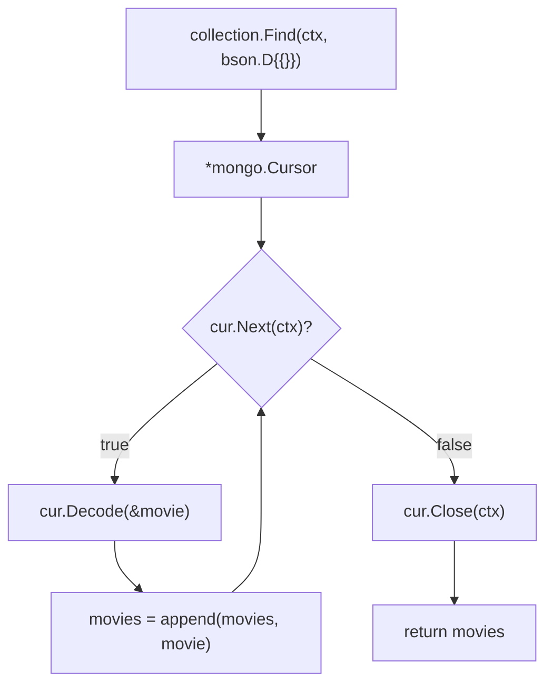

---
tags:
  - golang
  - mongodb
section: "07 API with MongoDB"
video: https://www.youtube.com/watch?v=1P5b4McGJQQ
video_title: "Get all collection in mongodb in golang"
order: 47
---
# Get All Documents from MongoDB

> [!info] Source
> 🎬 [Get all collection in mongodb in golang](https://www.youtube.com/watch?v=1P5b4McGJQQ) · Section **07 API with MongoDB** of [[Golang Notes]]
> ⬅️ [[Delete One and Delete Many in MongoDB]] · ➡️ [[MongoDB API Controllers]]

## Overview

Insert, update and delete are done; the last operation is **read**. Reading *one* document by a filter is easy, but reading *everything* is, in the instructor's words, "a tad bit more involved": `Find` does not hand you the documents, it hands you a **cursor** that you have to walk, decode document by document, and close. Object-relational mappers hide this; the raw MongoDB driver does not. The video follows a MongoDB blog recipe ("read all documents from the collection") and turns it into the `getAllMovies` helper that returns a slice of `primitive.M`. Expect a `for` loop in the while style from [[Loops, Break, Continue and Goto]], a `Decode` call that looks just like [[Consuming JSON Data]], and a `defer` from [[Defer]].

## `Find` returns a cursor, not documents

```go
func (coll *Collection) Find(ctx context.Context, filter interface{}, opts ...*options.FindOptions) (cur *Cursor, err error)
```

A **cursor** is a handle to a result set that still lives on the server. The driver pulls documents from it in batches as you iterate, which is what makes it possible to read a collection far larger than your memory. The price is that you cannot `return` the result of `Find`; you have to drain the cursor into a Go value first.



The cursor exposes a handful of methods, all verified against the driver documentation:

| Method | What it does |
|---|---|
| `Next(ctx) bool` | advances to the next document; `true` while there are documents and no error; blocks until a document arrives |
| `Decode(val) error` | unmarshals the **current** document into `val`, which must be a pointer |
| `Err() error` | the last error seen while iterating; check it after the loop |
| `Close(ctx) error` | releases the server-side resources; idempotent |
| `All(ctx, results) error` | drains and decodes the whole cursor into a slice pointer, then closes it |

## Step by step: `getAllMovies`

### 1. Ask for everything

```go
cur, err := collection.Find(context.Background(), bson.D{{}})
if err != nil {
	log.Fatal(err)
}
```

The empty filter selects every document, exactly as it did for `DeleteMany` in [[Delete One and Delete Many in MongoDB]]. `cur` is the cursor; the error covers things like a dropped connection or a malformed filter.

### 2. Declare the slice that will hold the result

```go
var movies []primitive.M
```

`primitive.M` is a `map[string]interface{}`: a document with whatever keys the database stored, values typed as the driver sees fit (`string`, `bool`, `primitive.ObjectID` ...). The instructor mentions that `bson.M` gave him errors here while `primitive.M` worked. The driver documentation settles it: `bson.M` is declared as `type M = primitive.M`, a **type alias**, so the two names are the same type and either compiles. Pick one spelling and stay consistent; the helper uses `primitive.M` for the slice and `bson.M` for each element, which is legal precisely because they are identical.

### 3. Walk the cursor

```go
for cur.Next(context.Background()) {
	var movie bson.M
	err := cur.Decode(&movie)
	if err != nil {
		log.Fatal(err)
	}
	movies = append(movies, movie)
}
```

- `for cur.Next(ctx)` is Go's while loop: it runs until `Next` reports `false`. The context argument is easy to miss; the instructor missed it on his first read of the blog too.
- `cur.Decode(&movie)` fills the map from the current document. It needs a **pointer** (see [[Pointers]]) for the same reason `json.Unmarshal` does: the function has to write into your variable.
- `append` grows the slice (see [[Slices]]). The blog folds the decode and the error check into one `if err := cur.Decode(&ep); err != nil` line; the video writes it in two lines, and both are idiomatic (see [[If Else]]).

### 4. Close the cursor

```go
defer cur.Close(context.Background())
```

Closing tells the server it can free the result set. The video places the `defer` *after* the loop, which still works because deferred calls run when the function returns, but the blog puts it right after the error check, and that is the better spot: it then runs even if the loop exits early through a `return` or a panic.

### 5. Return the slice

```go
return movies
```

with the function declared as `func getAllMovies() []primitive.M`. Because `primitive.M` and `bson.M` are the same type, `[]bson.M` would be an equally valid return type.

## `bson.M` or the model struct?

The video decodes into generic maps; you can equally decode into `model.Netflix` from [[Defining Models for MongoDB]]:

| Decode target | You get | Use when |
|---|---|---|
| `bson.M` / `primitive.M` | a map with the keys exactly as stored (`_id`, `movie`, `watched`), values as `interface{}` | you want to pass documents straight through to JSON, or the shape varies |
| `model.Netflix` | typed fields (`ID primitive.ObjectID`, `Movie string`, `Watched bool`) | you need to compute with the values or want the compiler to catch typos |

Either way the JSON that the controller in [[MongoDB API Controllers]] produces looks the same, because `primitive.ObjectID` knows how to encode itself as a hex string:

```json
[{"_id":"652f1a2b3c4d5e6f7a8b9c0d","movie":"KGF","watched":true}]
```

## The helper as written in the video

```go
// get all movies from database
func getAllMovies() []primitive.M {
	cur, err := collection.Find(context.Background(), bson.D{{}})
	if err != nil {
		log.Fatal(err)
	}

	var movies []primitive.M

	for cur.Next(context.Background()) {
		var movie bson.M
		err := cur.Decode(&movie)
		if err != nil {
			log.Fatal(err)
		}
		movies = append(movies, movie)
	}

	defer cur.Close(context.Background())
	return movies
}
```

**Output:** the helper prints nothing itself. When `GetMyAllMovies` encodes its result, Thunder Client shows the array above; with an empty collection it shows `null`, because a `nil` slice encodes as JSON `null` (see the gotchas).

## Example: the same read with `cur.All` and typed documents

A standalone version that uses the model struct, checks `cur.Err()`, and shows the one-call alternative `All`. It needs a reachable cluster in `MONGODB_URI`, so the output is what the video's collection would produce rather than a run from these notes.

```go
package main

import (
	"context"
	"fmt"
	"log"
	"os"
	"time"

	"go.mongodb.org/mongo-driver/bson"
	"go.mongodb.org/mongo-driver/bson/primitive"
	"go.mongodb.org/mongo-driver/mongo"
	"go.mongodb.org/mongo-driver/mongo/options"
)

type Netflix struct {
	ID      primitive.ObjectID `json:"_id,omitempty" bson:"_id,omitempty"`
	Movie   string             `json:"movie,omitempty" bson:"movie"`
	Watched bool               `json:"watched,omitempty" bson:"watched"`
}

// allMoviesLoop walks the cursor by hand, the way the video does, with the checks it skips.
func allMoviesLoop(ctx context.Context, col *mongo.Collection) ([]Netflix, error) {
	cur, err := col.Find(ctx, bson.D{})
	if err != nil {
		return nil, err
	}
	defer cur.Close(ctx)

	movies := []Netflix{} // empty, not nil, so an empty collection encodes as [] rather than null
	for cur.Next(ctx) {
		var m Netflix
		if err := cur.Decode(&m); err != nil {
			return nil, err
		}
		movies = append(movies, m)
	}
	return movies, cur.Err()
}

// allMoviesAll lets the driver do the loop.
func allMoviesAll(ctx context.Context, col *mongo.Collection) ([]Netflix, error) {
	cur, err := col.Find(ctx, bson.D{}, options.Find().SetSort(bson.D{{Key: "movie", Value: 1}}))
	if err != nil {
		return nil, err
	}
	var movies []Netflix
	if err := cur.All(ctx, &movies); err != nil {
		return nil, err
	}
	return movies, nil
}

func main() {
	uri := os.Getenv("MONGODB_URI")
	if uri == "" {
		log.Fatal("set MONGODB_URI first")
	}
	ctx, cancel := context.WithTimeout(context.Background(), 10*time.Second)
	defer cancel()

	client, err := mongo.Connect(ctx, options.Client().ApplyURI(uri))
	if err != nil {
		log.Fatal(err)
	}
	defer client.Disconnect(context.Background())
	col := client.Database("netflix").Collection("watchlist")

	movies, err := allMoviesLoop(ctx, col)
	if err != nil {
		log.Fatal(err)
	}
	fmt.Println("by hand:", len(movies), "movies")
	for _, m := range movies {
		fmt.Printf("  %s  %-10s watched=%t\n", m.ID.Hex(), m.Movie, m.Watched)
	}

	sorted, err := allMoviesAll(ctx, col)
	if err != nil {
		log.Fatal(err)
	}
	fmt.Println("with All, sorted by title:")
	for _, m := range sorted {
		fmt.Println("  " + m.Movie)
	}
}
```

**Output (with the video's two movies in the collection):**

```text
by hand: 2 movies
  652f1a2b3c4d5e6f7a8b9c0d  Deadpool   watched=true
  652f1a2b3c4d5e6f7a8b9c0e  KGF        watched=false
with All, sorted by title:
  Deadpool
  KGF
```

## Gotchas and Best Practices

> [!warning] Check `cur.Err()` after the loop
> `Next` returns `false` both when the cursor is exhausted *and* when an error occurred (for example the context expired). Without `cur.Err()` a network failure halfway through looks exactly like "that was all the data".

> [!tip] `defer cur.Close` immediately after the error check
> The video's placement after the loop works only because the function has no other exit. Deferring right away is the habit that also covers early returns and panics (see [[Defer]]).

> [!warning] A `nil` slice becomes JSON `null`
> `var movies []primitive.M` stays `nil` when the collection is empty, and `json.NewEncoder(w).Encode(nil slice)` writes `null`. Front-ends usually expect `[]`. Initialise with `movies := []primitive.M{}` if that matters to your client.

> [!note] Reading *everything* is rarely what production code does
> `Find` with an empty filter on a large collection streams the whole thing. Add a filter, or pass `options.Find().SetLimit(n)` and `SetSkip` for pagination, and `SetProjection` to leave out fields you do not need.

> [!tip] `context.Background()` vs `context.TODO()`
> Both are empty contexts. `Background` says "this is the root"; `TODO` says "I have not decided which context belongs here yet". The video mentions both; see [[Connecting to MongoDB]].

## Modern Go Notes

- `cur.All(ctx, &slice)` has been in driver v1 for years and replaces the manual loop whenever the result fits in memory; it closes the cursor for you.
- In driver v2 (`go.mongodb.org/mongo-driver/v2`) `Find`, `Cursor.Next`, `Decode`, `All` and `Close` keep their names; `primitive.M` lives on as `bson.M` and the `primitive` package is folded into `bson`, so check the v2 documentation before upgrading.

## Video Timeline

| Time | What happens |
|---|---|
| [00:40](https://youtu.be/1P5b4McGJQQ?t=40) | Reading with a filter is easy; reading everything needs a cursor |
| [01:48](https://youtu.be/1P5b4McGJQQ?t=108) | The MongoDB blog section "read all documents from the collection" |
| [02:13](https://youtu.be/1P5b4McGJQQ?t=133) | `Find` returns a cursor, a big object you loop through, not the data |
| [03:00](https://youtu.be/1P5b4McGJQQ?t=180) | `cursor.Next` and decoding each document into a `bson.M` |
| [04:20](https://youtu.be/1P5b4McGJQQ?t=260) | Writing `collection.Find(context.Background(), bson.D{{}})` |
| [05:15](https://youtu.be/1P5b4McGJQQ?t=315) | `var movies []primitive.M`; `bson.M` versus `primitive.M` |
| [06:00](https://youtu.be/1P5b4McGJQQ?t=360) | The while-style `for cur.Next(context.Background())` loop |
| [07:34](https://youtu.be/1P5b4McGJQQ?t=454) | `cur.Decode(&movie)`, then `append` into the slice |
| [08:47](https://youtu.be/1P5b4McGJQQ?t=527) | `defer cur.Close(context.Background())` and the `[]primitive.M` return type |

## Related Notes

- [[Delete One and Delete Many in MongoDB]] — the same empty filter, used to delete instead of read
- [[MongoDB API Controllers]] — `GetMyAllMovies` sends this slice as the JSON response
- [[Get All Courses Controller]] — the slice-based "get all" from the previous section, for comparison
- [[Defining Models for MongoDB]] — the typed alternative to `bson.M`
- [[Consuming JSON Data]] — `Decode(&v)` here works like `json.Unmarshal(data, &v)` there
- [[Loops, Break, Continue and Goto]] — the condition-only `for` loop that drives the cursor
- [[Slices]] — `append` and the difference between a `nil` and an empty slice
- [[Defer]] — why `defer cur.Close` belongs at the top of the function
- [[Error Handling in Go]] — `cur.Err()` and returning errors instead of `log.Fatal`
- [[Go Quick Reference]] — the cursor loop in five lines
