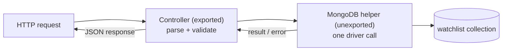

---
tags:
  - golang
  - mongodb
section: "07 API with MongoDB"
video: https://www.youtube.com/watch?v=K2nC_WpPVQE
video_title: "Insert data in mongodb in golang"
order: 44
---
# Insert Data in MongoDB

> [!info] Source
> 🎬 [Insert data in mongodb in golang](https://www.youtube.com/watch?v=K2nC_WpPVQE) · Section **07 API with MongoDB** of [[Golang Notes]]
> ⬅️ [[Connecting to MongoDB]] · ➡️ [[Update a Record in MongoDB]]

## Overview

This is the first video where the project spans **multiple packages** (`main`, `model`, `controller`, `router`), so it starts with the editor setup that makes cross-package imports work without red squiggly lines. It then lays out the strategy for the rest of the section, two layers of functions, and writes the first database helper: `insertOneMovie`, which puts a `model.Netflix` document into the collection and reports the generated id.

## Workspace setup for a multi-package project

So far one folder per video, each opened inside the big series folder, was fine. With sub-packages the editor's Go tooling (**gopls**, the Go language server) needs to find `go.mod` at the root of the workspace, otherwise `package model` shows errors such as *"is not in GOROOT"* or *"not a module"* even though the code is correct.

1. Open **the project folder itself** (`25mongoapi`, the one containing `go.mod`) as the VS Code workspace, in a separate window if you like.
2. Give `main.go` a minimal body so the module compiles:

```go
package main

import "fmt"

func main() {
	fmt.Println("MongoDB API")
}
```

3. If the driver import still complains, run `go get go.mongodb.org/mongo-driver/mongo` once more from the integrated terminal; downloads that were interrupted the first time get completed.
4. Open the command palette (`Cmd+Shift+P` on macOS, `Ctrl+Shift+P` elsewhere), type **Go: Install/Update Tools**, select every tool with the space bar and confirm. This installs or updates `gopls`, `dlv`, `staticcheck` and friends and removes most remaining squiggles.

![[44_insert_mongodb_go_tools_0420.png]]
*Figure: the "Go: Install/Update Tools" picker in VS Code (video at 04:20)*

> [!note] Why this matters now
> The controller is about to import the model. Auto-import and completion across your own packages only work once the language server understands the module, which is exactly what the steps above fix.

## Importing your own packages

Inside one module, a package is imported by **module path + folder**. The module was initialised as `github.com/hiteshchoudhary/mongoapi` in [[MongoDB Setup]], so:

```go
import "github.com/hiteshchoudhary/mongoapi/model"
```

Three rules follow (see [[Go Modules]] and [[Structs]]):

- The identifier you use in code is the **package name declared in the file** (`package model`), not the folder or file name. That is why the type is written `model.Netflix` even though the file is called `models.go`.
- Only **exported** identifiers (capitalised: `Netflix`, `ID`, `Movie`) are visible from another package.
- The editor adds the import line for you as soon as you type `model.` and pick a completion.

## Strategy: helpers and controllers

Adding to a slice in [[Create Course Controller]] was one step: decode the request body, append. With a database there is more to do, so the section uses **two layers** of functions:

| Layer | Naming | Responsibility |
|---|---|---|
| **MongoDB helpers** (this note onwards) | lower-case, unexported: `insertOneMovie`, `updateOneMovie` | receive already-validated data, run exactly one driver call, report success or failure |
| **Controllers** ([[MongoDB API Controllers]]) | capitalised, exported: `CreateMovie`, `MarkAsWatched` | read the request body / URL params, validate, then call a helper and write the JSON response |



The helpers trust their input completely; all checking lives in the controllers. Helpers are written first (this and the next three notes), the controllers afterwards.

## The first helper: `insertOneMovie`

```go
// insert 1 record
func insertOneMovie(movie model.Netflix) {
	inserted, err := collection.InsertOne(context.Background(), movie)

	if err != nil {
		log.Fatal(err)
	}
	fmt.Println("Inserted 1 movie in db with id: ", inserted.InsertedID)
}
```

Walking through it:

- `movie model.Netflix` is the document to store, typed with the struct from [[Defining Models for MongoDB]].
- `collection` is the package-level `*mongo.Collection` resolved in [[Connecting to MongoDB]]. Typing `collection.` shows the driver's whole toolbox: `Find`, `FindOne`, `InsertOne`, `InsertMany`, `UpdateOne`, `UpdateMany`, `DeleteOne`, `DeleteMany`, `Distinct`, `CountDocuments`, `Drop` and more.
- `InsertOne(ctx, document)` takes a **context** first, like every driver call (`context.Background()` is the documented choice for ordinary operations), and the document second. The driver converts the struct to BSON using the tags from the model.
- It returns `(*mongo.InsertOneResult, error)`. The result has a single field, `InsertedID`, holding the `_id` of the new document; because the model omitted the zero id, the driver generated a fresh `primitive.ObjectID`.
- `log.Fatal(err)` is "a more controlled version of panic" for the tutorial; see the gotchas for the production alternative.

**Output** when a controller later calls the helper (the id differs every time):

```text
Inserted 1 movie in db with id:  ObjectID("652f1a2b3c4d5e6f7a8b9c0d")
```

`fmt.Println` renders the id as `ObjectID("...")` because `primitive.ObjectID` implements `String()`. `inserted` as a whole is a struct you could print with `%+v` (see [[fmt Package and Format Verbs]]).

> [!tip] Why the lower-case name
> `insertOneMovie` starts with a lower-case letter on purpose: it is a package-private helper that the HTTP layer in the same package calls. The controllers that other packages (the router) need to reach are capitalised, i.e. exported.

## Example: a complete insert program

A self-contained version of the helper that reads the connection string from an environment variable, inserts one movie and reads the generated id back as an `ObjectID`:

```go
package main

import (
	"context"
	"fmt"
	"log"
	"os"
	"time"

	"go.mongodb.org/mongo-driver/bson/primitive"
	"go.mongodb.org/mongo-driver/mongo"
	"go.mongodb.org/mongo-driver/mongo/options"
)

type Netflix struct {
	ID      primitive.ObjectID `json:"_id,omitempty" bson:"_id,omitempty"`
	Movie   string             `json:"movie,omitempty"`
	Watched bool               `json:"watched,omitempty"`
}

func main() {
	uri := os.Getenv("MONGODB_URI")
	if uri == "" {
		log.Fatal("set MONGODB_URI first")
	}

	ctx, cancel := context.WithTimeout(context.Background(), 10*time.Second)
	defer cancel()

	client, err := mongo.Connect(ctx, options.Client().ApplyURI(uri))
	if err != nil {
		log.Fatal(err)
	}
	defer client.Disconnect(context.Background())

	collection := client.Database("netflix").Collection("watchlist")

	movie := Netflix{Movie: "Interstellar"}
	inserted, err := collection.InsertOne(ctx, movie)
	if err != nil {
		log.Fatal(err)
	}
	fmt.Println("Inserted 1 movie in db with id: ", inserted.InsertedID)

	// InsertedID is an interface{}; assert it to use ObjectID methods.
	if id, ok := inserted.InsertedID.(primitive.ObjectID); ok {
		fmt.Println("hex form for URLs:", id.Hex())
	}
}
```

**Output:**

```text
Inserted 1 movie in db with id:  ObjectID("652f1a2b3c4d5e6f7a8b9c0d")
hex form for URLs: 652f1a2b3c4d5e6f7a8b9c0d
```

After running it, the `netflix` database and `watchlist` collection appear in Atlas (Browse Collections) with one document: `{ _id: ObjectId('652f...'), movie: 'Interstellar', watched: false }`. The `watched: false` is stored because the struct has no `bson:"...,omitempty"` on that field; only JSON *responses* hide a `false` value, through the `json` tag (see [[Defining Models for MongoDB]]).

## Gotchas and Best Practices

> [!warning] `log.Fatal` inside a server kills every request
> In a helper called from an HTTP handler, `log.Fatal` terminates the whole process because one insert failed. The production shape is `func insertOneMovie(movie model.Netflix) (interface{}, error)` returning the id and the error, and letting the controller answer with a 500 status.

> [!warning] `InsertedID` is an `interface{}`
> The driver cannot know your id type (you could supply your own `_id`), so the field is untyped. Use a type assertion `inserted.InsertedID.(primitive.ObjectID)` (the comma-ok form from [[User Input and Comma Ok Syntax]]) before calling `Hex()` on it.

> [!tip] One context per operation
> Pass a fresh context into each driver call. `context.Background()` is fine for a tutorial; a request handler should forward `r.Context()` or wrap it with a timeout so a slow database does not hang the handler forever.

> [!note] Several documents at once
> `collection.InsertMany(ctx, []interface{}{a, b, c})` inserts a batch in one round trip and returns all generated ids.

## Modern Go Notes

- The `InsertOne` call and `InsertOneResult` are unchanged in driver v2; only the id type moves from `primitive.ObjectID` to `bson.ObjectID` (verify in the v2 docs if you migrate).
- `Go: Install/Update Tools` is still the way to refresh `gopls` in VS Code; the extension also prompts automatically when tools are missing.

## Video Timeline

| Time | What happens |
|---|---|
| [00:35](https://youtu.be/K2nC_WpPVQE?t=35) | The "not a module" errors and opening the project folder as the workspace |
| [02:16](https://youtu.be/K2nC_WpPVQE?t=136) | Minimal `main.go`, re-running `go get` for the driver |
| [03:57](https://youtu.be/K2nC_WpPVQE?t=237) | `Go: Install/Update Tools` and gopls |
| [05:22](https://youtu.be/K2nC_WpPVQE?t=322) | Strategy: MongoDB helpers vs controllers |
| [07:05](https://youtu.be/K2nC_WpPVQE?t=425) | Writing `insertOneMovie` with `model.Netflix` |
| [08:30](https://youtu.be/K2nC_WpPVQE?t=510) | `collection.InsertOne`, context, error handling, `InsertedID` |

## Related Notes

- [[Connecting to MongoDB]] — the `collection` handle this helper uses
- [[Defining Models for MongoDB]] — `model.Netflix` and the `omitempty` id
- [[Update a Record in MongoDB]] — next helper, built on the generated id
- [[MongoDB API Controllers]] — the exported `CreateMovie` controller that calls this helper
- [[Create Course Controller]] — the slice-based equivalent from section 06
- [[Go Modules]] — module path, import paths and `go get`
- [[User Input and Comma Ok Syntax]] — the comma-ok type assertion on `InsertedID`
- [[Error Handling in Go]] — `log.Fatal` vs returning errors
- [[fmt Package and Format Verbs]] — printing the result struct
- [[Go Quick Reference]] — driver call signatures
