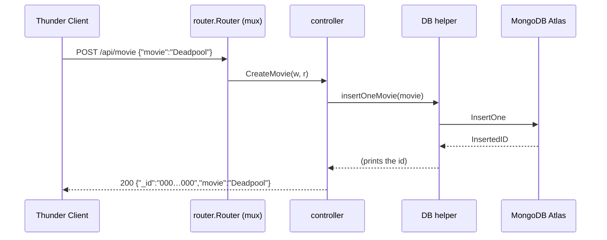

---
tags:
  - golang
  - mongodb
section: "07 API with MongoDB"
video: https://www.youtube.com/watch?v=uG2fpX2ktNE
video_title: "Creating routes and testing API in golang"
order: 51
---
# MongoDB API Routes and Testing

> [!info] Source
> 🎬 [Creating routes and testing API in golang](https://www.youtube.com/watch?v=uG2fpX2ktNE) · Section **07 API with MongoDB** of [[Golang Notes]]
> ⬅️ [[MongoDB API Controllers]] · ➡️ [[Concurrency and Goroutines]]

## Overview

The last piece of the Netflix watchlist API is the **router**: the table that maps a verb and a path to one of the controllers from [[MongoDB API Controllers]]. It lives in its own package, which forces one new idea, an exported function that *returns* the router to `main`. Then the server starts, the first build fails (as builds do), and every route is exercised with Thunder Client while the instructor watches the documents appear and disappear in MongoDB Atlas. Two things to take from the testing session: the mistakes he makes are the mistakes you will make, and each one produces a status code or a count that tells you exactly what went wrong.

## The `router` package

```go
package router

import (
	"github.com/gorilla/mux"
	"github.com/hiteshchoudhary/mongoapi/controller"
)

func Router() *mux.Router {
	router := mux.NewRouter()

	router.HandleFunc("/api/movies", controller.GetMyAllMovies).Methods("GET")
	router.HandleFunc("/api/movie", controller.CreateMovie).Methods("POST")
	router.HandleFunc("/api/movie/{id}", controller.MarkAsWatched).Methods("PUT")
	router.HandleFunc("/api/movie/{id}", controller.DeleteAMovie).Methods("DELETE")
	router.HandleFunc("/api/deleteallmovie", controller.DeleteAllMovies).Methods("DELETE")

	return router
}
```

- `Router` is capitalised because `main` lives in a different package and must import it (the same exported-name rule as the controllers).
- The function **returns `*mux.Router`**, a pointer. The instructor calls this the most important line: without a return type the router you build is unreachable from `main`. Everything else is the `HandleFunc(path, handler).Methods(verb)` chain from [[Routes and Testing the API]].
- `Methods` is variadic (`Methods(methods ...string)`), so a route may accept several verbs; here each route takes exactly one.
- `{id}` declares a path variable that `mux.Vars(r)["id"]` reads in the controllers.

### The route table, as designed on paper

| Verb | Path | Controller | Helper it calls | Purpose |
|---|---|---|---|---|
| `GET` | `/api/movies` | `GetMyAllMovies` | `getAllMovies` | list the watchlist |
| `POST` | `/api/movie` | `CreateMovie` | `insertOneMovie` | add a movie |
| `PUT` | `/api/movie/{id}` | `MarkAsWatched` | `updateOneMovie` | set `watched: true` |
| `DELETE` | `/api/movie/{id}` | `DeleteAMovie` | `deleteOneMovie` | remove one movie |
| `DELETE` | `/api/deleteallmovie` | `DeleteAllMovies` | `deleteAllMovie` | empty the collection |

The instructor sketches this table on paper before typing; the two `/api/movie/{id}` entries differ only by verb, and the "delete all" gets its own explicit path so that it can never be triggered by a `DELETE /api/movie` with a forgotten id (that request matches no route and gets a `405`).

## `main.go`

```go
package main

import (
	"fmt"
	"log"
	"net/http"

	"github.com/hiteshchoudhary/mongoapi/router"
)

func main() {
	fmt.Println("MongoDB API")
	r := router.Router()
	fmt.Println("Server is getting started...")
	log.Fatal(http.ListenAndServe(":4000", r))
	fmt.Println("Listening at port 4000 ...")
}
```

**Output:**

```text
MongoDB connection success
Collection instance is ready
MongoDB API
Server is getting started...
```

Two lines deserve a look:

- `MongoDB connection success` and `Collection instance is ready` are printed by the controller package's `init()` from [[Connecting to MongoDB]], which runs before `main` because `main` imports `router`, which imports `controller`.
- `Listening at port 4000 ...` **never prints**. `http.ListenAndServe` blocks for the lifetime of the server and only returns when something goes wrong; `log.Fatal` then prints that error and exits. Put such a message *before* the call, or drop it.

## The first build fails

Running `go build` reports `options redeclared as imported package name` and `undefined: options` in `controller.go` (on Go 1.27 the wording is `options redeclared in this block` plus `"..." imported and not used`). The editor had added a duplicate `options` import while the driver imports were being auto-completed; saving the file lets the language server tidy the import block, and the second build succeeds. The lesson is the one from [[Go Modules]]: when a build error points at an import, look at the import block before the code.



## Testing every route with Thunder Client

The instructor uses the Thunder Client extension in VS Code rather than Postman; either works. Each row below is a request he sends, the response the client shows, and what the server console prints.

| Step | Request | Response body | Server console |
|---|---|---|---|
| 1 | `POST http://localhost:4000/api/movie` with body `{"movie":"Deadpool","watched":false}` | `{"_id":"000000000000000000000000","movie":"Deadpool"}` | `Inserted 1 movie in db with id:  ObjectID("…")` |
| 2 | same with `{"movie":"KGF","watched":false}` | same shape, same zeros | a different `ObjectID` |
| 3 | `PUT http://localhost:4000/api/movie/<id of Deadpool>` | `"<id>"` | `modified count:  1` |
| 4 | `DELETE http://localhost:4000/api/movie/<id of Deadpool>` | `"<id>"` | `Movie got delete with delete count:  &{1}` |
| 5 | three more `POST`s: Iron Man, Spider-Man, Iron Man 2 | zeros each time | three inserted ids |
| 6 | `DELETE http://localhost:4000/api/deleteallmovie` | `3` | `Number of movies deleted:  3` |

![[51_thunder_post_movie_response_0938.png]]
*Figure: the first POST in Thunder Client, with the response echoing a zero `_id` (video at 09:38)*

### Reading the results

- **The zeros.** Both inserts answer with `_id` all zeros even though Atlas shows two documents with real, different ids. `CreateMovie` encodes the struct it decoded from the request, not the document the database stored; [[MongoDB API Controllers]] shows the fix (set `movie.ID` from `InsertedID`). `watched` is absent because `false` is dropped by `omitempty` (see [[Defining Models for MongoDB]]).
- **Checking Atlas.** After the inserts the instructor logs in to Atlas, opens *Browse Collections*, and finds `netflix` → `watchlist` with Deadpool and KGF. After the `PUT` he refreshes and `watched` has flipped to `true`; after the `DELETE` the document is gone. Looking at the stored data is always worth the detour.
- **The counts.** `modified count: 1`, `&{1}` and `3` come from the helpers' `Println` calls, not from the HTTP responses. The responses themselves (an id string, a bare number) are admittedly thin; polishing them is left as the exercise.

![[51_atlas_watchlist_collection_1045.png]]
*Figure: the `netflix.watchlist` collection in Atlas after the two inserts (video at 10:45)*

### The mistakes, and what they teach

While adding the last movies the instructor fires the wrong verb and the wrong path a few times. gorilla/mux answers each case differently, which makes them easy to diagnose (the codes below were verified against mux v1.8 with an in-memory test):

| What was sent | Why | Result |
|---|---|---|
| `DELETE /api/movie` (meant `POST`) | path exists, verb does not match | `405 Method Not Allowed`; nothing deleted |
| `POST /api/movie/` (trailing slash) | no route for that exact path | `404 Not Found` |
| `DELETE /api/deleteallmovie` after the inserts | correct | `3` |

A `405` means "right address, wrong verb"; a `404` means "no such address". Seeing `delete count 0` on a route that should have inserted is the same signal from the application side.

## The whole project

```text
25mongoapi/
├── go.mod                 module github.com/hiteshchoudhary/mongoapi
├── main.go                builds the router, ListenAndServe(":4000")
├── model/
│   └── models.go          type Netflix with json and bson tags
├── controller/
│   └── controller.go      init() connects; DB helpers (unexported); HTTP controllers (exported)
└── router/
    └── router.go          Router() *mux.Router with the five routes
```

Run it from the folder that holds `go.mod`:

```bash
go build            # compile everything, report errors across all packages
go run main.go      # or: go run .
```

Dependencies, as recorded in `go.mod`: `github.com/gorilla/mux v1.8.0` and `go.mongodb.org/mongo-driver v1.7.1` at the time of recording (see [[Go Modules]] for how they got there).

## Gotchas and Best Practices

> [!warning] Restart the server after every code change
> `go run` compiles a snapshot. Editing a controller while the server is up changes nothing until you stop it (`Ctrl+C`) and run again. Half the "my fix does not work" moments are this.

> [!tip] Read the status code before the body
> `404` and `405` are the router talking; a `200` with a surprising body is the controller talking. The code tells you which layer to look at.

> [!warning] The connection string is still in the source
> `controller.go` hard-codes the Atlas URI with a username and password. Move it to an environment variable before the project leaves your machine (see [[Connecting to MongoDB]]).

> [!tip] One path, several verbs, is normal
> `/api/movie/{id}` handles `PUT` and `DELETE` through two `HandleFunc` calls. Keep the controller names describing the action, not the path.

> [!note] Thin responses are a choice, not a limitation
> Returning the stored document with its real id, `201 Created` on insert, and `404` when a count is zero are a few lines each; the corrected controllers in [[MongoDB API Controllers]] show the shape.

## Modern Go Notes

Since Go 1.22 the standard library router understands methods and path variables, so the same table needs no third-party package:

```go
package router

import (
	"net/http"

	"github.com/hiteshchoudhary/mongoapi/controller"
)

func Router() *http.ServeMux {
	mux := http.NewServeMux()
	mux.HandleFunc("GET /api/movies", controller.GetMyAllMovies)
	mux.HandleFunc("POST /api/movie", controller.CreateMovie)
	mux.HandleFunc("PUT /api/movie/{id}", controller.MarkAsWatched)
	mux.HandleFunc("DELETE /api/movie/{id}", controller.DeleteAMovie)
	mux.HandleFunc("DELETE /api/deleteallmovie", controller.DeleteAllMovies)
	return mux
}
```

The controllers would then read the id with `r.PathValue("id")` instead of `mux.Vars(r)["id"]`. gorilla/mux still works (its latest release remains v1.8.1 from 2023, so check the project page before adopting it for new work); the standard router is simply enough for an API of this size.

## Video Timeline

| Time | What happens |
|---|---|
| [00:26](https://youtu.be/uG2fpX2ktNE?t=26) | `package router` and the exported `Router` function |
| [01:01](https://youtu.be/uG2fpX2ktNE?t=61) | It must return `*mux.Router`, "the most important part" |
| [01:52](https://youtu.be/uG2fpX2ktNE?t=112) | `GET /api/movies` and the `.Methods()` matcher |
| [03:14](https://youtu.be/uG2fpX2ktNE?t=194) | `POST /api/movie`, `PUT /api/movie/{id}`, the two `DELETE` routes |
| [05:31](https://youtu.be/uG2fpX2ktNE?t=331) | `main.go`: `router.Router()` and `http.ListenAndServe(":4000", r)` |
| [07:11](https://youtu.be/uG2fpX2ktNE?t=431) | `go build` fails with "options redeclared"; saving fixes the imports |
| [08:09](https://youtu.be/uG2fpX2ktNE?t=489) | First Thunder Client `POST`; the response shows a zero `_id` |
| [10:18](https://youtu.be/uG2fpX2ktNE?t=618) | Browsing the `watchlist` collection in Atlas |
| [11:44](https://youtu.be/uG2fpX2ktNE?t=704) | `PUT` marks Deadpool as watched; `DELETE` removes it |
| [13:21](https://youtu.be/uG2fpX2ktNE?t=801) | Wrong verb and wrong path while adding movies, then delete all returns `3` |

## Related Notes

- [[MongoDB API Controllers]] — the five functions these routes point at
- [[Routes and Testing the API]] — the same mux routing and Thunder Client workflow for the courses API
- [[Connecting to MongoDB]] — the `init()` that prints the connection lines at startup
- [[MongoDB Setup]] — Atlas, where the documents are inspected during testing
- [[Go Modules]] — multi-package imports and the `go.mod` that records mux and the driver
- [[Handling URLs]] — how a URL splits into scheme, host, path and query, the parts the router matches on
- [[Error Handling in Go]] — `log.Fatal` around `ListenAndServe`
- [[Go Quick Reference]] — the router and server skeleton in one block
- [[Concurrency and Goroutines]] — the next section; the server you just ran already handles each request in its own goroutine
