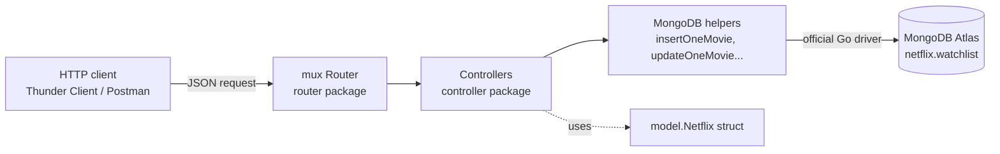

---
tags:
  - golang
  - mongodb
section: "07 API with MongoDB"
video: https://www.youtube.com/watch?v=EaZo7pcueBE
video_title: "MongoDB setup for API in golang"
order: 41
---
# MongoDB Setup

> [!info] Source
> 🎬 [MongoDB setup for API in golang](https://www.youtube.com/watch?v=EaZo7pcueBE) · Section **07 API with MongoDB** of [[Golang Notes]]
> ⬅️ [[Routes and Testing the API]] · ➡️ [[Defining Models for MongoDB]]

## Overview

Section 06 ended with a working CRUD API whose "database" was a plain **slice** of courses living in memory (see [[Building an API - Models]] and [[Routes and Testing the API]]). This section replaces that slice with a real database: **MongoDB**. The focus deliberately shifts away from modelling (multiple structs, relations between models) and towards the *interaction with the database*: how a Go program opens a connection, inserts, updates, deletes and reads documents, and how that plugs into the HTTP handlers we already know how to write.

Two decisions shape the whole section:

- **No ORM/ODM.** The instructor's view is that ORMs make life easier and are perfectly fine for most workloads, but to *understand* what happens underneath we talk to MongoDB through its **official Go driver** directly.
- **Gorilla Mux again.** Routing is done with `github.com/gorilla/mux` exactly as in [[Go Modules]] and [[Routes and Testing the API]], which doubles as revision.

This note covers the one-time setup: creating the project, pulling the driver, provisioning a free **MongoDB Atlas** cluster, and the folder layout the rest of the section follows.

## What we are going to build

A tiny "Netflix watchlist" API. Each document is a movie with a `watched` flag, and the API exposes these endpoints (they are implemented one by one in the following notes and wired together in [[MongoDB API Routes and Testing]]):

| Method | Route | Purpose | Note |
|---|---|---|---|
| `GET` | `/api/movies` | list every movie in the collection | [[Get All Documents from MongoDB]], [[MongoDB API Controllers]] |
| `POST` | `/api/movie` | add a movie | [[Insert Data in MongoDB]] |
| `PUT` | `/api/movie/{id}` | mark a movie as watched | [[Update a Record in MongoDB]] |
| `DELETE` | `/api/movie/{id}` | delete one movie | [[Delete One and Delete Many in MongoDB]] |
| `DELETE` | `/api/deleteallmovie` | wipe the collection | [[Delete One and Delete Many in MongoDB]] |



## Driver, not ORM

MongoDB publishes its official drivers under the dedicated `go.mongodb.org` import path; the source lives on GitHub at `mongodb/mongo-go-driver`. The same organisation also ships other Go tooling (for example the Atlas CLI) which we do **not** use here. The driver page lists plenty of usage examples and this section borrows its structure from MongoDB's own Go blog posts, simplified.

> [!note] Why skip the ORM?
> ORMs/ODMs add a layer that hides the driver. That is convenient, and only at very high query volumes (millions of queries) does the overhead become a real concern. For learning, going "to the extreme" and using the raw driver shows you exactly what every call does; you can always add an ORM later with that understanding.

## Local MongoDB vs Atlas

Installing MongoDB locally is a somewhat long process, so the series uses **MongoDB Atlas**, the managed cloud offering with a free tier. The code is identical in both cases; only the connection string differs:

| Deployment | Connection string shape |
|---|---|
| Local install | `mongodb://localhost:27017` |
| Atlas | `mongodb+srv://<user>:<password>@cluster0.xxxxx.mongodb.net/?retryWrites=true&w=majority` |

Keep the string you get from Atlas somewhere safe; it is needed in [[Connecting to MongoDB]]. You can always copy it again from the cluster's **Connect** dialog.

## Project bootstrap

Create the 25th project folder of the series and initialise a module with a full import path, because this project will be split into several packages that import each other (see [[Go Modules]] for why the module path matters):

```bash
mkdir 25mongoapi && cd 25mongoapi
go mod init github.com/hiteshchoudhary/mongoapi
go get github.com/gorilla/mux
go get go.mongodb.org/mongo-driver/mongo
```

The driver pulls in a surprising number of dependencies. After the second `go get`, `go.mod` lists packages such as `snappy`, `compress`, `go-stack/stack`, `golang.org/x/crypto`, `golang.org/x/sync` and `golang.org/x/text`, and `go.sum` records a checksum for each of them. That is the module system doing its job: every transitive dependency is pinned and verifiable.

```text
module github.com/hiteshchoudhary/mongoapi

go 1.17

require (
	github.com/golang/snappy v0.0.1 // indirect
	github.com/gorilla/mux v1.8.0 // indirect
	github.com/klauspost/compress v1.9.5 // indirect
	github.com/xdg-go/scram v1.0.2 // indirect
	go.mongodb.org/mongo-driver v1.7.1 // indirect
	golang.org/x/crypto v0.0.0-20200622213623-75b288015ac9 // indirect
	golang.org/x/sync v0.0.0-20210220032951-036812b2e83c // indirect
	...
)
```

> [!tip] `// indirect` everywhere?
> Until your code actually imports a package, Go marks the requirement as *indirect*. The comment disappears from the direct dependencies once you import them and run `go mod tidy`.

## Creating a free Atlas cluster

The Atlas UI changes over time, but the steps are stable:

1. **Sign in** to Atlas. A fresh account has no clusters, no database users and no network access rules.
2. **Build a Database** and pick the **free tier** (labelled *Shared* / M0 at the time of recording).
3. Choose a cloud provider and a **region close to you** (the instructor picks AWS Mumbai). Leave the other settings alone and click **Create Cluster**. Provisioning takes a few minutes.
4. Click **Connect** on the deployed cluster. Atlas now walks you through the prerequisites:
   - **Create a database user**: a username and password that your application will log in with (the video uses `learncodeonline` / a throw-away password).
   - **Network access**: Atlas blocks every IP by default. For development pick **Allow Access from Anywhere** (`0.0.0.0/0`).
5. Choose a connection method → **Connect your application** → copy the connection string.
6. Replace `<password>` in the string with the database user's real password.

![[41_mongodb_setup_create_cluster_0640.png]]
*Figure: picking the free shared tier and a region while creating the Atlas cluster (video at 06:40)*

![[41_mongodb_setup_connection_string_0842.png]]
*Figure: the "Connect your application" dialog with the `mongodb+srv://` connection string (video at 08:42)*

![[41_mongodb_setup_network_access_0910.png]]
*Figure: network access rule allowing connections from anywhere (video at 09:10)*

> [!warning] "Allow access from anywhere" is a development shortcut
> Opening the cluster to `0.0.0.0/0` means anybody with the credentials can connect from any machine. In production you whitelist the IP ranges of your servers (or use VPC peering/private endpoints); the instructor points to his AWS material for that discussion.

Atlas also offers **MongoDB Compass**, a desktop GUI for browsing data. It is optional: the Atlas web UI can show collections and documents too, which is what the series uses.

## Folder layout for a multi-package project

So far every program in the series was a single `main.go`. From here on the code is split into packages, and the video closes with one rule to remember:

> [!warning] Only one Go file in the project root
> Every `.go` file in a directory belongs to the *same* package. If you drop `controllers.go`, `models.go` and `main.go` all in the root as `package main`, they share one namespace and quickly collide, and `go run main.go` only compiles the single file you named. Put each concern in its own folder, which makes it its own package.

The layout the next notes build up:

```text
25mongoapi/
├── go.mod
├── go.sum
├── main.go              # package main – only Go file in the root
├── model/
│   └── models.go        # package model – the Netflix struct
├── controller/
│   └── controller.go    # package controller – DB connection, helpers, HTTP handlers
└── router/
    └── router.go        # package router – mux routes
```

How these packages import each other (`github.com/hiteshchoudhary/mongoapi/model` etc.) is covered in [[Insert Data in MongoDB]].

## Gotchas and Best Practices

> [!warning] Credentials in source code
> The series hard-codes the connection string (user and password included) into a Go constant for simplicity. Never do this in a real project or commit it to Git; read it from an environment variable instead (shown in [[Connecting to MongoDB]]).

> [!tip] Pick the nearest region
> Latency to the cluster shows up in every request your API makes. The free tier lets you choose the region, so choose the one closest to where the API runs.

> [!note] Free tier limits
> The free cluster is shared hardware with a small storage limit. It is more than enough for this series, but expect occasional cold starts.

## Modern Go Notes

- The series uses driver **v1** (`go.mongodb.org/mongo-driver`, v1.7 at recording time; the v1 line is still maintained). A **v2** major version exists with the module path `go.mongodb.org/mongo-driver/v2` and some API differences; the notes in this section stick to v1 so the code matches the videos.
- `go get` is for adding dependencies to `go.mod`. Installing command-line tools is done with `go install pkg@version` (available since Go 1.16; since Go 1.18 `go get` no longer installs binaries at all).
- Running `go mod tidy` after adding imports cleans up the `// indirect` markers and removes unused requirements.

## Video Timeline

| Time | What happens |
|---|---|
| [00:03](https://youtu.be/EaZo7pcueBE?t=3) | Goal of the section: CRUD against a real database, no ORM, Gorilla Mux for routing |
| [01:53](https://youtu.be/EaZo7pcueBE?t=113) | The `go.mongodb.org` driver site and the GitHub repo with examples |
| [03:00](https://youtu.be/EaZo7pcueBE?t=180) | Creating the project folder, `go mod init`, `go get` for mux and the driver |
| [05:54](https://youtu.be/EaZo7pcueBE?t=354) | Signing into Atlas and creating a free shared cluster |
| [07:18](https://youtu.be/EaZo7pcueBE?t=438) | Connect dialog: database user, network access, connection string |
| [09:48](https://youtu.be/EaZo7pcueBE?t=588) | Rule: only one Go file in the root, everything else in folders |

## Related Notes

- [[Routes and Testing the API]] — the in-memory CRUD API this section upgrades
- [[Go Modules]] — `go mod init`, `go get`, `go.sum`, and why the module path matters for multi-package projects
- [[Building an API - Models]] — the course/author models that inspired the Netflix model
- [[Defining Models for MongoDB]] — next step: the `Netflix` struct with BSON tags
- [[Connecting to MongoDB]] — where the connection string is used
- [[Error Handling in Go]] — `log.Fatal` vs `panic` when the connection fails
- [[Go Quick Reference]] — cheat sheet entry for the MongoDB driver calls
- [[Golang Notes]] — map of content
