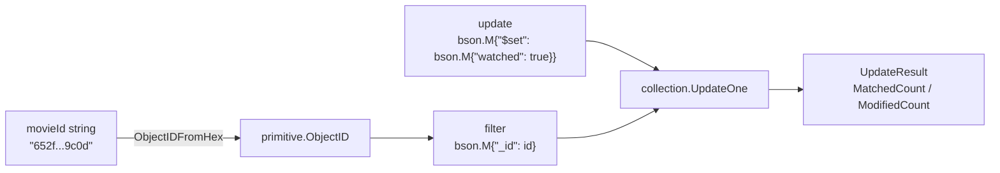

---
tags:
  - golang
  - mongodb
section: "07 API with MongoDB"
video: https://www.youtube.com/watch?v=00YTOQTxUEc
video_title: "Update a record in mongodb in golang"
order: 45
---
# Update a Record in MongoDB

> [!info] Source
> 🎬 [Update a record in mongodb in golang](https://www.youtube.com/watch?v=00YTOQTxUEc) · Section **07 API with MongoDB** of [[Golang Notes]]
> ⬅️ [[Insert Data in MongoDB]] · ➡️ [[Delete One and Delete Many in MongoDB]]

## Overview

An update in MongoDB always has two parts: a **filter** that selects the document(s) and an **update document** that says what to change, usually wrapped in the `$set` operator. The helper written in this video, `updateOneMovie`, receives a movie id as a string (that is how ids arrive from URL parameters), converts it into the `ObjectID` MongoDB understands, and flips the movie's `watched` flag to `true`. Compared with the slice version in [[Update Course Controller]] there is no loop at all: the database finds the document for us.

## From string id to `ObjectID`

Ids travel as text (`/api/movie/652f1a2b3c4d5e6f7a8b9c0d`), but the `_id` field holds a `primitive.ObjectID`. The `primitive` package from [[Defining Models for MongoDB]] converts between the two:

```go
id, err := primitive.ObjectIDFromHex(movieId)
```

The documentation says it "creates a new ObjectID from a hex string" and returns an error when the string is not a valid ObjectID (anything other than 24 hex characters). The video ignores that error; the gotchas below explain why you should not.

## `bson.M` vs `bson.D`

Filters and updates are BSON documents, and the driver gives you two literal forms for them. The instructor admits the choice confused him until a Stack Overflow answer cleared it up:

| Type | Underlying shape | Order | Use when |
|---|---|---|---|
| `bson.M` | `map[string]interface{}` | unordered (keys serialised in random order) | you want the shortest, clearest code and order does not matter: most filters and `$set` updates |
| `bson.D` | `[]bson.E` (slice of `{Key, Value}` pairs) | ordered | order matters: command documents, sort specifications, compound index keys |

```go
bson.M{"movie": "Interstellar", "watched": true}
bson.D{{Key: "movie", Value: "Interstellar"}, {Key: "watched", Value: true}}
```

Both are accepted everywhere a document is expected. The series uses `bson.M` almost exclusively.

## Building the filter and the update

```go
id, _ := primitive.ObjectIDFromHex(movieId)
filter := bson.M{"_id": id}
update := bson.M{"$set": bson.M{"watched": true}}
```

- The filter says "the document whose `_id` equals this ObjectID". Remember that in MongoDB terms the key is always `_id`, never `id`.
- The update is a document whose **only key is an operator**. `$set` changes just the listed fields and leaves everything else untouched. If you passed `bson.M{"watched": true}` without `$set`, you would be asking for a full replacement rather than an update, and `UpdateOne` rejects it: the driver requires update documents to contain operator keys (those starting with `$`).
- The key is `"watched"` in lower case because the model's `Watched` field has no `bson` tag, so the driver stored it under the lower-cased field name (see [[Defining Models for MongoDB]]).

> [!note] Always `true`, never toggled
> The helper does not check the current value; it unconditionally sets `watched` to `true`. Toggling would need a read first (`FindOne`) or an aggregation-pipeline update.

## Running the update

```go
result, err := collection.UpdateOne(context.Background(), filter, update)
if err != nil {
	log.Fatal(err)
}
fmt.Println("modified count: ", result.ModifiedCount)
```

`UpdateOne(ctx, filter, update)` updates **at most one** document. If the filter matches nothing the call still succeeds and reports `MatchedCount: 0`; if it matches several, one of them is picked. It returns a `*mongo.UpdateResult`:

| Field | Meaning |
|---|---|
| `MatchedCount` | documents selected by the filter (0 or 1 for `UpdateOne`) |
| `ModifiedCount` | documents actually changed (0 if the movie was already watched) |
| `UpsertedCount` / `UpsertedID` | only used with the *upsert* option, which inserts when nothing matches |

The driver also offers `UpdateMany` for several documents and a convenience `UpdateByID(ctx, id, update)` that builds the `_id` filter for you.



## The helper as written in the video

```go
// update 1 record
func updateOneMovie(movieId string) {
	id, _ := primitive.ObjectIDFromHex(movieId)
	filter := bson.M{"_id": id}
	update := bson.M{"$set": bson.M{"watched": true}}

	result, err := collection.UpdateOne(context.Background(), filter, update)
	if err != nil {
		log.Fatal(err)
	}

	fmt.Println("modified count: ", result.ModifiedCount)
}
```

**Output** when the controller in [[MongoDB API Controllers]] calls it with an existing id:

```text
modified count:  1
```

Calling it again with the same id prints `modified count:  0`: the document matched but nothing changed because `watched` was already `true`.

## Example: insert, then update, with full error handling

A standalone program that inserts a movie, marks it as watched and shows the difference between matched and modified counts:

```go
package main

import (
	"context"
	"fmt"
	"log"
	"os"
	"time"

	"go.mongodb.org/mongo-driver/bson"
	"go.mongodb.org/mongo-driver/bson/primitive"
	"go.mongodb.org/mongo-driver/mongo"
	"go.mongodb.org/mongo-driver/mongo/options"
)

type Netflix struct {
	ID      primitive.ObjectID `json:"_id,omitempty" bson:"_id,omitempty"`
	Movie   string             `json:"movie,omitempty" bson:"movie"`
	Watched bool               `json:"watched,omitempty" bson:"watched"`
}

func markWatched(ctx context.Context, col *mongo.Collection, hexID string) (*mongo.UpdateResult, error) {
	id, err := primitive.ObjectIDFromHex(hexID)
	if err != nil {
		return nil, fmt.Errorf("invalid movie id %q: %w", hexID, err)
	}
	filter := bson.M{"_id": id}
	update := bson.M{"$set": bson.M{"watched": true}}
	return col.UpdateOne(ctx, filter, update)
}

func main() {
	uri := os.Getenv("MONGODB_URI")
	if uri == "" {
		log.Fatal("set MONGODB_URI first")
	}
	ctx, cancel := context.WithTimeout(context.Background(), 10*time.Second)
	defer cancel()

	client, err := mongo.Connect(ctx, options.Client().ApplyURI(uri))
	if err != nil {
		log.Fatal(err)
	}
	defer client.Disconnect(context.Background())
	col := client.Database("netflix").Collection("watchlist")

	inserted, err := col.InsertOne(ctx, Netflix{Movie: "Inception"})
	if err != nil {
		log.Fatal(err)
	}
	hexID := inserted.InsertedID.(primitive.ObjectID).Hex()

	for i := 1; i <= 2; i++ {
		res, err := markWatched(ctx, col, hexID)
		if err != nil {
			log.Fatal(err)
		}
		fmt.Printf("run %d: matched %d, modified %d\n", i, res.MatchedCount, res.ModifiedCount)
	}

	if _, err := markWatched(ctx, col, "not-a-valid-id"); err != nil {
		fmt.Println("error:", err)
	}
}
```

**Output:**

```text
run 1: matched 1, modified 1
run 2: matched 1, modified 0
error: invalid movie id "not-a-valid-id": the provided hex string is not a valid ObjectID
```

## Gotchas and Best Practices

> [!warning] Do not discard the `ObjectIDFromHex` error
> With `id, _ :=` an invalid id silently becomes the zero ObjectID, the filter matches nothing, and the client only sees `modified count: 0`. Check the error and respond with `400 Bad Request` from the controller (see [[Error Handling in Go]]).

> [!warning] `MatchedCount == 0` means "not found"
> `UpdateOne` does not fail when nothing matches. A controller should inspect `MatchedCount` and return `404` instead of pretending the update worked.

> [!tip] Use `$set` for partial updates
> `$set` touches only the fields you list. To overwrite a whole document use `ReplaceOne`; to change many documents at once use `UpdateMany` with the same filter/update shape.

> [!note] The repetitive syntax is the point
> Every update you will ever write in Go looks like this: convert the id, build a `bson.M` filter, build a `bson.M{"$set": ...}` update, call `UpdateOne`. Learn the shape once and reuse it.

## Modern Go Notes

- `UpdateOne`, `UpdateByID` and `UpdateResult` are the same in driver v2; `primitive.ObjectIDFromHex` becomes `bson.ObjectIDFromHex` there (verify in the v2 docs).
- Returning `(*mongo.UpdateResult, error)` from the helper, as in the example, is the shape that lets controllers map outcomes to HTTP status codes instead of calling `log.Fatal`.

## Video Timeline

| Time | What happens |
|---|---|
| [00:25](https://youtu.be/00YTOQTxUEc?t=25) | Update = filter + `$set` with the new values |
| [01:01](https://youtu.be/00YTOQTxUEc?t=61) | `updateOneMovie(movieId string)` and `primitive.ObjectIDFromHex` |
| [02:41](https://youtu.be/00YTOQTxUEc?t=161) | BSON vs JSON, `bson.M` vs `bson.D` and the Stack Overflow answer |
| [04:21](https://youtu.be/00YTOQTxUEc?t=261) | Building the `_id` filter and the `$set` update document |
| [05:50](https://youtu.be/00YTOQTxUEc?t=350) | `collection.UpdateOne(context.Background(), filter, update)` |
| [06:55](https://youtu.be/00YTOQTxUEc?t=415) | `MatchedCount`, `ModifiedCount`, `UpsertedCount` on the result |

## Related Notes

- [[Insert Data in MongoDB]] — where the ids being updated come from
- [[Defining Models for MongoDB]] — why the BSON key is `watched` and the id type is `primitive.ObjectID`
- [[Delete One and Delete Many in MongoDB]] — next helper, same filter pattern
- [[MongoDB API Controllers]] — the exported `MarkAsWatched` controller that calls this helper
- [[Update Course Controller]] — the loop-based update from the slice API, for comparison
- [[Maps]] — `bson.M` is just a `map[string]interface{}`
- [[Handling URLs]] — ids arrive as strings from the URL
- [[Error Handling in Go]] — handling the conversion and driver errors
- [[Go Quick Reference]] — update recipe
