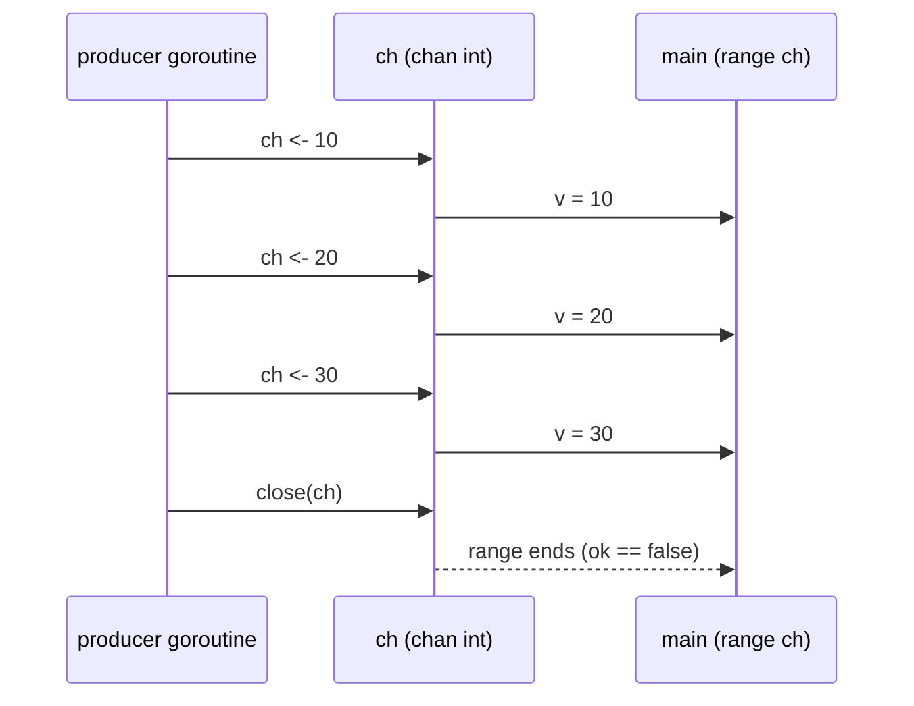

---
tags:
  - golang
  - concurrency
section: "08 Concurrency"
video: https://www.youtube.com/watch?v=i5HEE5Ikv3w
video_title: "Channels and Deadlock in golang"
order: 56
---
# Channels and Deadlock

> [!info] Source
> 🎬 [Channels and Deadlock in golang](https://www.youtube.com/watch?v=i5HEE5Ikv3w) · Section **08 Concurrency** of [[Golang Notes]]
> ⬅️ [[Race Conditions]] · ➡️ [[Go Quick Reference]]

## Overview

**Channels** are the way goroutines talk to each other. In [[Race Conditions]] three goroutines fought over one slice and a [[Mutex]] kept them apart; that works, but it means every goroutine must know about a shared variable. Often what you really want is for one goroutine to *hand a value* to another while both keep running: a worker fetches something from the internet and passes the result on, another goroutine waits only for a signal. A [[WaitGroups|WaitGroup]] cannot do that; it is pure management ("do your job, tell me when you are done"). A channel is a typed pipe between goroutines, and it is the mechanism behind the motto from [[Concurrency and Goroutines]]: *share memory by communicating*. The instructor promises a video full of errors, because you cannot understand channels without seeing the **deadlock** message a few times.

## Creating a Channel and Moving Values Through It

```go
myCh := make(chan int) // a channel that carries int values
myCh <- 5              // SEND: the value goes into the channel
value := <-myCh        // RECEIVE: a value comes out of the channel
```

- Channels are created with `make` (like [[Slices]] and [[Maps]]) and are **typed**: this one can only carry `int`. Strings, structs, your own types are all fine; the instructor's production project passed almost everything as integers.
- The arrow **always points left**. Picture the channel as a box: `myCh <- 5` pushes a value *into* the box, `<-myCh` pulls a value *out* of it. There is no `->` in Go (the instructor checked).

## The Classic Deadlock

The obvious first program sends a value and then prints it:

```go
package main

import "fmt"

func main() {
	fmt.Println("Channels in golang - LearnCodeOnline.in")

	myCh := make(chan int)

	myCh <- 5 // nobody is receiving yet
	fmt.Println(<-myCh)
}
```

**Output:**

```text
Channels in golang - LearnCodeOnline.in
fatal error: all goroutines are asleep - deadlock!

goroutine 1 [chan send]:
main.main()
	/path/to/main.go:10 +0x70
exit status 2
```

This is the most famous error message in Go. An **unbuffered** channel only accepts a send when some other goroutine is *at that moment* ready to receive. `main` is the only goroutine, it is stuck at the send waiting for a receiver that can never arrive (the receive is on the next line, which never executes), so the runtime detects that *every* goroutine is asleep and aborts. Swapping the two lines does not help: now `main` blocks on the receive waiting for a sender. The instructor calls it a chicken-and-egg problem, and it is the reason the series taught goroutines and WaitGroups *before* channels.

## Two Ways Out

### 1. A buffered channel

`make(chan int, 1)` gives the channel room for one value that can sit inside without a receiver:

```go
package main

import "fmt"

func main() {
	myCh := make(chan int, 1) // buffered: one value can wait inside

	myCh <- 5
	fmt.Println(<-myCh)
}
```

**Output:**

```text
5
```

Send more values than the buffer holds while nobody receives and you are back to the deadlock (the instructor experiments with pushing `5` and `6` into the channel); the buffer size says how many values can be *in flight* without anyone listening.

| | Unbuffered `make(chan T)` | Buffered `make(chan T, n)` |
|---|---|---|
| Send blocks until… | a receiver takes the value | the buffer has free space |
| Receive blocks until… | a sender provides a value | the buffer has a value |
| Use when | you want a hand-off that also *synchronises* the two goroutines | the producer may run ahead of the consumer by up to `n` items |

### 2. Separate goroutines (the real solution)

Channels are meant to connect *different* goroutines, so the video creates two anonymous goroutines (the immediately-invoked style from [[Race Conditions]]), one that sends and one that receives, and a [[WaitGroups|WaitGroup]] so `main` waits for both:

```go
package main

import (
	"fmt"
	"sync"
)

func main() {
	fmt.Println("Channels in golang - LearnCodeOnline.in")

	myCh := make(chan int, 2)
	wg := &sync.WaitGroup{}

	wg.Add(2)
	// receive-only goroutine
	go func(ch <-chan int, wg *sync.WaitGroup) {
		defer wg.Done()
		val, isChannelOpen := <-ch
		fmt.Println(isChannelOpen)
		fmt.Println(val)
	}(myCh, wg)

	// send-only goroutine
	go func(ch chan<- int, wg *sync.WaitGroup) {
		defer wg.Done()
		ch <- 0
		close(ch)
	}(myCh, wg)

	wg.Wait()
}
```

**Output:**

```text
Channels in golang - LearnCodeOnline.in
true
0
```

This is the companion program (folder `28channels`) with the `wg.Done()` calls moved into `defer` and one correction: the repository's goroutines declare `ch <-chan int` and `ch chan<- int` parameters but then ignore them and use the outer `myCh` directly, so the direction restriction they are meant to demonstrate is never actually enforced there; the version here uses `ch`, so the compiler really does check it. Three new things appear in it: closing a channel, the comma-ok receive, and the arrow in the parameter types. Each gets its own section below.

## Closing a Channel

`close(myCh)` says "no more values will ever be sent". It is optional for short-lived channels but essential whenever a receiver needs to know the stream has ended. The rules the instructor runs into:

- **Sending on a closed channel panics.**

  ```go
  myCh := make(chan int, 2)
  myCh <- 5
  close(myCh)
  myCh <- 6 // sending on a closed channel
  ```

  ```text
  panic: send on closed channel
  ```

- **Receiving from a closed channel does not panic.** You get the remaining buffered values first, and after that the **zero value** of the element type, forever. That zero is "a hell of a nightmare", as the instructor puts it: a `0` could be a real message or the sign of a closed channel.

## The Comma-Ok Receive

The language designers anticipated the nightmare. A receive can return two values, exactly like the map lookup in [[Maps]] and the type assertion in [[Consuming JSON Data]] (see [[Error Handling in Go]] for the whole family):

```go
package main

import "fmt"

func main() {
	myCh := make(chan int, 2)
	myCh <- 5
	close(myCh)

	val, ok := <-myCh // the buffered value is still delivered
	fmt.Println(val, ok)

	val, ok = <-myCh // drained and closed: zero value, ok == false
	fmt.Println(val, ok)
}
```

**Output:**

```text
5 true
0 false
```

`ok` (the instructor names it `isChannelOpen`) is `true` while a real value was received and `false` once the channel is closed *and* empty. In the companion program the sender pushed `0` before closing, so the receiver printed `true` and then `0`; comment the send out and it prints `false` and `0` instead. Only the boolean can tell those two situations apart.

## Send-Only and Receive-Only Channels

By default a channel is **bidirectional**: any goroutine holding it may send, receive or close. The video shows the clean-code habit of restricting what a function may do with the channel it is given, using the same arrow in the *type*:

| Parameter type | Meaning | Allowed |
|---|---|---|
| `ch chan int` | bidirectional | send, receive, close |
| `ch chan<- int` | **send-only** (values go *into* the box) | send, close |
| `ch <-chan int` | **receive-only** (values come *out* of the box) | receive |

A bidirectional channel converts to either restricted type automatically when you pass it, which is what happens with `myCh` above. The restriction is checked at compile time; closing a receive-only channel, the mistake the instructor fumbles with at the end of the video, is rejected outright:

```text
invalid operation: cannot close receive-only channel ro (variable of type <-chan int)
```

That matters because the *sender* is the only party that knows when the stream ends, so only the sender should be able to close.

## Ranging Over a Channel

The most common consumer loop is `for v := range ch`, which receives until the channel is closed and drained. Combined with directional parameters it reads like a pipeline:

```go
package main

import (
	"fmt"
	"sync"
)

func producer(ch chan<- int, wg *sync.WaitGroup) {
	defer wg.Done()
	for i := 1; i <= 3; i++ {
		ch <- i * 10
	}
	close(ch) // the sender closes, so the receiver's range ends
}

func main() {
	ch := make(chan int)
	wg := &sync.WaitGroup{}

	wg.Add(1)
	go producer(ch, wg)

	for v := range ch { // loops until the channel is closed and drained
		fmt.Println("received", v)
	}
	wg.Wait()
	fmt.Println("done")
}
```

**Output:**

```text
received 10
received 20
received 30
done
```

Note that the channel is *unbuffered* here and nothing deadlocks: the producer goroutine blocks on each send only until `main`'s `range` receives it. Each hand-off is also a synchronisation point.



## Gotchas and Best Practices

> [!warning] `fatal error: all goroutines are asleep - deadlock!`
> Every goroutine is blocked on a channel operation that no one will ever complete. Usual causes: sending on an unbuffered channel from the goroutine that is supposed to receive, forgetting to `close` a channel somebody is `range`-ing over, or a `wg.Wait()` that can never be satisfied. Unlike a panic, it cannot be recovered.

> [!warning] Close from the sender, close once
> Sending on a closed channel panics with `panic: send on closed channel`; closing an already-closed channel panics with `panic: close of closed channel`. Give consumers a receive-only channel so the compiler enforces that they never close it.

> [!warning] The zero value lies
> A plain `<-ch` on a closed `chan int` returns `0` forever. Use `v, ok := <-ch` or `range` whenever a closed channel is possible.

> [!tip] Do not "fix" a deadlock by adding a buffer
> A buffer hides the problem until the buffer fills up. Ask who is supposed to receive and make sure that goroutine exists and is running.

> [!note] A `nil` channel blocks forever
> `var ch chan int` without `make` is `nil`; sending or receiving on it blocks permanently. This is occasionally used on purpose inside `select`, but for beginners it is just another deadlock.

> [!tip] Buffers are rarer than you think
> The instructor's experience: most channels in real code are unbuffered and carry small flag-like values ("done", an id, a status). Reach for a buffer only when you can explain why the producer should run ahead.

## Modern Go Notes

Nothing in this video is deprecated, but the instructor explicitly leaves out the statement you will meet next in any real codebase: **`select`** waits on several channel operations at once and takes whichever is ready first, which is how timeouts and cancellation are written:

```go
package main

import (
	"fmt"
	"time"
)

func main() {
	fast := make(chan string)
	slow := make(chan string)
	go func() { time.Sleep(10 * time.Millisecond); fast <- "fast result" }()
	go func() { time.Sleep(50 * time.Millisecond); slow <- "slow result" }()

	for i := 0; i < 2; i++ {
		select { // waits on several channels at once
		case v := <-fast:
			fmt.Println(v)
		case v := <-slow:
			fmt.Println(v)
		case <-time.After(time.Second):
			fmt.Println("timeout")
		}
	}
}
```

**Output:**

```text
fast result
slow result
```

The `context` package (seen in [[Connecting to MongoDB]]) builds on exactly this: `ctx.Done()` is a channel that closes when the operation should be abandoned.

## Video Timeline

| Time | What happens |
|---|---|
| [01:04](https://youtu.be/i5HEE5Ikv3w?t=64) | Why channels: a WaitGroup manages goroutines but does not let them talk |
| [03:33](https://youtu.be/i5HEE5Ikv3w?t=213) | `make(chan int)` and the typed channel |
| [04:27](https://youtu.be/i5HEE5Ikv3w?t=267) | Sending and receiving with the left-pointing arrow |
| [06:00](https://youtu.be/i5HEE5Ikv3w?t=360) | The deadlock error, and why swapping lines does not help |
| [07:36](https://youtu.be/i5HEE5Ikv3w?t=456) | Two goroutines plus a WaitGroup make the channel work |
| [10:56](https://youtu.be/i5HEE5Ikv3w?t=656) | Buffered channels: `make(chan int, 2)` |
| [11:37](https://youtu.be/i5HEE5Ikv3w?t=697) | `close(myCh)` and the panic on sending afterwards |
| [13:52](https://youtu.be/i5HEE5Ikv3w?t=832) | `val, isChannelOpen := <-myCh` |
| [16:17](https://youtu.be/i5HEE5Ikv3w?t=977) | Send-only and receive-only channel parameters |

## Related Notes

- [[Concurrency and Goroutines]] — the motto this video finally explains.
- [[WaitGroups]] — still needed so `main` waits for the sender and receiver.
- [[Mutex]] and [[Race Conditions]] — the shared-memory alternative to channels.
- [[Maps]] — the comma-ok idiom on map lookups.
- [[Error Handling in Go]] — every comma-ok form in one table.
- [[Connecting to MongoDB]] — `context`, which is built on channels.
- [[Go Quick Reference]] — the concurrency cheat sheet and the end of the learning path.
- [[Golang Notes]] — map of content.
