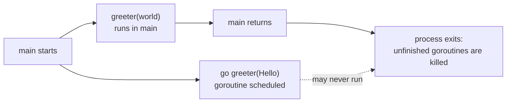

---
tags:
  - golang
  - concurrency
section: "08 Concurrency"
video: https://www.youtube.com/watch?v=V-0ifUKCkBI
video_title: "Concurrency and goroutines in golang"
order: 52
---
# Concurrency and Goroutines

> [!info] Source
> 🎬 [Concurrency and goroutines in golang](https://www.youtube.com/watch?v=V-0ifUKCkBI) · Section **08 Concurrency** of [[Golang Notes]]
> ⬅️ [[MongoDB API Routes and Testing]] · ➡️ [[WaitGroups]]

## Overview

This section opens with a warning from the instructor: *change your mindset*. Every program so far, from the pizza-rating app in [[User Input and Comma Ok Syntax]] to the Netflix API in [[MongoDB API Routes and Testing]], ran from top to bottom and was "complete in itself". From here on the examples are small and sometimes fictitious, because the goal is no longer to finish a project but to understand *why* things happen when several pieces of code run at the same time. The vocabulary of this section is **concurrency**, **parallelism**, **goroutines**, and later [[WaitGroups]], [[Mutex]], [[Race Conditions]] and [[Channels and Deadlock]]. Everything builds on [[Functions]] (goroutines are just functions started differently) and on the `sync` package.

## Concurrency vs Parallelism

The instructor's analogy is a plate of rice, an Instagram notification and a hot room:

- **Doing one thing at a time.** You eat the rice. You ignore the phone and the air conditioner until you are done. No concurrency, no parallelism.
- **Concurrency.** The notification arrives, you put the plate down, check Instagram, put the phone down, grab the remote, switch on the AC, go back to the rice. You are *involved in* several tasks, but at any instant you are doing exactly **one** of them. On a timeline (time running left to right) the bars for *eat*, *Instagram* and *AC* never overlap; you switch between them.
- **Parallelism.** One hand feeds you rice while the other scrolls Instagram and someone else switches on the AC. Several tasks progress at the **same instant**. His second picture is arranging a wedding at home by handing each job to a different friend: they all work simultaneously instead of one person switching between jobs.

| | Concurrency | Parallelism |
|---|---|---|
| Definition | Dealing with many tasks by *switching* between them | *Executing* many tasks at the same instant |
| Needs multiple CPU cores? | No, a single core can interleave tasks | Yes, one core per simultaneous task |
| In Go | Goroutines scheduled by the Go runtime | Goroutines spread across `GOMAXPROCS` threads/cores |

Go programs are written *concurrently* (you describe independent tasks as goroutines) and the runtime decides how much of that runs *in parallel* on the available cores.

![[52_concurrency_vs_parallelism_0140.png]]
*Figure: the two timelines the instructor compares, one task at a time versus several at once (video at 01:40)*

## Goroutines vs OS Threads

A **goroutine** is Go's unit of concurrent work. The video compares it with an operating-system thread on two points:

| | OS thread | Goroutine |
|---|---|---|
| Managed by | The operating system | The **Go runtime** (part of your program) |
| Stack | Fixed, roughly 1 MB by default (the figure the instructor quotes; the exact default depends on the OS) | Starts at about **2 KB** (since Go 1.19 the runtime tunes the initial size to the observed average) and grows or shrinks as needed |
| Cost of creating thousands | Heavy | Cheap, which is why Go servers routinely run tens of thousands |

Because the runtime, not the OS, hands out goroutines, Go can keep many of them in flight on a handful of OS threads. The instructor's cloud example: a request that needs data from twelve APIs can fire twelve goroutines and wait for all of them instead of calling the APIs one after another.

![[52_goroutines_vs_threads_0445.png]]
*Figure: the slide comparing OS threads (managed by the OS, ~1 MB stacks) with goroutines (managed by the Go runtime, ~2 KB stacks) (video at 04:45)*

> [!quote] The Go motto
> *"Do not communicate by sharing memory; instead, share memory by communicating."*
> The instructor asks you to write this down: it appears in every article about goroutines. It only makes full sense once you reach [[Channels and Deadlock]]; for now, notice that it is a warning against many goroutines writing to the same variable, which is exactly the problem [[Mutex]] and [[Race Conditions]] deal with.

## The `go` Keyword

A goroutine is started by putting `go` in front of a function call. This is the first time the series uses the keyword that gives the language its name. The companion program (folder `26goroutines`, the commented-out part) uses a `greeter` that prints a string six times with a tiny pause between prints:

```go
func greeter(s string) {
	for i := 0; i < 6; i++ {
		time.Sleep(3 * time.Millisecond)
		fmt.Println(s)
	}
}
```

Called twice in a row the function behaves exactly as every earlier program did: the first call finishes before the second starts.

```go
greeter("Hello")
greeter("world")
```

**Output:**

```text
Hello
Hello
Hello
Hello
Hello
Hello
world
world
world
world
world
world
```

Now start the first call as a goroutine (and, to make the surprise obvious, remove the `time.Sleep`):

```go
package main

import "fmt"

func greeter(s string) {
	for i := 0; i < 6; i++ {
		fmt.Println(s)
	}
}

func main() {
	go greeter("Hello") // fired off, never waited for
	greeter("world")
}
```

**Output:** (the `Hello` lines are usually missing entirely)

```text
world
world
world
world
world
world
```

This surprises everyone. `go greeter("Hello")` tells the runtime "run this *somewhere*, in the background, and carry on". `main` carries on, prints `world` six times, reaches its closing brace and **returns, which ends the whole program**. The goroutine never got a turn on the CPU, so it is simply thrown away with the process. In the rice analogy: you got so absorbed in Instagram that the food was taken away before you ate it. Nobody *waited* for the goroutine.



## The `time.Sleep` Hack

The instructor's first (admittedly ugly) fix is to make `main` slower than the goroutine. Putting the `time.Sleep(3 * time.Millisecond)` back inside `greeter` means the `world` loop takes about 18 ms, and during those pauses the scheduler runs the `Hello` goroutine:

```go
package main

import (
	"fmt"
	"time"
)

func greeter(s string) {
	for i := 0; i < 6; i++ {
		time.Sleep(3 * time.Millisecond)
		fmt.Println(s)
	}
}

func main() {
	go greeter("Hello")
	greeter("world")
}
```

**Output:** (interleaving differs on every run)

```text
world
Hello
Hello
world
world
Hello
Hello
world
world
Hello
Hello
world
```

Two lessons hide in this output. First, the two loops really do make progress at the same time. Second, their *order* is not under your control: the runtime decides which goroutine runs when. Sleeping is **not** a synchronisation mechanism; it just makes the problem rarer. The proper tool is the **`sync`** package, whose documentation the instructor opens at the end of the video ("basic synchronization primitives such as mutual exclusion locks ... WaitGroup"). That is the next note, [[WaitGroups]].

## A Peek at the Scheduler

You do not need the internals to use goroutines, but a few facts explain the behaviour above:

- The runtime multiplexes all goroutines over a small pool of OS threads. The number of threads allowed to execute Go code simultaneously is **`GOMAXPROCS`**, which by default is the number of logical CPUs, except that since Go 1.25 the runtime also respects the process's CPU affinity mask and, on Linux, the cgroup CPU quota, using the smallest of the three and re-checking it periodically (`go doc runtime.GOMAXPROCS`; `GODEBUG=containermaxprocs=0` restores the old rule). This matters in containers: a pod limited to 2 CPUs on a 64-core node now gets `GOMAXPROCS=2`.
- A goroutine that blocks (sleeping, waiting for the network, waiting on a channel) is parked and another one runs; that is why the sleeping `greeter` loops interleave.
- `runtime.NumCPU()` (first seen in [[Memory Management]]) and `runtime.NumGoroutine()` let a program inspect this:

```go
package main

import (
	"fmt"
	"runtime"
)

func main() {
	fmt.Println("Logical CPUs:", runtime.NumCPU())
	fmt.Println("GOMAXPROCS:  ", runtime.GOMAXPROCS(0)) // 0 = query without changing
	fmt.Println("Goroutines:  ", runtime.NumGoroutine())
}
```

**Output:** (numbers depend on the machine)

```text
Logical CPUs: 10
GOMAXPROCS:   10
Goroutines:   1
```

Even an "empty" program has one goroutine: `main` itself.

## Gotchas and Best Practices

> [!warning] When `main` returns, the program ends, goroutines or not
> There is no automatic waiting. Every goroutine you start needs something that waits for it: a [[WaitGroups|WaitGroup]], a [[Channels and Deadlock|channel]] receive, or a server loop that never returns.

> [!warning] Never synchronise with `time.Sleep`
> It makes tests pass on your laptop and fail in production where the network is slower. Use `sync.WaitGroup`, channels or `context`.

> [!note] Order is not guaranteed
> Two goroutines started one after the other may finish in either order. Code that relies on "the first one obviously finishes first" has a bug waiting to appear under load; [[Race Conditions]] shows the tooling that catches it.

> [!tip] `go` evaluates the arguments immediately, runs the body later
> `go greeter(name)` copies `name` at the moment the statement executes, exactly like `defer` in [[Defer]]. Only the function body is postponed.

> [!tip] Goroutines are cheap, not free
> Thousands are fine; a goroutine that blocks forever (for example waiting on a channel nobody writes to) is a **leak**, because its 2 KB stack is never reclaimed.

## Modern Go Notes

- **Loop variables and goroutines.** Before Go 1.22, `for i := 0; i < 3; i++ { go func() { fmt.Println(i) }() }` printed the *final* value of `i` three times because all goroutines shared one variable. Since Go 1.22 each iteration has its own `i`, so the classic bug is gone (see [[Loops, Break, Continue and Goto]]). Passing the value as an argument, as the instructor does throughout this section, works in every version.
- **`sync.WaitGroup.Go`** (added in Go 1.25) starts a goroutine and registers it in one call; see [[WaitGroups]].

## Video Timeline

| Time | What happens |
|---|---|
| [01:23](https://youtu.be/V-0ifUKCkBI?t=83) | Concurrency vs parallelism with the rice, Instagram and AC story |
| [04:22](https://youtu.be/V-0ifUKCkBI?t=262) | Goroutines vs threads: runtime-managed, 2 KB stacks |
| [05:39](https://youtu.be/V-0ifUKCkBI?t=339) | The motto: share memory by communicating |
| [07:18](https://youtu.be/V-0ifUKCkBI?t=438) | Writing the `greeter` function and calling it twice |
| [09:24](https://youtu.be/V-0ifUKCkBI?t=564) | Adding the `go` keyword: only `world` is printed |
| [10:47](https://youtu.be/V-0ifUKCkBI?t=647) | The `time.Sleep` hack and interleaved output |
| [12:23](https://youtu.be/V-0ifUKCkBI?t=743) | Opening the `sync` package documentation |

## Related Notes

- [[WaitGroups]] — the proper way to wait for goroutines, next video.
- [[Mutex]] and [[Race Conditions]] — what goes wrong when goroutines share memory.
- [[Channels and Deadlock]] — how goroutines communicate; the motto explained.
- [[Functions]] — a goroutine is just a function call with `go` in front.
- [[Defer]] — the same "arguments now, run later" rule.
- [[Memory Management]] — `runtime.NumCPU()` first appeared there.
- [[Handling Web Requests]] — `http.Get`, used in the next video's status-code example.
- [[Go Quick Reference]] — the concurrency cheat sheet.
- [[Golang Notes]] — map of content.
