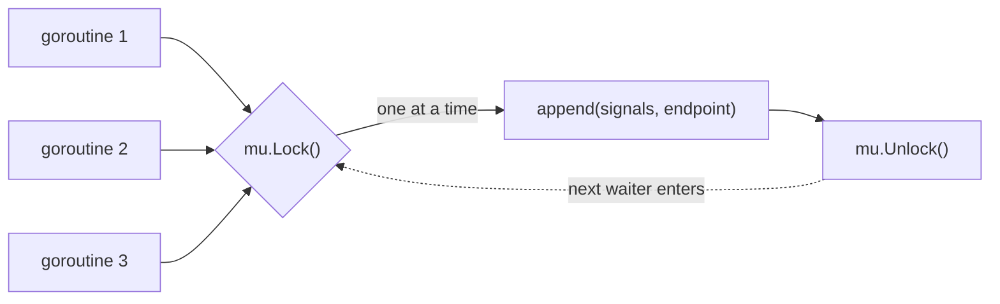

---
tags:
  - golang
  - concurrency
section: "08 Concurrency"
video: https://www.youtube.com/watch?v=v7DKtAluvYA
video_title: "Mutex in golang"
order: 54
---
# Mutex

> [!info] Source
> 🎬 [Mutex in golang](https://www.youtube.com/watch?v=v7DKtAluvYA) · Section **08 Concurrency** of [[Golang Notes]]
> ⬅️ [[WaitGroups]] · ➡️ [[Race Conditions]]

## Overview

The status-code program from [[WaitGroups]] now gets one small addition: every goroutine that successfully reaches a website appends that website to a shared **slice**. It runs, it prints what you expect, and the instructor's point is that *this is exactly when you should be worried*. Several goroutines writing to the same memory at the same time is a **data race**, and the fact that it happens to work today proves nothing. A **mutex** (mutual exclusion lock) lets exactly one goroutine at a time into the code that touches the shared value; its reader-friendly cousin, the **RWMutex**, lets many readers in together but writers alone. This note explains both; [[Race Conditions]] shows the tooling that proves the race is real.

## The Situation: a Shared Slice

```go
var signals = []string{"test"}
```

Inside `getStatusCode`, after the request succeeds, the goroutine records the endpoint:

```go
signals = append(signals, endpoint)
```

and after `wg.Wait()` the program prints the slice. Run it and you see the status lines and then something like `[test https://fb.com https://github.com ...]`. Nothing crashes. So where is the problem?

The instructor goes back to the slide from [[Concurrency and Goroutines]]: goroutines are managed by the Go runtime, and the runtime does **not** put a lock on the memory they share. One goroutine appending is fine. Five goroutines appending *at the same moment* can each read the old slice header, each write their own version back, and overwrite one another (see [[Slices]] for why `append` writes a new header). Which of them wins depends on timing you do not control. The result might be a missing entry, a corrupted slice, or, on a lucky day, exactly the right output. "Sometimes it gives the result we want, sometimes not" is the definition of a bug you cannot reproduce.

## What a Mutex Does

`go doc sync.Mutex`: *"A Mutex is a mutual exclusion lock. The zero value for a Mutex is an unlocked mutex."* It has two methods you will use (plus `TryLock`, added in Go 1.18, which is rarely the right tool):

| Method | Effect |
|---|---|
| `mu.Lock()` | Take the lock. If another goroutine holds it, **wait** until it is released |
| `mu.Unlock()` | Release the lock so the next waiting goroutine can proceed |

The code between `Lock` and `Unlock` is the **critical section**: at most one goroutine is inside it at any time. In the instructor's words, the mutex says "I am locking this memory while this one goroutine is working on it; nobody else gets in until it is done".



## Seeing the Difference Without a Network

The website program hides the race because the requests take milliseconds and rarely collide. A counter incremented by a thousand goroutines collides far more often (some runs still print exactly 1000, which is precisely what makes races treacherous):

```go
package main

import (
	"fmt"
	"sync"
)

func main() {
	var wg sync.WaitGroup
	counter := 0

	for i := 0; i < 1000; i++ {
		wg.Add(1)
		go func() {
			defer wg.Done()
			counter++ // read, add, write: not atomic
		}()
	}
	wg.Wait()
	fmt.Println("counter without mutex:", counter)
}
```

**Output:** (three runs)

```text
counter without mutex: 951
counter without mutex: 934
counter without mutex: 973
```

`counter++` is three steps (read the value, add one, write it back). When two goroutines interleave those steps, one increment is lost. Wrap the increment in a lock and every run is correct:

```go
package main

import (
	"fmt"
	"sync"
)

func main() {
	var wg sync.WaitGroup
	var mu sync.Mutex
	counter := 0

	for i := 0; i < 1000; i++ {
		wg.Add(1)
		go func() {
			defer wg.Done()
			mu.Lock()
			counter++
			mu.Unlock()
		}()
	}
	wg.Wait()
	fmt.Println("counter with mutex:", counter)
}
```

**Output:**

```text
counter with mutex: 1000
```

## Example: The Companion Program With a Mutex

The video declares the mutex next to the WaitGroup at package level and wraps only the `append`:

```go
package main

import (
	"fmt"
	"net/http"
	"sync"
)

var signals = []string{"test"}

var wg sync.WaitGroup // usually a pointer; kept simple like the video
var mut sync.Mutex    // zero value is an unlocked mutex

func main() {
	websitelist := []string{
		"https://lco.dev",
		"https://go.dev",
		"https://google.com",
		"https://fb.com",
		"https://github.com",
	}

	for _, web := range websitelist {
		wg.Add(1)
		go getStatusCode(web)
	}

	wg.Wait()
	fmt.Println(signals)
}

func getStatusCode(endpoint string) {
	defer wg.Done()

	res, err := http.Get(endpoint)
	if err != nil {
		fmt.Println("OOPS in endpoint", endpoint)
		return
	}
	defer res.Body.Close()

	mut.Lock()
	signals = append(signals, endpoint) // the shared slice: only one goroutine at a time
	mut.Unlock()

	fmt.Printf("%d status code for %s\n", res.StatusCode, endpoint)
}
```

**Output:** (one real run; order varies, and the sites' answers depend on the network)

```text
OOPS in endpoint https://lco.dev
403 status code for https://fb.com
200 status code for https://github.com
200 status code for https://go.dev
200 status code for https://google.com
[test https://fb.com https://github.com https://go.dev https://google.com]
```

As the instructor says, in *this* program the lock makes no visible difference: the output looks the same with or without it. The difference is that it is now *correct by construction*, and `go run -race .` (introduced in [[Race Conditions]]) reports nothing. In a bigger application, where a variable, a cache or a database handle is written by many goroutines, this is "very, very essential and you are going to thank me later".

## RWMutex: Many Readers, One Writer

`sync.RWMutex` is the "brother" of `Mutex`. Reads do not corrupt anything, so it is wasteful to serialise them; what must never happen is a write *while* anyone reads or writes. The RWMutex encodes exactly that:

| Method | Who may hold the lock at the same time |
|---|---|
| `rw.RLock()` / `rw.RUnlock()` | any number of readers, as long as no writer holds it |
| `rw.Lock()` / `rw.Unlock()` | exactly one writer, and no readers |

`go doc sync.RWMutex`: *"The lock can be held by an arbitrary number of readers or a single writer."* When a writer asks for the lock, new readers are blocked until the writer is done, which is the "kick everybody out" behaviour the instructor describes.

```go
package main

import (
	"fmt"
	"sync"
)

func main() {
	var wg sync.WaitGroup
	var rw sync.RWMutex
	config := map[string]string{"mode": "dev"}

	// one writer
	wg.Add(1)
	go func() {
		defer wg.Done()
		rw.Lock() // exclusive: no readers, no other writers
		config["mode"] = "prod"
		rw.Unlock()
	}()

	// many readers can hold RLock at the same time
	for i := 1; i <= 3; i++ {
		wg.Add(1)
		go func(id int) {
			defer wg.Done()
			rw.RLock()
			fmt.Printf("reader %d sees mode=%s\n", id, config["mode"])
			rw.RUnlock()
		}(i)
	}
	wg.Wait()
}
```

**Output:** (readers may see `dev` or `prod` depending on whether the writer ran first; what the lock guarantees is that they never read *during* the write, which would be a fatal error for a map)

```text
reader 3 sees mode=dev
reader 2 sees mode=dev
reader 1 sees mode=dev
```

The instructor's experience: you will see "very few use cases" of RWMutex in application code, but understanding it is what makes the read-heavy designs (caches, configuration) fast. [[Race Conditions]] shows the exact spot where `RLock` belongs.

## Gotchas and Best Practices

> [!warning] Lock *every* access, reads included
> A read that overlaps a write is still a data race; a map being read while it is written is even a fatal runtime error. Either take the full lock for reads too, or use an RWMutex and `RLock` them.

> [!warning] Unlock what you locked, once
> Calling `Unlock` on a mutex that is not locked crashes immediately with `fatal error: sync: unlock of unlocked mutex`. Forgetting to unlock blocks every other goroutine forever. `defer mu.Unlock()` right after `mu.Lock()` solves both (see [[Defer]]), as long as the critical section is the rest of the function.

> [!tip] Keep the critical section tiny
> Lock around the `append` or the map write, not around the HTTP request. Everything inside the lock runs one goroutine at a time, so a long critical section throws away the concurrency you wanted.

> [!warning] Do not copy a mutex
> Like a WaitGroup, a `sync.Mutex` must not be copied after use; pass `*sync.Mutex` (the video declares `&sync.RWMutex{}` in the next video) and `go vet` will warn about copies.

> [!note] A mutex is not re-entrant
> A goroutine that calls `Lock()` twice without unlocking blocks itself, and if nothing else can release it the program dies with the deadlock error from [[Channels and Deadlock]].

> [!tip] Prefer channels for hand-offs, mutexes for state
> The Go motto says share memory by communicating, but a counter or a cache behind a mutex is idiomatic too. Rule of thumb: a mutex protects *state*, a channel transfers *ownership*.

## Modern Go Notes

- For plain counters and flags, **`sync/atomic`** (`atomic.Int64`, `atomic.Bool`, Go 1.19+) does the read-modify-write in one hardware instruction, with no lock: `var n atomic.Int64; n.Add(1); n.Load()`.
- `sync.Map` exists for a specific pattern (keys written once, read many times, from many goroutines); for everything else the documentation itself recommends a plain map plus a mutex.
- Nothing in the video is deprecated; `sync.Mutex` and `sync.RWMutex` are unchanged.

## Video Timeline

| Time | What happens |
|---|---|
| [00:15](https://youtu.be/v7DKtAluvYA?t=15) | The `signals` slice that every goroutine appends to |
| [00:47](https://youtu.be/v7DKtAluvYA?t=47) | Appending inside `getStatusCode`; it "works", which is the problem |
| [01:41](https://youtu.be/v7DKtAluvYA?t=101) | Why: the runtime manages goroutines but nobody locks the memory |
| [02:28](https://youtu.be/v7DKtAluvYA?t=148) | `sync.Mutex` in the documentation: mutual exclusion lock |
| [03:02](https://youtu.be/v7DKtAluvYA?t=182) | `RWMutex`: readers share, a writer kicks everyone out |
| [03:50](https://youtu.be/v7DKtAluvYA?t=230) | Declaring `mut sync.Mutex` next to the WaitGroup |
| [04:27](https://youtu.be/v7DKtAluvYA?t=267) | `Lock()` and `Unlock()` around the `append` |

## Related Notes

- [[WaitGroups]] — the program this one extends.
- [[Race Conditions]] — proving the race with `go run -race` and placing `RLock` correctly.
- [[Concurrency and Goroutines]] — why runtime-managed goroutines share memory freely.
- [[Channels and Deadlock]] — the communicating alternative to shared state.
- [[Slices]] — why concurrent `append` corrupts the slice header.
- [[Maps]] — concurrent map writes are a fatal error, not just a race.
- [[Defer]] — `defer mu.Unlock()`.
- [[Go Quick Reference]] — the concurrency cheat sheet.
- [[Golang Notes]] — map of content.
