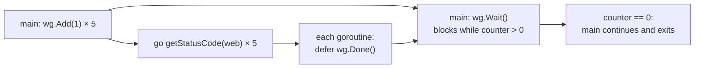

---
tags:
  - golang
  - concurrency
section: "08 Concurrency"
video: https://www.youtube.com/watch?v=FiTbXvc08wE
video_title: "Wait groups in golang"
order: 53
---
# WaitGroups

> [!info] Source
> 🎬 [Wait groups in golang](https://www.youtube.com/watch?v=FiTbXvc08wE) · Section **08 Concurrency** of [[Golang Notes]]
> ⬅️ [[Concurrency and Goroutines]] · ➡️ [[Mutex]]

## Overview

[[Concurrency and Goroutines]] ended with a problem: `main` returns before the goroutines it started have finished, and `time.Sleep` is not an acceptable fix. A **`sync.WaitGroup`** is the standard answer. It is a counter: you *add* one for every goroutine you start, each goroutine calls *done* when it finishes, and `main` *waits* until the counter is back to zero. The instructor motivates it with real deployments, where one request fans out to read replicas, several microservices or three API endpoints at once, and the handler must wait for all of them. The example in this video, fetching the HTTP status code of five websites, is the first useful concurrent program of the series and is extended in [[Mutex]] and [[Race Conditions]].

## The Scenario: Status Codes of Five Websites

The companion program (folder `26goroutines`) defines a function that performs a GET request (see [[Handling Web Requests]]) and prints the status code:

```go
func getStatusCode(endpoint string) {
	res, err := http.Get(endpoint)
	if err != nil {
		fmt.Println("OOPS in endpoint", endpoint)
		return
	}
	defer res.Body.Close()
	fmt.Printf("%d status code for %s\n", res.StatusCode, endpoint)
}
```

and a slice of websites that `main` loops over with `range` (see [[Loops, Break, Continue and Goto]]):

```go
websitelist := []string{
	"https://lco.dev",
	"https://go.dev",
	"https://google.com",
	"https://fb.com",
	"https://github.com",
}

for _, web := range websitelist {
	getStatusCode(web)
}
```

Run like this the program is **sequential**: each request has to finish before the next starts, so five sites take five round trips. It works, it is just slow.

> [!note] The two bugs the instructor hits on the way
> 1. He first writes `fmt.Println("%d status code for %s", ...)`. `Println` does not interpret verbs, so the `%d` and `%s` are printed literally; the verbs need `Printf` (see [[fmt Package and Format Verbs]]).
> 2. A typo (`gooogle.com`) makes `http.Get` return an error, and the code reads `res.StatusCode` anyway. When `err != nil` the response is `nil`, so that line panics with `invalid memory address or nil pointer dereference`. Check the error *before* touching the result (see [[Error Handling in Go]]); the `return` inside the `if err != nil` branch above is the fix.

## Step 1: Add `go` and Get Nothing

The tempting next step is `go getStatusCode(web)` inside the loop. Five goroutines start almost instantly, the loop ends, `main` returns, and the program exits **before a single request completes**. The output is empty. It is the same lesson as the greeter in the previous video: starting goroutines is easy, *waiting* for them is the part you have to design.

## Step 2: `sync.WaitGroup`

The `sync` package provides "basic synchronization primitives". The instructor reads the `WaitGroup` entry and summarises its three methods:

| Method | Who calls it | What it does |
|---|---|---|
| `wg.Add(n)` | the code that starts goroutines | "n more goroutines are out there"; adds `n` to the counter |
| `wg.Done()` | each goroutine, when finished | subtracts one (it is `Add(-1)`) |
| `wg.Wait()` | the goroutine that must not exit early, usually `main` | blocks until the counter is zero |

His mental model: a WaitGroup is a *steroid version* of `time.Sleep` that waits exactly as long as needed and not a millisecond more. `main` says "I cannot finish, my friends are still out", and each friend reports back with `Done`.



## Example: The Complete Program

```go
package main

import (
	"fmt"
	"net/http"
	"sync"
)

var wg sync.WaitGroup

func main() {
	websitelist := []string{
		"https://lco.dev",
		"https://go.dev",
		"https://google.com",
		"https://fb.com",
		"https://github.com",
	}

	for _, web := range websitelist {
		wg.Add(1) // register BEFORE starting the goroutine
		go getStatusCode(web)
	}

	wg.Wait() // block main until every Done() has been called
	fmt.Println("All goroutines reported back")
}

func getStatusCode(endpoint string) {
	defer wg.Done()

	res, err := http.Get(endpoint)
	if err != nil {
		fmt.Println("OOPS in endpoint", endpoint)
		return
	}
	defer res.Body.Close()
	fmt.Printf("%d status code for %s\n", res.StatusCode, endpoint)
}
```

**Output:** (one real run; the order changes every time because whichever site answers first prints first, and the exact codes depend on the sites and your network)

```text
OOPS in endpoint https://lco.dev
200 status code for https://github.com
403 status code for https://fb.com
200 status code for https://go.dev
200 status code for https://google.com
All goroutines reported back
```

All five requests are in flight at the same time, so the whole run takes about as long as the *slowest* site instead of the sum of all five. (In the video all five returned `200`; today `lco.dev` no longer resolves and `fb.com` answers `403` to non-browser clients, which is exactly the kind of variation the `err` check is for.)

Two details in the code matter:

- **`defer wg.Done()`** is the first line of the goroutine. Whatever path the function takes, including the early `return` on error, the counter is decremented exactly once (see [[Defer]]).
- **`wg.Add(1)` comes before `go`**, which the next section explains.

## Why `Add` Must Come Before `go`

The companion repository has the two lines the other way round:

```go
go getStatusCode(web)
wg.Add(1)
```

It usually works, which is what makes it dangerous. Once `go` has started the goroutine, nothing says the next line of `main` runs before the goroutine finishes. One bad interleaving is possible, and it is enough:

- The goroutine completes and calls `Done()` **before** `main` reaches `Add(1)`. The counter goes to `-1` and the program crashes with `panic: sync: negative WaitGroup counter`. (`main` itself always executes `Add(1)` before `Wait()`, in program order, so the counter can never be missing an `Add` by the time `Wait` runs; the whole danger is the early `Done`.)

The documentation states the rule directly (`go doc sync.WaitGroup.Add`): *"calls with a positive delta that occur when the counter is zero must happen before a Wait"*. Always `Add` first, then `go`. An equally common style is a single `wg.Add(len(websitelist))` before the loop, which the instructor shows in [[Race Conditions]].

## Pass It by Pointer

The video declares `wg` as a package-level variable so every function can see it, and immediately warns that in real code you will almost always see a **pointer**. A WaitGroup must not be copied after first use: a copy has its own counter, so `Done()` on the copy never releases the original `Wait()`. If you pass one to a function, pass `&wg`:

```go
package main

import (
	"fmt"
	"sync"
	"time"
)

func worker(id int, wg *sync.WaitGroup) {
	defer wg.Done() // always signal, even if the work panics or returns early
	time.Sleep(time.Duration(id) * 10 * time.Millisecond)
	fmt.Println("worker", id, "finished")
}

func main() {
	var wg sync.WaitGroup
	for i := 1; i <= 3; i++ {
		wg.Add(1)
		go worker(i, &wg) // pass a pointer: a WaitGroup must not be copied
	}
	wg.Wait()
	fmt.Println("main exits after all workers")
}
```

**Output:**

```text
worker 1 finished
worker 2 finished
worker 3 finished
main exits after all workers
```

Declare the parameter as `wg sync.WaitGroup` (no `*`) and `go vet` refuses it: `worker passes lock by value: sync.WaitGroup contains sync.noCopy`. The next videos use `wg := &sync.WaitGroup{}` from the start for the same reason (see [[Pointers]]).

## Gotchas and Best Practices

> [!warning] `Add` before `go`, `Done` exactly once
> Every `Add(1)` needs exactly one `Done()`. Too few and `Wait` hangs forever (a deadlock); too many and you get `panic: sync: negative WaitGroup counter`.

> [!warning] Never copy a WaitGroup
> Pass `*sync.WaitGroup`, store it in a struct by pointer, or keep it in a closure. `go vet` catches most accidental copies.

> [!tip] `defer wg.Done()` as the first statement
> It is the only way to guarantee the signal is sent on every exit path, including panics that are recovered higher up.

> [!note] A WaitGroup waits, it does not collect results
> It tells `main` *that* the goroutines are finished, not *what* they found. To get values back you need a shared slice protected by a [[Mutex]] or, better, a [[Channels and Deadlock|channel]].

> [!tip] `Wait` belongs at the end of the function that started the goroutines
> Usually that is `main`, but a handler or a helper function can own its own WaitGroup for a local fan-out.

## Modern Go Notes

- **`wg.Go(f)`** (Go 1.25 and later, present in the toolchain used for these notes) does `Add(1)`, starts the goroutine and calls `Done()` when `f` returns, so the ordering mistake above cannot happen:

  ```go
  var wg sync.WaitGroup
  for _, web := range websitelist {
  	wg.Go(func() {
  		res, err := http.Get(web) // a Done-free body: wg.Go calls Done for you
  		if err != nil {
  			fmt.Println("OOPS in endpoint")
  			return
  		}
  		fmt.Printf("%d status code for %s\n", res.StatusCode, web)
  	})
  }
  wg.Wait()
  ```

  The function you hand to `Go` must **not** call `wg.Done()` itself, because `Go` already does: reusing this note's `getStatusCode` (which has `defer wg.Done()`) would decrement twice per goroutine, so `Wait` returns early or the program panics with `sync: negative WaitGroup counter`. `go doc sync.WaitGroup.Add` now even says "Callers should prefer WaitGroup.Go". The function passed to `Go` must not panic.
- For fan-outs that also need to return the first error, the community package `golang.org/x/sync/errgroup` wraps a WaitGroup with error collection (verify its current API in the package docs before relying on it).

## Video Timeline

| Time | What happens |
|---|---|
| [00:10](https://youtu.be/FiTbXvc08wE?t=10) | Why: read replicas, microservices, several APIs per request |
| [01:26](https://youtu.be/FiTbXvc08wE?t=86) | Writing `getStatusCode` with `http.Get` |
| [05:14](https://youtu.be/FiTbXvc08wE?t=314) | Running it sequentially; the `Println` vs `Printf` and nil-pointer bugs |
| [06:58](https://youtu.be/FiTbXvc08wE?t=418) | Adding `go`: nothing is printed |
| [07:35](https://youtu.be/FiTbXvc08wE?t=455) | Declaring `var wg sync.WaitGroup` |
| [08:20](https://youtu.be/FiTbXvc08wE?t=500) | `Add`, `Done`, `Wait` explained with the "friends reporting back" picture |
| [10:36](https://youtu.be/FiTbXvc08wE?t=636) | `defer wg.Done()` inside the goroutine and the working run |

## Related Notes

- [[Concurrency and Goroutines]] — the problem a WaitGroup solves.
- [[Mutex]] — the same program grows a shared slice that needs a lock.
- [[Race Conditions]] — WaitGroups passed as pointers into anonymous goroutines.
- [[Channels and Deadlock]] — getting results back instead of just "done".
- [[Defer]] — why `defer wg.Done()` is the idiom.
- [[Handling Web Requests]] — `http.Get` and `res.StatusCode`.
- [[Error Handling in Go]] — checking `err` before using `res`.
- [[fmt Package and Format Verbs]] — `Printf` verbs vs `Println`.
- [[Pointers]] — passing `&wg`.
- [[Go Quick Reference]] — the concurrency cheat sheet.
