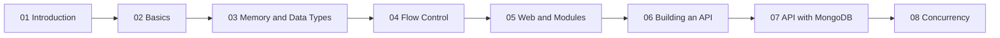

---
tags:
  - golang
  - moc
section: "Hub"
playlist: https://www.youtube.com/playlist?list=PLRAV69dS1uWQGDQoBYMZWKjzuhCaOnBpa
---
# Golang Notes

> [!info] About these notes
> Study notes for Hitesh Choudhary's YouTube series **"Let's go with golang"** (57 videos).
> 🎬 Playlist: [Let's go with golang](https://www.youtube.com/playlist?list=PLRAV69dS1uWQGDQoBYMZWKjzuhCaOnBpa)
> 💻 Companion code: [github.com/hiteshchoudhary/golang](https://github.com/hiteshchoudhary/golang)
> Every note has a **Source** callout with the exact video, a ⬅️ previous / ➡️ next chain, a *Video Timeline* with clickable timestamps, and a *Related Notes* list. Follow the sections top to bottom the first time; afterwards use the graph view or the [[Go Quick Reference]] to jump around.

## How the series is organised

The first four sections are **the language**: syntax, types, memory, control flow. The next three are **Go on the web**: files, HTTP, JSON, modules, a REST API, then the same API backed by MongoDB. The last section is **concurrency**: goroutines, WaitGroups, mutexes and channels.

## Hub notes

| Note | Use it for |
|---|---|
| [[Go Quick Reference]] | One-page syntax cheat sheet with links into every detailed note |
| [[Error Handling in Go]] | The `if err != nil` idiom, comma-ok, `panic`/`recover`, wrapping errors |
| [[fmt Package and Format Verbs]] | `Println` vs `Printf`, `%v %+v %#v %T`, `Sprintf`, `Errorf` |

## Learning path

### 01 Introduction

| # | Note | Video | What you learn |
|---|---|---|---|
| 1–2 | [[Welcome to Go]] | [Welcome](https://www.youtube.com/watch?v=JoJ8Sw5Yb4c) · [Before you start](https://www.youtube.com/watch?v=F3klnY_r8FU) | Why Go exists, who uses it, what the series covers, the mindset to bring |
| 3 | [[Installation and Hello World]] | [Installation and hello world](https://www.youtube.com/watch?v=62qGe9yhiJI) | Installing Go, VS Code setup, `go mod init`, `go run`, your first program |
| 4 | [[GOPATH and Go Docs]] | [GOPATH and reading go docs](https://www.youtube.com/watch?v=QEZlivtFOZk) | What `GOPATH`/`GOROOT` are, how to read pkg.go.dev and `go doc` |

### 02 Basics

| # | Note | Video | What you learn |
|---|---|---|---|
| 5 | [[Lexer and Types]] | [Lexer in golang and Types](https://www.youtube.com/watch?v=elYPAeX9h1E) | How the lexer inserts semicolons, the built-in type families |
| 6 | [[Variables, Types and Constants]] | [Variables, types and constants](https://www.youtube.com/watch?v=9fYqg6uo-UU) | `var`, `:=`, zero values, `const`, exported names |
| 7 | [[User Input and Comma Ok Syntax]] | [Comma ok syntax and packages](https://www.youtube.com/watch?v=zYIZtbyUIDY) | `bufio.NewReader(os.Stdin)`, the `value, err` pattern |
| 8 | [[Type Conversions]] | [Conversions in golang](https://www.youtube.com/watch?v=3j43y-PFJPI) | `strconv.ParseFloat`, `strings.TrimSpace`, handling bad input |
| 9 | [[Handling Time]] | [Handling time in golang](https://www.youtube.com/watch?v=xsAz24z4Hdg) | `time.Now()`, the reference-date layout `01-02-2006 15:04:05`, `time.Date` |
| 10 | [[Building for Windows, Linux and Mac]] | [Build for windows, linux and mac](https://www.youtube.com/watch?v=9vxsO5vMTAw) | `go build`, `GOOS`/`GOARCH` cross-compilation |
| 57 | [[Math, Crypto and Random Numbers]] | [Math, crypto and random number](https://www.youtube.com/watch?v=yPeYZ0QuspU) | `math`, `math/rand` vs `crypto/rand`, `math/big` |

### 03 Memory and Data Types

| # | Note | Video | What you learn |
|---|---|---|---|
| 11 | [[Memory Management]] | [Memory management in golang](https://www.youtube.com/watch?v=G1SP9uDJD0g) | Stack vs heap, garbage collection, `new` vs `make` |
| 12 | [[Pointers]] | [Pointers in golang](https://www.youtube.com/watch?v=-BFJ0dZyxHg) | `&` and `*`, why pointers exist, pass by reference |
| 13 | [[Arrays]] | [Array in golang](https://www.youtube.com/watch?v=JoUSa8jtadE) | Fixed-size arrays, zero values, why Go code rarely uses them |
| 14–15 | [[Slices]] | [Slices](https://www.youtube.com/watch?v=k7hVj8QL9Co) · [Remove by index](https://www.youtube.com/watch?v=931nR5TGCAk) | `append`, `make`, slicing, `sort`, removing an element by index |
| 16 | [[Maps]] | [Maps in golang](https://www.youtube.com/watch?v=_0R6H1m9o78) | `make(map[K]V)`, `delete`, ranging over key/value pairs |
| 17 | [[Structs]] | [Structs in golang](https://www.youtube.com/watch?v=NMTN543WVQY) | Defining structs, literals, `%+v`, no inheritance in Go |

### 04 Flow Control

| # | Note | Video | What you learn |
|---|---|---|---|
| 18 | [[If Else]] | [If else in golang](https://www.youtube.com/watch?v=f_xNeRurjZY) | `if`/`else if`/`else`, init statements `if v := f(); v < 10` |
| 19 | [[Switch Case]] | [Switch case and online playground](https://www.youtube.com/watch?v=Up4lTPhJBvs) | `switch`, `fallthrough`, `default`, the Go Playground |
| 20 | [[Loops, Break, Continue and Goto]] | [Loop break continue and goto](https://www.youtube.com/watch?v=ZWBA3l818y0) | The only loop keyword `for`, `range`, `break`, `continue`, `goto` labels |
| 21 | [[Functions]] | [Functions in golang](https://www.youtube.com/watch?v=rcUST3QvVOQ) | Parameters, multiple returns, variadic functions, anonymous functions |
| 22 | [[Methods]] | [Methods in golang](https://www.youtube.com/watch?v=GhYIKwMxz_Y) | Receivers, value vs pointer receivers |
| 23 | [[Defer]] | [Defer in golang](https://www.youtube.com/watch?v=jiy584-vv38) | `defer` and its LIFO order, cleaning up resources |

### 05 Web and Modules

| # | Note | Video | What you learn |
|---|---|---|---|
| 24 | [[Working with Files]] | [Working with files](https://www.youtube.com/watch?v=Mdg3tlGUXrE) | `os.Create`, `io.WriteString`, reading files, `defer file.Close()` |
| 25 | [[Handling Web Requests]] | [Handling web request](https://www.youtube.com/watch?v=ru53LpdVHn4) | `http.Get`, `response.Body`, reading the body into a string |
| 26 | [[Handling URLs]] | [Handling URL](https://www.youtube.com/watch?v=cl7_ouTMFh0) | `url.Parse`, scheme/host/path/port, query parameters, building URLs |
| 27 | [[Creating a Test Web Server]] | [Creating server for golang frontend](https://www.youtube.com/watch?v=xh79JXJy0yY) | The small Express.js server used to test GET/POST from Go |
| 28 | [[Making GET Requests]] | [How to make GET request](https://www.youtube.com/watch?v=V-sxFQ0fWlw) | Status codes, `strings.Builder`, reading responses |
| 29 | [[Making POST Requests with JSON]] | [POST request with JSON data](https://www.youtube.com/watch?v=h5NeKZuzUoc) | `http.Post` with a JSON body via `strings.NewReader` |
| 30 | [[Sending Form Data]] | [How to send form data](https://www.youtube.com/watch?v=U_LjyX4iDbU) | `url.Values`, `http.PostForm` |
| 31 | [[Creating JSON Data]] | [How to create JSON data](https://www.youtube.com/watch?v=SZ5xZ9OTeEI) | Struct tags, `json.Marshal`/`MarshalIndent`, `omitempty`, `json:"-"` |
| 32 | [[Consuming JSON Data]] | [How to consume JSON data](https://www.youtube.com/watch?v=a96veXdifys) | `json.Valid`, `json.Unmarshal` into structs and `map[string]interface{}` |
| 33 | [[Go Modules]] | [A long video on MOD](https://www.youtube.com/watch?v=O8uUGEobo-Q) | `go.mod`, `go.sum`, `go get`, `go mod tidy/verify/vendor`, versions |

### 06 Building an API

| # | Note | Video | What you learn |
|---|---|---|---|
| 34 | [[Building an API - Models]] | [Building API - Models](https://www.youtube.com/watch?v=TrouRtr5xWE) | Project layout, `Course`/`Author` models, the fake in-memory DB |
| 35 | [[Get All Courses Controller]] | [Sending a API json response](https://www.youtube.com/watch?v=V3S3hKrIdQo) | `json.NewEncoder(w).Encode`, response headers |
| 36 | [[Get One Course Controller]] | [Get one course based on request id](https://www.youtube.com/watch?v=1J1sgKriM-o) | `mux.Vars`, finding a record by id |
| 37 | [[Create Course Controller]] | [Add a course controller](https://www.youtube.com/watch?v=vMpBUkIMLzY) | Decoding the request body, validation, generating ids |
| 38 | [[Update Course Controller]] | [Update a course controller](https://www.youtube.com/watch?v=TQpB_QSgmXU) | Remove-then-append update strategy |
| 39 | [[Delete Course Controller]] | [Delete a course controller](https://www.youtube.com/watch?v=b1nJBaCzkHI) | Removing a record by index |
| 40 | [[Routes and Testing the API]] | [Handling routes and testing routes](https://www.youtube.com/watch?v=NedcxRgo4DY) | gorilla/mux routing, `ListenAndServe`, testing with Thunder Client/Postman |

### 07 API with MongoDB

| # | Note | Video | What you learn |
|---|---|---|---|
| 41 | [[MongoDB Setup]] | [MongoDB setup for API](https://www.youtube.com/watch?v=EaZo7pcueBE) | Atlas cluster, users, connection string, project layout |
| 42 | [[Defining Models for MongoDB]] | [Defining models for netflix](https://www.youtube.com/watch?v=laeZI6UdDNg) | `primitive.ObjectID`, `bson` and `json` tags |
| 43 | [[Connecting to MongoDB]] | [Making a connection to database](https://www.youtube.com/watch?v=GszGvj6eBZY) | `mongo.Connect`, `init()`, the collection handle |
| 44 | [[Insert Data in MongoDB]] | [Insert data in mongodb](https://www.youtube.com/watch?v=K2nC_WpPVQE) | `InsertOne`, working across packages |
| 45 | [[Update a Record in MongoDB]] | [Update a record in mongodb](https://www.youtube.com/watch?v=00YTOQTxUEc) | `ObjectIDFromHex`, `bson.M` filters, `$set` |
| 46 | [[Delete One and Delete Many in MongoDB]] | [Delete one and delete many](https://www.youtube.com/watch?v=qeZueI6d1Wg) | `DeleteOne`, `DeleteMany` |
| 47 | [[Get All Documents from MongoDB]] | [Get all collection in mongodb](https://www.youtube.com/watch?v=1P5b4McGJQQ) | `Find`, cursors, decoding into `bson.M` |
| 48–50 | [[MongoDB API Controllers]] | [Get all movies](https://www.youtube.com/watch?v=Ycc9sXgDCNQ) · [Mark as watched](https://www.youtube.com/watch?v=XdYpKfIgIQg) · [Delete 1 and all](https://www.youtube.com/watch?v=Qh1H-6Ebz7E) | HTTP controllers wrapping the DB helpers |
| 51 | [[MongoDB API Routes and Testing]] | [Creating routes and testing API](https://www.youtube.com/watch?v=uG2fpX2ktNE) | The `router` package, running and testing the full API |

### 08 Concurrency

| # | Note | Video | What you learn |
|---|---|---|---|
| 52 | [[Concurrency and Goroutines]] | [Concurrency and goroutines](https://www.youtube.com/watch?v=V-0ifUKCkBI) | `go` keyword, concurrency vs parallelism, the scheduler |
| 53 | [[WaitGroups]] | [Wait groups](https://www.youtube.com/watch?v=FiTbXvc08wE) | `sync.WaitGroup`: `Add`, `Done`, `Wait` |
| 54 | [[Mutex]] | [Mutex in golang](https://www.youtube.com/watch?v=v7DKtAluvYA) | `sync.Mutex` and `sync.RWMutex` |
| 55 | [[Race Conditions]] | [Race Condition](https://www.youtube.com/watch?v=4TCNUa-5wmI) | What a data race is, `go run -race` |
| 56 | [[Channels and Deadlock]] | [Channels and Deadlock](https://www.youtube.com/watch?v=i5HEE5Ikv3w) | Buffered/unbuffered channels, directional channels, `close`, deadlocks |

## Companion code map

| Repo folder | Note(s) |
|---|---|
| `01hello` | [[Installation and Hello World]] |
| `02variables` | [[Variables, Types and Constants]] |
| `03userinput` | [[User Input and Comma Ok Syntax]] |
| `04conversion` | [[Type Conversions]] |
| `05mymaths` | [[Math, Crypto and Random Numbers]] |
| `06mytime` | [[Handling Time]] |
| `07mypointers` | [[Pointers]] |
| `08myarray` | [[Arrays]] |
| `09myslices` | [[Slices]] |
| `10mymaps` | [[Maps]] |
| `11mystructs` | [[Structs]] |
| `12ifelse` | [[If Else]] |
| `13switchcase` | [[Switch Case]] |
| `14loops` | [[Loops, Break, Continue and Goto]] |
| `15functions` | [[Functions]] |
| `16methods` | [[Methods]] |
| `17defer` | [[Defer]] |
| `18files` | [[Working with Files]] |
| `19webrequests` | [[Handling Web Requests]] |
| `20urls` | [[Handling URLs]] |
| `lcowebserver` | [[Creating a Test Web Server]] |
| `21webreqverbs` | [[Making GET Requests]], [[Making POST Requests with JSON]], [[Sending Form Data]] |
| `22bitmorejson` | [[Creating JSON Data]], [[Consuming JSON Data]] |
| `23mymodules` | [[Go Modules]] |
| `24buildapi` | [[Building an API - Models]] … [[Routes and Testing the API]] |
| `25mongoapi` | [[MongoDB Setup]] … [[MongoDB API Routes and Testing]] |
| `26goroutines` | [[Concurrency and Goroutines]], [[WaitGroups]] |
| `27mutexAndAwaitGroups` | [[Mutex]], [[Race Conditions]] |
| `28channels` | [[Channels and Deadlock]] |

## Tags used

`#golang` on every note, plus one section tag: `#intro`, `#basics`, `#memory`, `#flow-control`, `#web`, `#api`, `#mongodb`, `#concurrency`, `#hub` on the three hub notes, and `#moc` on this map of content.
